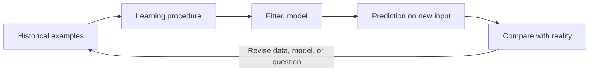
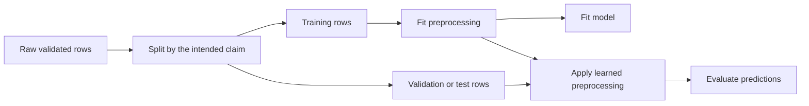
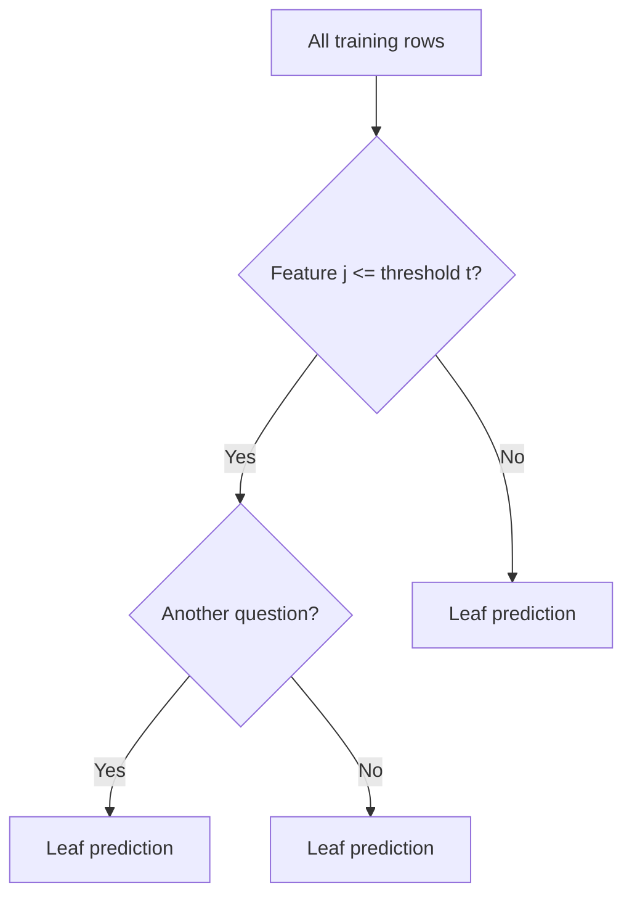

# Machine Learning: Foundations and Practice

Foundations and practice · CPU only · open-source tools

## Course Map

1. Course roadmap and learning objectives [0]
2. Foundations and data preparation [1-2]
3. Linear models and honest evaluation [3-4]
4. Trees, ensembles, and model selection [5-6]
5. Clustering, reduction, and anomaly detection [7-8]
6. Neural networks and transferable representations [9-10]
7. Trustworthy ML and productization [11-12]
8. Group project [13]

# 0. Course Roadmap & Learning Objectives

## 0.1 Format and Breakdown

The course consists of combining lectures, worked examples, discussions, and hands-on labs.

## 0.2 Learning Objectives

By the end of the course, you will be able to:

- formulate an engineering problem as a machine learning task;
- understand data preparation steps such as splitting, cleaning, and transforming without leaking information;
- train and compare the main model families including linear models, tree-based models, clustering algorithms, and basic neural networks;
- evaluate a model reliably on relevant unseen data;
- explain the mathematical ideas behind the core algorithms;
- assess explainability, fairness, robustness, and other trust risks;
- package a complete prediction pipeline and describe how to serve and monitor it.

## 0.3 Prerequisites and Assessment

### Prerequisites

- Python: functions, lists, loops, imports, and basic dataframe operations;
- linear algebra: vectors, matrices, and matrix products;
- calculus: derivatives and gradients;
- probability: means and variances.

The necessary notation is recalled when it first becomes useful. No previous machine learning intuition is assumed.

### Assessment

- an individual multiple-choice assessment covering Sections 1-12;
- a group project developed throughout the course and presented in Section 13.

The lecturer will provide the detailed project instructions, milestones, deliverables, and grading rubric separately.

## 0.4 Course Datasets

| Dataset | Main course use |
|---|---|
| **Titanic**, `mstz/titanic` | Binary classification and mixed-type tabular data |
| **California Housing**, scikit-learn `fetch_california_housing` distribution | Regression |
| **FinBench `cf1`**, exact `yuweiyin` repository/configuration supplied in the course manifest | Rare fraud and anomaly detection |
| **Wine Recognition**, scikit-learn `load_wine` distribution | Multiclass classification, clustering, and PCA |
| **Adult Census**, OpenML `adult` data version 2 via scikit-learn | Fairness analysis |

The practical materials must pin exact dataset revisions and preserve their documentation and licenses. Data access will be centralized through the distributed `course_data.py` helper. Owner names or planning labels such as `yuweiyin` are not complete Hugging Face identifiers: the manifest must record the exact repository, configuration, split, immutable revision, schema, and license before use.

The snippets below expect `course_data.load_titanic()` to return the manifest-pinned Titanic training split as a pandas dataframe with the asserted normalized columns. The distributed helper, not this document, defines the immutable revision and any source-schema normalization.

## 0.5 Setup

You can use either:

- **Google Colab**, with no local installation; or equivalent;
- a local Python **virtual environment**.

The course uses pandas, Matplotlib, scikit-learn, XGBoost, PyTorch on CPU, and SHAP. The distributed environment file defines the tested versions. No GPU, paid service, external API, or secret is required for the core activities.


## Foundations and supervised learning

# 1. What Is Machine Learning?

## 1.1 From Hand-Written Rules to Learned Rules

In April 1912, the *Titanic* sank after striking an iceberg. Of the passengers whose records are available, some survived and others did not. Suppose you receive a table containing information such as passenger class, sex, age, and fare. Could you write rules that predict survival?

You might begin with rules such as these:

- predict that every passenger died;
- predict that women survived and men died;
- predict that first-class passengers survived and others died.

These rules are understandable, but who chose them? How should we combine them? What should we do when a first-class man and a third-class woman do not fit the same story? Hand-written rules become difficult to maintain as the number of variables and exceptions grows.

Machine learning offers a different approach: instead of writing every decision rule directly, we provide examples for which the answer is known and ask a learning procedure to estimate a rule from those examples. This does not eliminate human choices. We still choose the question, data, candidate model family, loss, evaluation protocol, and conditions of use.

By the end of this chapter, you will be able to:

- define machine learning in plain and formal language;
- distinguish samples, features, labels, models, losses, parameters, and hyperparameters;
- recognize supervised, unsupervised, self-supervised, and reinforcement learning;
- describe training, inference, and the life cycle of a machine learning project;
- explain why performance on new data matters more than memorizing training data.

### Dataset used in this chapter

We use the Titanic dataset from the pinned course revision of `mstz/titanic` on the Hugging Face Hub. It is appropriate here because it is small, concrete, and contains both input information and a binary outcome: survival or non-survival. Its historical context also imposes an important limit: this is a teaching dataset, not a basis for judging individuals or claiming causal explanations of survival.

> **Key idea.** Machine learning estimates a rule from examples. The rule is useful only if it performs adequately on relevant examples it did not memorize.

## 1.2 Learning from Examples

Imagine teaching a brilliant apprentice to sort manufactured parts. In classical programming, you give the apprentice a complete instruction sheet: “if the diameter exceeds this value and the surface mark has that shape, reject the part.” The rules and measurements produce an answer.

In machine learning, you show the apprentice many previously inspected parts. Each example contains measurements and, when available, the inspector's answer. The apprentice adjusts an internal rule so that its answers resemble the known answers.

```text
Classical programming:   rules + data --------> answers
Machine learning:        data + answers ------> estimated rules
Using the fitted model:  estimated rules + new data --> predictions
```

The estimated rule is called a **model**. A model is a function that maps input information to an output. In this chapter, the output may be a predicted class such as “survived” or a score associated with that class.

The apprentice analogy clarifies why examples can replace some hand-written logic. It also breaks in several places. A person can ask questions, reason from physical principles, and understand social context. Most machine learning procedures only optimize a precisely specified numerical objective over the data and model family they are given. If the examples are biased, incomplete, leaked from the future, or unrelated to future use, the procedure can learn the wrong regularity very efficiently.

### A second analogy for generalization

Training data is like a set of practice exercises. A student who memorizes every answer may achieve a perfect practice score but fail an exam containing new questions. **Generalization** means succeeding on relevant new cases, not repeating stored answers.

This analogy also has a limit. Exam questions are deliberately designed, whereas future data can change because people, sensors, markets, or operating conditions change. Good validation estimates generalization only for the population and conditions it represents.

> **Stop and think.** If a model predicts every training label correctly, has it necessarily learned well?
>
> **Answer.** No. It may have memorized accidental details of those examples. We need separate, relevant observations to estimate how it behaves on new cases.

### From examples to a learning loop



The loop does not end when software returns a fitted object. Evaluation can reveal that the features contain too little signal, the wrong errors are being measured, or the intended population differs from the historical examples.

## 1.3 Vocabulary and Formal Framework

### A precise definition

Tom Mitchell proposed a compact definition in 1997:

> A computer program is said to learn from experience **E** with respect to some class of tasks **T** and performance measure **P** if its performance at tasks in **T**, as measured by **P**, improves with experience **E**.

The three letters prevent a vague statement such as “the system uses AI” from replacing a testable learning claim.

For a spam filter:

- **T**, the task, is to classify a new email as spam or not spam;
- **E**, the experience, is a collection of emails with known labels;
- **P**, the performance measure, might be precision and recall on later emails.

For Titanic survival prediction:

- **T** is to predict the recorded survival class from selected passenger information;
- **E** is the historical table of passengers and outcomes;
- **P** could initially be accuracy on held-out passengers, supplemented by class-specific errors.

The phrase “held-out” means deliberately excluded from fitting and reserved for evaluation. Chapter 2 explains how to construct such sets safely, and Chapter 4 explains how to choose performance measures.

> **Stop and think.** Why is “build a good Titanic model” not a complete T/E/P statement?
>
> **Answer.** “Good” does not define a measure, the available experience is unspecified, and the exact output task is ambiguous. A learning claim becomes testable only when T, E, and P are explicit.

### Essential vocabulary

Consider a table with $n$ rows and $d$ input columns.

A **sample**, also called an observation or example, is one case represented by one row. We write the inputs for sample $i$ as $x_i$. If there are $d$ features, then $x_i$ is a vector in $\mathbb{R}^d$ when all features have numerical representations.

A **feature** is an input variable available when a prediction is made. Passenger class and age can be features. A post-rescue record would not be an acceptable prediction-time feature because it reveals information from after the outcome.

A **label**, also called a target in supervised learning, is the answer associated with an example. We write it $y_i$. For binary Titanic survival, $y_i=1$ can denote survival and $y_i=0$ non-survival. The numbers are class codes, not quantities with physical units.

A **dataset** of labelled examples can therefore be written

$$
\mathcal{D}=\{(x_i,y_i)\}_{i=1}^{n}.
$$

In plain words, this expression says: “the dataset contains $n$ input-and-answer pairs, indexed from 1 to $n$.” If there are 891 passengers and 4 selected features, the feature matrix $X$ has shape $(891,4)$ and the label vector $y$ has shape $(891,)$. The exact row count and schema must still be confirmed from the pinned dataset revision.

A **model** is a function $f_\theta$ that maps features to a prediction. The symbol $\theta$ represents all values learned inside that function. For one sample,

$$
\hat y_i=f_\theta(x_i).
$$

The small hat in $\hat y_i$, read “y-hat,” means predicted rather than observed. This formula says: “apply the model with learned settings $\theta$ to the features of sample $i$ to produce a prediction.”

A **loss** is a numerical measure of how wrong one prediction is. For a simple class prediction, the zero-one loss is

$$
\ell(\hat y_i,y_i)=
\begin{cases}
0 & \text{if } \hat y_i=y_i,\\
1 & \text{if } \hat y_i\ne y_i.
\end{cases}
$$

It says that a correct prediction costs zero and an incorrect prediction costs one. This loss is easy to understand but treats every mistake as equally costly. Later chapters introduce losses that use prediction magnitudes or probabilities.

### Parameters and hyperparameters

A **parameter** is a value estimated from training data. Examples include a linear-model weight or a threshold selected as part of fitting a decision tree. The collection of parameters is denoted by $\theta$.

A **hyperparameter** is a setting chosen outside ordinary parameter fitting. Examples include the maximum permitted tree depth, the number of neighbours in k-nearest neighbours, or the learning rate used by gradient descent. Hyperparameters may be selected with validation data, but they are not ordinary fitted coefficients.

Think of parameters as adjustments the apprentice makes while studying examples. Hyperparameters are constraints placed on how the apprentice is allowed to learn, such as the size of the rule book. The analogy breaks when automated search selects hyperparameters from data: they are still hyperparameters because they control the fitting procedure, but the wider selection process has learned them using validation evidence.

**Training**, also called fitting, is the process of estimating parameters from examples. **Inference** is the computational act of applying the fitted model to new inputs. This use of “inference” means prediction; it should not be confused with statistical inference, which studies population quantities and uncertainty from samples.

### Learning paradigms

The kind of experience available determines the learning paradigm.

| Paradigm | Learning signal | Typical question | Example |
|---|---|---|---|
| Supervised learning | Inputs and labels | Can we predict a known outcome? | Survival, house price, spam |
| Unsupervised learning | Inputs without labels | What structure or compact representation is useful? | Customer groups, PCA |
| Self-supervised learning | Targets constructed from the data itself | Can one part of an example predict another part? | Predict a masked word |
| Reinforcement learning | Rewards obtained through interaction | Which sequence of actions earns long-term reward? | Game-playing agent |

In **supervised learning**, each training sample includes an input $x_i$ and label $y_i$. Classification predicts a discrete category; regression predicts a numerical value.

In **unsupervised learning**, no target label is supplied. An algorithm may group similar samples or compress their features, but the resulting structure is not automatically ground truth.

In **self-supervised learning**, the data supplies its own training targets. A language model can hide a word and learn to predict it from surrounding words. Human labels are not required for each example, but the pretext task and data collection remain human choices.

In **reinforcement learning**, an agent selects actions, observes consequences, and receives numerical rewards. It must account for actions that affect later situations, which differs from predicting a fixed label for an existing row.

The boundaries can overlap. A representation learned through self-supervision may later be used in a supervised classifier. The paradigm describes the learning signal, not the marketing name of the system.

### The life cycle of a machine learning project

A responsible project usually passes through these stages:

1. **Define.** Specify the user, decision, prediction unit, target, available inputs, and costs of mistakes.
2. **Collect and explore.** Understand source, schema, quality, missingness, representation, and limitations.
3. **Prepare.** Split the data and fit transformations without leaking protected information.
4. **Train.** Estimate model parameters on training data.
5. **Evaluate.** Measure relevant behavior on observations not used for fitting or selection.
6. **Deploy and monitor.** Package the complete process, control its use, observe drift and failures, and revise when necessary.

Data work commonly consumes most of a project's effort because real tables do not arrive with a guaranteed target, representative sampling, valid measurements, and prediction-time semantics. “60-80%” is a commonly repeated rule of thumb rather than a universal scientific constant; the defensible lesson is that data work is substantial and should be planned explicitly.

### The formal learning problem

Given $n$ training pairs $(x_i,y_i)$, a model family $f_\theta$, and a loss $\ell$, a common training objective is

$$
\hat\theta = \arg\min_\theta
\frac{1}{n}\sum_{i=1}^{n}
\ell\bigl(f_\theta(x_i),y_i\bigr).
$$

Each symbol has one role:

| Symbol | Meaning | Typical dimensions |
|---|---|---|
| $n$ | number of training samples | scalar count |
| $x_i$ | feature vector for sample $i$ | $(d,)$ |
| $y_i$ | observed label for sample $i$ | scalar for a binary task |
| $f_\theta$ | model with parameters $\theta$ | function from inputs to outputs |
| $\ell$ | per-sample loss | scalar, lower is better |
| $\hat\theta$ | parameter values minimizing the training objective | same shape as $\theta$ |

The symbol $\arg\min$ asks for the argument, here the parameter values, that makes the following quantity as small as possible. The formula therefore says: “choose model parameters that minimize the average loss over the training examples.”

Suppose four predictions incur zero-one losses $[0,1,0,1]$. Their average training loss is

$$
\frac{0+1+0+1}{4}=0.5.
$$

Because zero-one loss counts errors, this model misclassifies half of the four examples. The loss is unitless here. For a regression problem using absolute error, the loss would carry the target's unit, such as euros or degrees Celsius.

### The central difficulty: generalization

Training minimizes error on data we already possess, but the useful quantity is error on relevant future or otherwise unseen data. A model can exploit accidental patterns in a finite training set. It can also fail because future conditions no longer resemble the past.

This creates the central distinction:

- **training performance** describes examples used to fit parameters;
- **generalization performance** describes relevant new examples from the intended use conditions.

Chapter 4 develops the bias-variance trade-off, **cross-validation** (repeated fitting in which partitions take turns as validation data), and metrics used to estimate generalization. For now, remember that the training objective is a means, not the final goal.

### No miracle algorithm

The **No Free Lunch** idea warns that, averaged over all possible problems, no learning algorithm is universally best. An assumption that helps on one family of problems can hurt on another. A linear model assumes a simple functional shape; a tree makes different assumptions; a nearest-neighbour method relies on meaningful local similarity.

Think of algorithms as engineering tools. A torque wrench is excellent for one operation and inappropriate for another. This analogy breaks because model families are adaptable rather than single-purpose tools, but it correctly rejects the search for one universally superior algorithm.

Always begin with a **baseline**: a deliberately simple reference such as predicting the majority class, the average target, or a transparent domain rule. Add complexity only when it produces a meaningful, reproducible improvement under the same evaluation protocol.

## 1.4 Titanic Step by Step

### Four passengers by hand

Consider a deliberately tiny dataset with two binary features. `First class` equals 1 for a first-class passenger and 0 otherwise. `Woman` equals 1 for a woman and 0 otherwise. Survival is the label.

| Passenger | First class | Woman | Survived $y$ |
|---|---:|---:|---:|
| A | 1 | 1 | 1 |
| B | 1 | 0 | 1 |
| C | 0 | 1 | 0 |
| D | 0 | 0 | 0 |

Try three rules:

1. **Majority-style rule:** predict that nobody survives: $[0,0,0,0]$.
2. **Sex rule:** predict survival for women: $[1,0,1,0]$.
3. **Class rule:** predict survival for first-class passengers: $[1,1,0,0]$.

Using zero-one loss:

| Rule | Predictions | Errors | Average loss |
|---|---|---:|---:|
| Nobody survives | `[0, 0, 0, 0]` | 2 | $2/4=0.50$ |
| Women survive | `[1, 0, 1, 0]` | 2 | $2/4=0.50$ |
| First class survives | `[1, 1, 0, 0]` | 0 | $0/4=0$ |

On these four rows, the class rule is perfect. It would be a serious mistake to conclude that passenger class perfectly predicts survival in the full dataset or in any other maritime disaster. The example was constructed to make the arithmetic visible. Four selected observations cannot establish a general rule, and an association would not by itself establish causation.

> **Stop and think.** If we examined twenty candidate rules and reported only the best one on these same four passengers, would its zero loss be strong evidence?
>
> **Answer.** No. Repeatedly selecting against the same observations adapts the rule to those observations. Selection itself consumes data, which is why later chapters separate training, validation, and final testing.

### Titanic in Python

The next program uses two features with no learned preprocessing: passenger class and a fixed binary encoding of recorded sex. It compares a majority-class baseline with a shallow decision tree. A **decision tree** learns a small sequence of yes/no questions; its mechanism is explained in Chapter 5. Here it is only an example of a rule estimated from data.

```python
from course_data import load_titanic
from sklearn.dummy import DummyClassifier
from sklearn.metrics import accuracy_score
from sklearn.model_selection import train_test_split
from sklearn.tree import DecisionTreeClassifier

SEED = 42

df = load_titanic()
df.columns = [column.strip().lower() for column in df.columns]

# This fixed encoding does not estimate a value from the full dataset.
df["sex_female"] = df["sex"].astype(str).str.lower().eq("female").astype(int)
X = df[["pclass", "sex_female"]]
y = df["survived"].astype(int)

X_train, X_test, y_train, y_test = train_test_split(
    X, y, test_size=0.25, random_state=SEED, stratify=y
)

baseline = DummyClassifier(strategy="most_frequent")
tree = DecisionTreeClassifier(max_depth=2, random_state=SEED)

baseline.fit(X_train, y_train)
tree.fit(X_train, y_train)

for name, model in [("baseline", baseline), ("tree", tree)]:
    predictions = model.predict(X_test)
    print(name, round(accuracy_score(y_test, predictions), 3))
```

The program prints one accuracy for each named model. Do not copy fixed values into the report: the course manifest and environment are not included in this document, so learners must record the values produced from the distributed pinned bundle. The intended comparison is whether the shallow tree uses the two features better than always predicting the majority class on this split, not whether it reproduces a memorized decimal.

This comparison is not yet a complete model assessment. One split can be lucky, accuracy may not reflect the costs of errors, two features omit important information, and the test set should not be inspected repeatedly while changing the model. Chapters 2 and 4 repair these weaknesses.

The code also does not prove that sex or class caused survival. A predictive model learns associations in recorded data. Causal claims require a different question, design, and set of assumptions.

> **Key takeaway.** “Learned from data” does not mean “true in every setting,” “causal,” or “free from human choices.” It means that some internal rule was estimated using examples.

## 1.5 Where Machine Learning Goes Wrong

### Using jargon before defining the task

“We will use deep learning” says nothing about the target, available examples, or useful performance. Write T, E, and P before discussing model families.

### Confusing labels with objective truth

A label is a recorded operational answer. It may contain measurement error, historical bias, delayed information, or an imperfect proxy for the outcome people actually care about. Ask how and when labels were produced.

### Treating identifiers as useful features

A passenger ID, customer number, or device serial number may let a model memorize examples without learning a reusable relationship. An identifier can be useful for joining tables or controlling splits while remaining inappropriate as a predictive feature.

### Mixing parameters and hyperparameters

Parameters are fitted inside a candidate model. Hyperparameters control the candidate or fitting process. Both can overfit data if repeatedly adjusted against the same evaluation set, so hyperparameter tuning requires its own validation discipline.

### Reporting training performance as model quality

Training performance answers, “How well does the fitted rule match examples it has already used?” The engineering question is usually, “How well will the complete procedure work on relevant new cases?” Always label training metrics clearly.

### Assuming more complexity means more learning

A larger model can represent more patterns, including noise and leakage. Begin with a transparent baseline, then require measured evidence before accepting additional complexity, runtime, or maintenance cost.

### Ignoring the limits of analogies

Analogies help build intuition but omit mathematical and operational details. After using an analogy, return to explicit inputs, outputs, assumptions, and failure conditions.

### Good practices

- State T, E, and P in one short paragraph.
- Define one row, every candidate feature, and the target at prediction time.
- Record which values are parameters and which are hyperparameters.
- Compare every candidate with a simple baseline under the same protocol.
- Keep causal language out of purely predictive results.
- Ask what distribution or process could make future data differ from training data.

> **Warning.** A high score can coexist with a wrong target, leaked feature, unrepresentative sample, or harmful use. Optimization answers the numerical question supplied to it, not the question you intended but failed to specify.

## 1.6 Practice and Check Your Understanding

### Exercise 1.1 - Identify the learning paradigm and task

**Objective.** Separate the learning signal from the requested output.

**Instructions.** For each use case, identify the main learning paradigm and, when applicable, the task type.

1. Predict next month's electricity consumption from historical months with known consumption.
2. Group unlabelled wines by chemical measurements.
3. Hide words in millions of sentences and train a system to recover them.
4. Train a warehouse robot from rewards for fast, collision-free deliveries.

<details>
<summary>Solution</summary>

1. Supervised regression: labelled examples contain a numerical target.
2. Unsupervised clustering: no cultivar or other target is supplied to the grouping procedure.
3. Self-supervised learning: the target words are constructed by masking the original text.
4. Reinforcement learning: actions affect later states and rewards evaluate sequences of behavior.

</details>

### Exercise 1.2 - Parameters or hyperparameters?

**Objective.** Identify what fitting estimates and what controls fitting.

**Instructions.** A neural network has learned weights and biases, three hidden layers, 64 units per layer, a learning rate of 0.001, and a batch size of 32. Classify each item as a parameter or hyperparameter and explain the criterion.

<details>
<summary>Solution</summary>

The weights and biases are parameters because the training procedure adjusts them from examples. The number of layers, units per layer, learning rate, and batch size are hyperparameters because they define the architecture or fitting procedure. An automated tuning system may select those hyperparameters using validation data, but they remain hyperparameters of the inner network fit.

</details>

### Exercise 1.3 - Write T, E, and P

**Objective.** Turn an informal idea into a testable learning statement.

**Instructions.** A system should recognize handwritten digits from zero to nine. Write Mitchell's T, E, and P. Name one important ambiguity in each item.

<details>
<summary>Correction guidance</summary>

One answer is: T is assigning one of ten digit classes to a new image; E is a versioned collection of digit images with human-verified labels; P is accuracy or class-wise error on images from the intended acquisition process that were excluded from training and selection. Ambiguities include whether rejected or multi-digit images belong to T, whether writers or devices overlap between training and evaluation in E, and whether aggregate accuracy hides poor performance for a particular digit in P.

</details>

### Exercise 1.4 - Compute empirical loss

**Objective.** Read the formal objective through visible arithmetic.

**Instructions.** The observed labels are $y=[1,0,1,1]$. Model A predicts $[1,0,0,1]`; Model B predicts $[1,1,1,0]$. Using zero-one loss, compute every per-sample loss and the average empirical loss. Which model is preferred by this objective, and what can you not conclude?

<details>
<summary>Solution</summary>

Model A has losses $[0,0,1,0]$, so its average loss is $1/4=0.25$. Model B has losses $[0,1,0,1]$, so its average loss is $2/4=0.50$. This objective prefers Model A on these observations. We cannot conclude that A generalizes better, that all mistakes have equal operational cost, that its predictions are calibrated probabilities, or that either model captures causal relationships.

</details>

### Exercise 1.5 - Critique a perfect result

**Objective.** Apply the distinction between training fit and evidence.

**Instructions.** A team reports 100% training accuracy from a model using customer ID, account status, and a column called `closed_after_default`. Identify at least three reasons not to trust the result and propose the next checks.

<details>
<summary>Solution</summary>

Customer ID may enable memorization. `closed_after_default` appears to be known only after the target event and may leak the answer. Perfect training accuracy says nothing about new customers. The team should define prediction time, audit feature availability, remove identifiers or reserve them for splitting/joining, create an appropriate held-out protocol, compare with a baseline, and evaluate decision-relevant metrics.

</details>

## 1.7 Project Checkpoint

> **To be adapted.** The official project theme, dataset, deliverables, milestones, and grading rubric will be supplied by the lecturer. This checkpoint is generic and must be revised when those instructions arrive.

### Deliverable for this stage

Produce a one-page **learning-problem brief** containing:

- a one-sentence statement of the intended decision or analysis;
- Mitchell's T, E, and P;
- the proposed unit of observation, target, and prediction time;
- the learning paradigm and task type;
- one simple baseline and one reason it is appropriate;
- two assumptions that could prevent generalization.

Every statement must be marked as confirmed from the official brief, supported by dataset documentation, or provisional.

### Questions for the team

- What does one row represent, and can the same real-world entity appear in several rows?
- Which information is genuinely available when a prediction would be made?
- How was the target recorded, and is it the outcome users actually care about?
- What simple rule or constant prediction should a learned model beat?
- Which mistakes matter, and can one aggregate metric hide them?
- Does the intended claim concern future time, new entities, or both?

### Checklist

- [ ] T, E, and P are explicit and mutually consistent.
- [ ] One sample and the target are defined in plain language.
- [ ] Prediction time separates allowed inputs from future information.
- [ ] The learning paradigm and task type follow from the available signal.
- [ ] A baseline can be evaluated under the same protocol as later models.
- [ ] Generalization assumptions and prohibited claims are recorded.

### Fictitious example

A fictitious building operator wants to predict tomorrow's total electricity consumption at 18:00 today. T is numerical prediction for the next calendar day, E is two years of daily building measurements paired with later observed consumption, and P is mean absolute error on later days. One sample is one building-day cutoff; weather forecasts issued by 18:00 are allowed, while tomorrow's observed temperature is forbidden. The baseline predicts the median training-day consumption. The team flags holidays and a recent equipment renovation as possible breaks in generalization.

The brief does not yet choose linear regression, trees, or a neural network. Those are candidate tools, not definitions of the problem.

## 1.8 What You Should Remember

### Key takeaways

> **Key takeaway.** Classical programs apply rules written by people; machine learning estimates some rules from examples and a specified objective.

> **Key takeaway.** Samples provide features and, in supervised learning, labels. Training estimates parameters; inference applies the fitted model; hyperparameters control the model or fitting process.

> **Key takeaway.** The formal objective minimizes average training loss, but useful learning is measured by generalization to relevant new data.

> **Key takeaway.** Supervised, unsupervised, self-supervised, and reinforcement learning differ mainly in the learning signal they receive.

> **Key takeaway.** No algorithm is universally best. Start with a simple baseline and accept complexity only when honest evaluation shows a useful improvement.

### Mini-glossary

| Term | Meaning |
|---|---|
| Sample | One observation or case, usually represented by one row |
| Feature | An input variable available at prediction time |
| Label or target | The observed answer used in supervised learning |
| Model | A function mapping features to a prediction or score |
| Loss | A numerical measure of error for one prediction |
| Parameter | A value estimated during model fitting |
| Hyperparameter | A setting controlling model structure or fitting |
| Training | Estimating parameters from examples |
| Inference | Applying a fitted model to new inputs |
| Generalization | Useful behavior on relevant unseen examples |
| Baseline | A simple reference against which candidates are compared |
| Supervised learning | Learning from inputs paired with labels |
| Unsupervised learning | Describing or transforming inputs without target labels |
| Self-supervised learning | Learning from targets constructed from the data itself |
| Reinforcement learning | Learning actions from rewards obtained through interaction |

### Explain it in 3 sentences

**Prompt.** Explain machine learning to a classmate in exactly three sentences.

**Model answer.** Machine learning estimates a model from experience so that it can perform a specified task according to a specified performance measure. In supervised learning, fitting chooses parameters that reduce a loss on examples containing features and labels, while hyperparameters control how that fitting is performed. The real goal is not minimum training error but reliable performance on relevant new data, so every candidate must be compared with a baseline under honest evaluation.

### Further reading

1. Mitchell, T. M. (1997). *Machine Learning*, Chapter 1.
2. James, G., Witten, D., Hastie, T., Tibshirani, R., and Taylor, J. (2023). *An Introduction to Statistical Learning with Applications in Python*, Section 2.1.
3. scikit-learn developers. *An introduction to machine learning with scikit-learn* in the scikit-learn User Guide.

# 2. Data and Preprocessing

## 2.1 Why Raw Data Is Not Ready for Learning

Chapter 1 framed learning as the estimation of a rule from examples. That description quietly assumed that every row represented the right thing, every input was available at prediction time, and every value could be understood by the model. Real data rarely satisfies those assumptions without careful work.

Return to the Titanic table. `age` is numerical but sometimes missing. `sex` and `embarked` are words, while most learning algorithms operate on numbers. `fare` and `age` use different units and ranges. Passenger names and ticket numbers may identify individuals without providing a relationship that transfers to new passengers. Some columns can even reveal information recorded after the outcome.

The problem is therefore not simply “convert a CSV to numbers.” We must build a repeatable transformation from raw, prediction-time data to valid model inputs, while preventing information from future or evaluation observations from influencing training.

By the end of this chapter, you will be able to:

- inspect a dataset's shape, types, missingness, duplicates, ranges, and target balance;
- distinguish numerical, categorical, ordinal, text, image, and time-dependent inputs;
- impute, encode, and scale features for a stated reason;
- choose a random, stratified, grouped, or temporal split from the intended generalization claim;
- identify target, temporal, group, and preprocessing leakage;
- build a scikit-learn pipeline that learns every transformation from training data only.

### Dataset used in this chapter

We continue with the pinned `mstz/titanic` dataset. It is useful because one small table contains numerical variables, categorical variables, missing values, identifiers, and a binary target. This makes the data problems visible before the model itself becomes complicated.

> **Key idea.** A model can be evaluated honestly only if every learned data transformation is fitted without access to protected validation or test information.

## 2.2 Look Before You Transform

Imagine a measurement laboratory receiving components from a factory. Before comparing the components, the laboratory checks which instrument produced each measurement, which unit was used, whether the instrument failed, and whether two records refer to the same component. It calibrates its instruments using an authorized reference set, not by looking at the components reserved for the final acceptance test.

Preprocessing plays a similar role. It converts heterogeneous raw observations into a representation a learning algorithm can use. Statistics such as medians, means, standard deviations, and known categories are calibration values. They must be learned from training data and then applied unchanged to validation and test data.

The analogy has limits. A physical instrument has a traceable calibration standard, whereas a data transformation estimates conventions from a finite and possibly biased sample. A perfectly implemented scaler cannot repair an unrepresentative population, an invalid target, or a feature that will not exist in production.



The crucial asymmetry is visible in the arrows. Training rows determine the transformation. Validation or test rows pass through that already fitted transformation but never help define it.

### Start with questions, not cleaning commands

For every column, ask:

- What does this variable mean, and in which unit is it recorded?
- At what time does it become available?
- Is it numerical, categorical, ordered, free text, an identifier, or a timestamp?
- Which values are missing, impossible, rare, or duplicated?
- Could its measurement process differ across groups or time?
- Would the same schema and meaning exist when the model is used?

> **Stop and think.** A column has no missing values. Does that prove it is safe to use?
>
> **Answer.** No. It may be measured after the target, encode an identifier, use an undocumented proxy, or change meaning over time. Completeness is only one aspect of validity.

## 2.3 From Columns to Model Inputs

### Recognizing data types

The data type determines which operations make sense.

| Kind | Example | Appropriate treatment |
|---|---|---|
| Numerical | age, temperature, fare | Keep numeric; possibly impute, transform, or scale |
| Categorical | city, embarkation port | Encode categories without inventing an order |
| Ordinal | low, medium, high | Encode a documented order |
| Identifier | passenger ID, serial number | Usually exclude from prediction; retain for joins or split control |
| Text or image | review, photograph | Convert to learned or engineered representations |
| Timestamp or time series | sensor reading time | preserve chronology and derive only past-known features |

A numerical storage type does not guarantee a numerical meaning. Passenger class may be stored as `1`, `2`, and `3`, but those values primarily identify ordered categories. Conversely, a number stored as text may still represent a physical quantity. Use semantics, not the file format alone.

### Explore before modeling

**Exploratory data analysis**, abbreviated EDA, is a structured inspection of schema, quality, distributions, and relationships. At minimum, inspect:

- the number of rows and columns;
- column names, types, and several representative rows;
- missing values and distinct values per column;
- duplicate rows and duplicate observational units;
- numerical ranges, quantiles, and distribution shapes;
- target prevalence and possible class imbalance;
- distributions across relevant time periods or groups;
- suspiciously predictive columns and impossible values.

EDA is not permission to repeatedly inspect the final test labels. Exploration guides data understanding and the development protocol; the final test set remains protected after it is defined.

### Missing values and imputation

A **missing value** indicates that a value is absent from the representation. It does not explain why. A sensor may have failed, a question may not apply, or a value may not have been collected for one group. These mechanisms can carry information and can also create bias.

Common responses include:

- remove a feature when it is unusable or unjustified;
- remove rows only when the resulting population change is acceptable;
- fill numerical values with a training median or another justified estimate;
- fill categorical values with the most frequent training category or an explicit `Missing` category;
- add a missingness indicator when the fact that a value is absent may matter.

**Imputation** means replacing a missing representation according to a declared rule. It does not recover the unknowable true value. Median imputation is resistant to extreme values, but it reduces variability and can create an artificial concentration at the median.

### Duplicates and outliers

A duplicate can be a data-processing accident, a repeated measurement, or a legitimate repeated event. Removing every repeated row blindly can destroy real frequency information. First define the observational unit, then determine whether the repetition violates it.

An **outlier** is an observation unusually far from most others according to some representation. It may be an error or the most important real case in the dataset. Check units, source records, and domain limits before deleting it. A fraud-detection system that removes rare transactions because they look unusual would remove precisely what it needs to detect.

### Encoding categories

Most classical estimators require numbers. **One-hot encoding** creates one binary column for each category. For a port variable:

| port | port_C | port_Q | port_S |
|---|---:|---:|---:|
| C | 1 | 0 | 0 |
| Q | 0 | 1 | 0 |
| S | 0 | 0 | 1 |

The encoding does not claim that one port is larger than another. An ordinal encoding such as low = 0, medium = 1, high = 2 is appropriate only when the order is meaningful. Even then, the numerical gaps need not imply equal real-world distances.

An encoder must define what happens when a valid but previously unseen category appears. `OneHotEncoder(handle_unknown="ignore")` maps it without crashing, but monitoring should still report the new category. A schema-invalid value must be rejected rather than silently treated as ordinary.

### Scaling numerical variables

Standardization transforms a value $x$ into

$$
z=\frac{x-\mu_{train}}{\sigma_{train}},
$$

where $\mu_{train}$ is the training mean and $\sigma_{train}$ is the training standard deviation. The transformed value $z$ is unitless. This formula says: “measure how many training standard deviations the value lies above or below the training mean.”

For training ages `[20, 30]`, the mean is 25 and the population standard deviation is 5. An age of 30 becomes

$$
z=\frac{30-25}{5}=1.
$$

It lies one training standard deviation above the training mean. A value of 15 becomes $-2$. Min-max scaling instead maps a documented range to an interval, usually $[0,1]$.

Scaling is important for methods based on distances, margins, or gradient optimization, including k-NN, SVM, k-means, and many neural networks. Without it, a feature measured in thousands can dominate a feature measured between zero and one. Decision trees compare one feature at a time and generally do not require scaling.

> **Warning.** Scaling does not make a feature valid, causal, normally distributed, or free from outliers. It only changes its numerical representation.

### Splitting data according to the claim

A **training set** fits parameters and learned transformations. A **validation set** compares candidates and selects hyperparameters. A **test set** estimates the frozen procedure's final behavior and should be used once after choices are complete.

Typical proportions such as 60-70% training, 15-20% validation, and 15-20% test are starting points, not laws. The split must represent how the system will encounter new data.

| Intended claim | Appropriate split idea |
|---|---|
| New exchangeable rows | Random split |
| New rows with preserved class proportions | Stratified split |
| New patients, customers, devices, or sites | Group split |
| Future observations | Chronological split |

A **stratified split** approximately preserves class proportions. It does not fix time dependence or repeated entities. A **group split** keeps all rows from one entity on the same side. A **temporal split** trains on earlier observations and evaluates on later ones.

### Data leakage

**Data leakage** occurs when fitting or selection uses information that would not be available under the intended prediction procedure. It often produces excellent experimental scores and disappointing operation.

| Leakage type | Example | Correction |
|---|---|---|
| Target leakage | `repair_cost_after_failure` predicts failure | Prohibit post-outcome features |
| Temporal leakage | tomorrow's weather in a forecast made today | Use only prediction-time information |
| Group leakage | rows from one patient in train and test for a new-patient claim | Split by patient |
| Preprocessing leakage | fit a scaler or imputer on all rows | Fit inside each training fold |
| Duplicate leakage | same event copied into train and test | identify and control duplicates before splitting |

Leakage does not require direct use of the target. A global mean, vocabulary, selected feature list, or PCA projection can transmit information from validation data into training.

> **Stop and think.** A team standardizes all features and then performs a train-test split. The labels were never used during scaling. Is this safe?
>
> **Answer.** No. The means and standard deviations contain information about the test feature distribution. Split first, then fit the scaler on training rows only.

### Feature engineering

**Feature engineering** creates input variables from raw information using domain knowledge. Examples include price per square metre, day of week from a timestamp, a logarithm of a heavily skewed positive value, or an interaction between load and temperature.

Every engineered feature must obey prediction time. A seven-day trailing average can be valid when all seven days precede the cutoff. A centered seven-day average includes future days and leaks. Feature engineering often improves classical models more than switching to a more complicated algorithm, but it must be documented and fitted inside the same safe process.

## 2.4 A Leakage-Safe Titanic Workflow

### A small calculation by hand

Suppose a training split contains three ages:

```text
20, 30, missing
```

The validation split contains age 50. The training median of the observed ages is $(20+30)/2=25$, so the imputed training ages become `[20, 30, 25]`.

Their mean is

$$
\mu_{train}=\frac{20+30+25}{3}=25.
$$

Their population variance is

$$
\frac{(20-25)^2+(30-25)^2+(25-25)^2}{3}
=\frac{50}{3},
$$

and their standard deviation is $\sqrt{50/3}\approx4.082$. The validation age transforms to

$$
z_{val}=\frac{50-25}{4.082}\approx6.12.
$$

The large value honestly says that age 50 is far beyond this tiny training distribution. If we included validation age 50 while choosing the median, mean, or standard deviation, the training representation would change after seeing the evaluation observation. That would be preprocessing leakage.

The same rule applies to categories. Learn the set and encoding behavior from training data, then apply that behavior to validation data. Do not rebuild the columns separately for each set.

### One pipeline in Python

The following code loads the Titanic data, creates one untouched test split, and keeps every learned transformation inside a `Pipeline`. A **pipeline** is an ordered object that fits preprocessing and a model as one unit. **Logistic regression** is a linear model for binary class probability; it is used here as a preview, and Chapter 3 explains how it works.

```python
from course_data import load_titanic
from sklearn.compose import ColumnTransformer
from sklearn.dummy import DummyClassifier
from sklearn.impute import SimpleImputer
from sklearn.linear_model import LogisticRegression
from sklearn.metrics import accuracy_score
from sklearn.model_selection import train_test_split
from sklearn.pipeline import Pipeline
from sklearn.preprocessing import OneHotEncoder, StandardScaler

SEED = 42

df = load_titanic()
df.columns = [column.strip().lower() for column in df.columns]

numeric_features = ["age", "fare"]
categorical_features = ["pclass", "sex", "embarked"]
features = numeric_features + categorical_features

X = df[features]
y = df["survived"].astype(int)

X_train, X_test, y_train, y_test = train_test_split(
    X, y, test_size=0.20, random_state=SEED, stratify=y
)

numeric_pipeline = Pipeline([
    ("impute", SimpleImputer(strategy="median", add_indicator=True)),
    ("scale", StandardScaler()),
])

categorical_pipeline = Pipeline([
    ("impute", SimpleImputer(strategy="most_frequent")),
    ("encode", OneHotEncoder(handle_unknown="ignore")),
])

preprocess = ColumnTransformer([
    ("numeric", numeric_pipeline, numeric_features),
    ("categorical", categorical_pipeline, categorical_features),
])

baseline = Pipeline([
    ("preprocess", preprocess),
    ("model", DummyClassifier(strategy="most_frequent")),
])

model = Pipeline([
    ("preprocess", preprocess),
    ("model", LogisticRegression(max_iter=1_000, random_state=SEED)),
])

for name, estimator in [("baseline", baseline), ("logistic", model)]:
    estimator.fit(X_train, y_train)
    predictions = estimator.predict(X_test)
    print(name, round(accuracy_score(y_test, predictions), 3))
```

The program prints one accuracy for each named model. Record the values generated from the distributed pinned bundle rather than copying unsupported reference decimals. The important checks are structural:

- the split happens before `.fit`;
- the pipeline receives raw feature columns;
- imputation, scaling, and encoding are fitted from `X_train` only;
- the same fitted transformations process `X_test`;
- the candidate is compared with a baseline on identical rows.

This test score is illustrative, not a license to tune repeatedly on `X_test`. A real comparison uses validation or cross-validation within the training data and preserves the test set for the end.

### What the output means

The logistic pipeline correctly classifies more held-out passengers than the majority baseline on this split. It does not prove that the model is fair, causal, stable across time, or ready for another population. It also does not reveal whether one type of error matters more than another. Chapter 4 develops those questions.

## 2.5 How Data Pipelines Fail

### Fitting before splitting

Calling `fit_transform` on the complete dataset exposes evaluation distributions to preprocessing. Split raw rows first or place the transformation inside a cross-validated pipeline.

### Selecting columns after viewing test results

Feature selection is part of model selection. If test performance determines which columns remain, the test set has become validation data and no longer provides an honest final estimate.

### Filling missing values with convenient constants

Zero may be a valid physical value rather than “unknown.” An arbitrary replacement can invent structure. Choose an imputation rule from the variable's meaning, add an indicator when useful, and examine missingness by group.

### Encoding categories as arbitrary ranks

Mapping `Cherbourg=1`, `Queenstown=2`, and `Southampton=3` makes numerical distance and order available to many models even though neither is justified. Use one-hot encoding for unordered categories.

### Removing every outlier

Rare values may be errors, but they may also define the cases a system must handle. Validate ranges and sources, use robust methods where appropriate, and report performance on difficult slices.

### Using a convenient random split

Random splitting is invalid when the claim concerns future time or unseen groups. Choose the split from the data-generating process and operational use, not from which split gives the highest score.

### Transforming train and test independently

Fitting a separate scaler on the test set changes the coordinate system and gives the evaluation data an active role. Fit once on training data and call only `transform` on later data.

### Assuming a pipeline prevents every leak

A pipeline controls learned preprocessing placement. It cannot detect a future-derived feature, an invalid target, duplicated entities, or a split that contradicts the intended claim. Those require a data and prediction-time contract.

> **Warning.** Leakage is a mismatch between the experiment and the intended prediction procedure. It is not merely a software bug and cannot be solved by one library class alone.

## 2.6 Inspect, Transform, and Diagnose

### Exercise 2.1 - Audit a tiny table

**Objective.** Identify data-quality and semantic questions before modeling.

**Instructions.** Inspect the table below and list at least six issues or questions.

| passenger_id | age | class | port | survived | rescue_boat |
|---|---:|---:|---|---:|---|
| 10 | 22 | 3 | S | 0 | missing |
| 10 | 22 | 3 | S | 0 | missing |
| 11 | -4 | 1 | C | 1 | Boat 2 |
| 12 | missing | 7 | X | 1 | Boat 4 |

<details>
<summary>Solution</summary>

Rows one and two may be accidental duplicates, but the observational unit must be confirmed. Age `-4` is impossible under the apparent definition. Age is missing in the last row. Class `7` and port `X` may violate the documented categories. `rescue_boat` is likely recorded after survival and leaks the target. `passenger_id` is an identifier and should not automatically be a feature. With four selected rows, target proportions and distributions say little about the intended population.

</details>

### Exercise 2.2 - Impute and standardize by hand

**Objective.** Ensure preprocessing statistics come from training data only.

**Instructions.** Training values are `[10, 14, missing]`; validation contains `[18]`. Median-impute the training data, calculate its population mean and standard deviation, then standardize 18. Explain why including 18 in these calculations would leak.

<details>
<summary>Solution</summary>

The training median is 12, so training becomes `[10,14,12]`. Its mean is 12. The population variance is `((10-12)^2 + (14-12)^2 + 0^2)/3 = 8/3`, giving standard deviation approximately 1.633. Validation value 18 becomes `(18-12)/1.633`, approximately 3.674. Including 18 would let the validation feature distribution alter the representation used during fitting.

</details>

### Exercise 2.3 - Diagnose four leaks

**Objective.** Distinguish leakage mechanisms.

**Instructions.** Diagnose and correct each case.

1. A hospital model uses a discharge code to predict the diagnosis needed at admission.
2. Weekly records from the same patient are randomly divided when the claim concerns new patients.
3. A feature scaler is fitted before cross-validation.
4. Tomorrow's measured rainfall is used in a forecast issued today.

<details>
<summary>Solution</summary>

The discharge code is target or temporal leakage because it is created after admission; prohibit it. Repeated patients create group leakage for a new-patient claim; use a grouped split. Global scaling creates preprocessing leakage; fit the entire pipeline inside each fold. Measured future rainfall is temporal leakage; use only a forecast version available at the prediction cutoff.

</details>

### Exercise 2.4 - Build and inspect the pipeline

**Objective.** Translate preprocessing decisions into executable structure.

**Instructions.** Run the Titanic pipeline. Print the fitted numeric imputer statistics and the categories learned by the one-hot encoder. Confirm that their lengths correspond to the declared columns. Then add `sibsp` as a numerical feature without changing test membership.

<details>
<summary>Correction guidance</summary>

Access the fitted components through `model.named_steps["preprocess"]` and its `named_transformers_`. The imputer should contain one statistic for each original numeric feature. The encoder should expose one category array for each categorical feature. Add `sibsp` to both `numeric_features` and `features`, rerun the same split with the same seed, and keep the test rows unchanged. Do not select the feature because its test score happens to improve; use validation evidence for model choices.

</details>

### Exercise 2.5 - Choose the split from the claim

**Objective.** Match validation design to intended generalization.

**Instructions.** Choose and justify a split for each case: future energy demand, disease prediction for new patients with repeated visits, image classification from exchangeable independent images, and rare fraud classification without time order in the teaching snapshot.

<details>
<summary>Solution</summary>

Future demand requires a chronological split. New-patient prediction requires a group split by patient, preserving visits together. Exchangeable independent images can use a random split, stratified when class balance matters. The teaching fraud snapshot can use stratification to preserve rare positives, while a real deployment with temporal change would require time-aware validation. The split follows the claim, not merely the file format.

</details>

## 2.7 Project Checkpoint: Data and Split Contract

> **To be adapted.** Replace this generic checkpoint when the lecturer provides the official project dataset, milestones, and grading rubric.

### Deliverable for this stage

Produce a **data audit and split contract** containing:

- dataset source, revision, license, and retrieval method;
- one-row definition, target, prediction time, and allowed feature list;
- schema with types, units, ranges, categories, and missingness;
- duplicate, outlier, target-balance, time, and group findings;
- proposed train/validation/test split with a justification tied to the claim;
- a pipeline diagram identifying every operation that learns from data;
- known leakage risks and executable checks where possible.

### Questions for the team

- Which columns are available at the exact prediction cutoff?
- Can one entity or event appear in multiple rows?
- Which missingness mechanisms could change the represented population?
- Which transformations call `.fit`, directly or indirectly?
- Does the split estimate future cases, unseen entities, or exchangeable rows?
- What information must remain inaccessible until final evaluation?

### Checklist

- [ ] The raw data source and revision are recorded and remain unchanged.
- [ ] The observational unit and prediction time are unambiguous.
- [ ] Types, units, missingness, duplicates, ranges, and target balance are audited.
- [ ] The split follows time and group structure rather than convenience.
- [ ] Every learned transformation is inside the training pipeline.
- [ ] The final test set is identified and protected from exploration and tuning.

### Fictitious example

For the building-demand project introduced in Chapter 1, the team defines one row as one building at an 18:00 cutoff. It permits occupancy schedules and weather forecasts issued by that time, but prohibits tomorrow's observed weather and corrected meter totals produced after the day ends. Because the claim concerns future operation, the team trains on earlier months, validates on later months, and reserves the latest period for final testing. Median imputation and scaling are fitted separately inside each training fold. Holidays and the renovation date are audited as possible distribution changes rather than randomly mixed across splits.

## 2.8 What Clean Data Really Means

### Key takeaways

> **Key takeaway.** Explore schema, semantics, quality, missingness, duplicates, distributions, time, and groups before fitting a model.

> **Key takeaway.** Split according to the intended generalization claim before learning imputation, encoding, scaling, feature selection, or dimensionality reduction.

> **Key takeaway.** Keep preprocessing and the estimator in one pipeline so every validation fold learns transformations from its training portion only.

> **Key takeaway.** One-hot encoding avoids false order, scaling makes numerical magnitudes comparable, and neither operation repairs an invalid feature.

> **Key takeaway.** A pipeline prevents preprocessing leakage, not target leakage, future information, duplicates, or an inappropriate split.

### Mini-glossary

| Term | Meaning |
|---|---|
| EDA | Structured inspection of data schema, quality, distributions, and relationships |
| Imputation | Replacement of missing representations using a declared rule |
| One-hot encoding | One binary indicator column per category |
| Standardization | Centering and scaling using training mean and standard deviation |
| Training set | Data used to fit transformations and model parameters |
| Validation set | Data used to compare candidates and select hyperparameters |
| Test set | Protected data used for the final estimate after choices are frozen |
| Stratification | Preservation of class proportions across split subsets |
| Group split | Separation that keeps related rows or entities together |
| Temporal split | Training on earlier observations and evaluating on later ones |
| Data leakage | Use of information unavailable under the intended prediction procedure |
| Pipeline | One object that fits preprocessing and an estimator in the correct order |
| Feature engineering | Creation of model inputs from raw information and domain knowledge |

### Explain it in 3 sentences

**Prompt.** Explain safe data preparation in exactly three sentences.

**Model answer.** First define what each row and column means, when each value becomes available, and whether future use concerns new rows, groups, or time periods. Split raw observations according to that claim, then fit imputation, encoding, scaling, and the model only on the training portion through one pipeline. Apply the fitted pipeline unchanged to validation and test data, because allowing those observations to shape preprocessing would make the evaluation optimistic.

### Further reading

1. James, G., Witten, D., Hastie, T., Tibshirani, R., and Taylor, J. (2023). *An Introduction to Statistical Learning with Applications in Python*, Chapter 5.
2. scikit-learn developers. *Preprocessing data*, *Pipelines and composite estimators*, and *Cross-validation* in the scikit-learn User Guide.
3. Kapoor, S., and Narayanan, A. (2023). “Leakage and the Reproducibility Crisis in Machine-Learning-Based Science.” *Patterns*, 4(9).

# 3. Linear Models and Gradient Descent

## 3.1 Predicting with a Weighted Sum

Chapter 2 produced numerical model inputs without letting test data shape them. We can now begin with the simplest learned prediction rule: multiply each feature by a weight, add the results, and add an intercept.

Imagine estimating a home's value from its median income and age. Income may deserve a large positive contribution, while age may receive a smaller contribution. A linear model learns those contribution rates rather than asking us to write them by hand.

**Datasets and reason.** California Housing supplies a continuous target with explicit units for linear regression, while Titanic supplies a binary target and mixed inputs for logistic regression; together they expose the two principal linear-model tasks.

For one sample with $d$ features, linear regression predicts

$$
\hat y=w^\top x+b=\sum_{j=1}^{d}w_jx_j+b.
$$

Here $x\in\mathbb{R}^d$ is a feature vector with shape $(d,)$, $w\in\mathbb{R}^d$ is a weight vector with the same shape, and $w^\top x$ is their scalar dot product. The intercept $b$ and prediction $\hat y$ are scalars. The index $j$ identifies one feature; it runs from 1 to $d$.

Units make the formula concrete. If $x_1$ is median income measured in tens of thousands of dollars and $\hat y$ is house value in hundreds of thousands of dollars, then $w_1$ has units of “hundreds of thousands of dollars of predicted value per ten thousand dollars of median income.” The intercept has the target's unit. After standardization, $w_1$ instead describes the prediction change associated with one training standard deviation of income.

Suppose $x=[2,3]$, $w=[1.5,-0.2]$, and $b=0.5$. Then

$$
\hat y=1.5(2)-0.2(3)+0.5=2.9.
$$

The first feature contributes $3.0$, the second contributes $-0.6$, and the intercept contributes $0.5$. If the target is measured in hundreds of thousands of dollars, the prediction is $2.9\times\$100{,}000=\$290{,}000$.

For $n$ samples, place the rows into a matrix $X\in\mathbb{R}^{n\times d}$. All predictions can then be written

$$
\hat y=Xw+b\mathbf{1},
$$

where $\hat y\in\mathbb{R}^n$, and $\mathbf{1}\in\mathbb{R}^n$ is a vector of ones that adds the same intercept to every row. In software, the intercept is normally handled by the estimator rather than by manually creating a constant feature.

A coefficient compares rows that differ by one represented feature unit while all other represented features remain fixed. It is an association inside the fitted model, not proof that changing the feature would cause the prediction target to change.

> **Key idea.** A linear model is a weighted sum in a declared coordinate system. Coefficients become interpretable only after feature definitions, units, encoding, and scaling are known.

## 3.2 Finding the Best Line

Many lines can pass near the same points, so fitting requires a numerical definition of “near.” For regression, a common choice is **mean squared error** (MSE): calculate every residual, square it, and average the squares.

For observed target $y_i$ and prediction $\hat y_i=w^\top x_i+b$, the residual is $e_i=\hat y_i-y_i$. MSE is

$$
L(w,b)=\frac{1}{n}\sum_{i=1}^{n}(w^\top x_i+b-y_i)^2.
$$

$L$ is a scalar loss, $n$ is the number of training rows, and $i$ identifies a row. A residual has the target's unit; squaring gives squared target units. Consequently, house-value MSE measured from dollar targets has units of dollars squared. Its square root, RMSE, returns to dollars.

Consider points $(1,2)$, $(2,3)$, and $(3,5)$ and the line $\hat y=1.5x+1/3$. The predictions are approximately $1.833$, $3.333$, and $4.833$. The residuals are approximately $-0.167$, $0.333$, and $-0.167$, so

$$
\operatorname{MSE}=\frac{(-1/6)^2+(1/3)^2+(-1/6)^2}{3}
=\frac{1}{18}\approx0.0556.
$$

Squaring prevents positive and negative errors from cancelling and makes large residuals especially influential. That can be desirable when large misses are disproportionately costly, but it also makes MSE sensitive to unusual target values.

### A direct solution

If an intercept column of ones has already been included in $X$, ordinary least squares has the familiar **normal equation**

$$
\hat w=(X^\top X)^{-1}X^\top y.
$$

Here $X$ has shape $(n,d+1)$ because of the intercept column, $X^\top X$ has shape $(d+1,d+1)$, $X^\top y$ has shape $(d+1,)$, and $\hat w$ includes both slopes and intercept. The expression requires $X^\top X$ to be invertible. Practical libraries use numerically safer matrix factorizations or a pseudoinverse rather than explicitly computing this inverse. The derivation, obtained by setting the MSE gradient to zero, is deferred to **Appendix A**.

MSE for a linear model is a convex bowl: any local minimum is global, although duplicate or perfectly dependent columns can make the minimizing coefficients non-unique. Convexity does not make every numerical algorithm or learning rate safe.

### Reaching the minimum step by step

**Gradient descent** starts with parameters $\theta$ and repeatedly updates them:

$$
\theta\leftarrow\theta-\eta\nabla L(\theta).
$$

$\theta$ collects all fitted parameters, $\nabla L(\theta)$ is a vector of partial derivatives with the same shape, and the gradient points toward steepest local increase. The minus sign moves downhill. The positive scalar $\eta$ is the **learning rate**, a hyperparameter controlling step length.

For a visible one-parameter example, minimize $L(w)=(w-3)^2$, beginning at $w_0=0$ with $\eta=0.1$. Since $dL/dw=2(w-3)$:

| Step | Current $w$ | Gradient | Update | New $w$ | New loss |
|---:|---:|---:|---:|---:|---:|
| 1 | $0$ | $-6$ | $0-0.1(-6)$ | $0.6$ | $5.76$ |
| 2 | $0.6$ | $-4.8$ | $0.6-0.1(-4.8)$ | $1.08$ | $3.6864$ |

Repeated steps approach $w=3$, where the loss is zero. With a very small learning rate, progress is slow. With $\eta=2$, the first update jumps from 0 to 12 and subsequent updates oscillate with increasing magnitude. A correct gradient cannot rescue an unsafe step size.

The number of rows used to estimate one update defines three common variants:

| Variant | Rows per update | Main trade-off |
|---|---:|---|
| Batch gradient descent | all $n$ | stable gradient, expensive update |
| Stochastic gradient descent (SGD) | 1 | cheap, noisy update |
| Mini-batch gradient descent | usually 32-256 | efficient compromise with moderate noise |

One **epoch** means that the training procedure has processed approximately all $n$ rows once. Mini-batch training is standard for large models because matrix operations are efficient and gradient noise can be useful, but the best batch size depends on data, hardware, and optimizer.

> **Warning.** Loss that becomes `nan`, rises rapidly, or oscillates can indicate an excessive learning rate, unscaled features, extreme values, or an implementation error. Record the loss and stop rather than suppressing the symptom.

## 3.3 From Scores to Probabilities

A weighted sum can be any real number, but a binary-class probability must lie between 0 and 1. Logistic regression keeps the linear score and passes it through an S-shaped **sigmoid** function.

For a binary label $y\in\{0,1\}$,

$$
z=w^\top x+b,
\qquad
\hat p=\sigma(z)=\frac{1}{1+e^{-z}}.
$$

The score $z$ and probability $\hat p$ are scalars. The exponential $e^{-z}$ is unitless, so $z$ must also be unitless. Logistic coefficients therefore measure change in **log-odds**, not change in probability.

If $z=0$, then $\hat p=0.5$. If $z=1.386$, then $\hat p\approx0.8$; if $z=-1.386$, then $\hat p\approx0.2$. The inverse relationship is

$$
z=\log\left(\frac{\hat p}{1-\hat p}\right),
$$

where $\hat p/(1-\hat p)$ is the odds and $z$ is the log-odds, or **logit**. Increasing one feature by one unit multiplies the odds by $e^{w_j}$ when represented inputs other than that feature are fixed. For $w_j=0.69$, the odds multiplier is $e^{0.69}\approx2.0$.

Despite its name, logistic regression is a classifier. A threshold such as 0.5 converts probability into a class, but the threshold is a separate decision choice. A threshold of 0.8 can be appropriate when action is costly; neither threshold is automatically correct.

### Log loss

Binary **log loss** rewards probability assigned to the observed class:

$$
\ell(\hat p,y)=-\left[y\log(\hat p)+(1-y)\log(1-\hat p)\right].
$$

The label $y$, probability $\hat p$, and loss $\ell$ are unitless. When $y=1$, only $-\log(\hat p)$ remains. A prediction of 0.9 gives loss $-\log(0.9)\approx0.105$, while a confidently wrong prediction of 0.01 gives $-\log(0.01)\approx4.605$. When $y=0$, the loss is $-\log(1-\hat p)$.

The training objective averages this loss over $n$ rows. It is convex in the linear parameters, and its gradient has a particularly useful form for one row:

$$
\frac{\partial\ell}{\partial w}=(\hat p-y)x,
\qquad
\frac{\partial\ell}{\partial b}=\hat p-y.
$$

For $x=[2,1]$, $y=1$, $w=[0,0]$, and $b=0$, the initial probability is 0.5 and the weight gradient is $[-1,-0.5]$. With $\eta=0.1$, the new weights are $[0.1,0.05]$. The new score is $0.25$ and the probability is approximately $0.562$, moving toward the observed class. The full chain-rule derivation belongs in Appendix B rather than the chapter body.

> **Stop and think.** Does applying a sigmoid guarantee that 70% of passengers assigned probability 0.7 will survive?
>
> **Answer.** No. Sigmoid guarantees only the numerical range. **Calibration**, agreement between predicted probabilities and observed event frequencies, must be evaluated on relevant unseen data and can fail through misspecification, regularization (a penalty or constraint discouraging excessive fitted complexity), finite data, or distribution shift.

## 3.4 Linear Models on Housing and Titanic

California Housing and Titanic make the two linear-model tasks tangible. California Housing has a continuous target, median house value, so it supports regression and forces us to discuss target units and residuals. Titanic has a binary target, recorded survival, plus mixed numerical and categorical inputs, so it supports logistic probabilities while reusing Chapter 2's leakage-safe preprocessing. Neither dataset licenses causal claims or deployment to a different place, time, or population.

The examples assume the distributed course environment and its dataset manifest. California Housing must have 20,640 rows, eight documented numerical features, and target unit `$100,000`; Titanic must be the pinned 891-row `mstz/titanic` teaching snapshot with the asserted columns. The assertions deliberately stop execution if those assumptions change. `SEED=42` fixes row membership; it does not eliminate sampling uncertainty.

### California Housing regression

The following code follows the learning sequence directly: split, fit a training-only scaler and linear regression, then calculate held-out MSE and RMSE.

```python
from sklearn.datasets import fetch_california_housing
from sklearn.linear_model import LinearRegression
from sklearn.metrics import mean_squared_error
from sklearn.model_selection import train_test_split
from sklearn.pipeline import make_pipeline
from sklearn.preprocessing import StandardScaler

SEED = 42
housing = fetch_california_housing(as_frame=True)
assert housing.data.shape == (20_640, 8)
assert housing.target.name == "MedHouseVal"  # units: $100,000
X_train, X_test, y_train, y_test = train_test_split(
    housing.data, housing.target, test_size=0.20, random_state=SEED
)
model = make_pipeline(StandardScaler(), LinearRegression())
model.fit(X_train, y_train)
pred = model.predict(X_test)
mse = mean_squared_error(y_test, pred)
print(f"MSE={mse:.3f} RMSE=${mse**0.5 * 100_000:,.0f}")
```

The program prints MSE and RMSE for the loaded scikit-learn distribution. Record the actual values and environment rather than copying a fixed decimal from the notes. MSE is in squared units of `$100,000`; taking the square root and multiplying by 100,000 produces an error scale in dollars. This single split is a worked baseline, not final model-selection evidence.

### Titanic logistic regression

This version deliberately mirrors Chapter 2. Imputation, scaling, and one-hot encoding are fitted only from the training split, and logistic regression receives the transformed matrix.

```python
from course_data import load_titanic
from sklearn.compose import ColumnTransformer
from sklearn.impute import SimpleImputer
from sklearn.linear_model import LogisticRegression
from sklearn.metrics import log_loss
from sklearn.model_selection import train_test_split
from sklearn.pipeline import make_pipeline
from sklearn.preprocessing import OneHotEncoder, StandardScaler

SEED = 42
df = load_titanic()
df.columns = [c.strip().lower() for c in df.columns]
required = {"age", "fare", "pclass", "sex", "embarked", "survived"}
assert len(df) == 891 and required <= set(df.columns)
num, cat = ["age", "fare"], ["pclass", "sex", "embarked"]
X, y = df[num + cat], df["survived"].astype(int)
X_train, X_test, y_train, y_test = train_test_split(
    X, y, test_size=0.20, random_state=SEED, stratify=y
)
prep = ColumnTransformer([
    ("num", make_pipeline(SimpleImputer(strategy="median"), StandardScaler()), num),
    ("cat", make_pipeline(SimpleImputer(strategy="most_frequent"),
                          OneHotEncoder(handle_unknown="ignore")), cat),
])
model = make_pipeline(prep, LogisticRegression(max_iter=1_000, random_state=SEED))
model.fit(X_train, y_train)
p = model.predict_proba(X_test)[:, 1]
print(f"log_loss={log_loss(y_test, p):.3f} accuracy={model.score(X_test, y_test):.3f}")
```

The probability column `[:, 1]` refers to class 1, survival. Accuracy uses a default 0.5 class threshold, while log loss evaluates the probabilities themselves. Record the run's values rather than copying fixed decimals: the assertions detect schema drift, but the unavailable course manifest remains the authority for content provenance and exact output.

> **Warning.** Do not inspect the protected test result after every feature, penalty, or threshold change. Those choices belong inside training/validation evidence; repeated test use turns the test set into another validation set.

## 3.5 When Straight Lines Are Not Enough

A linear model assumes that the conditional mean is linear for regression or that log-odds are linear for logistic regression. Real relationships may bend, plateau, or depend on interactions. House value may rise with income and then level off; the association between fare and Titanic survival may differ by passenger class. One coefficient per raw feature cannot express those shapes by itself.

Linear models can still represent nonlinear relationships after feature engineering. Adding $x^2$ permits curvature; adding $x_1x_2$ permits an interaction. The model remains linear in its fitted weights:

$$
\hat y=b+w_1x+w_2x^2,
$$

but it is no longer a straight line in $x$. Such features must be chosen and validated without using the final test set. Trees in Chapter 5 provide another route to nonlinear thresholds and interactions.

Adding features also makes it easier to fit noise. **Regularization** adds a coefficient penalty to the training objective. With empirical loss $L(w,b)$, ridge or L2 regression minimizes

$$
J_{L2}(w,b)=L(w,b)+\lambda\sum_{j=1}^{d}w_j^2,
$$

while lasso or L1 regression minimizes

$$
J_{L1}(w,b)=L(w,b)+\lambda\sum_{j=1}^{d}|w_j|.
$$

$\lambda\ge0$ is a scalar hyperparameter controlling penalty strength. It must have the units needed to make the penalty commensurate with the loss; libraries define scaling conventions, so numerical values are not always comparable across implementations. The intercept is usually not penalized.

| Penalty | Geometric effect | Typical coefficient behavior |
|---|---|---|
| L2, $\sum w_j^2$ | large values become increasingly expensive | smooth shrinkage, useful with correlated predictors |
| L1, $\sum|w_j|$ | constant slope away from zero and a corner at zero | some coefficients can become exactly zero |

Suppose two candidate coefficient vectors fit similarly: $w_A=[3,0]$ and $w_B=[1.5,1.5]$. Both have L1 norm 3, but their squared L2 penalties are 9 and 4.5. L2 therefore prefers spreading weight here; L1 is more willing to keep a sparse solution.

Always scale numerical features before comparing coefficient penalties. Without scaling, a coefficient for dollars can be numerically tiny while a coefficient for a 0-1 feature is large, even if both contributions are equally important. Penalties act on coefficient magnitudes, not on semantic importance.

In scikit-learn's `LogisticRegression`, `C` is inverse regularization strength: smaller `C` means stronger regularization. L1 also requires a compatible solver such as `liblinear` or `saga`. These are API choices, not new mathematical definitions.

Regularization trades training fit for a simpler or more stable fitted rule, which can improve validation performance. It does not repair leakage, a wrong target, omitted structure, distribution shift, or an unjustified causal interpretation.

### Common failure modes

- **Curvature remains in residuals.** Add a justified nonlinear representation or compare another model family; shrinking a straight line does not make it curve.
- **Coefficients change sign across folds.** Check scaling, collinearity, sample size, and data shift; do not present an unstable sign as a scientific conclusion.
- **Training loss falls while validation loss rises.** Reduce complexity or strengthen regularization using validation data, and inspect leakage before calling it ordinary overfitting.
- **Optimization does not converge.** Scale inputs, inspect extreme values, increase iterations when justified, and report warnings rather than hiding them.
- **L1 selects one of several correlated features.** Treat the selected set as unstable unless resampling shows otherwise; zero is not proof of irrelevance.
- **A probability is treated as an action.** Select thresholds from costs, capacity, and validation evidence; 0.5 has no universal operational privilege.
- **A coefficient is called causal.** Say “associated conditional on represented features” unless a causal design and assumptions support more.

> **Key takeaway.** Regularization controls coefficient complexity; feature representation controls the shapes a linear model can express. Neither substitutes for honest evaluation.

## 3.6 Calculate, Optimize, and Interpret

The exercises progress from one prediction to model critique. Work each calculation before opening its correction.

### Exercise 3.1 - Calculate a weighted prediction

**Objective.** Track dimensions, contributions, and units.

**Instructions.** A standardized housing row is $x=[1.2,-0.5]$, with $w=[0.8,0.4]$ and $b=1.1$. Calculate $\hat y$, identify every shape, and convert the prediction to dollars when the target unit is `$100,000`.

<details>
<summary>Solution</summary>

$x$ and $w$ each have shape $(2,)$; their dot product, $b$, and $\hat y$ are scalars. The prediction is $0.8(1.2)+0.4(-0.5)+1.1=1.86$, or `$186,000`. Because inputs are standardized, each weight is the target change for a one-training-standard-deviation increase in its feature, holding the represented other feature fixed.

</details>

### Exercise 3.2 - Compare two lines with MSE

**Objective.** Make the regression objective visible.

**Instructions.** For targets $y=[2,3,5]$, Model A predicts $[2,3,4]$ and Model B predicts $[1,3,6]$. Calculate residuals, squared residuals, and MSE. State one limitation of choosing from these three rows alone.

<details>
<summary>Solution</summary>

Model A residuals are `[0,0,-1]`, squared residuals `[0,0,1]`, and MSE $1/3$. Model B residuals are `[-1,0,1]`, squared residuals `[1,0,1]`, and MSE $2/3$, so MSE prefers A on these rows. They provide no independent evidence that A generalizes, and repeated selection on them would overfit the comparison.

</details>

### Exercise 3.3 - Perform gradient steps

**Objective.** Connect a derivative, learning rate, and loss trajectory.

**Instructions.** For $L(w)=(w-3)^2$, $w_0=0$, and $\eta=0.1$, compute the first two gradients, updated values, and post-update losses. Then predict what changes if $\eta=0.001$.

<details>
<summary>Solution</summary>

The gradient is $2(w-3)$. At 0 it is $-6$, so $w_1=0.6$ and $L(w_1)=5.76$; the next gradient is $-4.8$, so $w_2=1.08$ and $L(w_2)=3.6864$. With $\eta=0.001$, the direction remains correct but progress is much slower.

</details>

### Exercise 3.4 - Move from score to log loss

**Objective.** Separate score, probability, loss, and threshold.

**Instructions.** A Titanic row receives score $z=1.2$ and has $y=1$. Calculate its odds, sigmoid probability, and log loss. Give predicted classes at thresholds 0.5 and 0.8.

<details>
<summary>Solution</summary>

The odds are $e^{1.2}\approx3.320$, and $\hat p=3.320/(1+3.320)\approx0.769$. Log loss is $-\log(0.769)\approx0.263$. The predicted class is 1 at threshold 0.5 and 0 at threshold 0.8, showing that the fitted probability and action policy are separate.

</details>

### Exercise 3.5 - Diagnose and correct a baseline

**Objective.** Integrate representation, regularization, optimization, and interpretation.

**Instructions.** A team one-hot encodes all data before splitting, leaves income in dollars while other features lie in $[0,1]$, tries 100 values of logistic `C` against the test set, suppresses convergence warnings, and reports that a positive fare coefficient proves paying more caused survival. Diagnose each error and propose a corrected workflow.

<details>
<summary>Correction guidance</summary>

Splitting must precede fitted encoding, which belongs inside each training fold. Numerical features should be scaled inside the same pipeline before coefficient penalties are compared. `C` must be selected with training/validation evidence, remembering that larger `C` means weaker regularization, while the test set remains protected. Convergence warnings require diagnosis through scaling, data checks, solver compatibility, iterations, and loss behavior rather than suppression. The fare coefficient is a conditional association in this representation, not a causal effect; the report must state units, encoding, reference categories, uncertainty, and possible confounding or omitted variables.

</details>

A compact implementation of the worked gradient example is executable without external data:

```python
w, eta = 0.0, 0.1
for step in range(2):
    gradient = 2 * (w - 3)
    w -= eta * gradient
    print(step + 1, f"w={w:.2f}", f"loss={(w - 3) ** 2:.4f}")
```

Expected output:

```text
1 w=0.60 loss=5.7600
2 w=1.08 loss=3.6864
```

## 3.7 Project Checkpoint: The Linear Baseline

> **To be adapted.** Replace this generic checkpoint when the lecturer supplies the official project theme, dataset, milestones, metric, and grading rubric.

### Deliverable for this stage

Produce a reproducible **linear-baseline report** containing:

- the regression or classification target and its unit or class meaning;
- a constant or majority baseline and a linear or logistic pipeline on identical folds;
- the complete prediction-time feature list and preprocessing pipeline;
- the loss, regularization type and strength, solver, learning settings, and seed;
- validation results with fold-level values, not only the best average;
- a coefficient table with transformed feature names, units, and categorical references;
- convergence status, residual or probability diagnostics, and known nonlinear patterns;
- a non-causal interpretation plus a decision to retain, revise, or reject the model.

### Questions for the team

- Which weighted contributions form one prediction, and in what units?
- Why is MSE or log loss appropriate for the declared target?
- Which data selected the penalty, features, and threshold?
- Does validation behavior indicate curvature, interactions, instability, or shift?
- How do coefficients change across folds and regularization strengths?
- What does the model fail to represent, and what evidence would justify added complexity?

### Checklist

- [ ] The linear candidate and simple baseline use identical raw folds.
- [ ] Every learned transformation is fitted inside each training fold.
- [ ] Dataset revision, schema assumptions, package lock, and seed are recorded.
- [ ] Numerical features are scaled before L1 or L2 penalties are compared.
- [ ] Hyperparameters are selected without reading final test results.
- [ ] Convergence warnings and rejected configurations remain in the record.
- [ ] Coefficients are explained in transformed units and not called causal.
- [ ] The final test set remains unopened.

### Fictitious example

A fictitious building operator predicts tomorrow's electricity consumption in kWh from information available at 18:00. The team compares the training-mean predictor with a ridge linear regression using lagged consumption, occupancy schedule, and an 18:00 weather forecast; median imputation and standardization occur inside chronological training folds. Validation RMSE is reported in kWh for every fold, and the team notes curved residuals at very high temperatures. The temperature coefficient is described as a conditional predictive association per training standard deviation, not a causal effect. The linear model remains the baseline while a predeclared nonlinear temperature representation is evaluated on the same validation periods.

## 3.8 What Linear Models Teach Us

Linear models expose the whole supervised-learning mechanism: represented features create a score, a loss measures mismatch, optimization adjusts parameters, and regularization controls coefficient complexity. Their simplicity makes assumptions and failures easier to inspect, which is why they remain valuable even when a more flexible model eventually performs better.

### Key takeaways

> **Key takeaway.** Linear regression predicts a numerical target with a weighted sum; each coefficient's meaning depends on feature units and representation.

> **Key takeaway.** MSE squares and averages residuals. The normal equation gives a direct least-squares solution under suitable matrix conditions, while gradient descent approaches a minimum through repeated loss-reducing steps.

> **Key takeaway.** The learning rate controls step size; batch, stochastic, and mini-batch methods differ in how many rows estimate each update.

> **Key takeaway.** Logistic regression maps a linear log-odds score through sigmoid and fits probabilities with log loss; a threshold remains a separate action choice.

> **Key takeaway.** L2 usually shrinks coefficients smoothly, while L1 can produce exact zeros. Scale before penalizing and select strength with validation evidence.

> **Key takeaway.** A transparent baseline can reveal curvature, interactions, leakage, instability, and weak signal, but its coefficients do not establish causation.

### Mini-glossary

| Term | Meaning |
|---|---|
| Linear regression | Weighted-sum model for a numerical target |
| Weight or coefficient | Fitted change in score per represented feature unit, holding represented features fixed |
| Intercept | Prediction or score when all represented feature values are zero |
| Residual | Prediction minus observed numerical target |
| MSE | Mean of squared residuals |
| Normal equation | Closed-form least-squares expression under suitable matrix conditions |
| Gradient | Vector of objective slopes pointing toward steepest local increase |
| Learning rate | Step-size hyperparameter in gradient-based optimization |
| SGD | Gradient update estimated from one training sample |
| Mini-batch | Small group of samples used to estimate one gradient update |
| Logistic regression | Linear log-odds model for class probability |
| Sigmoid | Function mapping a real score into the interval $(0,1)$ |
| Log loss | Probability loss that strongly penalizes confident wrong predictions |
| Regularization | Penalty or constraint discouraging excessive fitted complexity |
| L1 | Sum-of-absolute-coefficients penalty, capable of exact zeros |
| L2 | Sum-of-squared-coefficients penalty producing smooth shrinkage |

### Explain it in 3 sentences

**Prompt.** Explain what linear models teach us in exactly three sentences.

**Model answer.** A linear model combines represented features with learned weights, using MSE for numerical predictions or sigmoid and log loss for binary probabilities. Gradient descent lowers the objective by moving against its gradient, while the learning rate and batch size control how those moves are made. L1 and L2 regularization can improve stability and generalization, but coefficients remain conditional associations whose usefulness must be established on relevant unseen data.

### Further reading

1. James, G., Witten, D., Hastie, T., Tibshirani, R., and Taylor, J. (2023). *An Introduction to Statistical Learning with Applications in Python*, Chapters 3 and 4.
2. Deisenroth, M. P., Faisal, A. A., and Ong, C. S. (2020). *Mathematics for Machine Learning*, Chapters 5 and 9.
3. scikit-learn developers. *Linear Models* and *Stochastic Gradient Descent* in the scikit-learn User Guide.

# 4. Evaluating a Model

## 4.1 A Model Must Work Beyond Its Training Data

Chapter 3 produced fitted models. This chapter asks a harder question: what evidence shows that one of them will work on relevant cases it did not use to learn or to win a comparison?

**Datasets and reason.** Titanic makes ordinary stratified classification metrics visible, while rare-positive FinBench `cf1` demonstrates why accuracy, threshold choice, and fold support can fail under severe imbalance.

Imagine a student who has the answer sheet while practising. A perfect practice score tells us that the answers can be reproduced, not that the subject has been learned. A separate exam helps, provided the student did not see its questions while choosing what to study. Training data is the practice set; held-out data plays the role of the exam.

The analogy has a limit. An exam is deliberately sampled from a syllabus, while future passengers, transactions, patients, or houses may come from a changed population. A held-out score estimates performance only under the conditions represented by the split.

For a fitted model $f_{\hat\theta}$ and loss $\ell$, training error is

$$
\widehat R_{train}
=\frac{1}{n_{train}}\sum_{i\in train}
\ell\bigl(f_{\hat\theta}(x_i),y_i\bigr),
$$

while held-out error is

$$
\widehat R_{holdout}
=\frac{1}{n_{holdout}}\sum_{i\in holdout}
\ell\bigl(f_{\hat\theta}(x_i),y_i\bigr).
$$

$n_{train}$ and $n_{holdout}$ are scalar row counts. Each $x_i\in\mathbb R^d$ has shape $(d,)$, each $y_i$ and prediction is scalar for the tasks used here, and each average is scalar. The error has the loss's unit: squared target units for MSE and no physical unit for zero-one classification loss. Read the second formula as: "average the model's mistakes on rows that did not fit this model."

The corresponding **generalization error** is the expected loss on a new case $(X,Y)$ from the intended use distribution:

$$
R(f)=\mathbb E_{(X,Y)\sim P_{use}}
\left[\ell\bigl(f(X),Y\bigr)\right].
$$

$P_{use}$ names the intended population and conditions. It is not directly observable in full, so a valid holdout approximates it. The estimate can fail when rows are dependent, the split ignores groups or time, labels are wrong, or use conditions differ from the data.

### Which data may do what?

| Portion | Permitted use | Not permitted |
|---|---|---|
| Training | Fit parameters and training-only transformations | Claim final performance |
| Validation | Compare candidates, features, hyperparameters, and thresholds | Fit the candidate being scored |
| Test | Evaluate the completely frozen procedure once | Guide any choice |

A simple **holdout** makes one training/validation split. It is fast, but its answer can depend strongly on which rows happen to be held out. **$k$-fold cross-validation** partitions development data into $k$ folds, fits $k$ times, and gives every fold one turn as validation. For fold scores $s_1,\ldots,s_k$, report at least

$$
\bar s=\frac{1}{k}\sum_{j=1}^{k}s_j,
\qquad
s_{fold}=\sqrt{\frac{1}{k-1}\sum_{j=1}^{k}(s_j-\bar s)^2}.
$$

Both are scalars with the score's unit. The mean describes average fold performance; the standard deviation describes spread across these folds. Fold spread is not automatically a confidence interval and does not include every source of future uncertainty.

The folding rule must match the claim:

| Intended new case | Validation design | Essential constraint |
|---|---|---|
| Exchangeable independent row | Random holdout or ordinary $k$-fold | Random assignment is plausible |
| Rare class among exchangeable rows | Stratified holdout or stratified $k$-fold | Preserve approximate class proportions |
| New patient, customer, device, or site | Group holdout or group folds | One group never appears on both sides |
| Future observation | Chronological or forward-chaining split | Training precedes validation; add a gap if windows overlap |

Stratification does not solve repeated-patient leakage, and grouping does not create a valid future-time claim. More folds do not repair the wrong split.

> **Key idea.** Evaluation is an experiment about a declared population. The held-out rows, split rule, metric, and allowed choices define what that experiment can claim.

> **Golden rule.** Use validation or cross-validation for every adaptive choice; use the final test set once, after the pipeline, candidate, threshold, and reporting rules are frozen.

## 4.2 Recognizing Underfitting and Overfitting

A model can fail by being too rigid or too responsive to its training sample.

| Situation | Training error | Validation error | Typical interpretation |
|---|---|---|---|
| **Underfitting** | High | High | The representation or model cannot capture enough useful structure |
| **Good fit** | Low | Low and reasonably close to training | The learned structure transfers under this protocol |
| **Overfitting** | Very low | Much higher | The fit has captured training-specific accidents |

"Low" is relative to the target, baseline, cost, and unavoidable noise. A small gap is not sufficient if both errors are operationally unacceptable. A large gap can also be caused by leakage, distribution shift, inconsistent preprocessing, or a validation bug, so the table is a diagnostic pattern rather than a proof.

### Polynomial degree intuition

Suppose 60 points lie near a noisy sine curve. A degree-1 polynomial draws a line and misses the bend: high bias. A degree-4 polynomial can follow the broad curve. A degree-14 polynomial can pass close to many training points but oscillate between them: high variance.

As polynomial degree increases, training error can only stay the same or fall when fitting succeeds, because the larger family contains the simpler candidates. Validation error often falls and then rises. The bottom of that validation curve, selected without using the final test set, is evidence for an appropriate degree under the sampled conditions.

### Bias and variance

For a fixed input $x$, squared-error regression admits the decomposition

$$
\mathbb E_{\mathcal D,\epsilon}
\left[(Y-\hat f_{\mathcal D}(x))^2\right]
=
\underbrace{\left(f(x)-\mathbb E_{\mathcal D}[\hat f_{\mathcal D}(x)]\right)^2}_{\text{squared bias}}
+
\underbrace{\mathbb E_{\mathcal D}\left[
(\hat f_{\mathcal D}(x)-\mathbb E_{\mathcal D}[\hat f_{\mathcal D}(x)])^2
\right]}_{\text{variance}}
+
\underbrace{\sigma^2}_{\text{irreducible noise}}.
$$

Here $x\in\mathbb R^d$ is fixed; $Y$, $f(x)$, and $\hat f_{\mathcal D}(x)$ are scalar target values; $\mathcal D$ is a random training set; and every term has squared target units, such as dollars squared. In plain English: expected squared prediction error comes from systematic miss, sensitivity to which training sample was drawn, and variation in the outcome that the inputs do not explain.

This equality assumes $Y=f(x)+\epsilon$, $\mathbb E[\epsilon\mid x]=0$, $\operatorname{Var}(\epsilon\mid x)=\sigma^2<\infty$, finite model moments, the stated training-sampling process, fixed $x$, and squared loss. The exact identity does not carry unchanged to accuracy, F1, or absolute error. Its proof, obtained by adding and subtracting $\mathbb E_{\mathcal D}[\hat f_{\mathcal D}(x)]$ and cancelling centered cross-terms, is deferred to **Appendix C**.

| Symptom | Plausible remedies | Why they may help |
|---|---|---|
| High bias, both errors high | Better prediction-time features; more flexible family; less regularization | Expands the useful structure the model can represent |
| High variance, validation gap high | More representative data; simpler model; more regularization; bagging; early stopping | Reduces sensitivity to one training sample |

No remedy is automatic. More data from the wrong population preserves the mismatch; stronger regularization can worsen underfitting; a flexible model can amplify leakage; bagging does not repair a wrong target. Compare one predeclared change at a time under identical folds.

> **Stop and think.** A degree-14 polynomial has lower training MSE than degree 4. Which should be deployed?
>
> **Answer.** That fact is insufficient. Compare the complete candidates on suitable validation folds, include spread and operational costs, and reserve the test for the frozen winner.

## 4.3 Metrics Answer Different Questions

A metric is not a neutral scoreboard. Its numerator, denominator, units, and weighting define which mistakes matter.

### Regression metrics

Let $e_i=\hat y_i-y_i$ be the residual for $n$ held-out rows. Then

$$
\operatorname{MAE}=\frac{1}{n}\sum_{i=1}^{n}|e_i|,
\qquad
\operatorname{MSE}=\frac{1}{n}\sum_{i=1}^{n}e_i^2,
$$

$$
\operatorname{RMSE}=\sqrt{\operatorname{MSE}},
\qquad
R^2=1-\frac{\sum_{i=1}^{n}e_i^2}
{\sum_{i=1}^{n}(y_i-\bar y)^2}.
$$

$y,\hat y,e\in\mathbb R^n$ have shape $(n,)$ and $n$ is a scalar count. MAE and RMSE have the target's unit; MSE has squared target units; $R^2$ is unitless. In plain English, MAE averages error magnitudes, MSE makes large misses disproportionately influential, RMSE returns that squared penalty to the target scale, and $R^2$ compares squared error with predicting the evaluation set's mean.

For targets $y=[2,4,9]$ and predictions $\hat y=[3,4,6]$, measured in thousands of euros, the residuals are $[1,0,-3]$. Therefore

$$
\operatorname{MAE}=\frac{1+0+3}{3}=\frac43\approx1.333
\text{ thousand euros},
$$

$$
\operatorname{MSE}=\frac{1+0+9}{3}=\frac{10}{3}
\text{ (thousand euros)}^2,
\qquad
\operatorname{RMSE}=\sqrt{10/3}\approx1.826
\text{ thousand euros}.
$$

The mean target is $\bar y=5$, so the total squared deviation is $(2-5)^2+(4-5)^2+(9-5)^2=26$. Thus

$$
R^2=1-\frac{10}{26}=\frac{8}{13}\approx0.615.
$$

MAE is less sensitive than MSE to one extreme residual, but it is not immune to bad data. $R^2=1$ is perfect on the scored rows, $R^2=0$ matches their mean predictor in squared error, and $R^2<0$ is possible when the model is worse than that reference.

### Classification metrics

After a threshold converts scores to class predictions, a binary confusion matrix counts four outcomes.

| | Predicted positive | Predicted negative |
|---|---:|---:|
| Actually positive | true positive, TP | false negative, FN |
| Actually negative | false positive, FP | true negative, TN |

$$
\operatorname{Accuracy}=\frac{TP+TN}{TP+FP+FN+TN},
$$

$$
\operatorname{Precision}=\frac{TP}{TP+FP},
\qquad
\operatorname{Recall}=\frac{TP}{TP+FN},
$$

$$
F1=2\frac{\operatorname{Precision}\operatorname{Recall}}
{\operatorname{Precision}+\operatorname{Recall}}
=\frac{2TP}{2TP+FP+FN}.
$$

All counts are scalar non-negative integers; all four metrics are unitless scalars in $[0,1]$ when their denominators exist. Precision reads "among alarms, what fraction were truly positive?" Recall reads "among actual positives, what fraction did we find?" F1 is their harmonic mean and is high only when both are high; it does not include true negatives.

Consider 1,000 patients: 60 are ill, and a rule produces TP $=40$, FP $=10$, FN $=20$, TN $=930$. Then

$$
\operatorname{Accuracy}=\frac{40+930}{1000}=0.970,
$$

$$
\operatorname{Precision}=\frac{40}{50}=0.800,
\quad
\operatorname{Recall}=\frac{40}{60}\approx0.667,
\quad
F1=\frac{80}{110}\approx0.727.
$$

An "always healthy" rule has 0.940 accuracy but zero recall. Accuracy is mathematically correct and operationally misleading here because the many healthy patients dominate its denominator.

> **Warning.** A metric can be computed correctly and still answer the wrong question. Name the positive class, every denominator, the evaluation population, and the consequence of each error.

## 4.4 Evaluation on Titanic and Rare Fraud

Titanic and FinBench `cf1` expose different evaluation problems. Titanic has 891 passengers and a sizeable survival class, making stratified cross-validation and confusion-matrix arithmetic visible. The `yuweiyin` FinBench `cf1` teaching distribution has approximately 0.67% fraud, making the failure of accuracy and the importance of ranking, thresholds, and fold feasibility impossible to ignore. Titanic is not a deployment claim about other maritime populations, and FinBench is not a substitute for a financial institution's own time, entity, cost, and compliance design.

### A short seeded Titanic pipeline

This executable example cross-validates both a majority baseline and the complete logistic pipeline. Every imputer, scaler, and encoder is fitted inside each fold.

```python
from course_data import load_titanic
from sklearn.compose import ColumnTransformer
from sklearn.dummy import DummyClassifier
from sklearn.impute import SimpleImputer
from sklearn.linear_model import LogisticRegression
from sklearn.model_selection import StratifiedKFold, cross_validate
from sklearn.pipeline import make_pipeline
from sklearn.preprocessing import OneHotEncoder, StandardScaler

SEED = 42
df = load_titanic()
df.columns = [c.strip().lower() for c in df.columns]
required = {"age", "fare", "pclass", "sex", "embarked", "survived"}
assert len(df) == 891 and required <= set(df.columns)

num, cat = ["age", "fare"], ["pclass", "sex", "embarked"]
X, y = df[num + cat], df["survived"].astype(int)
prep = ColumnTransformer([
    ("num", make_pipeline(SimpleImputer(strategy="median"),
                          StandardScaler()), num),
    ("cat", make_pipeline(SimpleImputer(strategy="most_frequent"),
                          OneHotEncoder(handle_unknown="ignore")), cat),
])
cv = StratifiedKFold(n_splits=5, shuffle=True, random_state=SEED)

models = {
    "majority": make_pipeline(prep, DummyClassifier(strategy="most_frequent")),
    "logistic": make_pipeline(
        prep, LogisticRegression(max_iter=1_000, random_state=SEED)
    ),
}
for name, model in models.items():
    scores = cross_validate(model, X, y, cv=cv, scoring="accuracy")["test_score"]
    print(f"{name:8s} mean={scores.mean():.3f} sd={scores.std(ddof=1):.3f}")
```

The code prints the mean and sample standard deviation across folds for both models. Record the values generated from the distributed pinned bundle rather than copying fixed decimals: dataset content, package versions, and category handling affect them. The seed fixes fold assignment for a fixed environment; it does not eliminate sampling uncertainty. Accuracy is acceptable for this introductory comparison only because the class balance and error costs are being treated as roughly symmetric for the exercise; a real decision requires class-specific metrics and costs.

### FinBench `cf1`: a rare-positive stress test

At fraud prevalence $0.0067$, a classifier that never flags fraud has

$$
\operatorname{Accuracy}=1-0.0067=0.9933,
$$

or 99.33%, while fraud recall is zero. This is why `cf1` is used here: it turns the abstract warning about imbalance into a visible baseline that a useful fraud system must beat.

The practical materials should load `yuweiyin` FinBench `cf1` only through the distributed `course_data.py` helper. That helper must pin the exact revision, assert the target encoding and prevalence, preserve dataset documentation, and confirm license conditions. The workspace does not contain that helper or manifest, so this chapter does not invent a repository path, split name, or schema.

Given a score $s_i$ and threshold $t$, predict positive when $s_i\ge t$. Lowering $t$ usually raises TP and recall but also raises FP and often lowers precision. The threshold must therefore be selected on validation predictions from error costs or action capacity, then frozen before final testing.

Two curves summarize score ranking over many thresholds:

- The **ROC curve** plots true-positive rate, or recall, against false-positive rate $FP/(FP+TN)$. ROC-AUC is the probability-like ranking statistic that a randomly selected positive receives a higher score than a randomly selected negative, with 0.5 representing random ranking and 1 perfect ranking under the usual tie convention.
- The **precision-recall curve** plots precision against recall. It is usually more revealing when positives are rare because false positives directly reduce precision; its baseline depends on positive prevalence.

Both axes and both AUC summaries are unitless. They assess ranking across thresholds, not the cost of one chosen operating point. They also do not prove that a score of 0.8 is an 80% event probability; that is a calibration question, introduced here only to prevent conflating ranking with probability quality.

Suppose reviewing one flagged transaction costs $C_{review}$ euros, missing a fraud costs $C_{FN}$ euros, and blocking a legitimate transaction costs $C_{FP}$ euros. One declared evaluation cost is

$$
C(t)=C_{review}(TP(t)+FP(t))+C_{FN}FN(t)+C_{FP}FP(t).
$$

Counts are unitless and every $C$ coefficient is euros per event, so $C(t)$ is euros. Read it as: "at threshold $t$, add review cost for every alert, missed-fraud cost for every false negative, and disruption cost for every false positive." Actual cost models may also need fraud amount, recovery, investigation capacity, delayed labels, and legal constraints.

Class weights make mistakes on selected classes contribute more to the training objective. Resampling changes which training examples the estimator sees. Neither changes the real evaluation prevalence, and neither guarantees better precision or recall. Fit class weights from training policy and perform over- or under-sampling **inside each training fold only**; validation and test folds must retain their natural distribution. Reassess the threshold after weighting or resampling because score distributions can change.

> **Failure modes.** A stratified random FinBench snapshot is suitable for teaching rare-class metrics only if rows are reasonably exchangeable. Real fraud evaluation often requires chronological splits, customer or account grouping, delayed-label handling, amount-weighted costs, and monitoring for adversarial change.

## 4.5 How Evaluation Becomes Dishonest

Dishonesty need not involve deliberate deception. It often begins with a reasonable-looking question asked of protected data one more time.

### Repeated test use

A team tests degree 1, sees underfitting, tests degree 14, changes regularization, adds features, moves the threshold, and then reports the best test score. The test labels have guided every decision. They are now validation data, and the reported maximum is optimistically selected.

The repair is procedural: define development data and an inaccessible final test; perform all search inside development folds; record every candidate; freeze the full procedure and reporting plan; refit as declared; open the test once. If a final test exposes a serious defect, report the defect and create a new evaluation on genuinely fresh data rather than silently retuning and reusing the old score.

### Leakage inside cross-validation

Cross-validation is not safe if information crosses fold boundaries. Common examples include:

- imputing, scaling, encoding, selecting features, or applying PCA before folds are formed;
- oversampling rare frauds before splitting, allowing synthetic or duplicated relatives into validation;
- placing visits from the same patient or transactions from the same account on both sides of a new-entity claim;
- using later observations to predict earlier ones;
- choosing the threshold on the same fold used to quote final threshold performance;
- deduplicating or filtering rows using knowledge derived from all labels.

Put every learned operation inside the pipeline executed on each training fold. Use group or temporal splitters where dependence requires them. For extensive hyperparameter search, nested cross-validation can separate inner selection from outer estimation, though it still cannot repair unrepresentative data.

### Choosing the flattering metric

Reporting accuracy for 0.67% fraud, only recall when review capacity is tiny, or only ROC-AUC when useful precision is required can make a weak system look strong. Predeclare a primary metric from the decision, retain secondary metrics that expose trade-offs, compare with a simple baseline, and publish the confusion matrix at the selected threshold.

Other common distortions are reporting only the best fold, omitting variability, trying an unbounded number of configurations, dropping difficult slices after seeing results, and comparing candidates on different rows. A seed enables repetition of one randomization; it does not make the sample representative or the estimate certain.

### Assumptions an honest score needs

- The target and positive class match the intended decision.
- Features are available and have the same meaning at prediction time.
- Held-out cases represent the claimed population, time, and entities.
- Related rows and overlapping windows do not cross forbidden boundaries.
- All adaptive preprocessing, resampling, feature, model, and threshold choices use development data only.
- Labels and metrics are sufficiently reliable for the stated purpose.
- Dataset revision, split indices, software versions, seeds, failures, and search scope are recorded.

> **Warning.** A score is conditional evidence, not a property permanently attached to a model. Change the population, prevalence, threshold, costs, label process, or time period and the relevant score can change.

## 4.6 Measure, Compare, and Challenge

The five exercises progress from arithmetic to a complete evaluation critique. Work each one before opening its correction.

### Exercise 4.1 - Diagnose fit from two errors

**Objective.** Distinguish high bias, promising fit, and high variance.

**Instructions.** Three polynomial models have the following RMSE in degrees Celsius: A has training 4.8 and validation 5.0; B has training 1.9 and validation 2.1; C has training 0.2 and validation 4.1. Diagnose each pattern, choose the current candidate, and give one justified next experiment for A and C.

<details>
<summary>Solution</summary>

A likely underfits because both errors are high and close; test a more flexible but predeclared representation or better prediction-time features. B currently gives the strongest evidence because both errors are low and close. C likely overfits because its training error is tiny and its validation gap is large; test stronger regularization, a lower degree, or more representative training data on the same folds. These are diagnoses, not proofs: first rule out leakage, shift, inconsistent units, and implementation errors.

</details>

### Exercise 4.2 - Compute regression metrics

**Objective.** Track residuals, units, and reference performance.

**Instructions.** For targets `[2, 4, 9]` and predictions `[3, 4, 6]` in thousands of euros, compute residuals, MAE, MSE, RMSE, and $R^2$. Explain why RMSE exceeds MAE here and what negative $R^2$ would mean.

<details>
<summary>Solution</summary>

Residuals are `[1, 0, -3]`. MAE is $4/3\approx1.333$ thousand euros; MSE is $10/3$ squared-thousand-euro units; RMSE is $\sqrt{10/3}\approx1.826$ thousand euros. Since $\bar y=5$ and the total squared deviation is 26, $R^2=1-10/26\approx0.615$. RMSE exceeds MAE because squaring gives the residual of magnitude 3 extra influence. A negative $R^2$ would mean greater squared error than predicting the scored rows' mean.

</details>

### Exercise 4.3 - Read a confusion matrix

**Objective.** Use the correct denominator for each classification question.

**Instructions.** For 1,000 patients with TP $=40$, FP $=10$, FN $=20$, and TN $=930$, compute accuracy, precision, recall, and F1. Compare with predicting everyone healthy, and state which metric matters if every missed illness is far more costly than an unnecessary examination.

<details>
<summary>Solution</summary>

Accuracy is $970/1000=0.970$, precision is $40/50=0.800$, recall is $40/60\approx0.667$, and F1 is $80/110\approx0.727$. Predicting everyone healthy gives 0.940 accuracy but zero recall. If false negatives dominate cost, recall and an explicit cost calculation should guide threshold selection, subject to examination capacity; precision and false-positive counts still need reporting because resources are finite.

</details>

### Exercise 4.4 - Design the FinBench comparison

**Objective.** Evaluate rare positives without leaking or rewarding accuracy.

**Instructions.** Design a comparison of a no-fraud baseline, logistic regression, class-weighted logistic regression, and a resampled logistic regression on pinned `yuweiyin` FinBench `cf1`. Specify folds, metrics, resampling placement, threshold choice, and what remains untouched.

<details>
<summary>Correction guidance</summary>

First verify the pinned revision, schema, license, target, prevalence, entity identifiers, and timestamps through `course_data.py`. For the teaching snapshot, use identical stratified development folds only if exchangeability is defensible and every fold contains fraud; otherwise use the appropriate group or forward-time design and reduce fold count if class support requires it. Fit preprocessing, class weighting, and any resampler only on each training fold. Save out-of-fold scores and compare recall, precision, F1, PR-AUC or average precision, ROC-AUC, confusion counts, and declared cost; include the no-fraud baseline, whose accuracy will be about 99.33% and recall zero. Select a feasible threshold from development predictions and review capacity, then freeze the pipeline and threshold before one natural-prevalence test evaluation. Do not resample validation or test rows.

</details>

### Exercise 4.5 - Audit an impressive result

**Objective.** Challenge the complete evidence chain.

**Instructions.** A team scales all rows, oversamples frauds, makes five random folds, tries 300 feature/model/threshold combinations, reports the best fold's 0.98 ROC-AUC and 99.8% accuracy, then checks the test set after each meeting. Identify at least seven defects and write a corrected protocol.

<details>
<summary>Correction guidance</summary>

Global scaling leaks fold information. Oversampling before splitting contaminates validation and changes its prevalence. Random folds may violate account grouping or chronology. Three hundred adaptive comparisons can overfit development evidence and must be bounded and recorded. The best fold is selected rather than reporting paired fold results, mean, and spread. ROC-AUC alone may hide unusable rare-event precision and does not choose a threshold. Accuracy is dominated by non-fraud. Repeated test inspection spends the holdout. The report also omits costs, capacity, confusion counts, revision, class support, and uncertainty.

A corrected protocol freezes the target, eligible rows, revision, group/time-aware split, primary and secondary metrics, candidate space, seed, and tie rule. It runs complete pipelines on identical development folds, places resampling inside training folds, retains natural validation prevalence, saves all fold predictions, chooses a threshold from declared cost or capacity, reports all attempts and fold spread, freezes the winner, and evaluates the untouched test exactly once.

</details>

## 4.7 Project Checkpoint: Freeze the Evaluation Protocol

> **To be adapted.** Replace this generic checkpoint when the lecturer supplies the official project theme, dataset, constraints, milestones, and grading rubric.

### Deliverable for this stage

Produce a versioned **evaluation protocol** before comparing additional models. It must contain:

- the intended generalization claim, observational unit, target, positive class, prediction time, and population;
- dataset source, exact revision, license, schema assertions, and eligible-row rules;
- protected test membership and access rule;
- development-fold indices and justification for random, stratified, group, or temporal splitting;
- baseline, bounded candidate list, preprocessing, class-weighting, and resampling placement;
- primary metric with formula, units, direction, and decision rationale;
- secondary metrics, required confusion matrices, slices, and fold-level reporting;
- threshold-selection rule tied to costs or capacity;
- seed, package lock, failed-run policy, comparison log, tie rule, and named protocol owner;
- assumptions, known failure modes, and conditions that invalidate the final claim.

### Questions for the team

- Does the split estimate exchangeable rows, future time, new entities, or a different claim?
- Which choices can respond to validation evidence, and when does search stop?
- Which errors consume money, time, safety margin, or trust?
- Can every training fold support the rare class and every pipeline operation?
- Are candidates compared on identical held-out rows at natural prevalence?
- Who can access test labels, and what happens if the final result is poor?

### Checklist

- [ ] The generalization claim determines the split, not convenience.
- [ ] Every learned transformation and resampler is inside training folds.
- [ ] Baselines and candidates use identical folds and metrics.
- [ ] Fold-level values, mean, and spread will be retained.
- [ ] The threshold rule is frozen from development evidence and declared costs.
- [ ] The final test is inaccessible until all choices and reporting rules are signed off.
- [ ] The final test will be evaluated once, without silent retries.

### Fictitious example

A building operator predicts tomorrow's electricity consumption in kWh at 18:00. Because the claim concerns future operation, the team uses expanding chronological folds, keeps the latest month as the protected test, and fits imputation and scaling inside each training period. The primary metric is MAE in kWh because absolute planning deviation approximates routine cost; RMSE is secondary to expose large misses, and holiday performance is a required slice. A median seasonal baseline and three bounded candidates use identical folds. The protocol states that a poor final month is reported as evidence of failure or shift, not used to tune and retest on that month.

## 4.8 What an Honest Score Can Claim

An honest score is a conditional statement: under a named dataset revision, split, pipeline, threshold, metric, and set of assumptions, the frozen procedure behaved this way on these held-out cases. It does not prove causal effects, fairness, safety, future stability, or transfer to another population. Those claims require their own evidence.

### Key takeaways

> **Key takeaway.** Generalization, not training fit, is the goal; held-out evidence is useful only when the split represents the intended new cases.

> **Key takeaway.** High error on train and validation suggests underfitting, while a large validation gap suggests overfitting, after leakage and shift are ruled out.

> **Key takeaway.** MAE, MSE, RMSE, $R^2$, accuracy, precision, recall, F1, ROC-AUC, and PR curves answer different questions and cannot be exchanged by habit.

> **Key takeaway.** Rare fraud makes accuracy failure visible; choose metrics and thresholds from prevalence, costs, and capacity, and keep weighting or resampling inside training folds.

> **Key takeaway.** Tune on development evidence, record the search, freeze the complete procedure, and use the final test once.

### Mini-glossary

| Term | Meaning |
|---|---|
| Generalization | Performance on relevant unseen cases from the intended use conditions |
| Held-out data | Rows excluded from the fit being evaluated |
| Underfitting | Failure to capture enough useful structure, often producing high train and validation error |
| Overfitting | Learning training-specific detail that does not transfer |
| Bias | Systematic error from the expected fitted rule |
| Variance | Sensitivity of the fitted rule to the sampled training data |
| Holdout | One protected subset used for evaluation |
| Cross-validation | Repeated fitting in which folds take turns as validation data |
| Stratification | Approximate preservation of class proportions across folds |
| Confusion matrix | Counts of TP, FP, FN, and TN at a threshold |
| Precision | Fraction of predicted positives that are truly positive |
| Recall | Fraction of actual positives that are found |
| F1 | Harmonic mean of precision and recall |
| ROC-AUC | Threshold-free summary of positive-negative score ranking |
| Precision-recall curve | Precision versus recall as the threshold changes |
| Threshold | Rule converting a score into a class or action |
| Class weight | Training-objective weight that changes the influence of a class's errors |
| Resampling | Changing training-example representation by over- or under-sampling |

### Explain it in 3 sentences

**Prompt.** Explain honest model evaluation to a classmate in exactly three sentences.

**Model answer.** Honest evaluation fits and selects a complete pipeline using development data, then measures the frozen procedure on relevant observations that did not influence its choices. The split must represent the intended new rows, groups, or time periods, while the metric and threshold must reflect class balance, error costs, and action capacity. A final test score supports only that documented protocol and population, so the test is used once and limitations remain part of the result.

### Further reading

1. James, G., Witten, D., Hastie, T., Tibshirani, R., and Taylor, J. (2023). *An Introduction to Statistical Learning with Applications in Python*, Chapter 5.
2. scikit-learn developers. *Cross-validation: evaluating estimator performance* and *Metrics and scoring* in the scikit-learn User Guide.
3. Saito, T., and Rehmsmeier, M. (2015). "The Precision-Recall Plot Is More Informative than the ROC Plot When Evaluating Binary Classifiers on Imbalanced Datasets." *PLOS ONE*, 10(3).

# 5. Decision Trees and Ensembles

## 5.1 Learning Rules as a Sequence of Questions

A linear model combines all its inputs in one weighted expression. A decision tree behaves differently: it asks one yes/no question, routes the row according to the answer, asks another question, and eventually stops at a prediction. For a Titanic passenger, a small tree might ask whether recorded sex is female and then whether passenger class is at most two. For a housing district, it might ask whether median income is below a threshold and then whether latitude exceeds another threshold.

**Datasets and reason.** Titanic supports a compact classification-tree example with mixed tabular inputs, and California Housing supports regression comparisons in which nonlinear thresholds and interactions can improve on a linear baseline.

This resembles the game of twenty questions. A useful question divides the remaining possibilities into groups that are easier to describe. The analogy is imperfect: a fitted tree does not understand the passenger or district, and its thresholds are statistical partitions rather than physical laws or causal explanations.

The parts of a tree have simple names:

- a **node** contains the training rows that have followed the same path;
- a **split** applies a question such as $x_j\le t$ to one feature $j$ and threshold $t$;
- a **branch** represents one answer to that question;
- a **leaf** contains no further split and emits the prediction;
- the **depth** is the number of splits on a longest root-to-leaf path.

For classification, a leaf commonly predicts its majority class or its class proportions. If a leaf contains eight survivors and two non-survivors, its fitted survival proportion is $8/10=0.8$. For regression, a squared-error tree predicts the mean target in the leaf. If three house values are $[1.2,1.5,1.8]$ in units of $100,000$, their leaf prediction is $1.5$, or $150,000$ dollars.



The resulting rule is nonlinear. One feature can matter only after another question has been answered, so interactions arise naturally. A numerical feature can also be cut at several thresholds. Trees require valid numerical representations and missing-value handling, but ordinary monotone scaling is unnecessary: replacing metres by centimetres changes a threshold's number, not the ordering of rows or the available partitions.

> **Key idea.** A decision tree turns prediction into a path through feature questions. Its readability comes from this local structure, not from proof that the learned questions are true explanations.

By the end of this chapter, you will be able to compute a classification split, explain why a tree is greedy and unstable, distinguish bagging from boosting, compare nonlinear models under a fixed protocol, and interpret feature importance cautiously.

## 5.2 How a Tree Chooses a Split

A classification tree needs a numerical answer to: "Did this question make the child nodes purer than the parent?" A pure node contains one class. A mixed node contains several classes.

For class proportions $p_1,\ldots,p_K$, **Gini impurity** is

$$
G=1-\sum_{k=1}^{K}p_k^2.
$$

The proportions and $G$ are unitless scalars. One reading is: if two labels were independently drawn from the node's class proportions, $G$ is the probability that they differ. A pure node has $G=0$. For two equally represented classes, $G=1-(0.5^2+0.5^2)=0.5$, its binary maximum.

**Entropy** is another measure of mixture:

$$
H=-\sum_{k=1}^{K}p_k\log_2p_k,
$$

with the convention $0\log_2 0=0$. Entropy is measured in bits when the logarithm has base two. It is zero for a pure node and one bit for two equally represented classes. Gini and entropy are not numerically interchangeable, but they usually rank obvious candidate splits similarly; either criterion must still be validated as part of the complete model.

If parent node $P$ has $n_P$ rows and a split creates children $L$ and $R$, the weighted impurity after the split is

$$
I_{children}=\frac{n_L}{n_P}I_L+\frac{n_R}{n_P}I_R,
$$

and the impurity decrease, also called gain, is

$$
\Delta I=I_P-I_{children}.
$$

Here $I$ means the selected criterion, Gini or entropy. The fractions weight each child by its number of rows; otherwise a tiny pure child could look better than it deserves. A larger non-negative $\Delta I$ means a larger immediate reduction in mixture.

### Six positives and four negatives, exactly

Consider the ten-row parent from the slides: six positive labels and four negative labels. Its proportions are $0.6$ and $0.4$, so

$$
G_P=1-(0.6^2+0.4^2)=1-0.52=0.48.
$$

A candidate question sends `[5+, 0-]` left and `[1+, 4-]` right. Both children contain five rows. The left child is pure:

$$
G_L=1-(1^2+0^2)=0.
$$

The right proportions are $1/5=0.2$ and $4/5=0.8$:

$$
G_R=1-(0.2^2+0.8^2)=1-0.68=0.32.
$$

Weighting the children gives

$$
G_{children}=\frac{5}{10}(0)+\frac{5}{10}(0.32)=0.16,
$$

and therefore

$$
\Delta G=0.48-0.16=0.32.
$$

In plain English, the question removes two thirds of the parent's Gini mixture immediately. The same labels give parent entropy about $0.971$ bits, child entropy $0$ and about $0.722$ bits, weighted entropy about $0.361$ bits, and information gain about $0.610$ bits.

### Why the construction is greedy

At a node, the fitting algorithm evaluates permitted feature-threshold candidates and takes the one with the largest immediate gain. It then repeats the process separately in each child. This is **greedy** search: it chooses the best next step without enumerating every possible complete future tree. A split with modest immediate gain could enable better later splits than today's winner, so the constructed tree is not guaranteed to be the globally optimal tree of a given size.

For regression with squared error, the same logic replaces class impurity with within-node squared deviations. A leaf predicts $\bar y_P$, and one common node criterion is

$$
\operatorname{SSE}(P)=\sum_{i\in P}(y_i-\bar y_P)^2.
$$

The split seeks the largest reduction from parent SSE to child SSE. Read this as: "choose a question whose child means summarize the targets better than one parent mean."

> **Stop and think.** If a threshold produces two pure training children, has it discovered a natural boundary?
>
> **Answer.** No. It has perfectly separated the labels reaching this node in this training sample. The threshold can be sample-specific, unstable, leaked, or operationally meaningless.

## 5.3 From One Unstable Tree to an Ensemble

An unrestricted tree can keep splitting until leaves contain very few rows. Training error falls, often to zero, because the tree has enough branches to remember isolated cases. A slightly different training sample can then choose a different early split and grow a very different tree. This sensitivity is **high variance**.

Useful controls include:

- `max_depth`, which limits the number of successive questions;
- `min_samples_split`, which prevents a small node from being divided;
- `min_samples_leaf`, which prevents predictions based on tiny leaves;
- `max_leaf_nodes`, which limits the number of terminal regions;
- cost-complexity pruning through `ccp_alpha`, which removes branches whose fit improvement does not justify their complexity.

These are hyperparameters, not truths supplied by the data. Select them on development folds. A depth-three tree is not inherently honest, and a pure leaf is not inherently reliable.

### Bag many perturbed trees

**Bootstrap aggregation**, shortened to **bagging**, changes the question from "Which one tree should we trust?" to "What do many deliberately varied trees agree on?"

For each $b=1,\ldots,B$:

1. draw $n$ training rows **with replacement** from the $n$ available rows;
2. fit a tree to that bootstrap sample;
3. obtain its prediction $\hat f_b(x)$ for a new row.

Because sampling is with replacement, a row can appear more than once and another row may be absent. Regression averages predictions,

$$
\hat f_{bag}(x)=\frac{1}{B}\sum_{b=1}^{B}\hat f_b(x),
$$

while classification averages class probabilities or takes a vote. Averaging does not make every tree correct; it makes idiosyncratic fluctuations cancel when the trees differ sufficiently.

A **random forest** adds a second randomization. At every split, each tree considers only a random subset of features. This can stop one dominant feature from forcing nearly every bootstrap tree to begin the same way, reducing correlation among their errors.

Suppose the $B$ tree predictions at a fixed input each have variance $\sigma^2$ and every pair has correlation $\rho$. Then

$$
\operatorname{Var}\!\left(\frac{1}{B}\sum_{b=1}^{B}\hat f_b(x)\right)
=\rho\sigma^2+\frac{1-\rho}{B}\sigma^2.
$$

Variance has squared target units in regression. The first term is shared movement; the second is independent movement. Increasing $B$ shrinks only the second term. If $\rho=0$, variance becomes $\sigma^2/B$; if $\rho=1$, averaging identical trees changes nothing. Feature randomization matters because lowering $\rho$ can be more valuable than merely adding more highly similar trees.

The formula uses equal variance and equal pairwise correlation to expose the idea; real forests do not satisfy those assumptions exactly. Forests still cannot average away target leakage, a systematically wrong target, or distribution shift shared by every tree.

## 5.4 Trees and Ensembles on Tabular Data

Trees are especially useful on tabular data because thresholds represent nonlinear responses and conditional interactions without manually adding polynomial terms. They handle differently scaled numerical columns naturally. Categorical inputs still need an encoding for the scikit-learn estimators used here, and all imputers and encoders must remain inside the fitted pipeline.

### Titanic classification

This executable comparison uses the same five input columns, five stratified folds, and accuracy metric for four candidates. The depth-unlimited tree is included as a diagnostic, not as an automatic finalist.

```python
from course_data import load_titanic
from sklearn.compose import ColumnTransformer
from sklearn.ensemble import GradientBoostingClassifier, RandomForestClassifier
from sklearn.impute import SimpleImputer
from sklearn.model_selection import StratifiedKFold, cross_validate
from sklearn.pipeline import make_pipeline
from sklearn.preprocessing import OneHotEncoder
from sklearn.tree import DecisionTreeClassifier

SEED = 42
df = load_titanic()
df.columns = [c.strip().lower() for c in df.columns]
required = {"age", "fare", "pclass", "sex", "embarked", "survived"}
assert len(df) == 891 and required <= set(df.columns)

num, cat = ["age", "fare"], ["pclass", "sex", "embarked"]
X, y = df[num + cat], df["survived"].astype(int)
prep = ColumnTransformer([
    ("num", SimpleImputer(strategy="median", add_indicator=True), num),
    ("cat", make_pipeline(
        SimpleImputer(strategy="most_frequent"),
        OneHotEncoder(handle_unknown="ignore"),
    ), cat),
])
cv = StratifiedKFold(n_splits=5, shuffle=True, random_state=SEED)
models = {
    "tree_d3": DecisionTreeClassifier(max_depth=3, min_samples_leaf=8,
                                       random_state=SEED),
    "tree_full": DecisionTreeClassifier(random_state=SEED),
    "forest": RandomForestClassifier(n_estimators=300, min_samples_leaf=3,
                                     max_features="sqrt", n_jobs=-1,
                                     random_state=SEED),
    "boosting": GradientBoostingClassifier(n_estimators=150, learning_rate=0.05,
                                           max_depth=2, random_state=SEED),
}

for name, estimator in models.items():
    model = make_pipeline(prep, estimator)
    result = cross_validate(model, X, y, cv=cv, scoring="accuracy",
                            return_train_score=True)
    print(f"{name:10s} train={result['train_score'].mean():.3f} "
          f"valid={result['test_score'].mean():.3f} "
          f"sd={result['test_score'].std(ddof=1):.3f}")
```

The code prints training mean, validation mean, and validation spread for each candidate. Record the values generated from the distributed pinned bundle rather than copying fixed decimals. The seed reproduces fold assignment and estimator randomness only for fixed data and software. Inspect whether the unrestricted tree has the largest train-validation gap and whether the ensembles and controlled tree are plausible candidates; do not assume that pattern must occur. Accuracy is retained to match Chapter 4's introductory protocol; a consequential use would require class-specific errors, costs, slices, and an appropriate population.

### California Housing regression

The next example compares the Chapter 3 Ridge reference with a forest and histogram gradient boosting on one seeded split. California Housing may download on first use, so instructors should cache and license-review the documented scikit-learn distribution before class.

```python
from sklearn.datasets import fetch_california_housing
from sklearn.ensemble import HistGradientBoostingRegressor, RandomForestRegressor
from sklearn.linear_model import Ridge
from sklearn.metrics import mean_squared_error
from sklearn.model_selection import train_test_split
from sklearn.pipeline import make_pipeline
from sklearn.preprocessing import StandardScaler

SEED = 42
housing = fetch_california_housing(as_frame=True)
assert housing.data.shape == (20_640, 8)
assert housing.target.name == "MedHouseVal"  # units: $100,000
X_train, X_test, y_train, y_test = train_test_split(
    housing.data, housing.target, test_size=0.20, random_state=SEED
)
models = {
    "ridge": make_pipeline(StandardScaler(), Ridge(alpha=1.0)),
    "forest": RandomForestRegressor(
        n_estimators=300, min_samples_leaf=2, n_jobs=-1, random_state=SEED
    ),
    "boosting": HistGradientBoostingRegressor(
        learning_rate=0.08, max_iter=200, max_leaf_nodes=15,
        early_stopping=True, random_state=SEED
    ),
}
for name, model in models.items():
    model.fit(X_train, y_train)
    rmse = mean_squared_error(y_test, model.predict(X_test)) ** 0.5
    print(f"{name:8s} RMSE={rmse:.3f} (${rmse * 100_000:,.0f})")
```

Representative output for the documented 20,640-row scikit-learn distribution is approximately:

```text
ridge    RMSE=0.746 ($74,600)
forest   RMSE=0.500 ($50,000)
boosting RMSE=0.480 ($48,000)
```

Exact values are **revision- and package-dependent**, especially for iterative stopping and parallel tree implementation. The code asserts shape and target name so a changed distribution fails visibly. This one test split illustrates nonlinear improvement but must not be revisited for tuning; model selection belongs inside development folds before one frozen test evaluation.

## 5.5 Where Trees Mislead

Trees are easy to draw, which can make them easier to overinterpret.

### A threshold is not a law

If a tree splits age at 9.5 or median income at 5.1, it says that this threshold reduced training criterion among candidates at that node. It does not establish a biological, social, economic, or safety boundary. Nearby thresholds may predict almost identically, and a new sample may choose another value.

### Small leaves tell confident stories from little evidence

A pure leaf containing two rows reports a fitted class proportion of one, but its evidence is weak. `min_samples_leaf`, pruning, validation, and uncertainty-aware reporting reduce this temptation. Subgroup evaluation is still needed because a strong aggregate ensemble can hide fragile leaves for small groups.

### Axis-aligned steps do not extrapolate smoothly

Ordinary trees partition one feature at a time into rectangular regions and predict constants within leaves. A regression tree therefore produces a staircase, not a smooth curve, and it generally cannot continue an increasing linear trend beyond the training range. Rotated or smooth boundaries may require many splits. More trees smooth the average but do not create reliable out-of-range extrapolation.

### Impurity importance rewards opportunities to split

Scikit-learn's default tree importance sums the weighted impurity decreases attributed to each feature during training. It is fast, but features with many possible thresholds or categories have more chances to obtain an accidental gain. The result is training-dependent and can remain large for an overfit feature.

**Permutation importance** asks a more operational question on held-out data. For feature $j$ and held-out score $S$, shuffle that feature while leaving the fitted model unchanged:

$$
PI_j=S(X_{valid},y_{valid})-
\frac{1}{R}\sum_{r=1}^{R}S(X_{valid}^{\pi_{jr}},y_{valid}).
$$

$R$ is the number of shuffles, and $X_{valid}^{\pi_{jr}}$ is the validation matrix with column $j$ permuted in repeat $r$. Importance has the score's unit: an accuracy decrease is in accuracy points, while an RMSE increase must be defined with the sign adjusted because lower RMSE is better. In plain language: "how much worse does this fitted model score when this feature's association with the target is broken?"

The following addition to the California example compares the two views without touching the training data:

```python
import pandas as pd
from sklearn.inspection import permutation_importance

forest = models["forest"]
impurity = pd.Series(
    forest.feature_importances_, index=X_train.columns, name="impurity"
)
permuted = permutation_importance(
    forest, X_test, y_test, scoring="neg_root_mean_squared_error",
    n_repeats=10, random_state=SEED, n_jobs=-1
)
importance = pd.concat([
    impurity,
    pd.Series(permuted.importances_mean, index=X_train.columns,
              name="permutation"),
], axis=1).sort_values("permutation", ascending=False)
print(importance.round(3))
```

Because scikit-learn's negative RMSE score becomes more negative after harmful shuffling, baseline score minus shuffled score is positive for a useful feature. The exact ranking is revision-dependent.

Permutation importance is usually preferable for model reliance, but it is not causal importance. If two features are correlated, the model may substitute one for the shuffled other, making each appear weak; shuffling may also create unrealistic rows. Importance can change with the held-out population, metric, fitted model, and feature representation. Report these conditions rather than turning a ranking into a mechanism.

Other failure modes remain familiar: identifiers invite memorization, leaked features make every branch dishonest, random splits can mix entities or time, missing-value conventions can change in use, and forests cannot repair any of these problems through voting.

## 5.6 Split, Average, and Boost

A single tree repeatedly **splits**. A forest builds perturbed trees independently and **averages**. Boosting instead builds small trees **sequentially**, with each new tree correcting what the current ensemble still gets wrong.

For a differentiable loss $L(y,F(x))$, gradient boosting starts with a simple constant $F_0$. At iteration $m$, it computes pseudo-residuals

$$
r_{im}=-\left.\frac{\partial L(y_i,F(x_i))}{\partial F(x_i)}
\right|_{F=F_{m-1}},
$$

fits a small tree $h_m(x)$ to those values, and updates

$$
F_m(x)=F_{m-1}(x)+\eta h_m(x).
$$

$r_{im}$ and $F(x_i)$ have the target's unit for squared-error regression; $\eta$ is a unitless **learning rate**. The first formula says, "find the direction that most rapidly lowers the current loss for each row." The second says, "add only a fraction $\eta$ of the new correction."

For squared loss $L=\tfrac12(y-F)^2$, the negative gradient is simply

$$
r_i=y_i-F(x_i),
$$

the ordinary residual. Suppose current predictions are $[10,14,20]$ and targets are $[12,13,25]$. Residuals are $[2,-1,5]$. If a small tree predicts corrections $[2,2,5]$ and $\eta=0.1$, the updated predictions are $[10.2,14.2,20.5]$. The third row moves toward 25, but the second moves the wrong way because rows sharing a leaf receive the same correction. Later trees can correct what remains.

For classification, the pseudo-residuals come from the chosen classification loss and are not merely a list of misclassified labels. Boosting can reduce bias by combining many shallow rules into a rich function, but sequential dependence makes it more sensitive than a forest to tree size, learning rate, number of iterations, outliers, and noisy labels.

A small learning rate usually requires more trees. Too few iterations underfit; too many can fit noise. **Early stopping** monitors a validation criterion and stops after it fails to improve for a declared number of rounds. That validation data participates in model selection and therefore cannot be the final test. Libraries differ in their internal validation and stopping behavior, so record package versions and prefer explicit development folds when the split must respect groups or time.

### Five exercises, from arithmetic to judgement

### Exercise 5.1 - Compute the exact split

**Objective.** Connect labels, proportions, weighted impurity, and gain.

**Instructions.** A parent contains `[6+, 4-]`. A candidate creates `[5+, 0-]` and `[1+, 4-]`. Compute parent, child, and weighted-child Gini impurities and the gain. Then compute the parent entropy and weighted-child entropy to three decimals.

<details>
<summary>Correction</summary>

$G_P=1-(.6^2+.4^2)=.48$, $G_L=0$, and $G_R=1-(.2^2+.8^2)=.32$. Since both children contain five rows, weighted Gini is $.5(0)+.5(.32)=.16$, and gain is $.48-.16=.32$. Parent entropy is $-[.6\log_2.6+.4\log_2.4]\approx.971$ bits; right entropy is about $.722$ bits, so weighted child entropy is about $.361$ bits and information gain is about $.610$ bits. The criteria use different scales but both prefer a substantial purification.

</details>

### Exercise 5.2 - Compare two greedy choices

**Objective.** Trace candidate thresholds and separate a local choice from a global guarantee.

**Instructions.** Labels ordered by a feature are `[1,1,1,1,0,0]`; candidate thresholds after positions 2 and 4 produce `[2+,0-] | [2+,2-]` and `[4+,0-] | [0+,2-]`. Compute both Gini gains and identify the greedy split. Explain what the calculation cannot guarantee.

<details>
<summary>Correction</summary>

The parent Gini is $1-[(4/6)^2+(2/6)^2]=4/9\approx.444$. After position 2, the left Gini is 0 and the right Gini is $.5$, giving weighted impurity $(2/6)0+(4/6).5=1/3$ and gain $1/9\approx.111$. After position 4, both children are pure, weighted impurity is 0, and gain is $4/9\approx.444$, so the greedy choice is position 4. This only proves the largest immediate gain among the candidates considered; in a less decisive example it would not guarantee the globally best complete tree or held-out performance.

</details>

### Exercise 5.3 - Diagnose an unstable tree

**Objective.** Use train-validation evidence to choose a complexity control.

**Instructions.** On identical folds, a depth-three tree has train/validation accuracy `.84/.81`; an unlimited tree has `.99/.76`; a forest has `.91/.82`. Diagnose each pattern, name two tree controls, and explain why the forest can improve validation performance without matching the shallow tree's readability.

<details>
<summary>Correction</summary>

The depth-three tree has a small gap and reasonable transfer under these folds. The unlimited tree has a large gap consistent with high variance or memorization, after checking leakage and bugs. `max_depth`, `min_samples_leaf`, `max_leaf_nodes`, and `ccp_alpha` are valid controls; any two suffice. The forest averages bootstrap-fitted trees and randomizes split features, so sample-specific fluctuations can cancel, but hundreds of interacting paths cannot be read as one compact rule. The `.01` validation advantage must still be judged against fold spread, cost, and the predeclared tie rule.

</details>

### Exercise 5.4 - Trace a boosting update

**Objective.** Read boosting as loss correction rather than voting.

**Instructions.** For squared loss, current predictions are `[10,14,20]`, targets are `[12,13,25]`, a new tree predicts `[2,2,5]`, and $\eta=.1$. Compute pseudo-residuals and updated predictions. State why a smaller learning rate can require more trees and where early stopping evidence must come from.

<details>
<summary>Correction</summary>

Pseudo-residuals are target minus current prediction: `[2,-1,5]`. The scaled tree correction is `[.2,.2,.5]`, producing `[10.2,14.2,20.5]`. A small $\eta$ moves only partway in each fitted direction, often requiring more rounds but reducing the chance of an aggressive correction. Early stopping must use declared development validation evidence, ideally with folds respecting time or groups; the final test cannot decide when to stop.

</details>

### Exercise 5.5 - Audit model choice and importance

**Objective.** Combine fair comparison, operational cost, and cautious interpretation.

**Instructions.** A team tunes a forest on the test set, reports its training impurity importance as proof that income causes house value, and rejects boosting because one unseeded run is slower. Write a corrected comparison covering data roles, folds, metrics, runtime, stopping, feature importance, and the final decision.

<details>
<summary>Correction guidance</summary>

Protect the test set before any choice. Compare the linear baseline, controlled tree, forest, and boosting pipeline on identical development folds chosen for the intended rows, groups, or future periods; fit all preprocessing inside folds and report fold-level primary and secondary metrics with spread. Bound and record each hyperparameter search, seed stochastic estimators, measure fit and inference time on the same hardware, and give boosting a predeclared learning-rate/tree-count range with stopping based only on development evidence. Compute permutation importance on held-out development predictions, retain impurity importance only as a clearly labelled training diagnostic, and state that neither establishes causality and correlated features can mask one another. Select by the frozen metric, uncertainty, runtime, interpretability, and maintenance constraints, then evaluate the frozen winner once on the untouched test and report rejected candidates.

</details>

## 5.7 Project Checkpoint: Test Nonlinear Models

> **To be adapted.** Replace this generic checkpoint when the lecturer supplies the official project theme, dataset, constraints, milestones, deliverables, and grading rubric.

Extend the versioned evaluation protocol from Chapter 4 with a bounded nonlinear comparison. Do not change protected test membership, folds, primary metric, or eligibility rules merely because a candidate performs poorly.

### Deliverable for this stage

Produce a short **nonlinear model comparison** containing:

- the existing simple and linear baselines;
- one depth-controlled tree, one random forest, and one gradient-boosted tree candidate;
- a predeclared, CPU-safe hyperparameter range for depth or leaves, minimum leaf size, tree count, feature randomization, and learning rate where applicable;
- paired development-fold scores, train-validation gaps, fit time, inference time, and model size;
- one complexity curve, such as validation score against depth or number of trees;
- held-out permutation importance for the selected candidate with a correlation warning;
- a promotion or rejection decision tied to the frozen metric and operational constraints;
- every attempted and failed configuration, dataset revision, software version, and seed.

### Questions for the team

- Does the apparent nonlinear gain repeat on the same held-out rows across folds?
- Does an unlimited tree expose a train-validation gap?
- Are minimum leaf sizes adequate for important subgroups?
- Does adding forest trees stabilize, or merely increase runtime after the score plateaus?
- Is boosting's stopping rule based only on valid development evidence?
- Can the deployment environment meet latency, memory, and update requirements?
- Which conclusions are predictions, and which unsupported statements sound causal?

### Checklist

- [ ] All candidates use identical raw folds and the same primary metric.
- [ ] Imputation, encoding, weighting, and resampling occur inside training folds.
- [ ] The tree search is bounded and preserves rejected configurations.
- [ ] Forest diversity includes bootstrap rows and random candidate features.
- [ ] Boosting learning rate and stopping iteration are treated as selected hyperparameters.
- [ ] Importance is computed on held-out data and not described as causality.
- [ ] The final test remains unopened until one complete procedure is frozen.

### Fictitious example

A building operator keeps the chronological folds and MAE protocol defined in Chapter 4. A depth-four tree, a 300-tree forest, and two histogram-boosting settings are compared with the seasonal median and Ridge references; preprocessing is refitted in each earlier-time fold. Boosting lowers development MAE by 4% but doubles fit time while remaining inside the nightly budget, so the team provisionally promotes it, freezes its learning rate and stopping rule, and records weaker forest and unlimited-tree results. Temperature's permutation importance is reported as model reliance under the validation periods, not as the causal effect of temperature on consumption.

## 5.8 Choosing Between Trees, Forests, and Boosting

No row in a comparison table chooses a model by itself. The relevant question is which complete procedure gives adequate held-out evidence while meeting interpretability, latency, memory, update, and risk constraints.

| Candidate | Construction | Main strength | Main weakness | Complexity controls | Natural first use |
|---|---|---|---|---|---|
| Controlled tree | One greedy hierarchy | Compact rules and interactions | Unstable; piecewise constant | depth, leaf size, pruning | Explanation-friendly nonlinear baseline |
| Bagged trees | Bootstrap trees, averaged | Reduces variance | Correlated trees limit gain | tree count, depth, leaf size | Variance diagnostic |
| Random forest | Bagging plus random split features | Stable strong tabular baseline; modest tuning | Large and less readable; weak extrapolation | tree count, features per split, leaf size | First ensemble benchmark |
| Gradient boosting | Sequential shallow corrections | Often strong tabular accuracy; reduces residual bias | More tuning and stopping sensitivity | learning rate, iterations, tree size, early stopping | Performance-focused bounded search |

Choose a **single controlled tree** when a short decision path has genuine operational value and its lower score remains acceptable. Prefer a **random forest** when a robust nonlinear benchmark with comparatively forgiving tuning is needed, parallel training is useful, and model size is acceptable. Test **gradient boosting** when incremental predictive performance justifies more careful tuning, sequential fitting, and stopping discipline. Retain the simple or linear model whenever the nonlinear gain is smaller than uncertainty or operational cost.

### What you should remember

> **Key takeaway.** Trees learn nonlinear rules as greedy sequences of feature questions; immediate impurity gain does not guarantee a globally optimal or causal tree.

> **Key takeaway.** Gini and entropy are zero for pure nodes, and split gain subtracts size-weighted child impurity from parent impurity.

> **Key takeaway.** Deep trees have high variance; depth, minimum leaf size, and pruning control complexity, while bagging reduces sample-specific fluctuation through averaging.

> **Key takeaway.** Random forests add feature randomization to reduce tree correlation; adding trees cannot remove the shared $\rho\sigma^2$ part of variance.

> **Key takeaway.** Boosting fits sequential loss-reducing corrections; learning rate, tree size, iteration count, and development-only early stopping belong to one selection protocol.

> **Key takeaway.** Prefer held-out permutation importance to training impurity importance for model reliance, but interpret neither as causality.

### Mini-glossary

| Term | Meaning |
|---|---|
| Node | Training rows reaching the same point in a tree |
| Split | A feature question routing rows into children |
| Leaf | Terminal node that emits a prediction |
| Gini impurity | $1-\sum_kp_k^2$, a measure of class mixture |
| Entropy | $-\sum_kp_k\log_2p_k$, class uncertainty in bits |
| Impurity gain | Parent impurity minus size-weighted child impurity |
| Greedy search | Choosing the best immediate split without optimizing every future tree |
| Pruning | Removing or discouraging branches to control complexity |
| Bootstrap sample | Same-sized sample drawn from training rows with replacement |
| Bagging | Averaging models fitted to bootstrap samples |
| Random forest | Bagged trees with random candidate features at each split |
| Boosting | Sequentially adding learners that reduce current loss |
| Learning rate | Fraction multiplying each boosting correction |
| Early stopping | Halting iterative fitting when development performance stops improving |
| Impurity importance | Training impurity decrease credited to a feature |
| Permutation importance | Held-out score loss after a feature is shuffled |

### Explain it in 3 sentences

**Prompt.** Explain trees, forests, and boosting to a classmate in exactly three sentences.

**Model answer.** A decision tree greedily asks feature-threshold questions that make child targets more homogeneous, but a deep tree can memorize its training sample and change sharply when the sample changes. A random forest reduces this variance by averaging bootstrap trees whose split features are randomized, whereas gradient boosting adds shallow trees sequentially to correct the current loss with a controlled learning rate and stopping point. We choose among them on identical development evidence and operational constraints, use the final test once, and treat feature importance as model reliance rather than causality.

### Further reading

1. Breiman, L., Friedman, J. H., Olshen, R. A., and Stone, C. J. (1984). *Classification and Regression Trees*.
2. Breiman, L. (2001). "Random Forests." *Machine Learning*, 45, 5-32.
3. Friedman, J. H. (2001). "Greedy Function Approximation: A Gradient Boosting Machine." *The Annals of Statistics*, 29(5), 1189-1232.
4. James, G., Witten, D., Hastie, T., Tibshirani, R., and Taylor, J. (2023). *An Introduction to Statistical Learning with Applications in Python*, Chapter 8.
5. scikit-learn developers. *Decision Trees*, *Ensembles: Gradient boosting, random forests, bagging, voting, stacking*, and *Permutation feature importance* in the scikit-learn User Guide.

# 6. k-Nearest Neighbours, Support Vector Machines, and Model Selection

## 6.1 Can Similar Examples Guide a Prediction?

Suppose a new wine arrives without its cultivar label. A laboratory has measured its alcohol, malic acid, magnesium, colour intensity, and nine other properties. One simple question is: which labelled wines look most like this one? If nearby wines mostly belong to one cultivar, their labels may guide the new prediction.

**Datasets and reason.** Wine has three classes and 13 continuous features with sharply different ranges, so it makes scaling, neighbourhood geometry, margins, and fair model-family comparison concrete; Titanic later checks whether the same geometric lessons transfer to mixed tabular inputs.

This is the idea behind **k-nearest neighbours**, abbreviated **k-NN**. The method does not estimate a compact equation during fitting. Instead, it stores the training examples and performs most of its work when a prediction is requested:

1. represent the new example and every training example using the same features;
2. compute the distance from the new example to every training example;
3. retain the $k$ examples with the smallest distances;
4. for classification, let those neighbours vote; for regression, average their targets.

The integer $k$ is a hyperparameter. With $k=1$, one nearby training example controls the answer. The boundary can bend around individual points, giving low training bias but high variance. As $k$ grows, more observations vote, so the prediction becomes smoother and less sensitive to one unusual row. If $k$ becomes too large, genuinely local structure is washed away and the majority class can dominate almost everywhere.

For classification with neighbour index set $N_k(x)$ and classes $c=1,\ldots,K$, an unweighted k-NN prediction is

$$
\hat y(x)=\arg\max_c\sum_{i\in N_k(x)}\mathbf{1}(y_i=c).
$$

Here $x$ is the new feature vector, $N_k(x)$ is the set of indices of its $k$ closest training points, $y_i$ is the label of training point $i$, $K$ is the number of classes, and $\mathbf{1}(y_i=c)$ equals one when the statement is true and zero otherwise. The sum counts votes for class $c$, and $\arg\max$ returns the class with the largest count. A tie needs a declared rule; choosing an odd $k$ only avoids some binary ties.

For regression, the ordinary prediction is

$$
\hat y(x)=\frac{1}{k}\sum_{i\in N_k(x)}y_i.
$$

Distance-weighted variants give closer neighbours more influence, but they add another choice and can make one nearly identical noisy observation dominant. Neither voting rule makes similarity meaningful by itself. The features, their units, the distance, the population, and prediction-time availability determine what “near” means.

### A tiny two-dimensional vote by hand

Consider four labelled training points and query $q=(1,1)$:

| Point | Coordinates | Class | Euclidean distance to $q$ |
|---|---|---|---:|
| $A$ | $(0,0)$ | blue | $\sqrt{2}\approx1.414$ |
| $B$ | $(1,2)$ | blue | $1$ |
| $C$ | $(2,1)$ | red | $1$ |
| $D$ | $(4,4)$ | red | $\sqrt{18}\approx4.243$ |

For $k=1$, points $B$ and $C$ tie at distance one, so the prediction is undefined until a tie rule is declared. For $k=3$, the neighbours are $B$, $C$, and $A$; two are blue, so the prediction is blue. For $k=4$, the vote is tied again. This tiny example exposes three facts that software can hide: distances can tie, the answer can change with $k$, and a deterministic implementation's row-order tie break is not a scientific principle.

> **Key idea.** k-NN assumes that examples close in the chosen representation tend to have similar targets. It learns locally, but humans still define the geometry and select $k$ using development data.

By the end of this chapter, you will be able to explain k-NN and SVM geometry, calculate a small neighbour vote and margin, identify when scaling or high dimension breaks geometric intuition, tune models without leakage, and select a practical first model under one fair protocol.

## 6.2 Neighbours, Distances, and Margins

The usual k-NN distance is **Euclidean distance**. For two $d$-dimensional feature vectors $x$ and $x'$, it is

$$
d(x,x')=\lVert x-x'\rVert_2
=\sqrt{\sum_{j=1}^{d}(x_j-x'_j)^2}.
$$

$d$ is the number of features, $j$ indexes a feature, $x_j$ and $x'_j$ are values of that feature, and $\lVert\cdot\rVert_2$ is the Euclidean norm. Distance is non-negative and has the units of the coordinates only when those coordinates share a meaningful unit. Once standardized features are mixed, the result is best read as distance in standardized feature space.

Wine makes the unit problem concrete. In scikit-learn's documented Wine Recognition distribution, `proline` is approximately 278-1,680, `magnesium` 70-162, `alcohol` 11.0-14.8, and `nonflavanoid_phenols` 0.13-0.66. Thus observed feature ranges run from about 0.53 to 1,402, a difference of roughly three orders of magnitude. Exact minima and maxima belong to the loaded revision and should be printed rather than memorized. Before scaling, a difference of 300 in `proline` contributes $300^2=90,000$ to squared distance, while a difference of 2 in another feature contributes 4. The arithmetic silently lets the large numerical range define “similar.”

Standardization from Chapter 2 replaces each training value by

$$
z_j=\frac{x_j-\mu_{j,train}}{\sigma_{j,train}},
$$

where $\mu_{j,train}$ and $\sigma_{j,train}$ are the training-fold mean and standard deviation of feature $j$. Each transformed coordinate is unitless and expresses a difference in training standard deviations. This does not prove that every feature deserves equal influence, but it removes domination caused merely by measurement scale.

### From nearby points to the widest street

A **support vector machine**, or **SVM**, asks a different geometric question. For two classes, many hyperplanes may separate the training points. The SVM chooses the separating boundary with the widest empty corridor, called the **margin**.

A linear decision boundary is

$$
w^Tx+b=0.
$$

$x\in\mathbb{R}^d$ is a feature vector, $w\in\mathbb{R}^d$ is the learned normal vector perpendicular to the boundary, $w^T x$ is their dot product, and $b\in\mathbb{R}$ is the learned intercept. The classifier uses the sign of $w^Tx+b$. We encode the two labels as $y_i\in\{-1,+1\}$.

For separable data, the canonical **hard-margin SVM** solves

$$
\min_{w,b}\frac12\lVert w\rVert_2^2
\quad\text{subject to}\quad
y_i(w^Tx_i+b)\ge1\quad\text{for every }i.
$$

The constraints place positive examples on or beyond $w^Tx+b=1$ and negative examples on or beyond $w^Tx+b=-1$. The points touching those two planes are **support vectors**. They pin the corridor in place; points much farther away do not change this hard-margin solution unless they move close enough to become support vectors.

The perpendicular distance from $w^Tx+b=1$ to the decision plane is $1/\lVert w\rVert_2$, and the same distance lies on the other side. Therefore the full margin width is

$$
\boxed{\frac{2}{\lVert w\rVert_2}}.
$$

Minimizing $\tfrac12\lVert w\rVert_2^2$ maximizes this width. The full derivation from point-to-hyperplane distance is deferred to **Appendix G**; this chapter uses the result without pretending the one-line statement is a proof.

### A tiny margin calculation

In two dimensions, let $w=(2,0)$ and $b=-2$. The decision boundary is $2x_1-2=0$, or $x_1=1$. The support planes are $2x_1-2=1$ and $2x_1-2=-1$, hence $x_1=1.5$ and $x_1=0.5$. Their separation is $1$, agreeing with

$$
\frac{2}{\lVert w\rVert_2}=\frac{2}{\sqrt{2^2+0^2}}=1.
$$

Multiplying both $w$ and $b$ by ten leaves the zero boundary unchanged but changes the numerical norm. The canonical constraints remove this arbitrary scaling before the margin formula is interpreted.

## 6.3 Making Nonlinear Boundaries Possible

Perfect separation is unusual. One mislabeled bottle or overlapping class can make hard-margin constraints impossible. A **soft-margin SVM** introduces one non-negative slack variable $\xi_i$ for each training example:

$$
\min_{w,b,\xi}\frac12\lVert w\rVert_2^2+C\sum_{i=1}^{n}\xi_i
$$

subject to


$$
y_i(w^Tx_i+b)\ge1-\xi_i,
\qquad \xi_i\ge0.
$$

Here $n$ is the number of training examples, $\xi_i$ measures how far example $i$ violates its preferred margin condition, and $C>0$ is a hyperparameter controlling the penalty for violations. A **large $C$** makes violations expensive, encouraging a tighter fit and potentially a narrow, high-variance boundary. A **small $C$** tolerates more violations in exchange for a wider, more regularized margin. In scikit-learn, larger `C` therefore means weaker regularization for both logistic regression and `SVC`.

A straight line still cannot isolate the centre of a ring from its outside. One route is to map the inputs through a nonlinear feature map $\phi(x)$ and fit a linear separator in that transformed space. Kernel SVMs avoid explicitly constructing every transformed coordinate by replacing dot products $\phi(x)^T\phi(x')$ with a **kernel** $K(x,x')$.

The radial basis function, or **RBF**, kernel is

$$
K(x,x')=\exp\left(-\gamma\lVert x-x'\rVert_2^2\right).
$$

$x$ and $x'$ are two feature vectors, $\lVert x-x'\rVert_2^2$ is their squared Euclidean distance, $\exp$ is the exponential function, and $\gamma>0$ controls how rapidly similarity decays. Nearby points have kernel values near one; distant points have values near zero. Large $\gamma$ gives every point a small sphere of influence and can produce a wiggly boundary. Small $\gamma$ makes influence spread farther, producing a smoother boundary that may underfit.

The word “trick” does not mean every similarity formula is valid or that computation is free. A valid kernel must correspond to an inner product in some feature space. RBF SVM fitting also scales poorly with the number of training examples because it depends on relationships among many pairs; memory and fit time can become prohibitive before a tree ensemble does. Scaling remains essential because both the kernel and the margin use feature-space geometry.

### What $C$ and $\gamma$ do together

Treating `C` and `gamma` independently can be misleading:

- small `C`, small `gamma`: smooth and strongly regularized, with underfitting risk;
- large `C`, large `gamma`: local and weakly regularized, with memorization risk;
- intermediate values: often useful, but there is no universal numerical default;
- any setting: invalid if selected by repeatedly checking the final test.

Use logarithmic candidate scales such as `C` in `[0.01, 0.1, 1, 10, 100]` and `gamma` in `[0.001, 0.01, 0.1, 1]`, then narrow only through declared development evidence. A factor-of-ten search is more informative than testing `0.99`, `1.00`, and `1.01` when the useful order of magnitude is unknown.

## 6.4 A Fair Model Comparison on Wine

A model-family comparison is fair only when candidates see the same raw folds, target, and scoring rule. Preprocessing may differ when the model requires it, but learned transformations must be fitted separately inside each training fold. The following seeded example compares logistic regression, k-NN, RBF SVM, random forest, and gradient boosting both with and without standardization.

Wine is a small three-class teaching dataset: 178 rows, 13 continuous measurements, and cultivar labels `0`, `1`, and `2` in the scikit-learn encoding. It is not evidence for a production quality-control system. The code is executable without a network download and prints the observed feature ranges before fitting.

```python
import pandas as pd
from sklearn.datasets import load_wine
from sklearn.ensemble import GradientBoostingClassifier, RandomForestClassifier
from sklearn.linear_model import LogisticRegression
from sklearn.model_selection import StratifiedKFold, cross_validate
from sklearn.neighbors import KNeighborsClassifier
from sklearn.pipeline import make_pipeline
from sklearn.preprocessing import StandardScaler
from sklearn.svm import SVC

SEED = 42
wine = load_wine(as_frame=True)
X, y = wine.data, wine.target
assert X.shape == (178, 13) and y.nunique() == 3
print(pd.DataFrame({"min": X.min(), "max": X.max(), "range": X.max() - X.min()}))

cv = StratifiedKFold(n_splits=5, shuffle=True, random_state=SEED)
estimators = {
    "logistic": LogisticRegression(C=1.0, max_iter=10_000, random_state=SEED),
    "knn": KNeighborsClassifier(n_neighbors=7),
    "svm_rbf": SVC(C=1.0, gamma="scale"),
    "forest": RandomForestClassifier(
        n_estimators=300, min_samples_leaf=2, n_jobs=-1, random_state=SEED
    ),
    "boosting": GradientBoostingClassifier(
        n_estimators=150, learning_rate=0.05, max_depth=2,
        random_state=SEED,
    ),
}

rows = []
for scale in [False, True]:
    for name, estimator in estimators.items():
        model = make_pipeline(StandardScaler(), estimator) if scale else estimator
        result = cross_validate(
            model, X, y, cv=cv, scoring="accuracy",
            return_train_score=True, n_jobs=-1,
        )
        rows.append({
            "model": name,
            "scaled": scale,
            "train": result["train_score"].mean(),
            "valid": result["test_score"].mean(),
            "sd": result["test_score"].std(ddof=1),
            "fit_s": result["fit_time"].sum(),
        })

results = pd.DataFrame(rows).sort_values(["model", "scaled"])
print(results.to_string(index=False, float_format=lambda value: f"{value:.3f}"))
```

With current commonly used scikit-learn revisions, the expected **pattern**, not a guaranteed scoreboard, is:

- raw k-NN is often around the high `.6` to low `.7` range, while scaled k-NN is commonly around the mid `.9` range;
- RBF SVM and logistic regression usually improve materially after scaling;
- forest and boosting change little because their split ordering is invariant to ordinary monotone standardization;
- several scaled candidates can lie within one or two mistakes of one another on only 178 rows.

Exact means, fold spreads, and rankings are revision-dependent. A seed fixes fold assignment and estimator randomness for fixed data and software; it does not make five folds independent, remove sampling uncertainty, or prove that the highest third decimal is best. Report paired fold results, fit and prediction time, convergence warnings, and the complete environment alongside the mean.

Accuracy treats all three cultivar errors equally. That is acceptable for this geometry exercise, not automatic for an application. A consequential multiclass task may need class-specific recall, confusion matrices, probability quality, asymmetric costs, and subgroup or batch evaluation.

## 6.5 When Geometry Stops Helping

Geometric models rely on a useful representation. More columns do not automatically create more information; irrelevant coordinates can make every point look far away.

### The curse of dimensionality

Imagine a unit interval. To place grid points about `0.1` apart requires roughly 10 locations. In a unit square, the analogous grid requires $10^2=100$ locations; in ten dimensions, it requires $10^{10}$. The required sample density grows exponentially with dimension. This family of effects is called the **curse of dimensionality**.

Another view comes from distances. Each irrelevant coordinate contributes random squared difference to every pair. As many such contributions accumulate, nearest and farthest distances can become similar relative to their magnitude. The nearest neighbour remains mathematically nearest, but “near” may no longer describe a tight local analogue. k-NN then needs enormous data, informative feature selection, or a better learned representation.

High dimension does not make every method fail identically. A regularized linear model can work well when signal is sparse, and a margin classifier can perform well in high-dimensional text-like representations. The warning is specifically against assuming ordinary Euclidean neighbourhoods remain semantically local. Effective dimension, sample size, sparsity, metric, and signal matter more than a column-count slogan.

### Practical failure modes and risks

- **Scale risk:** unscaled units let large numerical ranges dominate k-NN and RBF kernels.
- **Representation risk:** one-hot mismatches, arbitrary ordinal codes, irrelevant features, or invalid learned vectors create meaningless closeness.
- **Leakage risk:** scaling, imputation, feature selection, or dimensionality reduction fitted before cross-validation leaks fold information.
- **Population risk:** historical neighbours may not represent a new site, group, device, or time period.
- **Outlier and label risk:** k-NN can copy a local bad label; large-`C`, large-`gamma` SVM can wrap around noise.
- **Class-imbalance risk:** a local majority can suppress rare but important classes; accuracy can hide the failure.
- **Latency and memory risk:** k-NN stores the training set and searches it at inference; kernel SVM training can become expensive as rows grow.
- **Probability risk:** `SVC` scores are margins, not probabilities. `probability=True` adds calibration-like fitting cost and still needs held-out probability assessment.
- **Privacy risk:** retaining examples for nearest-neighbour inference can increase exposure if training records are sensitive; access and data minimization remain necessary.
- **interpretation risk:** a support vector is geometrically influential, not necessarily important in a causal or domain sense.

Scaling cannot repair any invalid feature, biased label, or unsuitable split. Approximate nearest-neighbour indexes can accelerate search but may return approximate neighbours, adding a recall-latency trade-off that must be evaluated on the intended hardware. If a geometric model is operationally attractive, measure fit time, prediction latency at realistic batch sizes, artifact or retained-data size, and performance under shift.

> **Stop and think.** A scaled k-NN model scores perfectly after customer transactions are randomly split. Is scaling the likely problem?
>
> **Answer.** Not necessarily. Transactions from the same customer may occur on both sides, allowing near duplicates and customer-specific patterns to leak into validation. If the claim concerns new customers, split by customer before fitting the pipeline.

## 6.6 Scale, Tune, and Compare

Hyperparameter tuning is another learning process. It can overfit validation evidence when the search is broad, repeated, or selectively reported. The test set remains untouched while candidate hyperparameters are compared inside development data.

### Three bounded search strategies

| Strategy | Mechanism | Natural use | Main caution |
|---|---|---|---|
| Grid search | Evaluates every Cartesian-product combination | A few discrete hyperparameters with known small ranges | Cost grows multiplicatively and wastes trials on unimportant dimensions |
| Random search | Samples a fixed number of combinations from distributions | Several hyperparameters when only some strongly matter | Results depend on distributions, trial budget, and seed |
| Bayesian optimization | Uses past trial results to build a surrogate and choose promising next trials | Expensive evaluations where sequential adaptation can save trials | More machinery, sequential overhead, and another adaptive layer to audit |

Grid search is not more scientific merely because it is exhaustive over an arbitrary grid. Random search can explore more distinct values of influential dimensions for the same budget. Bayesian optimization is useful only when each evaluation is expensive enough to justify its setup; the chosen library, acquisition rule, bounds, initialization, seed, failures, and complete trial history must be recorded. None permits test-guided tuning.

For a modest course task, begin with a small logarithmic grid and identical stratified folds. Use nested cross-validation when an approximately unbiased estimate of the entire tuning procedure is required: inner folds choose hyperparameters, while outer folds estimate that choice procedure. After selection, freeze the preprocessing, hyperparameters, threshold, and refit rule before one final test evaluation.

### Titanic under the same lens

The next seeded example compares the same five model families on mixed numerical and categorical features, with and without numerical scaling. The categorical encoder is fitted inside every fold. `pclass` is deliberately treated as categorical here; another documented representation is possible but changes the model.

```python
import pandas as pd
from course_data import load_titanic
from sklearn.compose import ColumnTransformer
from sklearn.ensemble import GradientBoostingClassifier, RandomForestClassifier
from sklearn.impute import SimpleImputer
from sklearn.linear_model import LogisticRegression
from sklearn.model_selection import StratifiedKFold, cross_validate
from sklearn.neighbors import KNeighborsClassifier
from sklearn.pipeline import make_pipeline
from sklearn.preprocessing import OneHotEncoder, StandardScaler
from sklearn.svm import SVC

SEED = 42
df = load_titanic()
df.columns = [column.strip().lower() for column in df.columns]
required = {"age", "fare", "pclass", "sex", "embarked", "survived"}
assert len(df) == 891 and required <= set(df.columns)

num, cat = ["age", "fare"], ["pclass", "sex", "embarked"]
X, y = df[num + cat], df["survived"].astype(int)
cv = StratifiedKFold(n_splits=5, shuffle=True, random_state=SEED)

def make_preprocessor(scale):
    numeric_steps = [SimpleImputer(strategy="median", add_indicator=True)]
    if scale:
        numeric_steps.append(StandardScaler())
    return ColumnTransformer([
        ("num", make_pipeline(*numeric_steps), num),
        ("cat", make_pipeline(
            SimpleImputer(strategy="most_frequent"),
            OneHotEncoder(handle_unknown="ignore", sparse_output=False),
        ), cat),
    ])

estimators = {
    "logistic": LogisticRegression(C=1.0, max_iter=2_000, random_state=SEED),
    "knn": KNeighborsClassifier(n_neighbors=15),
    "svm_rbf": SVC(C=1.0, gamma="scale"),
    "forest": RandomForestClassifier(
        n_estimators=300, min_samples_leaf=3, n_jobs=-1, random_state=SEED
    ),
    "boosting": GradientBoostingClassifier(
        n_estimators=150, learning_rate=0.05, max_depth=2,
        random_state=SEED,
    ),
}

rows = []
for scale in [False, True]:
    for name, estimator in estimators.items():
        model = make_pipeline(make_preprocessor(scale), estimator)
        result = cross_validate(
            model, X, y, cv=cv, scoring="accuracy",
            return_train_score=True, n_jobs=-1,
        )
        rows.append({
            "model": name,
            "scaled": scale,
            "train": result["train_score"].mean(),
            "valid": result["test_score"].mean(),
            "sd": result["test_score"].std(ddof=1),
        })

print(pd.DataFrame(rows).sort_values(["model", "scaled"]).to_string(
    index=False, float_format=lambda value: f"{value:.3f}"
))
```

Expected revision-dependent pattern: scaling should help k-NN substantially because raw `fare` differences can dominate `age` and one-hot differences; it often helps RBF SVM and may improve logistic convergence or score modestly. Forest and boosting should be nearly unchanged because standardization preserves numerical ordering, though exact implementation and ties can move last decimals. On this small feature set, logistic regression and the nonlinear candidates are often fairly close; no fixed winner should be printed as a universal fact. The exact Titanic repository revision, `datasets` version, scikit-learn version, schema, source documentation, and license must be pinned in practical materials because Hub content and library defaults can change.

For an actual selection, replace one fixed setting per family with a bounded search, such as `n_neighbors`, k-NN weights, SVM `C` and `gamma`, forest leaf size and feature sampling, and boosting learning rate and tree count. Keep one primary metric and paired folds. A larger search budget is not a fair advantage unless budgets and computational constraints are part of the declared comparison.

## 6.7 Project Checkpoint: Select Without Leakage

> **To be adapted.** This is a generic checkpoint until the lecturer supplies the official project theme, dataset, constraints, deliverables, and grading rubric.

Freeze one **model-selection protocol** that joins the work from Chapters 2-6. Preserve the protected test and the folds already justified by the intended generalization claim. Add logistic regression, k-NN, linear or RBF SVM, random forest, and gradient boosting only when each is computationally and operationally plausible.

### Required deliverable

Produce a versioned selection report containing:

- dataset source, exact revision, schema, license, observational unit, target, and prediction time;
- protected test membership and evidence that it was not accessed during selection;
- fixed development folds respecting class, group, and time constraints;
- complete pipelines with fold-fitted imputation, encoding, scaling, feature selection, and any resampling;
- a simple baseline and a predeclared, CPU-safe search space for every model family;
- the search strategy, trial budget, seed, failed trials, warnings, and stopping rule;
- fold-level primary and secondary metrics, paired differences, uncertainty or spread, and train-validation gaps;
- fit time, prediction latency, memory or artifact size, retained-data implications, and convergence evidence;
- a tie rule favouring the simpler or safer candidate when differences are practically negligible;
- a signed freeze decision naming preprocessing, estimator, hyperparameters, threshold, and final refit rule.

### Five exercises with corrections

### Exercise 6.1 - Vote in two dimensions

**Objective.** Compute distances and expose tie handling.

**Instructions.** Use training points $A=(0,0)$ blue, $B=(1,2)$ blue, $C=(2,1)$ red, and $D=(4,4)$ red. For query $q=(1,1)$, calculate all Euclidean distances and predict with $k=1$, $k=3$, and $k=4$. State every ambiguity rather than silently using row order.

<details>
<summary>Correction</summary>

$d(q,A)=\sqrt2$, $d(q,B)=1$, $d(q,C)=1$, and $d(q,D)=\sqrt{18}$. At $k=1$, $B$ and $C$ tie for nearest with different labels, so a declared distance-tie rule is required. At $k=3$, the set is $\{B,C,A\}$ and blue wins two votes to one. At $k=4$, each class has two votes, so a class-vote tie rule is required. Choosing odd $k$ removes the final binary vote tie here but does not remove equal-distance ambiguity.

</details>

### Exercise 6.2 - Calculate a margin

**Objective.** Connect the SVM coefficients to geometric width.

**Instructions.** For $w=(3,4)$ and $b=-5$, write the decision boundary, calculate $\lVert w\rVert_2$, and calculate the distance between the support planes $w^Tx+b=1$ and $w^Tx+b=-1$. Explain why minimizing $\tfrac12\lVert w\rVert_2^2$ maximizes the canonical margin.

<details>
<summary>Correction</summary>

The boundary is $3x_1+4x_2-5=0$. The norm is $\sqrt{3^2+4^2}=5$, so each support plane is $1/5=0.2$ perpendicular units from the boundary and the full width is $2/5=0.4$. Under the canonical constraints, increasing the width $2/\lVert w\rVert_2$ is equivalent to decreasing the positive quantity $\lVert w\rVert_2$, and squaring it and multiplying by one half preserves the minimizer while giving a convenient objective. The point-to-plane proof is deferred to Appendix G.

</details>

### Exercise 6.3 - Diagnose scale and dimension

**Objective.** Distinguish unit domination from the curse of dimensionality.

**Instructions.** A raw k-NN model uses age in years, account balance in euros, and 200 independent noise columns. Scaling raises validation accuracy from `.61` to `.69`, but adding the noise columns back after feature review lowers it to `.57`. Diagnose both changes and propose a leakage-safe next experiment.

<details>
<summary>Correction</summary>

The first gain is consistent with euros no longer dominating distance merely through numerical range. The later loss is consistent with irrelevant coordinates diluting neighbourhood meaning: scaling equalizes units but does not make noise informative. Within each development training fold, fit the scaler and any feature-selection procedure, then compare the predeclared valid feature set against the larger set on the same validation rows. Do not select columns using all labels, and do not claim the diagnosis is proven until duplicated entities, temporal leakage, and coding errors are checked.

</details>

### Exercise 6.4 - Choose a tuning strategy

**Objective.** Match search design to cost and dimensionality.

**Instructions.** You have a budget of 40 fits beyond cross-validation overhead. Candidate SVM settings include five orders of magnitude for `C`, five for `gamma`, two class-weight choices, and two kernels. Compare grid, random, and Bayesian search; choose one and state what must be logged.

<details>
<summary>Correction guidance</summary>

The full grid has $5\times5\times2\times2=100$ configurations before multiplying by folds, so it exceeds the stated 40-configuration interpretation of the budget. A seeded random search over log-uniform `C` and `gamma` plus the discrete choices is a simple defensible option because it explores more distinct magnitudes without extra optimizer machinery. Bayesian optimization could be justified if each configuration is very expensive and an approved implementation is available, but 40 cheap SVM trials may not repay its overhead; a reduced expert grid is also defensible if the kernel choice is separated first. Log parameter bounds and distributions, sampled configurations in order, folds, scores, durations, warnings, failures, seed, package versions, selection rule, and untouched-test status. The answer must resolve whether “40 fits” means configurations or individual fold fits before execution.

</details>

### Exercise 6.5 - Repair a model tournament

**Objective.** Design one fair decision across model families and operational risks.

**Instructions.** A team scales the entire dataset, gives SVM 500 trials but k-NN one default setting, uses accuracy for selection, discards failed runs, chooses the best test score, and plans to deploy k-NN by copying sensitive training rows onto every edge device. Write a corrected protocol and decision rule.

<details>
<summary>Correction guidance</summary>

Lock the final test and rebuild all reported development results. Use folds appropriate to future rows, groups, or time, with imputation, encoding, scaling, resampling, and feature selection fitted only on each training fold. Give each plausible family a declared search budget or justify unequal budgets from known computational constraints; include a simple baseline and retain defaults only as labelled baselines. Select with a primary metric tied to error costs and class prevalence, plus confusion counts, calibration where probabilities are used, paired fold spread, runtime, latency, memory, and robustness slices. Keep warnings and failed trials because silent deletion biases the record. Freeze one complete procedure and threshold, then use the final test once. Reject edge-device k-NN if retaining sensitive rows violates minimization or access constraints; consider a compact model only after confirming acceptable predictive evidence, and never trade privacy obligations for a small score gain.

</details>

### Generic project scenario

A maintenance team predicts whether an industrial pump will fail within seven days. The unit is one pump at a Monday decision cutoff, repeated readings from a pump remain grouped, and chronological folds estimate later weeks. Median imputation and scaling are fitted within each training fold; the team compares a regularized logistic baseline, k-NN, RBF SVM, forest, and boosting under the same average-precision metric and weekly inspection capacity. k-NN is rejected despite a competitive score because inference requires distributing sensitive history and its latency exceeds the edge budget; RBF SVM is rejected because fit time grows sharply; the forest and logistic model are statistically close, so the frozen tie rule selects logistic regression for compactness and easier monitoring. The latest protected month remains unopened until that decision, threshold, and report template are signed.

### Checkpoint checklist

- [ ] Similarity features are valid and available at prediction time.
- [ ] Scaling and all adaptive transformations occur inside training folds.
- [ ] Folds represent the intended rows, entities, and time periods.
- [ ] Every candidate has a bounded, recorded, and reasonably fair search budget.
- [ ] Selection uses paired development evidence and operational constraints.
- [ ] Warnings, failures, runtime, and rejected models remain in the record.
- [ ] The test remains untouched until one complete procedure is frozen.

## 6.8 A Practical First-Model Guide

There is no universally best first model. The useful first model is inexpensive enough to run early, simple enough to debug, and credible enough to reveal whether added complexity earns its cost.

| Situation | Sensible first candidates | Why | Immediate warning |
|---|---|---|---|
| Small or medium tabular classification | Dummy baseline, regularized logistic, shallow tree | Establishes prevalence, linear signal, and simple interactions | Encode and split correctly before comparing |
| Tabular accuracy focus | Random forest, gradient boosting | Strong nonlinear references with limited feature engineering | Tune and stop only on development evidence |
| Meaningful low-dimensional geometry | Scaled k-NN, scaled RBF SVM | Tests local smoothness and curved margins | Scaling and sample size are decisive |
| Many sparse features | Regularized linear model, linear SVM | High dimension can still support a sparse linear separator | RBF and dense transformations may be costly |
| Small dense data with nonlinear boundary | Scaled RBF SVM | Flexible boundary and margin regularization | Search `C` and `gamma`; runtime grows with rows |
| Strict interpretability or tiny latency budget | Regularized linear model, controlled tree | Compact inference and inspectable structure | Simplicity is not causality or fairness |
| Images, text, or audio | Appropriate pretrained representation and model | Raw Euclidean tabular geometry is usually inadequate | Data rights, transfer mismatch, and compute matter |

A pragmatic sequence is: validate data and a dummy baseline; fit a regularized linear model; fit one controlled tree or forest; then test k-NN, SVM, or boosting when their assumptions and operational profile match the task. Stop when additional search cannot produce a practically meaningful, repeatable gain under the frozen protocol. “Best” includes error costs, uncertainty, latency, memory, privacy, maintainability, calibration, and monitoring, not only mean cross-validation accuracy.

### What you should remember

> **Key takeaway.** k-NN predicts from local votes or averages; small $k$ is flexible and variable, while large $k$ is smoother and can underfit.

> **Key takeaway.** Distances and margins depend on units, so fit scaling inside each training fold for k-NN and SVM.

> **Key takeaway.** A canonical linear SVM maximizes margin width $2/\lVert w\rVert_2`; support vectors pin the boundary, and soft-margin `C` controls tolerance of violations.

> **Key takeaway.** The RBF kernel $\exp(-\gamma\lVert x-x'\rVert^2)$ enables nonlinear boundaries; large `gamma` is more local and can overfit.

> **Key takeaway.** High dimension can make neighbourhoods data-hungry and distances less discriminating, especially when features are irrelevant.

> **Key takeaway.** Grid, random, and Bayesian search all learn from validation evidence; bound and record the search, then touch the final test once.

> **Key takeaway.** Start with a simple credible baseline and choose the final procedure from paired predictive and operational evidence, not model prestige.

### Mini-glossary

| Term | Meaning |
|---|---|
| k-NN | Method predicting from the $k$ closest represented training examples |
| Neighbourhood | Selected nearby points under a stated distance and representation |
| Euclidean distance | $\sqrt{\sum_j(x_j-x'_j)^2}$ |
| $k$ | Number of neighbours voting or being averaged |
| SVM | Classifier that balances a wide geometric margin against violations |
| Hyperplane | Boundary $w^Tx+b=0$ in feature space |
| Margin | Corridor between the class-facing support planes |
| Support vector | Training point touching or violating the margin and influencing the boundary |
| Slack $\xi_i$ | Non-negative amount of margin-condition violation for example $i$ |
| `C` | Penalty strength for SVM violations; larger means weaker regularization |
| Kernel | Valid inner-product function representing similarity in a transformed space |
| RBF kernel | $\exp(-\gamma\lVert x-x'\rVert_2^2)$ |
| `gamma` | RBF locality control; larger values produce shorter-range influence |
| Curse of dimensionality | Data-density and distance problems that grow with dimension |
| Grid search | Evaluation of every combination in a finite parameter grid |
| Random search | Evaluation of a fixed number of sampled parameter combinations |
| Bayesian optimization | Adaptive search using a surrogate model of previous trial results |
| Nested cross-validation | Outer evaluation wrapped around inner hyperparameter selection |

### Explain it in 3 sentences

**Prompt.** Explain k-NN, SVM, and honest model selection to a classmate in exactly three sentences.

**Model answer.** k-NN lets nearby scaled training examples vote, with small $k$ producing a flexible rule and large $k$ producing a smoother one, but irrelevant high-dimensional features can make “nearby” unhelpful. An SVM places a wide margin between classes using support vectors, allows violations through `C`, and can create nonlinear boundaries with an RBF kernel controlled by `gamma`. We compare these methods with simple linear and tree baselines on identical development folds, fit preprocessing inside each fold, include operational constraints, and evaluate the frozen winner once on the untouched test.

### Further reading

1. James, G., Witten, D., Hastie, T., Tibshirani, R., and Taylor, J. (2023). *An Introduction to Statistical Learning with Applications in Python*, Chapters 9 and 13.
2. Cortes, C., and Vapnik, V. (1995). “Support-Vector Networks.” *Machine Learning*, 20, 273-297.
3. Bergstra, J., and Bengio, Y. (2012). “Random Search for Hyper-Parameter Optimization.” *Journal of Machine Learning Research*, 13, 281-305.
4. Snoek, J., Larochelle, H., and Adams, R. P. (2012). “Practical Bayesian Optimization of Machine Learning Algorithms.” *Advances in Neural Information Processing Systems*, 25.
5. scikit-learn developers. *Nearest Neighbors*, *Support Vector Machines*, *Tuning the hyper-parameters of an estimator*, and *Pipelines and composite estimators* in the scikit-learn User Guide.


# 7. Clustering

## 7.1 Finding Structure Without Answers

Suppose a laboratory gives us 178 wines described by 13 chemical measurements but hides the cultivar names. In supervised classification, the cultivar labels would tell a model which distinctions matter. In **unsupervised learning**, the algorithm receives only the feature matrix $X$ and must describe structure without a target $y$.

**Dataset and reason.** The bundled Wine Recognition data is small enough to inspect and has hidden cultivar labels that can be reserved for a strictly post-hoc check, making it suitable for contrasting internal clustering evidence with external agreement.

By the end of this chapter, you will be able to:

- explain why clustering has no single accuracy score when answers are absent;
- trace k-means and state exactly what its objective does and does not guarantee;
- use inertia, silhouette, stability, and domain evidence without turning them into truth tests;
- compare k-means, DBSCAN, and a Gaussian mixture model from their assumptions;
- keep hidden labels strictly post-hoc when demonstrating external agreement.

Clustering is like drawing neighbourhoods on a map: the result changes when “near” means walking distance, travel time, or administrative boundary. The analogy is useful because it exposes a choice of representation and similarity; it stops being useful if it suggests that every dataset has geographic borders waiting to be found.

The evaluation problem is fundamental. Without labels, we can measure whether represented points are compact, separated, stable under reasonable perturbations, or useful for a declared purpose, but none of those measurements proves that a group is a real category. Different useful partitions can coexist: a wine merchant may group by flavour profile, a chemist by composition, and a logistics team by storage needs.

> **Key idea.** Clustering proposes a partition under chosen features, scaling, similarity, algorithm, and hyperparameters; it does not reveal a unique hidden truth.

## 7.2 Grouping by Distance

For numeric vectors $x$ and $z$, Euclidean distance is

$$
d(x,z)=\lVert x-z\rVert_2=\sqrt{\sum_{j=1}^{d}(x_j-z_j)^2}.
$$

A feature measured in thousands can dominate one measured between zero and one, even when its units are no more important. Standardization replaces feature $j$ by $z_{ij}=(x_{ij}-\bar x_j)/s_j$, giving each training feature mean zero and standard deviation one. Fit the scaler on the data legitimately available for the analysis; in any predictive pipeline or cross-validation experiment, fit it inside each training fold. Scaling makes units comparable, not semantics valid: an arbitrary customer code remains arbitrary after standardization.

### k-means objective and algorithm

For $k$ clusters, assignment $c_i$, and centroid $\mu_r$, k-means minimizes the **inertia**

$$
J=\sum_{i=1}^{n}\lVert x_i-\mu_{c_i}\rVert_2^2.
$$

In plain language, add each point's squared distance to the centre assigned to it. The algorithm alternates:

1. initialize $k$ centroids, commonly with k-means++;
2. assign every point to its nearest centroid;
3. replace each centroid by the coordinate-wise mean of its assigned points;
4. repeat assignment and update until the stopping rule is met.

### Exact manual example

Take the one-dimensional samples $\{1,2,3,10,11,12\}$, choose $k=2$, and initialize centroids at 2 and 11. The nearest-centroid step assigns $\{1,2,3\}$ to 2 and $\{10,11,12\}$ to 11. Their means are still $(1+2+3)/3=2$ and $(10+11+12)/3=11$, so the next update changes nothing.

The inertia is exact:

$$
(1-2)^2+(2-2)^2+(3-2)^2+(10-11)^2+(11-11)^2+(12-11)^2=4.
$$

Thus the two groups contribute 2 each. Inertia has squared-feature units and is meaningful only relative to the same represented dataset; it is not an accuracy percentage.

### Guarantees and limits

The assignment step chooses the best cluster for each point while centroids are fixed, so it cannot increase $J$. The update step chooses each cluster's mean, the point minimizing its sum of squared distances, so it also cannot increase $J$. There are finitely many assignments and practical implementations stop, but this monotone descent can reach a **local minimum** rather than the best possible partition; the detailed proof is deferred to **Appendix F**.

Use repeated starts such as `n_init=20` and retain the run with lowest inertia. Repeated starts reduce initialization risk but do not repair the wrong features or assumptions. The user must still choose $k$, and lower inertia cannot choose it alone because inertia never rises when another centroid is added; at $k=n$, it can reach zero.

k-means favours compact, roughly spherical, similarly sized, similarly dense groups under Euclidean distance. Its boundaries are Voronoi cells, so curved moons or rings are cut into convex pieces. Outliers can pull means strongly. “Spherical” is geometric shorthand after representation and scaling, not a claim that data points literally form balls.

## 7.3 Three Different Meanings of a Cluster

The word **cluster** can support at least three distinct claims:

| Meaning | Question | Evidence | Limit |
|---|---|---|---|
| Geometric cluster | Are represented points compact and separated under a metric? | Inertia, silhouette, plots, stability | Geometry depends on features and scaling |
| Generative component | Could observations plausibly arise from one component of a probability model? | Likelihood, BIC, posterior checks | A fitted component is model-dependent, not necessarily a kind |
| Operational segment | Does treating these rows together improve a defined action? | Domain review, prospective outcomes, constraints | Usefulness for one decision does not establish identity or cause |

Confusing these meanings creates reification: an algorithmic group receives a name, then the name is treated as if nature supplied it. A compact group of customers is not automatically a personality type; a mixture component is not automatically a species; a useful maintenance segment is not automatically a failure mechanism.

### Elbow and silhouette

An **elbow plot** graphs inertia against $k$. A bend can mark diminishing returns, but bends may be weak or subjective, and inertia necessarily decreases as $k$ grows.

For sample $i$, let $a(i)$ be its mean distance to other members of its own cluster and $b(i)$ the smallest mean distance to another cluster. Its silhouette is

$$
s(i)=\frac{b(i)-a(i)}{\max(a(i),b(i))}.
$$

For example, if $a(i)=2$ and $b(i)=5$, then $s(i)=(5-2)/5=0.6$. Values near 1 indicate separation under the chosen distance, values near 0 indicate overlap or a boundary, and negative values indicate that another cluster is closer on average. The reported silhouette is usually the sample mean; it cannot validate the semantic meaning of the groups and may prefer compact convex partitions.

Choose $k$ from purpose, feasibility, stability, and several diagnostics together. If five independent starts, modest resampling, or small preprocessing changes produce entirely different memberships, a visually attractive average silhouette is weak evidence.

## 7.4 Discovering Structure in Wine

The following example is executable with scikit-learn's bundled Wine dataset. It hides `y` during scaling, fitting, and silhouette selection; only the final ARI line reveals labels for a retrospective teaching comparison.

```python
from sklearn.cluster import KMeans
from sklearn.datasets import load_wine
from sklearn.metrics import adjusted_rand_score, silhouette_score
from sklearn.preprocessing import StandardScaler

SEED = 42
X, y_hidden = load_wine(return_X_y=True)
X_scaled = StandardScaler().fit_transform(X)

print("k  inertia  silhouette")
models = {}
for k in range(2, 7):
    model = KMeans(n_clusters=k, n_init=20, random_state=SEED).fit(X_scaled)
    models[k] = model
    print(f"{k}  {model.inertia_:7.1f}  {silhouette_score(X_scaled, model.labels_):.3f}")

# Labels are revealed only after the unsupervised analysis is complete.
print("post-hoc ARI at k=3:",
      f"{adjusted_rand_score(y_hidden, models[3].labels_):.3f}")
```

Record the printed table, scikit-learn version, and post-hoc ARI from the course environment; this document does not pin those output decimals. In the slide example, $k=3$ has the largest silhouette among 2 through 6 but the silhouette is modest rather than decisive, while agreement with the three hidden cultivars is high. The **adjusted Rand index** (ARI) compares whether pairs are together or apart in both partitions, adjusts for chance, equals 1 for identical partitions up to arbitrary cluster-number permutation, and is about 0 under its random-partition baseline; negative values are possible.

ARI is external, post-hoc evidence here. If we inspected cultivar labels repeatedly to select scaling, $k$, seed, or features, the analysis would become label-guided and could no longer support the claim that those choices were unsupervised.

### Why scaling changes the question

Add this comparison after the previous code:

```python
for name, data in {"raw": X, "scaled": X_scaled}.items():
    model = KMeans(n_clusters=3, n_init=20, random_state=SEED).fit(data)
    print(name,
          f"silhouette={silhouette_score(data, model.labels_):.3f}",
          f"post_hoc_ARI={adjusted_rand_score(y_hidden, model.labels_):.3f}")
```

Compare the values printed by the pinned environment. In the slide example, the raw silhouette is larger because high-range measurements dominate raw Euclidean geometry, yet that partition agrees less with cultivars. This does not prove that cultivar agreement is the only valid goal; it proves that “higher internal score” and “closer to this external categorization” are different claims.

## 7.5 When Clusters Are Illusions

A clustering algorithm returns output even when the data are one smooth cloud. Apparent groups can be induced by a forced $k$, unequal units, outliers, duplicated entities, missing-value codes, batch effects, sampling gaps, or a two-dimensional projection. Stability checks and negative controls help reveal such stories, but cannot prove that the remaining story is ontologically true.

### DBSCAN: connected density rather than centroids

**DBSCAN** uses a radius `eps` and a count `min_samples`:

- a **core point** has at least `min_samples` points, including itself in scikit-learn, within distance `eps`;
- a **border point** is within `eps` of a core point but is not itself core;
- a **noise point** is not density-reachable from a core point.

DBSCAN joins density-connected core points and attaches reachable border points. It can follow non-convex shapes and mark sparse observations as noise without requiring a cluster count. Noise means “not assigned at these density settings,” not “bad record” or “fraud.”

Its weakness is variable density: one `eps` may merge a dense pair while fragmenting a sparse group. Scaling, distance, duplicated rows, and dimension strongly affect neighbourhood counts; in high dimensions, a single radius can become especially uninformative.

### Seeded half-moons example

```python
from sklearn.cluster import DBSCAN, KMeans
from sklearn.datasets import make_moons
from sklearn.metrics import adjusted_rand_score, silhouette_score
from sklearn.preprocessing import StandardScaler

SEED = 42
X_moons, y_hidden = make_moons(n_samples=500, noise=0.06, random_state=SEED)
Z_moons = StandardScaler().fit_transform(X_moons)

kmeans = KMeans(n_clusters=2, n_init=20, random_state=SEED).fit(Z_moons)
dbscan = DBSCAN(eps=0.22, min_samples=5).fit(Z_moons)

for name, labels in {"k-means": kmeans.labels_, "DBSCAN": dbscan.labels_}.items():
    clusters = len(set(labels)) - int(-1 in labels)
    noise = int((labels == -1).sum())
    print(name,
          f"clusters={clusters}", f"noise={noise}",
          f"silhouette={silhouette_score(Z_moons, labels):.3f}",
          f"post_hoc_ARI={adjusted_rand_score(y_hidden, labels):.3f}")
```

```text
k-means clusters=2 noise=0 silhouette=0.495 post_hoc_ARI=0.450
DBSCAN clusters=2 noise=0 silhouette=0.388 post_hoc_ARI=1.000
```

k-means has the higher silhouette but slices across the two curved moons; DBSCAN follows their connected density and happens to recover the generating labels exactly at these settings. This is a constructed demonstration, not evidence that DBSCAN always wins: changing noise, density, scaling, `eps`, or `min_samples` can fragment or merge its result.

### Gaussian mixture models

A **Gaussian mixture model** (GMM) assumes a density

$$
p(x)=\sum_{r=1}^{k}\pi_r\,\mathcal N(x\mid\mu_r,\Sigma_r),
$$

meaning that component $r$ has weight $\pi_r$, centre $\mu_r$, and covariance $\Sigma_r$. Covariance allows elliptical components, unlike k-means' equal spherical-distance picture. The output is a vector of **responsibilities**, the fitted probability that each component generated a point; a hard label can be obtained from the largest responsibility.

Expectation-maximization (**EM**) alternates two steps. The E-step computes responsibilities under current parameters; the M-step re-estimates weights, means, and covariances using those responsibilities. Likelihood does not decrease, but EM can also reach local optima, so initialization and repeated starts matter.

The **Bayesian information criterion** is $\mathrm{BIC}=-2\log L+p\log n$, where $L$ is fitted likelihood, $p$ the number of free parameters, and $n$ the sample count; lower is preferred among fitted candidates. BIC balances fit against model size under assumptions and asymptotic reasoning. It does not prove that Gaussian components are real populations, and a responsibility is not a probability of a known class unless that interpretation is separately justified.

## 7.6 Assign, Compare, and Validate

No clustering algorithm is a universal upgrade over another:

| Property | k-means | DBSCAN | GMM |
|---|---|---|---|
| Main idea | Minimize squared distance to means | Connect dense neighbourhoods | Fit a probabilistic mixture |
| Must choose count? | Yes, $k$ | No, but choose density settings | Yes, often compared with BIC |
| Natural geometry | Compact, roughly spherical | Arbitrary density-connected shape | Elliptical under covariance model |
| Assignment | Hard | Hard plus noise | Soft responsibilities |
| Outliers | Pull centroids | Can be labelled noise | Can distort components unless modelled |
| Main difficulty | Scale, $k$, local minima | Scale, variable density, dimension | Distribution/covariance assumptions, local optima |

Use a validation ladder rather than one magic score:

1. **Representation:** justify the observational unit, features, transformations, scaling, and distance.
2. **Optimization:** record seeds, repeated starts, convergence, inertia or likelihood, warnings, and software version.
3. **Internal evidence:** inspect silhouette and per-cluster sizes; use elbow or BIC only within their assumptions.
4. **Stability:** compare memberships across seeds, resamples, time windows, and small defensible hyperparameter changes.
5. **External evidence:** if independent labels later become available, use ARI or another predeclared measure strictly post-hoc.
6. **Domain usefulness:** ask experts whether groups support the declared action and whether harmful interpretations or uneven errors arise.

Comparisons require the same rows and defensible representations. Do not rank raw k-means, scaled DBSCAN, and a hand-picked GMM as if the algorithm name were the only difference. Preserve all tried settings rather than reporting only the most attractive plot.

### Five exercises with corrections

### Exercise 7.1 - Trace k-means exactly

**Instructions.** For $\{1,2,3,10,11,12\}$, $k=2$, and starting centroids 1 and 3, assign an exact distance tie to the lower-valued centroid, perform assignment and update steps until stable, then compute final inertia.

<details>
<summary>Correction</summary>

Point 2 is equally distant from 1 and 3, so the declared tie rule sends it to 1. The first assignment is therefore $\{1,2\}$ versus $\{3,10,11,12\}$, and the means become 1.5 and 9. The next assignment becomes $\{1,2,3\}$ versus $\{10,11,12\}$, whose means are 2 and 11. That assignment is stable and inertia is $1+0+1+1+0+1=4$. The route differs from starting at 2 and 11, but this simple dataset reaches the same solution; that does not remove local-minimum risk in general.

</details>

### Exercise 7.2 - Calculate a silhouette

**Instructions.** A point has mean within-cluster distance $a=3$, and mean distances 7 and 5 to the two other clusters. Compute its silhouette and interpret it.

<details>
<summary>Correction</summary>

The nearest other-cluster mean is $b=5$, not 7. Therefore $s=(5-3)/\max(3,5)=2/5=0.4$. The point is closer on average to its own group under this distance, but `0.4` neither validates the cluster's meaning nor describes the whole partition.

</details>

### Exercise 7.3 - Diagnose the Wine result

**Instructions.** Raw Wine has silhouette `0.571` and post-hoc ARI `0.371`; scaled Wine has silhouette `0.285` and post-hoc ARI `0.897`. A colleague says the raw analysis is objectively better. Correct the claim.

<details>
<summary>Correction</summary>

Raw and scaled data define different geometries, so the larger raw silhouette says only that the raw-distance partition is more compact and separated by that internal criterion. It agrees much less with the hidden cultivar partition. If cultivar recovery was declared in advance, scaled features have stronger external agreement; if another domain purpose matters, neither ARI nor silhouette alone decides it. The team must justify units and purpose rather than selecting whichever metric supports a preferred story.

</details>

### Exercise 7.4 - Choose an algorithm for two moons

**Instructions.** Two scaled, curved bands have similar local density and a few isolated points. Compare k-means, DBSCAN, and a full-covariance GMM; propose a first experiment and one failure check.

<details>
<summary>Correction guidance</summary>

DBSCAN is a sensible first experiment because density connectivity can follow curved bands and label isolated points as noise. k-means tends to make convex cuts, and one Gaussian per moon cannot represent a strongly curved component, though multiple Gaussian components could approximate it while changing the meaning of a component. Sweep a small predeclared range of `eps` and `min_samples`, report cluster/noise counts and stability, and check whether modest density changes merge or fragment the bands. Hidden generating labels, if used in this synthetic exercise, remain a post-hoc check.

</details>

### Exercise 7.5 - Audit an unsupervised claim

**Instructions.** A team calls six customer clusters “personality types” after choosing features, $k$, and a two-dimensional projection from the plot that looked clearest. Write a corrected protocol and conclusion.

<details>
<summary>Correction guidance</summary>

Return to the original feature space, document the unit of observation and why every feature and scaling choice represents relevant similarity, and separate visualization from clustering evidence. Record all attempted settings; compare internal diagnostics, stability across seeds/resamples/time, cluster sizes, and plausible alternatives such as DBSCAN or a GMM. Have domain and ethics reviewers test whether any grouping supports a specific permissible action and whether protected or proxy features create harm. The defensible conclusion is “this specified procedure produced six candidate operational segments requiring validation,” not “we discovered six personality types.”

</details>

## 7.7 Project Checkpoint: An Optional Unsupervised View

> **To be adapted.** Replace this generic checkpoint when the lecturer supplies the official project theme, dataset, constraints, deliverables, milestones, and grading rubric. Unsupervised work is optional and must not displace the project's supervised baseline, frozen evaluation protocol, or primary decision evidence.

If clustering could answer a real secondary question, create a short **unsupervised-view note** containing:

- the purpose of grouping and why it is not a substitute for target prediction;
- the rows and features used, with units, scaling, missing-value handling, and excluded identifiers;
- at least one simple k-means reference and one justified alternative only when its assumptions fit;
- seeds, hyperparameters, convergence, internal diagnostics, stability checks, and cluster/noise sizes;
- a domain review that names useful and prohibited interpretations;
- confirmation that protected test labels and future outcomes did not guide choices.

Do not add a cluster label as a predictive feature merely because it exists. That creates another fitted transformation which must occur inside folds and must earn its complexity on untouched development evidence. Do not use final test labels to name, tune, or select clusters.

For a fictitious pump-failure project, the team might cluster scaled pre-decision sensor profiles only to audit whether operating regimes exist. It reports unstable memberships across weeks and therefore keeps the view as exploratory EDA, makes no claim that clusters are failure mechanisms, and leaves the frozen supervised comparison unchanged.

### Checkpoint checklist

- [ ] The clustering question has a declared user and action.
- [ ] Features represent defensible similarity and use legitimate information.
- [ ] Scaling and every fitted transformation respect the evaluation boundary.
- [ ] Results include stability and alternatives, not only the prettiest plot.
- [ ] Labels, if revealed, are clearly separated as post-hoc evidence.
- [ ] The report avoids causal, identity, and ground-truth language.

## 7.8 What a Cluster Can and Cannot Mean

A cluster can mean that points are grouped by a specified algorithm under a specified representation. It can summarize geometric compactness, density connectivity, a fitted mixture component, or a useful operational segment when the corresponding evidence supports that limited claim. It cannot by itself establish a natural kind, cause, identity, risk level, or policy entitlement.

### What you should remember

> **Key takeaway.** Unsupervised evaluation is difficult because no target supplies one correct answer; combine purpose, stability, internal diagnostics, and independent external evidence.

> **Key takeaway.** k-means monotonically reduces inertia but can stop at a local minimum, requires $k$, and favours scaled, compact, roughly spherical groups.

> **Key takeaway.** Inertia always falls as $k$ grows; elbow and silhouette help describe geometry but do not certify meaning.

> **Key takeaway.** DBSCAN follows density-connected shapes and can mark noise, but one density scale struggles when densities vary.

> **Key takeaway.** A GMM supplies soft assignments to elliptical probability components; EM, covariance choice, initialization, and BIC all rely on modelling assumptions.

> **Key takeaway.** Hidden labels may assess a frozen clustering post-hoc with ARI, but using them to choose the clustering turns the process into label-guided selection.

### Mini-glossary

| Term | Meaning |
|---|---|
| Unsupervised learning | Describing structure or representations without target labels |
| Cluster | Group induced by stated data, representation, objective, and settings |
| Centroid | Coordinate-wise mean of points assigned to a k-means cluster |
| Inertia | Sum of squared distances from points to assigned centroids |
| Local minimum | Solution no nearby algorithm step improves, though another start may be better |
| `n_init` | Number of k-means initializations tried |
| Silhouette | $(b-a)/\max(a,b)$, comparing within-cluster and nearest-other-cluster distances |
| ARI | Chance-adjusted agreement between two partitions, invariant to label names |
| Core point | DBSCAN point meeting the neighbourhood-count threshold |
| Border point | Non-core DBSCAN point reachable directly from a core point |
| Noise point | Point not assigned by DBSCAN at the chosen density settings |
| Responsibility | GMM's fitted soft assignment of a point to a component |
| EM | Alternation between estimating responsibilities and updating mixture parameters |
| BIC | Penalized likelihood criterion; lower values are preferred among candidate models |

### Explain it in 3 sentences

**Prompt.** Explain clustering and its validation to a classmate in exactly three sentences.

**Model answer.** Clustering proposes groups without target labels, so its result depends on the represented features, scaling, similarity, algorithm, and hyperparameters rather than revealing one guaranteed truth. K-means seeks compact centroid-based groups, DBSCAN follows density-connected shapes and can mark noise, and a Gaussian mixture gives soft assignments to fitted probability components. We validate a clustering with purpose, stability, internal diagnostics such as silhouette, domain review, and only genuinely post-hoc external evidence such as ARI, while avoiding causal or identity claims.

### Further reading

1. Lloyd, S. (1982). “Least Squares Quantization in PCM.” *IEEE Transactions on Information Theory*, 28(2), 129-137.
2. Rousseeuw, P. J. (1987). “Silhouettes: A Graphical Aid to the Interpretation and Validation of Cluster Analysis.” *Journal of Computational and Applied Mathematics*, 20, 53-65.
3. Ester, M., Kriegel, H.-P., Sander, J., and Xu, X. (1996). “A Density-Based Algorithm for Discovering Clusters in Large Spatial Databases with Noise.” *KDD*.
4. Hubert, L., and Arabie, P. (1985). “Comparing Partitions.” *Journal of Classification*, 2, 193-218.
5. Bishop, C. M. (2006). *Pattern Recognition and Machine Learning*, Chapter 9.
6. scikit-learn developers. *Clustering*, *Gaussian mixture models*, and *Clustering performance evaluation* in the scikit-learn User Guide.

# 8. Dimensionality Reduction and Anomaly Detection

## 8.1 When Too Many Dimensions Hide the Structure

Wine has only 13 measurements, yet no person can directly inspect a 13-dimensional cloud. A transaction table can have hundreds of original and encoded features. More columns can represent useful evidence, but they also increase computation, offer more opportunities to fit noise, and make ordinary geometric intuition unreliable.

**Datasets and reason.** Wine provides a labelled-afterward 13-dimensional example for PCA and visualization, while rare-positive FinBench `cf1` supports anomaly ranking and review-capacity evaluation without giving labels to the detector during fitting.

By the end of this chapter, you will be able to:

- explain the curse of dimensionality without claiming that every high-dimensional method fails;
- derive and apply principal component analysis (PCA), including centring, scaling, covariance, eigenvectors, and explained variance;
- choose a component count from cumulative variance and a scree plot without treating either as a universal rule;
- use PCA, t-SNE, and UMAP as exploratory views with appropriate limits;
- compare statistical scores, Isolation Forest, local outlier factor, one-class SVM, and autoencoder anomaly scores;
- evaluate an unsupervised anomaly ranking with hidden labels, average precision, and a fixed review budget.

### The curse of dimensionality

Imagine covering the unit interval with points spaced about `0.1` apart. It takes roughly 10 points in one dimension, $10^2=100$ in two dimensions, and $10^{10}$ in ten dimensions. Keeping the same coverage therefore requires exponentially more observations as dimension grows.

For another view, suppose points are sampled independently and uniformly from the unit hypercube. A neighbourhood extending a fraction $r$ along every coordinate occupies fraction $r^d$ of the volume. With $r=0.5$, that fraction is $1/2$ in one dimension, $1/1,024$ in ten, and about $9.5\times10^{-7}$ in twenty. A neighbourhood that sounds broad coordinate by coordinate can contain almost no data.

These effects are called the **curse of dimensionality**. Sparse coverage makes local estimates data-hungry, irrelevant coordinates add noise to distances, and nearest and farthest distances can become less distinguishable. It also becomes easier to search enough directions or rules to find accidental patterns.

The curse is a warning, not a theorem that “high dimension never works.” Sparse text can be linearly separable, regularization can suppress irrelevant coefficients, and real data may lie near a lower-dimensional structure inside the recorded feature space. Sample size, effective dimension, representation, sparsity, metric, and model assumptions matter more than the raw column count alone.

Think of dimensionality reduction as photographing a sculpture. A useful viewpoint can reveal structure hidden from one angle and reduce the image to two dimensions. The analogy stops there: an algorithmic projection is selected by a numerical criterion, can overlap distinct points, and does not preserve every distance, direction, or meaning in the original object.

> **Key idea.** A low-dimensional view is a deliberately lossy representation. It can support compression, visualization, denoising, or faster learning, but its omissions must be tested against the intended task.

## 8.2 Finding a More Informative View

Let $X\in\mathbb R^{n\times d}$ contain $n$ rows and $d$ numerical features. PCA constructs new, mutually perpendicular axes and expresses every row using coordinates along those axes. The first axis captures the greatest possible sample variance, the second captures the greatest remaining variance while perpendicular to the first, and so on.

### Centre, scale, and compute covariance

For each feature $j$, centre the observations:

$$
X_{c,ij}=X_{ij}-\bar x_j.
$$

Here $X_c$ still has shape $(n,d)$. Subtracting a mean does not change a feature's unit: centred alcohol remains in percentage points and centred proline remains in its original measurement unit.

If units or numerical ranges should not define importance, standardize as well:

$$
Z_{ij}=\frac{X_{ij}-\bar x_j}{s_j}.
$$

The matrix $Z\in\mathbb R^{n\times d}$ is unitless; each nonconstant training feature has mean zero and sample standard deviation one under the corresponding convention. Fit means and scales on training data only, then apply them unchanged to validation or test rows. Scaling is a modelling choice, not an automatic truth: preserving physical variance in one common unit can sometimes be the intended question.

For a centred matrix $A$, either $X_c$ or $Z$, the sample covariance matrix is

$$
S=\frac{1}{n-1}A^TA, \qquad S\in\mathbb R^{d\times d}.
$$

Entry $S_{jk}$ describes how features $j$ and $k$ vary together. Without scaling, a diagonal entry has the squared unit of feature $j$, while an off-diagonal entry has the product of the two feature units. After standardization, all entries are unitless and $S$ is the sample correlation matrix.

PCA solves

$$
Sv_r=\lambda_rv_r,
$$

where $v_r\in\mathbb R^d$ is a unit-length **eigenvector**, $\lambda_r$ is its **eigenvalue**, and eigenvalues are ordered $\lambda_1\ge\lambda_2\ge\cdots\ge0$. Eigenvector $v_r$ supplies the feature weights, or **loadings**, for component $r$. The projected scores are

$$
T=AV_k, \qquad A:(n,d),\quad V_k:(d,k),\quad T:(n,k),
$$

where $V_k=[v_1,\ldots,v_k]$. In plain language, each projected coordinate is a weighted sum of one row's centred or standardized features. Scores inherit a common feature unit only if all inputs share one; standardized PCA scores are unitless.

The sign of an eigenvector is arbitrary: $v_r$ and $-v_r$ define the same axis. Software versions may therefore draw a component left-to-right or right-to-left without changing the PCA solution.

### What PCA optimizes

For any unit direction $v$, the projected vector is $Av$ and its sample variance is

$$
\operatorname{Var}(Av)=\frac{1}{n-1}(Av)^T(Av)=v^TSv.
$$

PCA chooses the unit vector maximizing this quantity. Subsequent components maximize it subject to being perpendicular to earlier components. Equivalently, the first $k$ components give the rank-$k$ linear reconstruction with minimum squared reconstruction error.

The **explained-variance ratio** of component $r$ is

$$
\rho_r=\frac{\lambda_r}{\sum_{j=1}^{d}\lambda_j},
$$

and the cumulative ratio through component $k$ is $\sum_{r=1}^{k}\rho_r$. Both are unitless proportions of variance in the represented inputs, not proportions of label information, causal explanation, prediction accuracy, or business value.

## 8.3 Projection, Variance, and Unusual Points

### Exact covariance example

Consider the covariance matrix

$$
\Sigma=\begin{pmatrix}3&1\\1&3\end{pmatrix}.
$$

Its characteristic equation is

$$
\det(\Sigma-\lambda I)
=(3-\lambda)^2-1
=\lambda^2-6\lambda+8
=(\lambda-4)(\lambda-2)=0.
$$

The eigenvalues are therefore exactly $4$ and $2$. For $\lambda_1=4$, $(\Sigma-4I)v=0$ requires equal coordinates, giving the normalized eigenvector

$$
v_1=\frac{1}{\sqrt2}(1,1)^T.
$$

For $\lambda_2=2$, the coordinates have opposite signs:

$$
v_2=\frac{1}{\sqrt2}(1,-1)^T.
$$

Total variance is the trace $3+3=6$, also the sum of eigenvalues. PC1 explains

$$
\frac{4}{4+2}=\frac23\approx66.7\%,
$$

usually rounded to **67%**, and PC2 explains $2/6\approx33.3\%$. If the two original features share a unit, eigenvalues have that unit squared and component scores retain that unit.

### Why the first eigenvector wins

Write any unit direction in the orthonormal eigenvector basis as $v=a_1v_1+\cdots+a_dv_d$, where $\sum_r a_r^2=1$. Then

$$
v^TSv=\sum_{r=1}^{d}\lambda_ra_r^2\le
\lambda_1\sum_{r=1}^{d}a_r^2=\lambda_1.
$$

Equality holds when $v=v_1$ up to sign. This establishes the maximum-variance statement; **Appendix E** gives the full constrained-optimization proof, the orthogonality argument for later components, and the connection to singular value decomposition and minimum reconstruction error.

### Choosing the number of components

Two common diagnostics are:

- retain the smallest $k$ reaching a predeclared cumulative variance such as **90-95%**;
- inspect a **scree plot** of eigenvalue or explained-variance ratio against component number and look for an elbow after which gains flatten.

Neither diagnostic knows the downstream purpose. A 95% rule can retain noise or discard a low-variance feature that predicts a rare but important event. A scree elbow can be absent or subjective. For supervised use, select the component count inside development folds using downstream performance and constraints; never choose it after inspecting final test results.

On standardized scikit-learn Wine, two components explain about **55%** cumulatively and approximately eight components pass **90%**. Exact values and the component at which a threshold is crossed depend on dataset revision, scaling convention, and package version, so the executable example prints them rather than hard-coding them as universal facts.

### Projection and anomalies are different questions

A point can look isolated in a two-dimensional PCA plot because it is extreme along PC1 or PC2, yet another point can be unusual mainly in discarded components and appear ordinary in the plot. Conversely, a projection can make separated high-dimensional points overlap. PCA's squared reconstruction error, $\lVert a_i-V_kV_k^Ta_i\rVert_2^2$, can itself be an anomaly score, but it detects deviations from a fitted linear subspace rather than every form of fraud, fault, or novelty.

> **Warning.** High variance means numerically variable under the chosen representation. It does not mean important, legitimate, causal, safe, or relevant to a target.

## 8.4 PCA on Wine and Anomalies in FinBench

### Seeded Wine PCA and figures

This program is executable with scikit-learn's bundled Wine dataset. Cultivar labels are stored separately and are not supplied to the scaler or PCA. The first figure is deliberately unlabelled; only afterward is the identical projection coloured by hidden cultivar for post-hoc interpretation.

```python
import matplotlib.pyplot as plt
import numpy as np
import sklearn
from sklearn.datasets import load_wine
from sklearn.decomposition import PCA
from sklearn.preprocessing import StandardScaler

SEED = 42
wine = load_wine()
X = wine.data
y_hidden = wine.target.copy()

Z = StandardScaler().fit_transform(X)
pca = PCA(svd_solver="full", random_state=SEED).fit(Z)
scores = pca.transform(Z)
ratios = pca.explained_variance_ratio_
cumulative = np.cumsum(ratios)

print("scikit-learn", sklearn.__version__)
print("shape", X.shape)
print("first two", np.round(ratios[:2], 4),
      "cumulative", round(cumulative[1], 4))
for threshold in (0.90, 0.95):
    k = int(np.searchsorted(cumulative, threshold) + 1)
    print(f"components for {threshold:.0%}: {k}")

fig, axes = plt.subplots(1, 2, figsize=(10, 4))
axes[0].plot(np.arange(1, len(ratios) + 1), ratios, marker="o")
axes[0].set(xlabel="Principal component", ylabel="Explained-variance ratio",
            title="Wine PCA scree plot")
axes[1].plot(np.arange(1, len(ratios) + 1), cumulative, marker="o")
axes[1].axhline(0.90, color="black", linestyle="--", linewidth=1)
axes[1].axhline(0.95, color="grey", linestyle=":", linewidth=1)
axes[1].set(xlabel="Number of components", ylabel="Cumulative ratio",
            ylim=(0, 1.02), title="Cumulative explained variance")
fig.tight_layout()
plt.show()

fig, axes = plt.subplots(1, 2, figsize=(10, 4), sharex=True, sharey=True)
axes[0].scatter(scores[:, 0], scores[:, 1], color="0.35", s=24)
axes[0].set_title("Labels hidden")
for cultivar in np.unique(y_hidden):
    mask = y_hidden == cultivar
    axes[1].scatter(scores[mask, 0], scores[mask, 1], s=24,
                    label=wine.target_names[cultivar])
axes[1].set_title("Same PCA, labels revealed afterward")
axes[1].legend()
for axis in axes:
    axis.set(xlabel="PC1 score", ylabel="PC2 score")
fig.tight_layout()
plt.show()
```

Record the shape, variance ratios, threshold crossings, and package version printed by the course environment rather than copying fixed output decimals. The slide's approximate pattern is that two standardized components retain about 55% and roughly eight pass 90%, but the executable result is authoritative for the pinned environment. The unlabelled view can suggest gradients, overlap, or candidate groups but cannot name cultivars. The coloured view shows whether cultivar membership aligns with the first two variance directions even though PCA never saw `y_hidden`; that is post-hoc evidence, not proof that every cultivar is cleanly separable or that PCA discovered a biological cause.

### FinBench helper contract and seeded ranking

The course's distributed `course_data.py` helper must pin the exact `yuweiyin` FinBench `cf1` revision, preserve its documentation and license, identify the binary target, return model-ready numerical features, and expose any time or entity columns needed for a defensible split. The following lab is executable once that helper is present; it intentionally does not invent a Hub split, mutable revision, or target name.

```python
import numpy as np
import sklearn
from sklearn.ensemble import IsolationForest
from sklearn.metrics import average_precision_score
from sklearn.neighbors import LocalOutlierFactor
from sklearn.preprocessing import StandardScaler

from course_data import load_finbench_cf1

SEED = 42
X_fit, X_eval, y_eval, metadata = load_finbench_cf1(
    split="anomaly_teaching", random_state=SEED
)

# The helper guarantees numeric finite arrays and an unlabeled, legitimate fit set.
assert np.isfinite(X_fit).all() and np.isfinite(X_eval).all()
assert set(np.unique(y_eval)) <= {0, 1}

scaler = StandardScaler().fit(X_fit)
Z_fit = scaler.transform(X_fit)
Z_eval = scaler.transform(X_eval)

detectors = {
    "IsolationForest": IsolationForest(
        n_estimators=300, contamination="auto", random_state=SEED, n_jobs=-1
    ),
    "LOF": LocalOutlierFactor(
        n_neighbors=35, contamination="auto", novelty=True, n_jobs=-1
    ),
}

print("scikit-learn", sklearn.__version__)
print("revision", metadata["revision"])
print("fit/eval", X_fit.shape, X_eval.shape)
prevalence = float(np.mean(y_eval))
print(f"prevalence={prevalence:.6f} no_skill_AP={prevalence:.6f}")

for name, detector in detectors.items():
    detector.fit(Z_fit)                 # y_eval is never passed to fit
    score = -detector.decision_function(Z_eval)  # larger = more unusual
    ap = average_precision_score(y_eval, score)
    top = np.argsort(score)[-100:][::-1]
    top_frauds = int(np.asarray(y_eval)[top].sum())
    print(f"{name:15s} AP={ap:.4f} frauds_in_top100={top_frauds}")
```

`X_fit` must be selected without consulting fraud labels and must represent the normality reference available at fitting time. Labels are revealed only in `y_eval` to ask whether known frauds rank unusually. At prevalence near `0.0067`, the no-skill precision-recall baseline and expected AP of a random ranking are approximately `0.0067`; finite-sample random AP varies around that prevalence rather than equalling a permanently fixed constant. `frauds_in_top100` measures yield at a review capacity of 100 cases, while `100 * prevalence` is the expected random count, about `0.67` at the slide prevalence.

Exact AP and top-100 counts are deliberately not fabricated here: they depend on the pinned FinBench revision, helper split, feature contract, preprocessing, and scikit-learn version. The lab must record all of those values beside its output. Average precision summarizes ranking over recall levels; it does not select a review threshold, estimate monetary value, or prove that unusual transactions are fraudulent.

## 8.5 How Visualizations and Anomaly Scores Mislead

### PCA limitations

PCA is linear: curved manifolds may need many components. Its components mix original features and can be hard to explain. Results are sensitive to units, scaling, outliers, missing-value handling, and the population used to fit the covariance. Most importantly, maximizing variance is unsupervised; a low-variance direction can carry the information needed for a target or rare event.

### t-SNE and UMAP

**t-distributed stochastic neighbour embedding** (t-SNE) and **uniform manifold approximation and projection** (UMAP) seek low-dimensional layouts that keep selected local neighbours close. They can reveal candidate local structure in learned vector representations that a linear PCA view misses.

Their plots require disciplined language:

- local neighbourhoods are the primary object; distances between separated clusters are not reliable global distances;
- apparent cluster area, spacing, density, and sometimes even separation can change with perplexity or neighbour count, minimum distance, metric, initialization, preprocessing, and random seed;
- t-SNE generally does not provide a simple reusable linear transform, while UMAP can transform new points after fitting but still inherits the fitted representation's assumptions;
- fitting on all data leaks information if the learned representation feeds a predictive evaluation;
- a colourful island is not automatically a class, mechanism, or stable population.

Run several declared seeds and defensible hyperparameters, preserve every plot rather than selecting the prettiest one, compare with PCA and original-space diagnostics, and treat both methods as exploration rather than proof.

### What an anomaly score means

An **anomaly score** ranks observations as unusual under a fitted reference and representation. It is not inherently a fraud probability, error probability, or moral judgment.

| Method | Principle | Important limitation |
|---|---|---|
| Univariate z-score | $z=(x-\mu)/\sigma$; a rule such as $\lvert z\rvert>3$ flags a tail | Misses multivariate structure; mean and standard deviation are outlier-sensitive; normal-tail intuition may not apply |
| Isolation Forest | Random feature splits isolate sparse or extreme points in fewer splits | Scores depend on features, contamination/threshold policy, sample, and axis-aligned random partitions |
| Local outlier factor (LOF) | Compares a point's local density with neighbour densities | Sensitive to scale, metric, neighbour count, variable density, and high dimension |
| One-class SVM | Fits a kernel boundary around the reference data | Kernel, `gamma`, `nu`, scale, and sample size can radically change the boundary |
| Autoencoder | Learns to reconstruct reference inputs; large reconstruction error is unusual | Can reconstruct anomalies, flag harmless complexity, overfit, and require substantial tuning and data |

A z-score is dimensionless and refers to one feature. Isolation Forest, LOF, and one-class SVM scores are algorithm-specific unitless rankings; values from different fitted models are not directly comparable. Autoencoder squared reconstruction error has squared represented-feature units before aggregation, or is unitless after standardized inputs, but its magnitude still depends on architecture and loss reduction.

### Common failure modes

- **Contaminated reference:** fitting “normal” behaviour on many anomalies teaches the detector that they are ordinary.
- **Wrong reference population:** a global model flags a legitimate regional, seasonal, device, or customer subgroup.
- **Leakage:** scaling, PCA, hyperparameter choice, or threshold selection uses evaluation rows or labels.
- **Novelty misuse:** scikit-learn LOF with default `novelty=False` supports training-set outlier detection, not scoring arbitrary new rows; use `novelty=True` and score only unseen rows.
- **Score-direction error:** some APIs assign larger values to normality and others to abnormality; verify and standardize “larger means more unusual.”
- **Prevalence neglect:** accuracy and ROC-AUC can look strong while a review queue contains almost no positives; report AP, precision, recall, counts, and capacity.
- **Adaptive behaviour:** fraudsters and operating systems change after interventions, invalidating exchangeable random splits.
- **Deletion without investigation:** an extreme row may be a unit error, a new regime, or the most important valid case.

Domain experts are needed to distinguish data errors, harmless novelty, and actionable events. Review outcomes should feed a governed labelling and monitoring process, not an automatic assumption that every alert is wrongdoing.

## 8.6 Project, Rank, and Investigate

Use this sequence for a defensible reduction or anomaly study:

1. **Define the row and purpose.** State whether the goal is visualization, compression, denoising, faster modelling, novelty screening, or a fixed-capacity review queue.
2. **Protect evaluation evidence.** Split by time, entity, or another intended generalization claim before fitting imputers, scalers, PCA, learned representations, or detectors.
3. **Validate representation.** Exclude identifiers and post-event fields, document units and missingness, and justify scaling and distance.
4. **Fit without protected labels.** Train PCA or the anomaly detector on the legitimate fit rows; labels must not guide an unsupervised fit.
5. **Check reduction quality.** Report per-component and cumulative variance, scree figures, reconstruction error, stability, and downstream performance where relevant.
6. **Normalize score direction.** Make larger consistently mean more unusual, retain the raw estimator score, and document the conversion.
7. **Evaluate the ranking.** Reveal labels only on evaluation rows; report prevalence, AP, precision-recall behavior, and positives among the top $K$ for the real review capacity.
8. **Investigate cases.** Review high scores with source records and domain experts; sample lower-ranked cases too, because top-only review cannot estimate all misses.
9. **Stress-test.** Slice by time, site, device, customer context, and relevant groups; vary defensible seeds and hyperparameters and test drift.
10. **Freeze and monitor.** Version data, code, preprocessing, detector, threshold or $K$, and review policy; monitor score distributions, queue yield, delayed outcomes, and subgroup burden.

### Five exercises with corrections

### Exercise 8.1 - Solve the covariance example

**Instructions.** For $\Sigma=\begin{pmatrix}3&1\\1&3\end{pmatrix}$, compute both eigenvalues and normalized eigenvectors, the explained-variance ratios, and the PC1 score of centred point $x=(2,0)^T$.

<details>
<summary>Correction</summary>

The characteristic polynomial is $(3-\lambda)^2-1=(\lambda-4)(\lambda-2)$, so the eigenvalues are 4 and 2. Unit eigenvectors are $v_1=(1,1)^T/\sqrt2$ and $v_2=(1,-1)^T/\sqrt2$, up to independent sign flips. Ratios are $4/6=2/3$ and $2/6=1/3$. The PC1 score is $x^Tv_1=2/\sqrt2=\sqrt2$; choosing the equally valid negative eigenvector changes the score to $-\sqrt2$ but not distances, variance, or reconstruction.

</details>

### Exercise 8.2 - Read a scree result

**Instructions.** Eigenvalues are `[5, 3, 1, 1]`. Compute every explained-variance ratio and cumulative ratio, choose the smallest count reaching 90%, and state two conclusions the 90% result does not support.

<details>
<summary>Correction</summary>

Total variance is 10, so ratios are `[0.5, 0.3, 0.1, 0.1]` and cumulative ratios are `[0.5, 0.8, 0.9, 1.0]`. Three components first reach 90%. This does not show that three components retain 90% of target signal or produce 90% accuracy, and it does not prove that the discarded direction is noise or unimportant to a rare event.

</details>

### Exercise 8.3 - Keep Wine labels hidden

**Instructions.** A learner colours Wine by cultivar, tries raw and standardized PCA, chooses standardized PCA because its coloured classes look clearer, and reports an unsupervised discovery. Diagnose the error and give a corrected workflow.

<details>
<summary>Correction guidance</summary>

Cultivar labels guided the representation choice, so the claimed unsupervised discovery is label-selected. First justify raw or standardized geometry from units and purpose without labels, fit the chosen scaler and PCA only on legitimate fit rows, freeze component count and plotting settings, and inspect the unlabelled plot. The labels may then colour the unchanged coordinates as explicitly post-hoc evidence. If cultivar separation is the actual objective, treat it as supervised development and evaluate choices on protected labels rather than calling the process unsupervised.

</details>

### Exercise 8.4 - Compare FinBench rankings

**Instructions.** On an evaluation set of 20,000 transactions containing 134 frauds, Isolation Forest has AP `0.041` and 11 frauds in its top 100; LOF has AP `0.052` and 8 in its top 100. Compute prevalence, random AP, top-100 precision, and top-100 lift for each, then choose a model for a queue of exactly 100 reviews.

<details>
<summary>Correction</summary>

Prevalence and the no-skill AP reference are $134/20{,}000=0.0067$; a finite random ranking varies around that value. Top-100 precision is `0.11` for Isolation Forest and `0.08` for LOF. Lift over prevalence at 100 is $0.11/0.0067\approx16.42$ and $0.08/0.0067\approx11.94$, respectively. Although LOF has better overall AP, Isolation Forest serves this exact frozen 100-review queue better on these evaluation data because it finds three more known frauds at $K=100$. The choice remains uncertain without repeated or later evaluation, amount/cost information, split validity, and domain review; do not tune repeatedly on this final set.

</details>

### Exercise 8.5 - Audit an anomaly claim

**Instructions.** A team fits an autoencoder on all transactions, chooses its architecture and threshold from test fraud labels, deletes every flagged row as corrupt, and reports 99.5% anomaly accuracy. Write a corrected protocol and conclusion.

<details>
<summary>Correction guidance</summary>

The fit set may be contaminated, preprocessing and model fitting crossed the test boundary, labels directly selected architecture and threshold, deletion confuses unusual with erroneous, and accuracy is uninformative at low prevalence. Define the intended reference population and action; form chronology- and entity-safe fit, development, and untouched evaluation sets; fit every transformation and autoencoder only on fit rows; select architecture and review capacity on development evidence; and report prevalence, AP, precision-recall behavior, top-$K$ yield, reconstruction-error stability, and subgroup/time slices once on evaluation. Investigate alerts against source records and sample non-alerts. A defensible conclusion is “this frozen detector prioritizes cases for review under the stated representation,” not “it identifies corrupt or fraudulent rows automatically.”

</details>

## 8.7 Project Checkpoint: Compression or Anomaly Review

> **To be adapted.** Replace this checkpoint when the lecturer provides the official project theme, dataset, review capacity, constraints, deliverables, milestones, and grading rubric. Dimensionality reduction or anomaly detection is optional and must not replace the project's declared baseline or protected evaluation protocol.

Choose one relevant deliverable.

### Option A: compression note

- state why compression is needed and what must be preserved;
- document rows, features, units, exclusions, split boundary, imputation, and scaling;
- report explained-variance ratios, cumulative curve, scree plot, chosen $k$, and reconstruction error;
- show an unlabelled two-dimensional view before any post-hoc colouring;
- compare the compressed and original representations on the downstream purpose;
- name information that projection can hide and define a rollback condition.

### Option B: anomaly-review note

- define “unusual under what reference,” the user, review action, capacity $K$, and prohibited automatic conclusions;
- justify fit and evaluation populations, including time and entity boundaries;
- compare a transparent reference such as robust univariate scores with one justified multivariate detector;
- record seeds, preprocessing, score direction, hyperparameters, and every attempted configuration;
- report natural prevalence, random AP, model AP, top-$K$ positives and precision, and review findings;
- define expert escalation, false-alarm handling, delayed-label collection, subgroup checks, and monitoring.

### Checkpoint checklist

- [ ] The purpose is compression or review, not “use PCA because it is available.”
- [ ] All learned transformations fit inside the legitimate training boundary.
- [ ] Labels remain hidden until their predeclared evaluation role.
- [ ] Variance, visual separation, unusualness, and target relevance are not conflated.
- [ ] Results include units, dimensions, prevalence, counts, uncertainty, and failure modes.
- [ ] The report preserves unsuccessful settings and avoids causal or guilt language.

For a fictitious pump project, a team might fit standardized PCA on earlier healthy-operation sensor windows, retain the smallest component count exceeding a predeclared 90% variance target, and compare reconstruction errors on later windows. If maintenance experts can inspect only 50 windows weekly, the team separately evaluates the top-50 reconstruction-error ranking against delayed fault records and reviews legitimate operating regimes that generate false alarms. It does not call every large error a fault and does not let later labels redefine the supposedly unsupervised fit.

## 8.8 What Reduced Dimensions Preserve

PCA preserves as much represented variance as possible among linear projections of a fixed size and, equivalently, minimizes squared linear reconstruction error. It does not preserve every pairwise distance, neighbourhood, feature meaning, rare-event signal, or causal mechanism. t-SNE and UMAP emphasize selected local relationships but sacrifice dependable global geometry, while anomaly methods preserve only a ranking induced by their reference data and assumptions.

### What you should remember

> **Key takeaway.** High dimension can make data sparse and neighbourhoods unreliable, but effective dimension and model assumptions matter more than column count alone.

> **Key takeaway.** PCA centres data, usually scales features when units differ, eigendecomposes covariance, and projects onto directions of greatest represented variance.

> **Key takeaway.** A 90-95% cumulative-variance rule and a scree elbow are diagnostics, not guarantees that task-relevant information survives.

> **Key takeaway.** PCA, t-SNE, and UMAP plots are lossy views; reveal labels only after freezing an unsupervised view and never infer truth from visual islands alone.

> **Key takeaway.** Anomaly detectors rank unusual observations, not confirmed frauds or errors; evaluate natural-prevalence rankings with AP, top-$K$ yield, domain investigation, and honest splits.

### Mini-glossary

| Term | Meaning |
|---|---|
| Curse of dimensionality | Sparse coverage and degraded local geometry as dimension grows |
| Dimensionality reduction | Mapping data to fewer represented coordinates |
| PCA | Linear projection maximizing successive directions of sample variance |
| Centre | Subtract each training-feature mean |
| Loading | Weight of an original represented feature in a principal component |
| Score | Coordinate of an observation after projection onto a component |
| Covariance matrix | Matrix describing feature variances and pairwise covariances |
| Eigenvector | Direction whose orientation is unchanged by a matrix transformation |
| Eigenvalue | Variance captured along the corresponding PCA eigenvector |
| Explained-variance ratio | Component eigenvalue divided by total eigenvalue sum |
| Scree plot | Plot of component variance or eigenvalue against component number |
| Reconstruction error | Difference between represented input and its compressed reconstruction |
| t-SNE | Nonlinear visualization emphasizing local probabilistic neighbours |
| UMAP | Nonlinear manifold-based method emphasizing local neighbourhood structure |
| Anomaly score | Algorithm-specific ranking of unusualness under a fitted reference |
| Isolation Forest | Detector using unusually short random-partition paths |
| LOF | Detector comparing local density with neighbour density |
| One-class SVM | Kernel method fitting a boundary around reference observations |
| Autoencoder | Neural network trained to reconstruct its input through a bottleneck |
| Average precision | Precision-recall ranking summary whose random expectation follows prevalence |
| Top-$K$ yield | Number of known positives among the $K$ highest-ranked observations |

### Explain it in 3 sentences

**Prompt.** Explain dimensionality reduction and anomaly detection to a classmate in exactly three sentences.

**Model answer.** PCA centres and often scales features, then projects observations onto covariance eigenvectors that preserve the most represented variance, although retained variance is not the same as retained target value. PCA, t-SNE, and UMAP provide lossy views whose apparent groups depend on preprocessing and settings, so labels should remain hidden during fitting and visual structure should be treated as exploration rather than proof. Anomaly methods rank cases unusual under a chosen reference, and rare-event usefulness must be tested at natural prevalence with average precision, top-$K$ yield, honest splits, and domain investigation.

### Further reading

1. Jolliffe, I. T., and Cadima, J. (2016). “Principal Component Analysis: A Review and Recent Developments.” *Philosophical Transactions of the Royal Society A*, 374(2065).
2. van der Maaten, L., and Hinton, G. (2008). “Visualizing Data Using t-SNE.” *Journal of Machine Learning Research*, 9, 2579-2605.
3. McInnes, L., Healy, J., and Melville, J. (2018). “UMAP: Uniform Manifold Approximation and Projection for Dimension Reduction.” arXiv:1802.03426.
4. Liu, F. T., Ting, K. M., and Zhou, Z.-H. (2008). “Isolation Forest.” *IEEE International Conference on Data Mining*.
5. Breunig, M. M., Kriegel, H.-P., Ng, R. T., and Sander, J. (2000). “LOF: Identifying Density-Based Local Outliers.” *SIGMOD*.
6. Schölkopf, B., Platt, J. C., Shawe-Taylor, J., Smola, A. J., and Williamson, R. C. (2001). “Estimating the Support of a High-Dimensional Distribution.” *Neural Computation*, 13(7), 1443-1471.
7. scikit-learn developers. *Decomposing signals in components*, *Manifold learning*, *Novelty and outlier detection*, and *Precision-Recall* in the scikit-learn User Guide.

# 9. Neural Networks

## 9.1 From One Linear Unit to a Network

A neural network does not replace the ideas developed earlier in the course. It arranges affine maps, nonlinear functions, losses, and gradient-based updates into a larger function. The resulting model can learn intermediate representations, but it still needs an honest split, a relevant metric, and comparison with simpler baselines.

**Dataset and reason.** California Housing is a medium-sized all-numerical regression dataset that permits a short CPU MLP run and a direct comparison with a strong tabular tree ensemble.

By the end of this chapter, you will be able to:

- express a neuron and a multilayer perceptron (MLP) with explicit tensor shapes;
- explain why nonlinear activations are essential;
- trace a forward pass, derive gradients with the chain rule, and distinguish backpropagation from an optimizer update;
- match output layers and losses to regression, binary classification, and multiclass classification;
- train and diagnose a small CPU PyTorch network;
- explain convolution, weight sharing, pooling, initialization, normalization, regularization, and gradient clipping;
- decide whether a neural network is justified for a tabular project.

### One neuron

For one observation with $d$ numerical features, a neuron computes

$$
z=w^Tx+b,\qquad a=\varphi(z),
$$

where $x\in\mathbb R^d$, $w\in\mathbb R^d$, $b\in\mathbb R$, and $z,a\in\mathbb R$. The dot product combines the inputs into an unrestricted **pre-activation** $z$; the activation function $\varphi$ transforms it into the neuron's output $a$. A bias is an intercept, not an extra measured feature.

Units require care. If $z$ is a physical prediction such as house value in units of `$100,000`, each $w_jx_j$ and $b$ must have that output unit. If $z$ is a classification logit, it is unitless, as are sigmoid probabilities and cross-entropy. Standardized inputs are unitless, which makes optimization easier but does not give a hidden activation a physical interpretation.

Logistic regression is one neuron with sigmoid activation:

$$
\hat p=\sigma(w^Tx+b),\qquad \sigma(z)=\frac{1}{1+e^{-z}}.
$$

The value $z$ is a logit and $\hat p\in(0,1)$ is a model probability. This connection is important: a neural network is not mysterious simply because it has more units; its novelty comes from composing many learned units and nonlinearities.

### A fully connected MLP

For a batch of $B$ rows, let $X\in\mathbb R^{B\times d}$, where $d$ is the number of represented input features. Under the row-batch convention, an MLP with hidden widths $h_1$ and $h_2$ computes

$$
Z^{(1)}=XW^{(1)}+b^{(1)},\qquad A^{(1)}=\varphi_1(Z^{(1)}),
$$

$$
Z^{(2)}=A^{(1)}W^{(2)}+b^{(2)},\qquad A^{(2)}=\varphi_2(Z^{(2)}),
$$

$$
Z^{(3)}=A^{(2)}W^{(3)}+b^{(3)}.
$$

The dimensions are:

| Quantity | Shape | Plain meaning |
|---|---:|---|
| $X$ | $(B,d)$ | $B$ observations, each with $d$ input numbers |
| $W^{(1)}$ | $(d,h_1)$ | Every input-to-first-hidden connection |
| $b^{(1)}$ | $(h_1,)$ | One bias per first-layer unit, broadcast across rows |
| $A^{(1)}$ | $(B,h_1)$ | First hidden representation for every row |
| $W^{(2)}$ | $(h_1,h_2)$ | First-to-second-hidden connections |
| $A^{(2)}$ | $(B,h_2)$ | Second hidden representation |
| $W^{(3)}$ | $(h_2,q)$ | Hidden-to-output connections |
| $Z^{(3)}$ | $(B,q)$ | $q$ output scores per row |

PyTorch's `Linear(in_features, out_features)` stores its weight with shape `(out_features, in_features)` and internally applies the equivalent transposed operation. Always state the convention instead of diagnosing a correct transpose as an error.

For architecture $d\rightarrow h_1\rightarrow h_2\rightarrow q$, the parameter count is

$$
(dh_1+h_1)+(h_1h_2+h_2)+(h_2q+q).
$$

For `8 -> 32 -> 16 -> 1`, this is $8(32)+32+32(16)+16+16(1)+1=833$ learned scalars. Batch size changes the number of rows processed per update, not the model's parameter count.

> **Key idea.** A layer computes many neurons in parallel, and a feed-forward MLP passes each layer's outputs forward as the next layer's inputs.

## 9.2 Why Networks Need Nonlinearity

Suppose two layers have no nonlinear activation:

$$
h=W_1x+b_1,\qquad y=W_2h+b_2.
$$

Substitution gives


$$
y=W_2(W_1x+b_1)+b_2=(W_2W_1)x+(W_2b_1+b_2).
$$

Defining $W_*=W_2W_1$ and $b_*=W_2b_1+b_2$ shows that the two layers are exactly one affine layer. The same argument repeats for any number of stacked affine layers. Width and depth alone therefore do not create curved decision boundaries or nonlinear regression functions.

An activation interrupts this collapse. ReLU,

$$
\operatorname{ReLU}(z)=\max(0,z),
$$

is piecewise linear: one unit bends its response at zero, and many units compose many such regions. Sigmoid and hyperbolic tangent are smooth alternatives, but their derivatives become small at large positive or negative inputs. ReLU is a common hidden-layer default, not a universal winner.

### Activations, outputs, and losses

| Task or location | Model output | Training activation | Suitable loss | Units and interpretation |
|---|---|---|---|---|
| Hidden layer | Hidden scores | ReLU commonly; GELU or `tanh` in some architectures | Not applied directly | Usually no physical unit or direct probability meaning |
| Numeric regression | One or more unrestricted values | Identity | MSE or MAE | Prediction retains target units; MSE has squared target units |
| Binary classification | One unrestricted logit | No explicit sigmoid before the combined loss | `BCEWithLogitsLoss` | Logit, probability, and loss are unitless |
| Multiclass, one class per row | $K$ unrestricted logits | No explicit softmax before the combined loss | `CrossEntropyLoss` | Softmax probabilities are unitless and sum to one |
| Multilabel classification | One logit per independent label | No explicit sigmoid before the combined loss | `BCEWithLogitsLoss` | Each sigmoid probability is separate; they need not sum to one |

Stable combined losses operate directly on logits. Applying sigmoid before `BCEWithLogitsLoss`, or softmax before `CrossEntropyLoss`, duplicates the activation and can make numerical behavior and gradients wrong. Apply sigmoid or softmax afterward only when probabilities are needed for reporting or a decision rule.

### What universal approximation does and does not promise

Universal approximation results state, under specified activation and domain conditions, that a sufficiently wide network with a hidden layer can approximate any continuous function on a compact domain as closely as desired. This is an **existence** result. It does not say how many units are needed, that finite data identify the desired function, that gradient training finds the approximating parameters, that the model extrapolates, or that it generalizes better than a tree ensemble.

Depth can represent some compositional patterns more economically than one enormous layer, but greater capacity also increases tuning, computation, instability, and overfitting risk. Architecture is an assumption about useful structure, not evidence that such structure exists in the project data.

### Convolution uses spatial structure

A convolutional neural network (CNN) replaces dense connections with small learned **filters** that slide over an image or spatial array. A filter reuses the same weights at every location, so it can detect a local pattern regardless of location and usually needs far fewer parameters than a dense image layer. This **weight sharing** produces translation-equivariant feature maps: shifting the input tends to shift the feature map, although boundary handling, stride, and later operations qualify the statement.

For one spatial axis of input size $n$, kernel size $k$, zero-padding $p$, stride $s$, and dilation 1, output size is

$$
n_{out}=\left\lfloor\frac{n+2p-k}{s}\right\rfloor+1.
$$

For a two-dimensional input, apply the formula separately to height and width. A convolution with $c_{in}$ input channels, $c_{out}$ filters, and a $k_h\times k_w$ kernel has $c_{out}(c_{in}k_hk_w+1)$ parameters when each filter has a bias; image height and width do not appear in this parameter count because weights are shared.

**Pooling** summarizes small neighbourhoods, reducing spatial size and sensitivity to small shifts. It also discards location and detail, so it is not automatically beneficial. CNN assumptions suit images, grids, and some signals; they offer no automatic advantage for eight unrelated housing columns whose order is not spatial.

## 9.3 Learning Through Backpropagation

Training separates three responsibilities:

1. A **forward pass** computes layer values, predictions, and a scalar loss.
2. **Backpropagation** applies the chain rule backward through the recorded computation to calculate every parameter gradient.
3. An **optimizer** uses those gradients and its state to update parameters.

Backpropagation does not itself perform gradient descent. In PyTorch, `loss.backward()` fills `.grad` fields; `optimizer.step()` changes parameters; and `optimizer.zero_grad()` removes accumulated gradients before the next backward pass.

### One neuron, exactly by hand

Use the slide's one-neuron source path

```text
x --multiply by w--> y_hat --compare with y using MSE--> L
```

with no bias or activation:

$$
x=2,\qquad w=0.3,\qquad y=1,\qquad \hat y=wx=0.6.
$$

Define the single-example squared error as $L=(\hat y-y)^2$. Then

$$
L=(0.6-1)^2=0.16,
$$

and the chain rule gives

$$
\frac{\partial L}{\partial w}
=\frac{\partial L}{\partial\hat y}\frac{\partial\hat y}{\partial w}
=2(\hat y-y)x
=2(0.6-1)(2)=-1.6.
$$

With learning rate $\eta=0.1$, gradient descent performs

$$
w_{new}=w-\eta\frac{\partial L}{\partial w}
=0.3-0.1(-1.6)=0.46.
$$

The new prediction is $0.46(2)=0.92$ and its loss is $(0.92-1)^2=0.0064$, smaller than $0.16$. If MSE had instead been defined as $\tfrac12(\hat y-y)^2$, the derivative and update would be half as large; loss reduction conventions must therefore be stated.

For a two-layer batch network, backpropagation reuses downstream derivatives to produce matrix-shaped gradients matching every weight and bias. The complete chain-rule derivation, shape check, and reverse-mode computation graph are in **Appendix H**.

### Optimizers and epochs

For a mini-batch gradient $g_t$, basic stochastic gradient descent (SGD) updates

$$
\theta_{t+1}=\theta_t-\eta g_t.
$$

An **epoch** is one pass through all training examples. With 1,000 rows and batch size 100, one epoch usually contains 10 optimizer updates, not one. Shuffling changes batch composition but not the definition.

**Momentum** maintains a running direction, for example $v_t=\beta v_{t-1}+g_t$ and $\theta_{t+1}=\theta_t-\eta v_t$. It can smooth noisy batch gradients and move faster along persistent directions, but introduces the coefficient $\beta$ and velocity state. **Adam** keeps exponential averages of first and squared gradients, applies bias correction, and gives parameters adaptive step scales; a learning rate near $10^{-3}$ is a common starting point, not a guaranteed default for every problem.

Optimizer choice cannot repair leakage, an inappropriate loss, absent signal, or malformed inputs. Compare training behavior and validation evidence rather than assuming Adam always wins or SGD always generalizes better.

## 9.4 A Small PyTorch Network on Housing Data

California Housing contains 20,640 districts, eight numerical inputs, and target `MedHouseVal` in units of `$100,000`. The example below creates one seeded train/validation/test split, fits scaling on training rows only, trains a small CPU MLP with early stopping, and compares it with fixed histogram gradient boosting. It is deliberately compact rather than a tuning recipe.

```python
import copy
import random
import numpy as np
import torch
from sklearn.datasets import fetch_california_housing
from sklearn.ensemble import HistGradientBoostingRegressor
from sklearn.metrics import mean_squared_error
from sklearn.model_selection import train_test_split
from sklearn.preprocessing import StandardScaler
from torch import nn
from torch.utils.data import DataLoader, TensorDataset

SEED = 42
random.seed(SEED); np.random.seed(SEED); torch.manual_seed(SEED)
torch.set_num_threads(1)                 # Short, reproducible CPU teaching run
device = torch.device("cpu")

housing = fetch_california_housing(as_frame=True)
assert housing.data.shape == (20_640, 8)
assert housing.target.name == "MedHouseVal"  # units: $100,000
X_dev, X_test, y_dev, y_test = train_test_split(
    housing.data, housing.target, test_size=.20, random_state=SEED
)
X_train, X_valid, y_train, y_valid = train_test_split(
    X_dev, y_dev, test_size=.20, random_state=SEED
)
scaler = StandardScaler().fit(X_train)

def tensor(a):
    return torch.tensor(np.asarray(a), dtype=torch.float32, device=device)

Xtr, Xva, Xte = map(tensor, [scaler.transform(X_train),
                             scaler.transform(X_valid),
                             scaler.transform(X_test)])
ytr, yva = map(lambda y: tensor(y).reshape(-1, 1), [y_train, y_valid])
loader = DataLoader(TensorDataset(Xtr, ytr), batch_size=256,
                    shuffle=True, generator=torch.Generator().manual_seed(SEED))

net = nn.Sequential(nn.Linear(8, 32), nn.ReLU(),
                    nn.Linear(32, 16), nn.ReLU(), nn.Linear(16, 1))
loss_fn = nn.MSELoss()
opt = torch.optim.Adam(net.parameters(), lr=1e-3, weight_decay=1e-4)
best_loss, best_state, stale = float("inf"), None, 0

for epoch in range(100):
    net.train()
    for xb, yb in loader:
        opt.zero_grad()
        loss = loss_fn(net(xb), yb)       # forward pass and scalar MSE
        loss.backward()                   # chain-rule gradients
        opt.step()                        # Adam update
    net.eval()
    with torch.no_grad():
        valid_loss = loss_fn(net(Xva), yva).item()
    if valid_loss < best_loss - 1e-5:
        best_loss, best_state, stale = valid_loss, copy.deepcopy(net.state_dict()), 0
    else:
        stale += 1
        if stale == 12:
            break

net.load_state_dict(best_state)
net.eval()
with torch.no_grad():
    mlp_pred = net(Xte).squeeze(1).numpy()

boost = HistGradientBoostingRegressor(max_iter=200, max_leaf_nodes=15,
                                      learning_rate=.08, random_state=SEED)
boost.fit(X_train, y_train)               # Trees do not need standardized inputs
for name, pred in {"MLP": mlp_pred, "boosting": boost.predict(X_test)}.items():
    rmse = mean_squared_error(y_test, pred) ** .5
    print(f"{name:8s} RMSE={rmse:.3f} (${rmse * 100_000:,.0f})")
print("epochs", epoch + 1, "parameters", sum(p.numel() for p in net.parameters()))
```

Record both RMSE values and the stopping epoch from the pinned course environment; this document does not prescribe numerical ranges for them. The architecture has exactly 833 parameters, while metric values depend on dataset revision, PyTorch and scikit-learn versions, CPU kernels, and stopping trajectory. A seed fixes intended random streams in a fixed environment but does not promise bit-identical results across hardware and releases. Compare both models with a linear reference and test, rather than assume, the common pattern that a well-configured tree ensemble wins on medium-sized tabular data with less preprocessing and tuning.

The printed MSE inside training has squared units of `$100,000`; RMSE returns to units of `$100,000`, and multiplication by 100,000 expresses the error scale in dollars. The hidden activations are learned representations, not dollars. This one frozen configuration is a teaching comparison: serious selection requires development folds or repeated splits and only one final test evaluation.

### Reading the PyTorch loop

- `net.train()` enables training-time behavior such as dropout and batch-normalization updates.
- `zero_grad()` is necessary because PyTorch accumulates gradients by default.
- `net(xb)` is the forward pass; `loss_fn` converts predictions and labels into one scalar objective.
- `backward()` computes gradients but leaves parameter values unchanged.
- `step()` changes parameters using gradients and optimizer state.
- `net.eval()` and `torch.no_grad()` disable training behavior and gradient recording for evaluation; they do not fit the model.

Target and prediction both have shape `(B, 1)`. Indiscriminate `squeeze()` can silently remove the batch dimension when $B=1$; reshape targets explicitly and assert shapes at model boundaries.

## 9.5 Why Neural Networks Fail to Train

Failure is not one diagnosis. Separate optimization failure, overfitting, data or implementation defects, and a genuinely unsuitable model.

### Initialization and signal scale

If every unit in a layer starts with identical weights, it receives identical gradients and remains redundant. Random initialization breaks this symmetry, but its variance matters. **Xavier/Glorot initialization** scales variance using fan-in and fan-out and is commonly paired with `tanh` or sigmoid-like activations; **He/Kaiming initialization** scales primarily by fan-in and is designed for ReLU-like activations. PyTorch supplies tested implementations and sensible layer defaults; do not invent an initialization formula without checking the activation assumptions.

Unscaled inputs with ranges such as median income near single digits and population in thousands can make optimization poorly conditioned. Fit a scaler on training data and reuse it unchanged. Scaling the target can also help, but predictions and metrics must be inverse-transformed to report original units.

### Vanishing and exploding gradients

Backpropagation multiplies many local derivatives. Products mostly below one can produce **vanishing gradients**, leaving early layers almost unchanged; products repeatedly above one can produce **exploding gradients**, causing unstable steps, infinities, or `NaN` values. Saturated sigmoid or `tanh`, excessive depth, poor initialization, and badly scaled data can contribute.

Useful responses include appropriate initialization, ReLU-family activations, normalization, residual connections in deep architectures, and shallower models. For exploding gradients, lower the learning rate, inspect data and loss scale, and clip a validated library-computed gradient norm, for example `torch.nn.utils.clip_grad_norm_(net.parameters(), max_norm=1.0)`, after `backward()` and before `step()`. Clipping limits an update symptom; it can hide rather than cure a defective pipeline.

### Normalization and regularization

**Batch normalization** normalizes intermediate features using mini-batch statistics during training and learned scale and shift parameters. At evaluation it uses running statistics, which is why `train()` and `eval()` matter. Very small or nonrepresentative batches can make those statistics noisy, and batch normalization does not replace input preprocessing or leakage control.

**Dropout** randomly zeros activations during training and rescales survivors; evaluation uses the full deterministic network. It discourages fragile co-adaptation but can slow optimization and is not automatically helpful on every small tabular MLP. Never compare a training-mode stochastic prediction directly with an evaluation-mode baseline.

**Weight decay** penalizes or shrinks large parameters. It resembles Ridge regularization, although optimizer implementations and treatment of adaptive updates can make the exact operation differ from adding a simple L2 penalty. Bias and normalization parameters are sometimes excluded in larger systems.

**Early stopping** monitors a validation quantity, stores the best parameter state, and stops after a declared patience. It regularizes the training duration and saves computation, but repeated architecture decisions on the same validation set can still overfit that set. The final test set must not select the stopping epoch.

### Diagnostic failure modes

| Symptom | Plausible causes | Checks and responses |
|---|---|---|
| Loss is `NaN` immediately | Nonfinite input, excessive learning rate, unstable manual logs, exploding values | Assert finite tensors; use combined stable losses; lower rate; inspect first bad batch |
| Loss remains flat | Missing `step()`, gradients disabled, dead ReLUs, rate too small, wrong target or shape | Inspect `.grad` norms; overfit one tiny batch; verify forward/loss/backward/update roles |
| Loss oscillates or diverges | Rate too high, unscaled inputs, exploding gradients, tiny noisy batches | Plot batch loss; scale; reduce rate; increase batch; clip only after diagnosis |
| Training improves, validation worsens | Excess capacity, too little data, leakage in model selection, shifted validation population | Early stop; reduce model; add justified decay/dropout; repair split; collect data |
| Both losses remain high | Underfitting, weak features, wrong loss, optimization failure | Compare naive and linear baselines; inspect residuals; increase justified capacity only afterward |
| Validation is implausibly excellent | Leakage, duplicate entities, target-derived feature, preprocessing fit globally | Rebuild split by time/entity; audit feature availability and transformations |
| Binary training is unstable or slow | Sigmoid passed into `BCEWithLogitsLoss`, wrong target dtype/shape | Pass logits directly; use floating targets of matching shape |
| Results vary widely by seed | Small data, unstable optimization, weak regularization, fragile split | Repeat declared seeds/splits; report distribution; simplify model |

The most useful debugging test is to ask a small network to overfit a tiny clean batch. Failure to drive its training loss very low suggests an implementation, optimization, target, or capacity problem. Success proves only that the training path can memorize those examples; it says nothing about generalization.

> **Warning.** Adding dropout, clipping, batch normalization, and a larger network simultaneously destroys the diagnostic trail. Change one justified factor at a time and retain the learning curves.

## 9.6 Trace, Train, and Diagnose

Use the following workflow for a network experiment:

1. **Define the task and units.** State the row, prediction-time inputs, target, output meaning, loss, metric, and cost of errors.
2. **Protect evaluation evidence.** Split by the intended time, entity, or population boundary before fitting scaling or selecting architecture.
3. **Establish baselines.** Record a naive predictor, an appropriate linear model, and a strong tree baseline for tabular data.
4. **Write every shape.** Trace one batch through the network and calculate the parameter count before training.
5. **Test the path.** Check finite values, output-target shape equality, one forward loss, nonzero finite gradients, and one parameter change.
6. **Overfit a tiny batch.** Verify that the implementation can learn, then restore the real split and regularization.
7. **Train with monitoring.** Record epoch-level train and validation metrics, gradient norms when needed, learning rate, elapsed CPU time, and best epoch.
8. **Diagnose curves.** Distinguish optimization failure from overfitting and from weak signal; do not treat every plateau as a request for more layers.
9. **Compare fairly.** Use the same rows, metric, and protected evidence for the network and baselines; include latency, variability, and maintenance cost.
10. **Freeze and evaluate once.** Refit only according to the declared protocol, evaluate on untouched test data, and preserve unsuccessful runs.

### Five exercises with corrections

### Exercise 9.1 - Update one neuron

**Instructions.** For $x=2$, $w=0.3$, $y=1$, $\hat y=wx$, $L=(\hat y-y)^2$, and $\eta=0.1$, calculate the prediction, loss, gradient, updated weight, new prediction, and new loss. Then state what changes if the loss is defined with a factor of $1/2$.

<details>
<summary>Correction</summary>

$\hat y=0.6$ and $L=(0.6-1)^2=0.16$. The gradient is $2(0.6-1)(2)=-1.6$, so $w_{new}=0.3-0.1(-1.6)=0.46$; the new prediction is $0.92$ and loss is $0.0064$. For $L=\tfrac12(\hat y-y)^2$, the gradient is $-0.8$, the updated weight is $0.38$, and the prediction is $0.76$; neither convention is wrong, but learning-rate comparisons must account for loss scaling.

</details>

### Exercise 9.2 - Collapse stacked linear layers

**Instructions.** Let $h=W_1x+b_1$ and $y=W_2h+b_2$, with $x:(5,)$, $W_1:(4,5)$, $b_1:(4,)$, $W_2:(2,4)$, and $b_2:(2,)$. Derive the equivalent one-layer parameters, give their shapes, and explain whether adding ten more affine layers solves XOR.

<details>
<summary>Correction</summary>

Substitution gives $y=(W_2W_1)x+(W_2b_1+b_2)$. Thus $W_*=W_2W_1$ has shape `(2, 5)` and $b_*=W_2b_1+b_2$ has shape `(2,)`; all additions are dimensionally valid. Any finite stack of affine layers remains affine, so adding ten layers without nonlinear activations cannot represent XOR's nonlinearly separable boundary.

</details>

### Exercise 9.3 - Trace shapes and backpropagation

**Instructions.** For row batches and architecture `10 -> 8 -> 1` with batch size 32, give the shapes of $X,W_1,b_1,H,W_2,b_2,Z_2$, count parameters, and give the shapes of $H^T\Delta_2$, $\Delta_2W_2^T$, and $X^T\Delta_1$.

<details>
<summary>Correction</summary>

$X:(32,10)$, $W_1:(10,8)$, $b_1:(8,)$, $H:(32,8)$, $W_2:(8,1)$, $b_2:(1,)$, and $Z_2:(32,1)$. The count is $10(8)+8+8(1)+1=97$. With $\Delta_2:(32,1)$, $H^T\Delta_2:(8,1)$ is the $W_2$ gradient, $\Delta_2W_2^T:(32,8)$ is the derivative reaching hidden activations, and $X^T\Delta_1:(10,8)$ is the $W_1$ gradient.

</details>

### Exercise 9.4 - Compute convolution outputs

**Instructions.** A `32 x 32` RGB image enters a convolution with 16 filters of size `5 x 5`, padding 2, and stride 1. Compute output shape and parameter count. Recompute output spatial size at stride 2, then give the size after `2 x 2` pooling with stride 2 applied to the stride-1 feature map.

<details>
<summary>Correction</summary>

At stride 1, each axis is $\lfloor(32+2(2)-5)/1\rfloor+1=32$, so output shape is `16 x 32 x 32` per image. Parameters are $16(3(5)(5)+1)=1,216$, including one bias per filter. At stride 2, each axis is $\lfloor31/2\rfloor+1=16$, giving `16 x 16 x 16`; pooling the original stride-1 feature map gives `16 x 16 x 16` as well, although convolution and pooling perform different operations.

</details>

### Exercise 9.5 - Diagnose and compare the housing run

**Instructions.** A team standardizes all rows before splitting, applies a final sigmoid to its regression network, never calls `zero_grad()`, selects 12 architectures by test RMSE, and declares the MLP superior because its training RMSE is lower than boosting's test RMSE. Identify every defect and write a corrected comparison, including what to plot and what complexity evidence to report.

<details>
<summary>Correction guidance</summary>

Global scaling leaks held-out distribution information; fit the scaler on training rows only. A sigmoid wrongly restricts a general regression output to `(0,1)` in target units; use identity output unless a justified target transformation defines another range. Missing `zero_grad()` unintentionally accumulates gradients. Test-based architecture selection consumes final evidence, and training-versus-test RMSE is not a common comparison population. Create train, validation, and untouched test partitions using the intended deployment boundary; fit all preprocessing on train; compare fixed or validation-selected candidates by the same validation RMSE; use validation only for early stopping; and evaluate frozen choices once on test. Plot train and validation RMSE by epoch, retain the selected epoch, and report test RMSE in dollars, parameter count, CPU training and inference time, seed/split variability, tuning attempts, and operational burden beside the boosting baseline.

</details>

## 9.7 Project Checkpoint: Is a Neural Network Justified?

> **To be adapted.** Replace this checkpoint when the lecturer provides the official project theme, dataset, constraints, deliverables, milestones, and grading rubric. A neural network is an optional candidate, not a required display of complexity, and it must use the project's protected evaluation protocol.

Prepare a one-page escalation decision containing:

- the prediction task, target units or class meaning, row definition, use population, and evaluation metric;
- train, validation, and test boundaries, including time or entity grouping and training-only preprocessing;
- naive, linear, and strong tree baselines evaluated on the same rows and metrics;
- the proposed network's layer shapes, activations, output-loss pairing, parameter count, optimizer, learning rate, batch size, seed, epoch cap, and stopping rule;
- train and validation curves, best epoch, run-to-run variability, failure analysis, and any gradient diagnostics;
- held-out predictive evidence with uncertainty or repeated-development evidence where feasible;
- CPU training time, inference latency, memory, tuning effort, explainability, monitoring, retraining, and ownership costs;
- a decision to adopt, retain as a challenger, or reject the network, with a measurable reason and rollback condition.

### Decision questions

- Does the data have spatial, sequential, perceptual, or representation-learning structure that the architecture uses?
- Is there enough relevant data to estimate the additional parameters and compare seeds reliably?
- Does the network improve a project-relevant metric by more than uncertainty and practical tolerance?
- Does it improve a needed output, such as a shared representation, rather than only training loss?
- Can the team reproduce, explain, monitor, secure, retrain, and serve it within constraints?
- Would calibrated linear or tree models provide adequate performance with lower lifecycle risk?

For California Housing, a small MLP is educational and may predict well, but histogram gradient boosting is usually the stronger initial tabular candidate. A network becomes justified by measured value under the same evaluation conditions, not by the words “deep learning,” a larger parameter count, or universal approximation.

### Checkpoint checklist

- [ ] The output activation and loss match the task.
- [ ] Tensor dimensions and parameter count are recorded.
- [ ] Scaling and all learned preprocessing stay inside the training boundary.
- [ ] Validation selects epochs and configurations; test data remains untouched.
- [ ] At least one simple and one strong tabular baseline use identical evaluation rows.
- [ ] Curves and failed runs distinguish optimization failure from overfitting.
- [ ] Predictive gains are weighed against variability, compute, latency, and maintenance.
- [ ] The report states why the architecture's inductive bias fits the data.

## 9.8 What Makes a Network Learn

A network learns when its architecture can represent useful structure, nonlinear activations prevent affine collapse, the loss supplies an appropriate signal, backpropagation computes valid gradients, and an optimizer makes stable updates. Learning the training rows is not enough: preprocessing, regularization, validation, early stopping, and relevant held-out evidence determine whether the fitted function generalizes. On tabular data, the correct conclusion may be that gradient boosting offers the better accuracy-complexity tradeoff.

### What you should remember

> **Key takeaway.** A neuron is an affine map followed by an activation; logistic regression is one sigmoid neuron.

> **Key takeaway.** Without nonlinear activations, any stack of affine layers collapses to one affine map.

> **Key takeaway.** Backpropagation computes gradients by reverse chain rule, while the optimizer updates parameters.

> **Key takeaway.** Stable combined losses take logits directly; output activation, target shape, loss, and units must agree.

> **Key takeaway.** Initialization, scaling, normalization, clipping, regularization, and stopping address different symptoms and should not be applied blindly.

> **Key takeaway.** CNN filters exploit locality and shared spatial patterns; an MLP does not automatically outperform boosting on tabular data.

### Mini-glossary

| Term | Meaning |
|---|---|
| Neuron | Affine weighted sum, usually followed by an activation |
| Pre-activation | Affine value before an activation function |
| Activation | Usually nonlinear transformation applied to a unit or layer |
| Logit | Unrestricted unitless score before sigmoid or softmax |
| MLP | Feed-forward network of fully connected layers |
| Hidden layer | Intermediate learned representation between input and output |
| Forward pass | Computation from inputs through predictions to loss |
| Backpropagation | Reverse-mode chain-rule calculation of parameter gradients |
| Gradient | Derivative of loss with respect to a parameter or intermediate |
| Optimizer | Algorithm applying gradients and state to update parameters |
| Batch | Subset of training observations used for one update |
| Epoch | One pass through the training observations |
| Learning rate | Scale controlling optimizer step size |
| ReLU | Elementwise activation $\max(0,z)$ |
| Weight decay | Parameter shrinkage used as regularization |
| Dropout | Random training-time removal of activations |
| Batch normalization | Layer normalization using batch and running statistics |
| Early stopping | Selection of a training epoch using validation evidence |
| Vanishing gradient | Gradient becoming too small through repeated chain products |
| Exploding gradient | Gradient becoming too large through repeated chain products |
| Gradient clipping | Bounding gradient magnitude before an optimizer step |
| Xavier initialization | Variance-scaled initialization using fan-in and fan-out |
| He initialization | Fan-in-scaled initialization for ReLU-family activations |
| Convolution | Shared local filter operation producing feature maps |
| Pooling | Local aggregation that reduces spatial resolution |

### Explain it in 3 sentences

**Prompt.** Explain what makes a neural network learn to a classmate in exactly three sentences.

**Model answer.** A neural network composes affine maps with nonlinear activations, and a task-matched loss measures how its output differs from the target. Backpropagation uses the chain rule to compute each parameter's gradient, while an optimizer such as SGD or Adam applies updates over mini-batches and epochs. Scaling, initialization, regularization, validation, and early stopping can make training stable and generalizable, but only a fair comparison can show whether the network is better than a simpler baseline.

### Further reading

1. Goodfellow, I., Bengio, Y., and Courville, A. (2016). *Deep Learning*, Chapters 6-9.
2. Rumelhart, D. E., Hinton, G. E., and Williams, R. J. (1986). “Learning Representations by Back-Propagating Errors.” *Nature*, 323, 533-536.
3. Glorot, X., and Bengio, Y. (2010). “Understanding the Difficulty of Training Deep Feedforward Neural Networks.” *Proceedings of AISTATS*.
4. He, K., Zhang, X., Ren, S., and Sun, J. (2015). “Delving Deep into Rectifiers.” *Proceedings of ICCV*.
5. Kingma, D. P., and Ba, J. (2015). “Adam: A Method for Stochastic Optimization.” *Proceedings of ICLR*.
6. Srivastava, N., Hinton, G., Krizhevsky, A., Sutskever, I., and Salakhutdinov, R. (2014). “Dropout: A Simple Way to Prevent Neural Networks from Overfitting.” *Journal of Machine Learning Research*, 15, 1929-1958.
7. Ioffe, S., and Szegedy, C. (2015). “Batch Normalization: Accelerating Deep Network Training by Reducing Internal Covariate Shift.” *Proceedings of ICML*.
8. PyTorch developers. *Autograd Mechanics*, `torch.nn`, initialization, optimization, and reproducibility documentation.

# 10. Representations and Transfer Learning

## 10.1 Learning Features Instead of Designing Them

Earlier chapters represented a passenger with selected columns, a category with one-hot indicators, and a signal with measurements chosen by people. Those are useful representations, but text, images, and audio make manual feature design difficult: the raw coordinates are characters, pixels, or waveform samples rather than direct descriptions of topic, object, or event.

**Dataset and reason.** This chapter uses a deliberately synthetic six-object embedding table so every coordinate, label, and transfer assumption is visible without an external model, network access, GPU, or unverifiable model-card claim.

A neural network can learn an intermediate function

$$
z=g_\phi(x),
$$

where $x$ is the original input, $g_\phi$ is an **encoder** with learned parameters $\phi$, and $z\in\mathbb R^d$ is a representation containing $d$ numbers. The integer $d$ is the **embedding dimension**: a 2-dimensional embedding gives each object two coordinates, while a 768-dimensional embedding gives it 768 coordinates. These coordinates usually have no individual physical unit or stable human-readable name; their usefulness comes from patterns distributed across them.

For a classifier, a task-specific head can then compute

$$
\hat y=h_\theta(z)=h_\theta(g_\phi(x)).
$$

End-to-end training changes both $\phi$ and $\theta$ so that the representation helps reduce the task loss. **Representation learning** is this estimation of useful features from data rather than specifying every feature by hand.

Think of a learned representation as a map whose coordinates place related destinations near one another. The analogy helps explain neighbourhoods but fails if taken literally: an embedding map can have hundreds of unnamed dimensions, its geometry depends on the training objective and data, and there is no guarantee that every socially or scientifically meaningful relationship appears as distance. Unlike geographic distance, model distance can also change when the model version changes.

Learned features do not make designed features obsolete. A documented temperature, elapsed time, or one-hot machine type may be cheaper, more stable, and easier to audit than an opaque representation. The question is not whether learned features are modern, but whether they add measured value under the intended conditions.

> **Key idea.** An embedding is a numerical representation learned or chosen so that geometry is useful for a purpose; it is not the object's complete meaning.

## 10.2 Meaning as a Position in Vector Space

An **embedding** maps an object such as a word, sentence, image, product, or machine state to a dense vector. “Dense” means that many coordinates can carry information, in contrast with a large one-hot vector containing mostly zeros. If a vocabulary has 50,000 words, one-hot representation uses 50,000 coordinates per word; a model might instead produce a dense vector with 300 coordinates. The latter is smaller, but its dimensions are learned mixtures rather than 300 named properties.

Training objectives often make objects used in similar contexts or serving similar predictive roles **nearby**. Nearby must be defined by a distance or similarity; it does not follow from the word “embedding.” Two common choices are Euclidean distance and cosine similarity.

For nonzero vectors $a,b\in\mathbb R^d$, cosine similarity is

$$
\operatorname{cos}(a,b)=\frac{a^Tb}{{\lVert a\rVert}_2{\lVert b\rVert}_2}
=\frac{\sum_{j=1}^{d}a_jb_j}
{\sqrt{\sum_{j=1}^{d}a_j^2}\sqrt{\sum_{j=1}^{d}b_j^2}}.
$$

The numerator is a dot product and the denominator divides by both vector lengths. Cosine therefore compares direction rather than magnitude. It is unitless, lies between $-1$ and $1$ for real nonzero vectors, and is undefined for a zero vector.

### Two dimensions by hand

Let

$$
a=(1,0),\qquad b=(1,1),\qquad c=(-1,0).
$$

Each shape is `(2,)`: one object represented by two numbers. Then

$$
\operatorname{cos}(a,b)
=\frac{1(1)+0(1)}{\sqrt{1^2+0^2}\sqrt{1^2+1^2}}
=\frac{1}{\sqrt2}\approx0.707,
$$

whereas

$$
\operatorname{cos}(a,c)=\frac{-1}{(1)(1)}=-1.
$$

Vectors $a$ and $b$ point partly in the same direction; $a$ and $c$ point in exactly opposite directions. For $d=(10,0)$, $\operatorname{cos}(a,d)=1$ even though Euclidean distance is $9$. This is the central tradeoff: cosine ignores length, which is useful when length is nuisance scale and harmful when magnitude contains signal.

### What similarity does not establish

- Similarity reflects the model, objective, preprocessing, and source data, not an objective definition of meaning.
- A single vector for a word can merge different senses such as a river “bank” and financial “bank”; contextual encoders reduce but do not eliminate ambiguity.
- Nearest neighbours can change across model versions, languages, prompts, image crops, or normalization choices.
- High-dimensional embeddings can be anisotropic, with vectors concentrated in a few directions, so raw cosine values may not be comparable across models or populations.
- A high cosine does not imply synonymy, causation, factual correctness, fairness, or safe interchangeability.
- Vector arithmetic analogies sometimes reveal regularities but are inconsistent: one celebrated relation does not prove that all concepts obey linear equations.

The map analogy fails especially for negation and role. “The valve is open” and “the valve is not open” share most words and may be close even though an operator must act differently; “dog bites person” and “person bites dog” contain the same tokens but reverse the event. Evaluate retrieval or downstream decisions on task-specific examples rather than accepting plausible neighbours as validation.

## 10.3 Reusing a Pre-Trained Model

A **pre-trained model** has already learned parameters from a source dataset and objective. **Transfer learning** reuses some of those parameters or representations for a target task. The source task may be broad self-supervision, such as predicting hidden text or image content, while the target task may have a small labelled dataset.

Write a pre-trained encoder as $g_{\phi_0}$. There are two main strategies:

| Strategy | Encoder parameters | Target-task work | Main tradeoff |
|---|---|---|---|
| Feature extraction | Freeze $\phi_0$ | Compute embeddings and fit a new head $h_\theta$ | Cheap and stable, but cannot adapt the representation |
| Fine-tuning | Update some or all of $\phi$ from $\phi_0$ | Train the head and selected encoder layers | More adaptable, but costs more and can overfit or forget |

**Frozen** means that optimizer updates do not change the encoder parameters. Feature extraction still involves learning: the task head is fitted from target labels. It also requires the exact input preprocessing, tokenizer, resizing, normalization, model version, output layer, pooling rule, and license expected by the source model.

With limited labelled data or compute, begin frozen. Cache training embeddings when permitted, fit a simple linear or tree head, and compare it with a task-appropriate classical baseline. Fine-tune only if frozen features leave a documented error pattern and protected validation evidence shows that adaptation improves enough to justify compute, instability, monitoring, and artifact size.

A useful sequence is:

1. Define the target population, split boundary, metric, latency, memory, and license constraints.
2. Establish a simple raw-feature, engineered-feature, or bag-of-words baseline.
3. Select a documented pre-trained model whose source domain and input contract are plausible.
4. Freeze it, compute embeddings without crossing the split boundary, and train a small head.
5. Inspect errors and relevant slices, not only one aggregate score.
6. If justified, unfreeze a small upper portion and use a lower learning rate with early stopping.
7. Evaluate the frozen decision once on untouched test data and preserve both model versions.

Foundation models are large pre-trained models designed to support many downstream tasks. As of 2026, they define the state of the art for many language, vision, audio, and multimodal benchmarks, but benchmark leadership is conditional on task, data, evaluation, access, and compute; it is not universal superiority. Small structured datasets, strict latency or memory limits, stable numerical relationships, traceability needs, and ordinary regression or ranking tasks remain strong settings for linear models, trees, boosting, nearest neighbours, and designed features.

## 10.4 A Small Embedding and Transfer Example

The following synthetic example treats a fixed lookup table as a tiny pre-trained encoder. Its first coordinate was learned elsewhere, in the story, to separate heat-producing equipment from cooling equipment; the target dataset contains labels for only four names. A nearest-centroid head learns one prototype per target class and then classifies two unseen names in the same representation.

This is a mechanism demonstration, not evidence that real semantic embeddings have two dimensions or that nearest-centroid classification is generally best. It uses no external model, download, API, GPU, NumPy, or scikit-learn.

```python
import math
import random

SEED = 42
random.seed(SEED)

# Fixed synthetic source representation: six objects, two coordinates each.
embedding = {
    "boiler": (1.0, 0.1),
    "furnace": (0.9, 0.2),
    "heater": (0.8, 0.1),
    "pump": (-1.0, 0.1),
    "chiller": (-0.9, 0.2),
    "cooler": (-0.8, 0.1),
}

labelled = [
    ("boiler", 1),
    ("furnace", 1),
    ("pump", 0),
    ("chiller", 0),
]
random.shuffle(labelled)  # Seeded; centroids do not depend on row order.
test = [("heater", 1), ("cooler", 0)]

def cosine(a, b):
    dot = sum(x * y for x, y in zip(a, b))
    norm_a = math.sqrt(sum(x * x for x in a))
    norm_b = math.sqrt(sum(y * y for y in b))
    if norm_a == 0 or norm_b == 0:
        raise ValueError("cosine is undefined for a zero vector")
    return dot / (norm_a * norm_b)

centroid = {
    class_id: tuple(
        sum(embedding[word][j] for word, y in labelled if y == class_id)
        / sum(y == class_id for _, y in labelled)
        for j in range(2)
    )
    for class_id in (0, 1)
}

def predict(word):
    def squared_distance(class_id):
        return sum(
            (value - centre) ** 2
            for value, centre in zip(embedding[word], centroid[class_id])
        )
    return min(centroid, key=squared_distance)

predictions = [predict(word) for word, _ in test]
accuracy = sum(
    prediction == target
    for prediction, (_, target) in zip(predictions, test)
) / len(test)

print(f"cos(boiler, furnace)={cosine(embedding['boiler'], embedding['furnace']):.3f}")
print(f"train shape=({len(labelled)}, 2) test shape=({len(test)}, 2)")
print(f"predictions={predictions}")
print(f"accuracy={accuracy:.3f}")
```

Expected exact output under Python 3 is:

```text
cos(boiler, furnace)=0.993
train shape=(4, 2) test shape=(2, 2)
predictions=[1, 0]
accuracy=1.000
```

The training matrix has shape `(4, 2)`: four labelled objects and two frozen features per object. The test matrix has shape `(2, 2)`. The centroids are learned from target labels, but the six embedding vectors never change, so this is feature extraction rather than fine-tuning.

The example succeeds because its geometry was deliberately constructed to match the target. It has only two test cases, no uncertainty estimate, no domain shift, and no comparison with raw or engineered features. A real result must compare representations using the same split, target labels, metric, and operating constraints; changing the embedding after seeing test errors would consume the test set.

## 10.5 When Transfer Does Not Transfer

Transfer helps only when source-learned structure is relevant and usable in the target setting. **Negative transfer** occurs when reuse harms target performance compared with an appropriate non-transfer baseline.

### Domain mismatch

A model trained on everyday photographs may represent radiographs poorly; a language model trained mainly on general web text may mishandle maintenance abbreviations; an audio encoder trained on clean speech may fail in a noisy turbine hall. Mismatch can involve population, language, sensor, resolution, labels, time period, or objective. Similar file formats do not imply similar domains.

Test mismatch with target-domain validation slices and error analysis. If representative unlabelled target data are available, compare embedding norms, neighbour quality, missing-token rates, and distribution summaries without using protected labels for fitting. These diagnostics can reveal difference but do not prove target performance.

### Catastrophic forgetting

**Catastrophic forgetting** is loss of previously useful behavior when fine-tuning updates parameters strongly toward a narrow target dataset. It can appear as improved target validation score but degraded robustness, language coverage, or performance on source-like inputs. Lower learning rates, fewer unfrozen layers, regularization toward initial weights, mixed replay data when lawful and available, and early stopping can reduce forgetting; each is a mitigation to evaluate, not a guarantee.

### Inherited biases and defects

A pre-trained representation can inherit stereotypes, demographic skews, annotation errors, copyrighted or sensitive content, security weaknesses, and blind spots from inaccessible source data. Freezing does not remove these properties, and fine-tuning on a small dataset may preserve or amplify them. Review model cards and data documentation, licenses, provenance, subgroup behavior, abuse cases, and target-domain errors before adoption; absence of a disclosed issue is not evidence of absence.

### Other failure modes

- The source preprocessing contract is wrong or silently changes between training and inference.
- The selected layer encodes source-task detail but discards information needed by the target.
- A very large embedding lets a flexible head overfit a small labelled set.
- Embedding computation violates latency, memory, privacy, availability, or licensing constraints.
- Training examples or near-duplicates appeared in pre-training, inflating evaluation.
- A proprietary remote encoder changes without version control or becomes unavailable.
- Fine-tuning improves an average metric while worsening a safety-critical slice.

The apprenticeship analogy for transfer says that an experienced worker learns a new machine faster than a novice. It fails because a model cannot reliably recognize when prior experience is irrelevant, question a changed label definition, or explain hidden source-data biases. Prior learning can accelerate adaptation, constrain it in the wrong direction, or merely make errors look more plausible.

> **Warning.** “Pre-trained” describes parameter history, not fitness, approval, factuality, fairness, or security for the target use.

## 10.6 Compare, Freeze, and Fine-Tune

A fair experiment changes the representation strategy while holding the target task and evidence boundary fixed.

| Candidate | Representation | Fitted target parameters | Why include it |
|---|---|---|---|
| Simple baseline | Counts, one-hot columns, documented measurements, or engineered features | Classical estimator | Establishes whether transfer is needed |
| Frozen transfer | Fixed pre-trained embedding | Small head only | Tests reusable source structure cheaply |
| Partial fine-tune | Embedding plus selected upper layers | Head and selected encoder parameters | Tests limited adaptation |
| Full fine-tune | Entire encoder and head | All parameters | Highest adaptation and cost |

Use identical development folds or time/group splits, target preprocessing, metrics, and slices. Report parameter counts, CPU/GPU time, peak memory, inference latency, artifact and dependency size, variability across declared seeds, and every attempted configuration. A gain smaller than split or seed variability is not convincing evidence for operational complexity.

Start with the encoder frozen when labels or compute are limited. If the frozen candidate underfits in a repeated, domain-coherent way, unfreeze the smallest plausible upper block, use a lower encoder learning rate than head learning rate, monitor both target validation and retained capabilities, and stop early. Full fine-tuning is an escalation, not a default final step.

### Five exercises with corrections

### Exercise 10.1 - Compute and limit cosine similarity

**Instructions.** For $a=(1,0)$, $b=(1,1)$, $c=(10,0)$, and $z=(0,0)$, compute $\operatorname{cos}(a,b)$ and $\operatorname{cos}(a,c)$. State why $\operatorname{cos}(a,z)$ cannot be computed and give one conclusion that the valid values do not support.

<details>
<summary>Correction</summary>

$\operatorname{cos}(a,b)=1/\sqrt2\approx0.707$ and $\operatorname{cos}(a,c)=10/(1\cdot10)=1$. The zero vector has norm zero, so the cosine denominator is zero and the expression is undefined. The values compare directions only: they do not show that $a$ and $c$ are close in Euclidean distance, have equal magnitude, are synonyms, or can be substituted safely.

</details>

### Exercise 10.2 - Read embedding dimensions

**Instructions.** A frozen encoder maps a batch of 32 images to shape `(32, 512)`, and a three-class linear head has a weight matrix of shape `(512, 3)` plus three biases. Explain every dimension and count the fitted head parameters.

<details>
<summary>Correction</summary>

There are 32 images in the batch and each becomes 512 embedding coordinates. The head combines those 512 numbers into three class scores per image, so its output has shape `(32, 3)`. It fits $512(3)+3=1,539$ parameters; freezing the encoder means its much larger parameter set is used but not updated.

</details>

### Exercise 10.3 - Choose a transfer strategy

**Instructions.** You have 200 labelled equipment images, no GPU, and a documented image encoder trained on visually similar industrial components. Choose an initial strategy and define the comparison needed before adoption.

<details>
<summary>Correction guidance</summary>

Begin with the frozen encoder as a feature extractor, cache embeddings within the legitimate split, and fit a small regularized head. Compare it with a simple image or documented-feature baseline on identical group-safe or time-safe folds, including class-wise errors, seed or split variability, CPU latency, memory, and license constraints. Fine-tune only if frozen errors indicate representation mismatch and additional compute is available; with 200 labels, unrestricted fine-tuning has substantial overfitting risk.

</details>

### Exercise 10.4 - Diagnose failed transfer

**Instructions.** A web-photo encoder scores 94% on ordinary valve photographs but 61% on infrared valve images from the deployment sensor. The team fine-tunes every layer on 80 infrared images until training accuracy reaches 100%, after which ordinary-photo accuracy falls to 70%. Diagnose the failures and propose the next experiment.

<details>
<summary>Correction guidance</summary>

The infrared result is evidence of sensor and source-domain mismatch, while perfect training accuracy on 80 images is not generalization evidence. The loss on ordinary photos after unrestricted updating is consistent with catastrophic forgetting. Preserve a group- and time-appropriate infrared validation set, compare a frozen head with partial unfreezing at a lower encoder learning rate and early stopping, and evaluate infrared slices plus any required retained ordinary-photo capability. More representative infrared data or a better-matched encoder may be preferable to stronger fine-tuning.

</details>

### Exercise 10.5 - Critique an embedding claim

**Instructions.** A team says, “These applicants have cosine similarity above 0.9, so they have equivalent skills and can receive the same decision.” Identify at least four defects and write a defensible replacement claim.

<details>
<summary>Correction guidance</summary>

The claim does not identify the encoder, version, input fields, training objective, threshold evidence, or whether zero and missing inputs are handled. Cosine proximity is model geometry, not verified skill equivalence; the source model may inherit bias, protected attributes may be encoded through proxies, and equal treatment under one score can still produce invalid decisions. A defensible statement is: “Under encoder version X and declared preprocessing, these represented inputs are close by cosine; we must separately validate job-relevant outcomes, subgroup errors, uncertainty, lawful use, and a human review process before using that proximity in a decision.”

</details>

## 10.7 Project Checkpoint: Decide Whether Transfer Helps

> **To be adapted.** Replace this checkpoint when the lecturer provides the official project theme, dataset, modalities, constraints, deliverables, milestones, and grading rubric. Transfer learning is optional and must not replace the project's simple baseline, protected evaluation protocol, or domain justification.

Prepare a one-page **transfer decision note** containing:

- the prediction unit, target, population, prediction time, metric, and decision consequence;
- the classical or engineered-feature baseline that transfer must beat;
- the encoder name, immutable version, source task and domain, license, input preprocessing, selected output, embedding dimension, and known limitations;
- evidence about source-target match and possible pre-training overlap with evaluation data;
- a split-safe frozen-feature experiment with a simple head;
- only if justified, a partial fine-tuning experiment with unfrozen layers, learning rates, seed, stopping rule, and retained-capability checks;
- aggregate and slice metrics, uncertainty or development variability, error examples, and inherited-bias review;
- training and inference compute, latency, memory, artifact size, dependencies, ownership, and rollback condition;
- an adopt, challenger, or reject decision based on measured value over the baseline.

### Checkpoint checklist

- [ ] The intended similarity or downstream task is defined independently of the encoder.
- [ ] Train, validation, and test boundaries prevent target-label leakage and duplicate-entity overlap.
- [ ] The baseline, frozen model, and any fine-tuned model use the same evaluation rows and metrics.
- [ ] Encoder version and preprocessing are reproducible without an unversioned remote dependency.
- [ ] Domain mismatch, catastrophic forgetting, inherited bias, licensing, and pre-training overlap are assessed.
- [ ] Gains exceed practical tolerance and plausible run or split variability.
- [ ] Lifecycle cost and failure behavior are acceptable, not merely benchmark accuracy.

For a fictitious maintenance project, the team might compare TF-IDF plus logistic regression with frozen maintenance-note embeddings plus the same type of head. It would split by machine and time, inspect abbreviations and rare fault classes, and fine-tune only if frozen errors persist across development folds. If TF-IDF meets the requirement with lower latency and clearer vocabulary diagnostics, rejecting transfer is a successful engineering decision.

## 10.8 Use the Simplest Representation That Works

Embeddings can compress complex inputs into useful numerical coordinates, and pre-training can make those coordinates available with few target labels. Reuse is valuable only when source structure survives the target domain, while fine-tuning adds enough measured value to outweigh overfitting, forgetting, bias, compute, and maintenance. The correct escalation is baseline, frozen feature extraction, partial fine-tuning, and full fine-tuning only as evidence requires.

### What you should remember

> **Key takeaway.** An embedding gives each object $d$ numerical coordinates; dimensions are model features, not automatically named concepts.

> **Key takeaway.** Nearby vectors can encode useful similarity, but cosine measures direction and cannot establish truth, causation, fairness, or safe equivalence.

> **Key takeaway.** Feature extraction freezes the encoder and learns a task head; fine-tuning updates some or all encoder parameters.

> **Key takeaway.** With limited labels or compute, start frozen and escalate only after a fair baseline comparison identifies a reproducible need.

> **Key takeaway.** Domain mismatch, catastrophic forgetting, inherited biases, and operational constraints can make transfer negative.

> **Key takeaway.** Foundation models lead many perceptual benchmarks as of 2026, but classical ML remains a strong first choice for many small, structured, constrained, or auditable tasks.

### Mini-glossary

| Term | Meaning |
|---|---|
| Representation | Numerical form of an input supplied to a model |
| Representation learning | Estimating useful features from data and an objective |
| Encoder | Function mapping an input to a representation |
| Embedding | Usually dense vector representing one object |
| Embedding dimension | Number of coordinates in an embedding |
| Cosine similarity | Normalized dot product comparing directions of nonzero vectors |
| Pre-trained model | Model whose parameters were fitted on a prior source task or dataset |
| Transfer learning | Reusing source-learned parameters or representations on a target task |
| Feature extraction | Freezing an encoder and using its outputs as target-task features |
| Task head | Target-specific model consuming an encoder's representation |
| Fine-tuning | Updating pre-trained parameters on target data |
| Domain mismatch | Difference making source-learned structure less relevant to the target |
| Negative transfer | Worse target performance caused by reuse compared with a suitable baseline |
| Catastrophic forgetting | Loss of previously useful behavior during adaptation |
| Foundation model | Broad pre-trained model intended to support many downstream tasks |

### Explain it in 3 sentences

**Prompt.** Explain embeddings and transfer learning to a classmate in exactly three sentences.

**Model answer.** An embedding represents an object with a vector whose geometry can make task-relevant objects nearby, although cosine similarity and individual dimensions do not define complete meaning. Transfer learning reuses a pre-trained encoder either as a frozen feature extractor or, when evidence and resources justify it, by fine-tuning some of its parameters on target data. Compare both approaches with a simpler baseline under the same protected evaluation protocol because domain mismatch, catastrophic forgetting, inherited bias, and operational cost can erase the apparent advantage.

### Further reading

1. Bengio, Y., Courville, A., and Vincent, P. (2013). “Representation Learning: A Review and New Perspectives.” *IEEE Transactions on Pattern Analysis and Machine Intelligence*, 35(8), 1798-1828.
2. Pan, S. J., and Yang, Q. (2010). “A Survey on Transfer Learning.” *IEEE Transactions on Knowledge and Data Engineering*, 22(10), 1345-1359.
3. Bommasani, R., et al. (2021). “On the Opportunities and Risks of Foundation Models.” arXiv:2108.07258.

# 11. Trustworthy Machine Learning

## 11.1 A Good Score Is Not Enough

A model can score well on an average test metric and still be unfit for use. It may fail systematically for a small population, rely on an unstable shortcut, expose personal information, become confidently wrong after conditions change, or leave nobody responsible for an appeal. Trust is therefore not a property stored inside a model and not a synonym for accuracy. It is a bounded claim supported by evidence, controls, ownership, and stated limits for a particular use.

**Dataset and reason.** Adult/Census Income exposes group-rate calculations and proxy questions using historically consequential attributes; it is used only as a critical audit exercise, not as a legitimate decision system or a current-population claim.

By the end of this chapter, you will be able to:

- distinguish understanding, fairness, robustness, privacy, and accountability;
- explain model behavior globally and one prediction locally without claiming causality;
- compute and interpret group fairness rates with their denominators;
- audit Adult Census predictions across `sex` and `race` while questioning the target itself;
- test shift, out-of-distribution inputs, calibration, and degraded-input behavior;
- document evidence and limitations in a model card and dataset datasheet;
- build a trust case that can support a decision to adopt, restrict, revise, or reject a model.

### Five connected dimensions

| Dimension | Question | Evidence that helps | Evidence that is not enough |
|---|---|---|---|
| Understanding | What patterns does the model use? | Simple model structure, global and local explanations, error cases | One attractive explanation plot |
| Fairness | How are benefits, errors, and burdens distributed? | Relevant group rates, counts, uncertainty, process review | Overall accuracy or one parity metric |
| Robustness | Does behavior remain acceptable under plausible change? | Shift monitoring, calibration, slice and stress tests | An in-distribution test score |
| Privacy | Could data or model access reveal information? | Data minimization, access controls, privacy review, tested library mechanisms | Removing names from a table |
| Accountability | Who approves, monitors, explains, and remedies decisions? | Named owners, logs, appeal path, model card, incident process | “The algorithm decided” |

These dimensions interact. A local explanation may expose sensitive features; a fairness intervention can change calibration; privacy protection can reduce utility for a small group; a robust model can still optimize an unjust target. Trade-offs must be measured and governed rather than hidden behind a composite “trust score.”

Think of a model assessment as a vehicle inspection. Braking, visibility, crash protection, and driver responsibility all matter, so maximum speed alone cannot certify the vehicle. The analogy fails because social acceptability is not a fixed mechanical tolerance: affected people can contest the target, categories, evidence, and distribution of harms, and those questions require institutional and legal judgment.

> **Key idea.** A high score may be necessary for a use, but trustworthy evidence must also address what the model uses, who bears errors, how conditions can change, what information can leak, and who is accountable.

## 11.2 Understanding What a Model Uses

An explanation describes behavior of a fitted model under a specified data and explanation procedure. A **global explanation** asks how the model behaves across a population; a **local explanation** asks what contributed to one prediction. Neither automatically explains why the real-world outcome occurred.

First ask whether an interpretable model is accurate enough. A small tree, sparse rule list, or regularized linear model can sometimes meet the requirement while exposing its decision structure directly. “Interpretable” remains audience- and task-dependent: 200 logistic coefficients may be inspectable but not understandable to an applicant, and a simple model trained on an invalid target is still invalid.

### Global methods

**Coefficients.** In linear regression, coefficient $\beta_j$ is the fitted change in prediction for a one-unit increase in feature $j$, holding encoded inputs fixed. In logistic regression, $\beta_j$ changes log-odds, and $e^{\beta_j}$ is an odds ratio under the model. Magnitudes are not comparable when feature scales differ; one-hot reference levels, regularization, interactions, and correlated features all affect interpretation. “Holding other inputs fixed” can describe an impossible comparison and is not a causal intervention.

**Permutation importance.** On held-out data, compute a baseline score $S$, shuffle one feature column, and recompute $S_j^{\mathrm{perm}}$. For a score where larger is better,

$$
I_j=S-S_j^{\mathrm{perm}}.
$$

Repeat the shuffle to expose Monte Carlo variation. A large drop means the fitted pipeline needed that feature's information under this evaluation distribution. Correlated substitutes can make each feature look unimportant because shuffling one leaves the other; shuffling can also create unrealistic feature combinations. Compute importance on validation or test-like data, not training fit, and state the scoring metric because importance can change with it.

**Partial dependence plots (PDPs).** For feature $j$, partial dependence averages predictions after setting that feature to value $z$ across rows:

$$
\operatorname{PD}_j(z)=\frac{1}{n}\sum_{i=1}^{n}f(z,x_{i,-j}).
$$

This summarizes the model's average response, not an individual's response or a causal dose-response curve. Strong dependence between features can make the synthetic rows implausible, and averaging can hide opposite interactions. Individual conditional expectation curves, subgroup PDPs, and data-density marks can reveal some of these failures but do not cure confounding.

### Local methods

**SHAP.** SHAP assigns feature contributions $\phi_j$ relative to a baseline $\phi_0$. For the explainer's chosen output scale and feature coalition rule, the additivity property is

$$
f(x)=\phi_0+\sum_{j=1}^{p}\phi_j,
$$

or equivalently $\sum_j\phi_j=f(x)-\phi_0$. Check this additivity numerically when auditing an explanation. The baseline population, probability versus log-odds output, treatment of dependent features, model approximation, and SHAP explainer all change the attribution. SHAP values allocate a prediction difference; they do not identify causes, moral responsibility, or the effect of changing a real person's attribute.

**LIME.** LIME perturbs points around one input, obtains model predictions, weights nearby perturbations, and fits a sparse local surrogate. Its result depends on the neighborhood, perturbation distribution, kernel width, discretization, and random seed. Report local fidelity and repeat across plausible settings; a simple-looking surrogate can be a poor approximation of the original model.

| Method | Scope | Useful question | Important failure |
|---|---|---|---|
| Coefficients | Usually global | Which encoded directions alter a linear score? | Scale, coding, dependence, and interactions distort readings |
| Permutation | Global or slice | Which information supports held-out score? | Correlated substitutes and unrealistic shuffles |
| PDP | Global | What average response did the model learn? | Extrapolation and hidden heterogeneous effects |
| SHAP | Local, aggregatable | How was this output allocated relative to a baseline? | Baseline/dependence choices; attribution is not causation |
| LIME | Local | Can a sparse model mimic behavior near this row? | Neighborhood instability and low local fidelity |

The “model as a student showing its work” analogy is limited. A student may report intentions and reasoning, whereas SHAP, LIME, permutation, and PDP probe mathematical behavior chosen by an analyst. A coherent explanation can faithfully describe a harmful shortcut, and an unfaithful explanation can make a sound prediction look reassuring.

## 11.3 Fairness, Robustness, and Accountability

### Five sources of bias

1. **Historical bias:** recorded outcomes or decisions reflect unequal past opportunity or treatment.
2. **Representation bias:** a population is absent, rare, or sampled differently from the intended population.
3. **Measurement bias:** features or labels measure different constructs or have different error rates across groups.
4. **Proxy bias:** seemingly neutral variables such as postal code, school, device, or employment history encode sensitive attributes or structural disadvantage.
5. **Feedback-loop bias:** model decisions affect who receives opportunities, scrutiny, labels, or future inclusion, reinforcing the next training set.

Bias can enter before modeling and remain after a parity adjustment. Ask who defined the target, who is missing, when features are observed, whose errors matter, who can appeal, and how decisions alter later data.

### Fairness criteria and denominators

Let $A=g$ denote group membership, $Y=1$ the observed positive outcome, and $\hat Y=1$ a favorable model decision. Report every numerator and denominator:

$$
\text{selection rate}_g=P(\hat Y=1\mid A=g)
=\frac{\#\{A=g,\hat Y=1\}}{\#\{A=g\}},
$$

$$
\operatorname{TPR}_g=P(\hat Y=1\mid Y=1,A=g)
=\frac{TP_g}{TP_g+FN_g},
$$

$$
\operatorname{FPR}_g=P(\hat Y=1\mid Y=0,A=g)
=\frac{FP_g}{FP_g+TN_g}.
$$

- **Demographic parity** requires equal selection rates. It ignores whether the measured outcome is positive and may be relevant when access itself is the concern.
- **Equal opportunity** requires equal TPR, also called recall among observed positives. It focuses on missed qualified or eligible cases.
- **Equalized odds** requires both equal TPR and equal FPR. It compares both types of conditional error.

When groups have different observed base rates and predictions are imperfect, demographic parity, equalized odds, and groupwise calibration generally cannot all hold simultaneously except in special cases. Equal opportunity is one part of equalized odds, but demographic parity can still disagree with both. This incompatibility is not a command to choose one metric; it exposes a normative choice that must consider target validity, harms, law, intervention, and remedy. Small denominators also make apparent gaps unstable, so include counts and uncertainty rather than ranking groups from rates alone.

### Worked loan gaps

Suppose a loan model evaluates 1,000 applicants in group A and 1,000 in group B. It approves 600 A applicants and 300 B applicants:

$$
\text{selection}_A=600/1000=0.60,\qquad
\text{selection}_B=300/1000=0.30.
$$

The signed demographic-parity difference $A-B$ is $0.60-0.30=0.30$, a **30-percentage-point gap**. The ratio is $0.30/0.60=0.50$ if B is compared with A; the difference and ratio answer different questions and both need their orientation stated.

Now suppose each group contains 500 applicants labeled creditworthy. The model approves 400 of those in A and 250 in B:

$$
\operatorname{TPR}_A=400/(400+100)=0.80,\qquad
\operatorname{TPR}_B=250/(250+250)=0.50.
$$

The equal-opportunity difference $A-B$ is also $0.80-0.50=0.30$, a **30-percentage-point recall gap**. We still cannot compute equalized odds because the false-positive counts and negative-outcome denominators were not supplied. Nor can we conclude discrimination or choose a remedy from these numbers alone: “creditworthy” may be historically measured, groups may differ in label quality, and approval consequences and legal context matter.

### Robustness beyond ordinary test data

**Distribution shift** means deployment differs from evaluation. Covariate shift changes $P(X)$, prevalence shift changes $P(Y)$, and concept drift changes $P(Y\mid X)$. A new census year can contain all three. Compare reference and current windows for schema, missingness, ranges, categories, feature distributions, prediction distributions, action rates, delayed outcomes, and slice performance.

An **out-of-distribution (OOD)** input lies outside or sparsely within training support. A classifier will usually still produce a class and may produce a large probability, so confidence is not an OOD detector. Define validity checks, support or distance indicators suitable to the data, abstention or human-review behavior, and tests on genuinely novel groups, devices, periods, or geographies. Detection itself can fail in high dimensions and must be validated against realistic novelties.

**Calibration** asks whether predictions near probability $p$ have an observed positive frequency near $p$ in the relevant population and time window. Inspect reliability diagrams, Brier or log loss, and calibration by consequential slice with enough observations. A model can be calibrated but poor at ranking, accurate but miscalibrated, or calibrated overall while opposing subgroup errors cancel.

**Stress tests** deliberately alter plausible conditions: increase missingness, perturb measurements within known error, introduce unseen categories, evaluate seasonal or regional slices, shift prevalence, test boundary values, and simulate delayed or corrupted feeds. They are scenario evidence, not proof against every future. Define expected behavior and pass/fail criteria before viewing results so the test does not become a demonstration chosen to flatter the model.

### Privacy and accountability

Models and artifacts can leak information through memorized outputs, membership inference, inversion, logs, explanations, debug traces, or broad access to features and predictions. Pseudonyms do not erase linkage risk. Collect only fields needed for a justified purpose, limit retention, separate identifiers, apply least-privilege access control, encrypt through approved platform mechanisms, audit access, and avoid exposing raw explanations or confidence scores without a need.

**Differential privacy (DP)** gives a formal bound on how much one person's inclusion can influence a randomized result, parameterized in common formulations by a privacy budget such as $\varepsilon$ and $\delta$. Do not implement DP noise, accounting, cryptography, authentication, or access control from scratch. Use maintained, vetted libraries and platform services, involve privacy and security specialists, configure the threat model and privacy unit correctly, and measure utility and subgroup effects; adding arbitrary noise is not differential privacy.

Accountability requires a named model owner, data owner, approving authority, monitoring owner, incident response, change log, human override where appropriate, and an accessible contest or appeal route for consequential decisions. If predictions are served, validate input schema, type, range, size, and allowed categories on the server; authenticate and authorize every request with deny-by-default access. Client-side checks improve usability but are not a security boundary.

As of 2026, the EU **GDPR** remains a central framework for processing personal data, including principles such as lawfulness, purpose limitation, data minimization, accuracy, storage limitation, security, and data-subject rights. The EU **AI Act**, Regulation (EU) 2024/1689, uses a risk-based framework with obligations and phased application dates that depend on role, system, use, and date; relevant themes can include risk management, data governance, technical documentation, logging, human oversight, accuracy, robustness, cybersecurity, and post-market monitoring. Definitions, guidance, national enforcement, and applicability continue to develop: check the current official texts and obtain advice from your organization's legal, privacy, compliance, and security services for the actual system. This course is not legal advice, and a fairness score or model card does not establish legal compliance.

### Documentation as an operational control

A **model card** should identify the model and version, owners, intended and prohibited uses, population, training and evaluation data, metrics with slice counts, threshold and calibration, explanation methods, robustness and privacy tests, ethical considerations, limitations, monitoring, escalation, and retirement conditions. A **datasheet for datasets** should record origin, collection purpose and period, consent or lawful basis as applicable, sampling, composition, fields, labels, preprocessing, missingness, sensitive attributes, known biases, recommended and prohibited uses, retention, access, license, and maintenance. Both are versioned evidence, not certificates; update them when data, code, thresholds, use, or observed behavior changes.

## 11.4 Auditing Adult Census Predictions

The Adult/Census Income dataset asks whether recorded annual income exceeds $50,000 using census-derived attributes. In this course it is obtained through scikit-learn's OpenML interface as the pinned `adult`, version 2 distribution. Preserve the source description, license information, exact OpenML data/version identifiers, retrieval date, and local file checksum in a real artifact because upstream metadata or cached representations can change.

This is an audit exercise, not a claim that income is a legitimate proxy for merit, need, creditworthiness, or social value. `sex` and `race` are simplified historical categories with serious conceptual and representation limits. The records describe an older United States context; results should not be generalized to current populations or converted into decisions about people.

### Debate before calculation

Treat predicted `>50K` as the exercise's “favorable” output and ask:

- Should demographic parity matter because predicted access or attention is itself a benefit?
- Should equal opportunity matter if the observed `>50K` label is accepted, and what historical processes made that label?
- Which false positives and false negatives create which harms in the imagined use?
- Are the categories, sample, and target adequate for the question?
- Who is absent, who can contest a result, and what intervention would follow?

There is no context-free correct criterion. Reporting selection rate and recall by `sex` and `race` surfaces differences but cannot establish justice.

### Short seeded audit

The following executable example fits a regularized logistic regression and audits predictions on one held-out split. It leaves sensitive columns in the fitted inputs so their direct and indirect use can be discussed. It is intentionally a teaching audit, not a production pipeline or evidence for deployment.

```python
import pandas as pd
from sklearn.compose import ColumnTransformer
from sklearn.datasets import fetch_openml
from sklearn.impute import SimpleImputer
from sklearn.linear_model import LogisticRegression
from sklearn.metrics import accuracy_score
from sklearn.model_selection import train_test_split
from sklearn.pipeline import make_pipeline
from sklearn.preprocessing import OneHotEncoder, StandardScaler

SEED = 42
adult = fetch_openml("adult", version=2, as_frame=True, parser="auto")
X = adult.data.copy()
y = adult.target.astype(str).str.strip().eq(">50K")

X_train, X_test, y_train, y_test = train_test_split(
    X, y, test_size=0.20, random_state=SEED, stratify=y
)
categorical = X_train.select_dtypes(include=["category", "object"]).columns
numeric = X_train.columns.difference(categorical)

preprocess = ColumnTransformer([
    ("num", make_pipeline(
        SimpleImputer(strategy="median"),
        StandardScaler(),
    ), numeric),
    ("cat", make_pipeline(
        SimpleImputer(strategy="most_frequent"),
        OneHotEncoder(handle_unknown="ignore"),
    ), categorical),
])
model = make_pipeline(
    preprocess,
    LogisticRegression(max_iter=2000, solver="liblinear", random_state=SEED),
)
model.fit(X_train, y_train)
pred = model.predict(X_test)

def audit(column):
    rows = []
    for group, index in X_test.groupby(column, observed=True).groups.items():
        truth = y_test.loc[index]
        decision = pd.Series(pred, index=X_test.index).loc[index]
        selected = int(decision.sum())
        positives = int(truth.sum())
        true_positive = int((decision & truth).sum())
        rows.append({
            column: str(group), "n": len(index),
            "selected/n": f"{selected}/{len(index)}",
            "selection_rate": selected / len(index),
            "tp/positive": f"{true_positive}/{positives}",
            "tpr": true_positive / positives if positives else float("nan"),
        })
    return pd.DataFrame(rows).sort_values(column)

print(f"rows={len(X_test)} accuracy={accuracy_score(y_test, pred):.3f}")
for sensitive in ["sex", "race"]:
    print(f"\n{sensitive}")
    print(audit(sensitive).to_string(index=False))
```

Expected output is a `rows=... accuracy=...` line followed by `sex` and `race` tables containing `n`, `selected/n`, `selection_rate`, `tp/positive`, and `tpr`. Exact groups, counts, rates, and accuracy are **revision- and environment-dependent** because they depend on the retrieved OpenML revision/representation, dependency versions, and split implementation; record the actual output rather than copying fixed values from course notes. For a pinned scikit-learn environment and unchanged Adult version, rerunning with `SEED = 42` should reproduce that environment's split and estimator result.

Every rate has a visible denominator. A group with `tp/positive = 2/3` has estimated TPR $0.667$, but three positives are too few for a stable comparison. Add intervals or resampling appropriate to the sampling design, predeclare consequential slices where possible, and identify exploratory slices honestly.

### Remove a sensitive feature?

Refit after removing `sex`, then after removing `race`, and compare the same held-out rows. A smaller gap would show that direct use contributed under this experiment; an unchanged gap would not prove that the original feature was unused, and a closed gap would not prove fairness. `relationship`, `marital-status`, `occupation`, `education`, `native-country`, hours, and geography-like or socioeconomic fields can act as proxies, while historical labels and sample composition remain unchanged.

Conversely, retaining a sensitive attribute can be necessary for auditing, and in some governed settings may support a carefully justified mitigation. Whether it may be used for training or decisions is a separate legal and policy question. Control access and purpose rather than deleting the audit column and becoming unable to measure disparities.

To extend the audit, compare confusion matrices with all denominators, calibration curves, score distributions, uncertainty, intersectional groups with adequate support, and errors across age or work categories. Then test a later or deliberately shifted cohort if available. Do not select a threshold or mitigation on the test set and then report the same test as untouched evidence.

## 11.5 When Explanations Create False Confidence

Explanations can increase confidence without increasing correctness. Their polished numerical form often hides choices about reference data, feature dependence, perturbations, output scale, and audience.

### Common failures

- **Causal storytelling:** “Age reduced this approval by 0.12” is presented as what would happen if the person became younger. An attribution only describes the model under an explanation rule.
- **Baseline laundering:** a SHAP contribution is called positive without naming the baseline. The same prediction can receive different allocations against different background populations.
- **Correlation splitting:** two proxies divide, duplicate, or exchange importance; neither looks decisive even though the shared information drives predictions.
- **Implausible perturbation:** permutation, PDP, or LIME creates combinations outside the data-generating process, so the explanation concerns synthetic cases the model should never see.
- **Local-to-global leap:** one person's LIME or SHAP plot is treated as the model's universal policy.
- **Global-to-local leap:** a globally important feature is said to explain every individual prediction.
- **Instability:** small input, seed, model, background, or library changes produce a different story.
- **Low fidelity:** a sparse surrogate is easy to read but does not reproduce the original prediction surface where it matters.
- **Fairness theater:** a benign-looking explanation substitutes for group outcome and error analysis.
- **Selective presentation:** only intuitive examples are shown while failures and counterexamples are omitted.

SHAP additivity is an accounting check, not a truth check. Contributions can sum exactly to $f(x)-\phi_0$ while relying on an inappropriate baseline, distorted dependence assumptions, a biased model, or an invalid target. Likewise, a reproducible permutation score drop establishes predictive reliance under that shuffle and dataset, not that the feature causes the outcome or is legitimate to use.

An explanation resembles a map legend: it can decode symbols used by a particular map. The analogy fails when it suggests an objective territory, because explanation methods construct views from assumptions and can omit uncertainty, invalid regions, institutional causes, and people affected by the route. Validate an explanation as an analytical instrument: define its audience and question, measure fidelity and stability, vary the background or perturbation scheme, compare methods, inspect counterexamples, and state what it cannot support.

## 11.6 Explain, Measure, and Stress-Test

A practical trust review should combine methods rather than ask one chart to answer every question.

1. **Frame the use.** Specify prediction unit, population, time, target, action, benefit, harm, alternatives, abstention, and prohibited use.
2. **Validate the evidence boundary.** Preserve train/development/test separation, source versions, feature availability at prediction time, label maturity, and duplicate or entity boundaries.
3. **Start interpretable.** Fit the simplest credible baseline and decide whether added complexity produces a material, repeatable gain.
4. **Explain behavior.** Use coefficients or structure where valid, held-out repeated permutation, PDP only over supported ranges, and local SHAP or LIME with declared settings. Check SHAP additivity and local-surrogate fidelity.
5. **Measure consequences.** Report aggregate and group confusion counts, denominators, rates, calibration, uncertainty, and representative errors. Explain why groups and criteria are relevant.
6. **Stress conditions.** Test missingness, range limits, category novelty, realistic corruption, seasonal or regional slices, OOD cases, latency or dependency failure, and plausible shifts.
7. **Review privacy and security.** Minimize data and outputs, restrict access, assess leakage and retention, and use vetted privacy/security libraries and services rather than custom mechanisms.
8. **Assign accountability.** Name owners, monitoring windows, alert thresholds, investigation steps, human review, appeal, rollback, suspension, and retirement criteria.
9. **Document and challenge.** Complete the model card and datasheet, have independent reviewers seek counterevidence, and record unresolved limits.

| Claim | Measure | Stress test | Decision example |
|---|---|---|---|
| Performance meets need | Frozen test metric with interval | Time and relevant slices | Restrict if a critical slice misses minimum recall |
| Probabilities support action | Brier/log loss and reliability plot | Calibration by time and group | Recalibrate on development data or avoid probability language |
| Inputs are supported | Range/category/support diagnostics | OOD and corrupted inputs | Abstain and route to review |
| No unexplained group burden | Counts and relevant parity gaps | Intersectional and label-quality checks | Investigate process; do not optimize a metric blindly |
| Explanation is fit for purpose | Additivity, fidelity, stability | Background, seed, and dependence sensitivity | Present limits or use a simpler model |
| Privacy controls fit risk | Data-flow and access review | Leakage and unauthorized-access exercises | Minimize, restrict, redesign, or stop |

An alert should trigger validation and diagnosis, not automatic retraining. Input drift can occur without performance loss, performance can decay without obvious marginal input drift, and delayed labels can make current performance unknowable. The responsible action may be continue, investigate, restrict, roll back, suspend, collect better evidence, or retire the use.

### Five exercises with corrections

### Exercise 11.1 - Compute two fairness gaps

**Instructions.** In a loan evaluation, group A has 600 approvals among 1,000 applicants and group B has 300 among 1,000. Among 500 observed creditworthy applicants in each group, 400 in A and 250 in B are approved. Compute selection rates, the signed A-minus-B demographic-parity difference, TPRs, and the signed equal-opportunity difference. Can equalized odds be assessed?

<details>
<summary>Correction</summary>

Selection rates are $600/1000=0.60$ and $300/1000=0.30$, so the A-minus-B demographic-parity difference is $0.30$. TPRs are $400/500=0.80$ and $250/500=0.50$, so the equal-opportunity difference is also $0.30$. Equalized odds cannot be assessed because false-positive counts and the numbers of observed negatives in each group are missing. These gaps do not by themselves determine cause, legitimacy, lawfulness, or remedy.

</details>

### Exercise 11.2 - Explain a permutation and SHAP result

**Instructions.** Held-out accuracy falls from $0.84$ to $0.77$ when `occupation` is shuffled. For one row, a SHAP explainer on the probability scale reports baseline $0.24$, contributions $+0.18$, $+0.07$, and $-0.03$, and prediction $0.46$. Verify both calculations and write the strongest defensible interpretation.

<details>
<summary>Correction</summary>

Permutation importance is $0.84-0.77=0.07$ on this held-out set and scoring rule. SHAP additivity holds because $0.24+0.18+0.07-0.03=0.46$. The model relied on information in `occupation` under this shuffle, and the selected SHAP procedure allocated this row's $0.22$ difference from its baseline among the features. Neither result says occupation or any attributed feature causes income; correlated proxies, baseline choice, feature dependence, and sampling uncertainty remain.

</details>

### Exercise 11.3 - Diagnose why deletion is insufficient

**Instructions.** After `sex` is removed from Adult training, the selection-rate gap changes little. Give four plausible reasons and two next audit steps.

<details>
<summary>Correction guidance</summary>

Other fields can proxy sex; the label can encode historical inequality; representation or measurement bias can remain; and nonlinear combinations can reconstruct similar information. Sampling variation or threshold choice can also affect the observed gap. Refit and evaluate on identical untouched rows, inspect group confusion counts and calibration with denominators and uncertainty, test plausible proxy sets, review label validity and collection history, and examine adequately supported intersections. Do not infer that a remaining gap proves intentional discrimination or that removing every correlated field is automatically useful or lawful.

</details>

### Exercise 11.4 - Design a seasonal stress test

**Instructions.** A maintenance classifier was trained in spring, while winter changes temperature, sensor missingness, and failure prevalence. Design a stress test that distinguishes observed input shift from delayed performance evidence.

<details>
<summary>Correction guidance</summary>

Freeze a spring reference window and compare winter schema, temperature, missingness, category frequencies, score distribution, and action rate immediately, including equipment-family slices. Predeclare valid ranges, realistic missingness corruption, winter/OOD cases, and expected abstention or fallback behavior. Once labels mature, compare prevalence, recall, precision, calibration, and error slices with counts and intervals; changed $P(X)$ does not prove changed performance, while changed $P(Y\mid X)$ may only become visible through delayed outcomes. Assign owners and actions for invalid feed, investigate, restrict, rollback, and insufficient-label states rather than automatically retraining.

</details>

### Exercise 11.5 - Challenge a trust claim

**Instructions.** A team states: “Our model is fair because race was removed, safe because accuracy is 91%, private because names were deleted, and transparent because SHAP explains every decision.” Correct the claim and list the minimum missing evidence.

<details>
<summary>Correction guidance</summary>

Removing race does not remove proxies, labels, or representation bias; 91% needs a relevant denominator, baseline, uncertainty, slices, costs, and shift tests; deleting names does not prevent linkage, memorization, logs, or unauthorized access; and SHAP allocations depend on a baseline and assumptions and are not causal or automatically understandable. Minimum evidence includes intended/prohibited use, data provenance and datasheet, untouched evaluation and group counts, criterion justification, calibration, realistic shift/OOD and degraded-input tests, explanation additivity/stability and limits, privacy threat and access review, owners, monitoring, appeal, rollback, and a versioned model card. A defensible replacement is: “For this declared use and evaluation population, version X meets specified performance thresholds; identified disparity, robustness, privacy, and explanation limits remain subject to the documented controls and review.”

</details>

## 11.7 Project Checkpoint: Build the Trust Case

> **To be adapted.** Replace this checkpoint when the lecturer provides the official project theme, dataset, affected parties, constraints, deliverables, milestones, and grading rubric. Fairness analysis applies to people or socially consequential groups when substantively relevant; a machine site or device family is ordinarily a reliability slice, not a demographic fairness category.

Prepare a concise **trust case** whose claims link to reproducible evidence:

- intended and prohibited use, prediction unit, population, target, action, affected parties, and consequence of each error;
- dataset version, origin, collection period, license, sampling, labels, sensitive fields, missingness, retention, access, and datasheet;
- simple interpretable baseline and selected model under the same protected evaluation protocol;
- aggregate and predeclared slice metrics with numerators, denominators, uncertainty, calibration, and representative errors;
- a justified fairness criterion where relevant, alternatives considered, observed gaps, target-validity discussion, and unresolved harms;
- global and local explanation questions, methods and settings, SHAP additivity or LIME fidelity checks, stability tests, and explicit non-causal language;
- distribution-shift assumptions, OOD behavior, degraded-input and boundary stress tests, and delayed-label limitations;
- privacy data flow, minimization, retention, least-privilege access, output exposure, and specialist review; use vetted libraries for any DP mechanism;
- model card with owners, approval, monitoring windows, triggers, human review or abstention, appeal, incident response, rollback, retirement, and residual risks;
- an adopt, restrict, revise, collect-evidence, or reject decision that follows from the stated thresholds rather than presentation quality.

### Checkpoint checklist

- [ ] Every trust claim names its use, population, model/data version, metric, and acceptance threshold.
- [ ] Test evidence remains untouched by explanation tuning, threshold selection, and mitigation choice.
- [ ] Group rates show numerators and denominators; small or missing groups are reported as evidence gaps.
- [ ] Explanations answer declared questions and are checked for additivity or fidelity, stability, support, and causal overclaiming.
- [ ] Sensitive-feature removal is not presented as proof that proxies or historical bias disappeared.
- [ ] Shift, OOD, calibration, missingness, and realistic corruption have expected behavior and owners.
- [ ] Privacy, server-side validation where serving is relevant, deny-by-default authorization, and access logging are reviewed.
- [ ] The model card and datasheet identify limitations, prohibited uses, monitoring, escalation, appeal, and retirement.
- [ ] Legal, privacy, compliance, security, and domain specialists review issues within their remit.

For a non-human predictive-maintenance project, the same trust structure still applies, but the language changes. Compare error and calibration by machine family, site, sensor version, season, and missingness as reliability slices; test OOD equipment and degraded sensors; document data access and incident ownership. Do not call equal machine-family recall “demographic fairness,” and do not invent protected groups where no people-centered claim is present.

## 11.8 What Trustworthy Evidence Requires

Trustworthy machine learning begins with a valid use and target, not an explanation after training. Global and local tools can reveal model behavior, fairness metrics can expose distributions of decisions and errors, and robustness tests can identify brittle conditions, but each method has assumptions and blind spots. Privacy and accountability make the evidence operational by limiting information exposure and assigning people who can monitor, intervene, explain, and provide remedy.

### What you should remember

> **Key takeaway.** A good aggregate score is necessary evidence for many uses, but it cannot establish understanding, fairness, robustness, privacy, or accountability.

> **Key takeaway.** Coefficients, permutation importance, PDP, SHAP, and LIME describe fitted behavior under assumptions; none establishes causality.

> **Key takeaway.** Demographic parity compares selection rates, equal opportunity compares TPR, and equalized odds compares both TPR and FPR; counts, denominators, uncertainty, and context are mandatory.

> **Key takeaway.** Removing a sensitive feature does not remove proxies, historical labels, representation bias, or the need to audit with controlled access to sensitive attributes.

> **Key takeaway.** Shift, OOD inputs, calibration failure, and degraded data require predeclared stress tests, monitoring, abstention or escalation, and delayed outcome review.

> **Key takeaway.** Model cards and datasheets record bounded claims and limitations; they support accountability but do not certify safety, fairness, privacy, or legal compliance.

### Mini-glossary

| Term | Meaning |
|---|---|
| Global explanation | Description of model behavior across a dataset or population |
| Local explanation | Description of contributions or behavior near one prediction |
| Permutation importance | Held-out score drop after shuffling a feature |
| Partial dependence | Average model prediction after setting a feature to selected values |
| SHAP value | Additive allocation of prediction difference from a chosen baseline |
| LIME | Locally weighted surrogate fitted to perturbed samples around one input |
| Demographic parity | Equality of favorable-decision or selection rates across groups |
| Equal opportunity | Equality of true-positive rates across groups |
| Equalized odds | Equality of true-positive and false-positive rates across groups |
| Proxy variable | Feature carrying information about another attribute, often indirectly |
| Distribution shift | Difference between operational and reference distributions |
| OOD input | Input outside or weakly supported by the training distribution |
| Calibration | Agreement between predicted probabilities and observed frequencies |
| Stress test | Deliberate evaluation under plausible difficult or changed conditions |
| Data minimization | Limiting collection, use, and retention to justified necessary data |
| Differential privacy | Formal bound on one privacy unit's influence under a randomized mechanism |
| Model card | Versioned record of model use, evidence, limits, controls, and owners |
| Datasheet | Versioned record of dataset origin, composition, processing, uses, and limits |
| Trust case | Bounded claims linked to evidence, controls, owners, and residual risks |

### Explain it in 3 sentences

**Prompt.** Explain trustworthy machine learning to a classmate in exactly three sentences.

**Model answer.** Trustworthy evidence combines relevant performance with understanding, fairness, robustness, privacy, and accountable governance for a declared use and population. Explanations show what a fitted model uses rather than what causes the world, while group metrics require explicit denominators and stress tests must cover shift, OOD inputs, and calibration. A model card, dataset datasheet, named owners, access controls, monitoring, appeal, and honest residual limits turn measurements into a bounded trust case rather than a certificate.

### Further reading

1. Barocas, S., Hardt, M., and Narayanan, A. (2023). *Fairness and Machine Learning: Limitations and Opportunities*. MIT Press.
2. Hardt, M., Price, E., and Srebro, N. (2016). “Equality of Opportunity in Supervised Learning.” *Advances in Neural Information Processing Systems*.
3. Kleinberg, J., Mullainathan, S., and Raghavan, M. (2017). “Inherent Trade-Offs in the Fair Determination of Risk Scores.” *Proceedings of ITCS*.
4. Lundberg, S. M., and Lee, S.-I. (2017). “A Unified Approach to Interpreting Model Predictions.” *Advances in Neural Information Processing Systems*.
5. Ribeiro, M. T., Singh, S., and Guestrin, C. (2016). “Why Should I Trust You? Explaining the Predictions of Any Classifier.” *Proceedings of KDD*.
6. Molnar, C. (2022). *Interpretable Machine Learning*, second edition.
7. Mitchell, M., et al. (2019). “Model Cards for Model Reporting.” *Proceedings of FAT*.
8. Gebru, T., et al. (2021). “Datasheets for Datasets.” *Communications of the ACM*, 64(12), 86-92.
9. Dwork, C., and Roth, A. (2014). *The Algorithmic Foundations of Differential Privacy*. Foundations and Trends in Theoretical Computer Science.
10. European Union. Regulation (EU) 2016/679 (General Data Protection Regulation), current consolidated text.
11. European Union. Regulation (EU) 2024/1689 (Artificial Intelligence Act), current official text and implementation guidance.
12. scikit-learn developers. Documentation for permutation importance, partial dependence, calibration, preprocessing pipelines, and `fetch_openml`.

# 12. From Notebook to Product

## 12.1 Why a Notebook Is Not a Product

A notebook is excellent for asking questions. It keeps code, plots, intermediate tables, and commentary close together while an analyst discovers which data problems and model ideas matter. That same flexibility makes a notebook a weak operational boundary: cells can run out of order, hidden state can survive after code changes, paths can depend on one laptop, and a result can rely on a variable that no visible cell now creates.

**Dataset and reason.** The API example uses eight invented rows solely to test pipeline packaging, validation, version reporting, and authorization boundaries without implying model quality or requiring external data.

By the end of this chapter, you will be able to:

- identify the evidence required to reproduce a fitted model;
- separate exploratory notebooks from reusable modules, configuration, and tests;
- package preprocessing and prediction as one versioned pipeline;
- describe a typed, server-validated prediction endpoint without exposing a public service;
- distinguish data, prediction, model-performance, and system monitoring;
- prepare retraining, rollback, and ownership plans before deployment;
- state where this foundations course ends and ML engineering begins.

### Exploration and operation answer different questions

| Exploration in a notebook | Reusable product code |
|---|---|
| What is unusual in this column? | Is every required field validated every time? |
| Which representation might help? | Is exactly the fitted representation used at inference? |
| Which model is worth evaluating? | Can a clean process load the approved version? |
| What does this plot suggest? | Do tests and monitoring detect a broken assumption? |
| Can one analyst rerun this cell? | Can an authorized team reproduce, release, observe, and roll back it? |

Move stable feature construction, fitting, evaluation, and prediction into importable modules. Keep the notebook as a thin narrative that calls those modules and displays their outputs. A notebook may remain an important report, but it should not be the only definition of the system.

Think of the notebook as a workshop bench and the product as a manufactured instrument. The bench is ideal for trying parts and learning how they behave; the instrument needs a fixed interface, tolerances, tests, documentation, and an owner. The analogy is incomplete because an ML system also depends on changing data and social or operational context, so passing a build test does not guarantee that future predictions remain useful or legitimate.

> **Key idea.** A fitted model is one component of a product. The product also includes its input contract, preprocessing, configuration, software environment, authorization, evidence, monitoring, operating policy, and people responsible for intervention.

### Course boundary

This chapter teaches the handoff concepts and a small in-process API example. It does **not** claim to teach production identity systems, internet exposure, TLS termination, secret management, databases, orchestration, high availability, incident response, or regulatory approval. Those controls require the organization's approved platforms and specialists; do not implement cryptography, authentication, or authorization from scratch, do not hardcode secrets, and never construct dynamic SQL from input. Any real database access must use an ORM or parameterized prepared statements and an independently reviewed authorization rule.

## 12.2 Making the Complete Workflow Reproducible

Reproducibility means that an authorized person can identify the inputs and procedure, rebuild the result in a clean environment, and explain any remaining variation. A seed alone is not reproducibility. Record at least these connected versions:

| Item | Minimum record | Why it matters |
|---|---|---|
| Code | immutable commit or release identifier | A changed function can change features or fitting |
| Data | source, immutable revision, extraction window, schema, license, checksum | A familiar filename may contain different rows |
| Environment | operating assumptions and exact dependency lock | Numerical and serialization behavior can change |
| Randomness | every declared seed and nondeterministic operation | Splits, initialization, and search can vary |
| Hyperparameters | complete resolved configuration, including defaults that matter | The algorithm name does not define one fit |
| Metrics | definitions, split/cohort, threshold, denominators, uncertainty, and results | `accuracy=0.9` is not a reproducible claim |
| Artifact | model version, trusted location, provenance, and standard-tool digest | The evaluated bytes must be the served bytes |

Lineage should connect these records rather than leave them as unrelated files:

```text
data version + split version + code commit + resolved config + environment lock
                                   |
                                   v
                         fitted pipeline version
                                   |
                                   v
                   metrics + signature + model card
```

Seeds reduce one source of variation but cannot make all libraries, parallel operations, hardware, or external data deterministic. Record the observed output and tolerated variation, and rerun important results across sensible seeds or folds. Exact byte identity and scientifically equivalent results are different goals; state which one the workflow requires.

### Modules, configuration, and automation

A small project can be understandable without a large framework:

```text
project/
  pyproject.toml
  requirements.lock
  configs/train.toml
  src/product_model/train.py
  src/product_model/api.py
  tests/test_api.py
  artifacts/model-1.0.0.joblib
  reports/metrics-1.0.0.json
  notebooks/exploration.ipynb
```

Put values such as the seed, model hyperparameters, input paths, and metric threshold in a versioned configuration file. Configuration is not a place for credentials. Secrets belong in an approved secret-management service and should never appear in notebooks, source, configuration, images, logs, or model artifacts.

Use four complementary checks:

- **`pytest` tests** check transformations, schema failures, fitted-pipeline behavior, and important regressions.
- A **linter/formatter** catches inconsistent and suspicious code before review.
- **Type checking** catches incompatible interfaces; runtime validation is still required because type hints do not validate HTTP input.
- **Continuous integration (CI)** recreates the environment and runs checks on each proposed change rather than relying on one developer's machine.

A minimal conceptual CI job is intentionally boring:

```yaml
quality:
  script:
    - python -m pytest -q
    - ruff check src tests
    - mypy src
```

Pin the CI image and dependencies in the actual project, run a small deterministic training smoke test where feasible, and keep expensive or data-sensitive evaluation behind appropriate access controls. A green CI job means that declared checks passed; it does not prove model quality, security, fairness, or production readiness.

### Reproduction checklist

1. Create a clean environment from the reviewed lock file.
2. Retrieve the authorized immutable data version and verify its standard-tool checksum.
3. Check out the recorded code version and resolved configuration.
4. Run data validation, training, and evaluation without notebook state.
5. Compare metrics within their declared tolerance and retain the run record.
6. Confirm that the artifact selected for serving is exactly the approved artifact.

## 12.3 Packaging, Serving, and Monitoring

The deployable prediction unit is the complete fitted transformation-and-model pipeline. If training imputes missing ages, scales numerical fields, encodes categories, or selects columns, those same fitted operations must travel with the estimator. Reimplementing them in a service invites **training-serving skew**: production computes a different numerical input from the one used during fitting.


Saving a bare estimator is insufficient when preprocessing was fitted separately. A scikit-learn `Pipeline` gives the service one raw-input interface and keeps the order and fitted state of transformations with the model. It does not replace request validation: a pipeline may accept a technically convertible value that violates the product contract.

### Serialization is a trust boundary

`joblib` and Python pickle formats can execute code while loading. Load them **only** from a trusted, controlled source after the organization's provenance and integrity checks have succeeded; never load a user upload, email attachment, or arbitrary downloaded artifact. A checksum detects a difference from expected bytes only when the expected value itself comes through a trusted channel; an attacker can publish a malicious file and a matching checksum.

This course uses a locally created artifact to demonstrate the interface. A real release process should restrict artifact writers and readers, retain provenance, scan dependencies, and promote immutable approved versions. Alternative formats can reduce some executable-serialization risk but still require trusted conversion, schema validation, compatibility tests, and access control.

### Four monitoring layers

| Layer | Observe | Example question |
|---|---|---|
| Data | schema, volume, missingness, ranges, categories, distributions, drift | Did a sensor update double missing values? |
| Predictions | class/score distribution, action rate, confidence or margin, abstentions | Did positive predictions suddenly collapse? |
| Performance | metrics, calibration, costs, and slices when labels mature | Has recall fallen for the latest labelled cohort? |
| System | request rate, end-to-end latency, saturation, errors, timeouts, dependency health | Are valid requests failing or becoming too slow? |

Low confidence can identify ambiguous predictions when the score has an appropriate interpretation, but high confidence does not prove correctness or in-distribution input. Drift is evidence of change, not automatically evidence of performance loss. Conversely, concept drift or label-process changes may reduce performance before a simple marginal feature monitor notices anything.

Every monitor needs a reference window, current window, statistic, threshold or review rule, minimum sample size, owner, and response. Dashboards without decisions are decoration. Labels often arrive late, selectively, or not at all, so record label maturity and coverage before reporting an operational performance metric.

### Retraining and rollback are plans, not buttons

Define before release:

- what event starts investigation rather than automatic retraining;
- which data and labels are eligible for a new version;
- how leakage, selection, and protected evaluation boundaries remain intact;
- which tests and approval gates a challenger must pass;
- how the previous approved model or safe non-model process remains available;
- which measurable conditions trigger restriction, rollback, suspension, or retirement;
- who can approve each action and who communicates an incident.

Automatic retraining can automate a broken feed, poisoned data, immature labels, or a feedback loop. Rollback can also fail if the old version no longer accepts the current schema. Test both the rollback mechanism and the compatibility assumptions, and preserve the evidence explaining why each version was promoted.

## 12.4 From a Fitted Pipeline to a Small API

The following example is deliberately local and conceptual. It trains on a tiny invented dataset, uses a fixed seed, saves preprocessing and model together, and prints a stable structural result rather than claiming useful accuracy.

### Train and save one trusted local artifact

```python
# src/product_model/train.py
from pathlib import Path

import joblib
import pandas as pd
from sklearn.impute import SimpleImputer
from sklearn.linear_model import LogisticRegression
from sklearn.pipeline import make_pipeline
from sklearn.preprocessing import StandardScaler

SEED = 42
MODEL_VERSION = "teaching-risk-1.0.0"
ARTIFACT = Path("artifacts/model-1.0.0.joblib")

X = pd.DataFrame({
    "age": [18, 22, 29, 35, 41, 48, 56, 67],
    "fare": [8.0, 12.0, 15.0, 22.0, 31.0, 46.0, 63.0, 85.0],
})
y = pd.Series([0, 0, 0, 0, 1, 1, 1, 1], name="outcome")

pipeline = make_pipeline(
    SimpleImputer(strategy="median"),
    StandardScaler(),
    LogisticRegression(random_state=SEED, solver="liblinear"),
)
pipeline.fit(X, y)

ARTIFACT.parent.mkdir(parents=True, exist_ok=True)
joblib.dump({
    "model_version": MODEL_VERSION,
    "columns": ["age", "fare"],
    "pipeline": pipeline,
}, ARTIFACT)
print(f"saved {MODEL_VERSION} features={len(X.columns)}")
```

Expected output:

```text
saved teaching-risk-1.0.0 features=2
```

The artifact is trusted here only because this controlled example just created it locally. In a real handoff, loading must occur only after approved provenance and integrity verification; do not turn the filename into a user-controlled parameter.

### Define one typed endpoint

```python
# src/product_model/api.py
from typing import Annotated

import joblib
import pandas as pd
from fastapi import Depends, FastAPI, HTTPException, status
from pydantic import BaseModel, ConfigDict, Field

ARTIFACT_PATH = "artifacts/model-1.0.0.joblib"  # Fixed approved local release path.
artifact = joblib.load(ARTIFACT_PATH)  # Load only after deployment provenance checks.
app = FastAPI(title="Teaching prediction API", docs_url=None, redoc_url=None)


class Sample(BaseModel):
    model_config = ConfigDict(extra="forbid")

    age: Annotated[float, Field(ge=0, le=120)]
    fare: Annotated[float, Field(ge=0, le=1_000_000)]


class Prediction(BaseModel):
    probability: Annotated[float, Field(ge=0, le=1)]
    model_version: str


class Principal(BaseModel):
    subject: str
    roles: set[str]


def approved_platform_identity() -> Principal:
    # Fail closed until the deployment team injects its vetted identity adapter.
    raise HTTPException(status_code=status.HTTP_403_FORBIDDEN, detail="forbidden")


@app.post("/predict", response_model=Prediction)
def predict(
    sample: Sample,
    principal: Principal = Depends(approved_platform_identity),
) -> Prediction:
    if "model:predict" not in principal.roles:  # Deny by default per request.
        raise HTTPException(status_code=status.HTTP_403_FORBIDDEN, detail="forbidden")
    row = pd.DataFrame([sample.model_dump()], columns=artifact["columns"])
    probability = float(artifact["pipeline"].predict_proba(row)[0, 1])
    return Prediction(
        probability=probability,
        model_version=artifact["model_version"],
    )
```

Pydantic checks types, ranges, required fields, and forbidden extras on the server before endpoint logic. Authorization is a separate check on every request and starts closed; a real deployment must replace the dependency through an approved identity and policy integration, not by writing home-grown token or cryptographic code. Safe error responses should not reveal artifact paths, internals, stack traces, sensitive inputs, or whether another user's resource exists.

The example has one endpoint and returns the model version with every prediction. It intentionally supplies no `uvicorn` command, container exposure, public bind address, credentials, TLS setup, or database because those are outside this course and unsafe to improvise.

## 12.5 How Models Break After Deployment

Deployment changes the question from “did this model work on a protected test?” to “does this version, in this system, continue to support its declared use?” Failures can occur even when model bytes remain unchanged.

### Common failure modes

- **Schema break:** a field disappears, changes unit, or changes type. Reject invalid requests and alert rather than silently inventing compatibility.
- **Training-serving skew:** service preprocessing differs in ordering, defaults, categories, or fitted values. Package and test the complete pipeline.
- **Covariate shift:** $P(X)$ changes because the population, season, sensor, or collection process changes.
- **Prevalence shift:** $P(Y)$ changes, altering action volume and predictive values.
- **Concept drift:** $P(Y\mid X)$ changes, so old relationships no longer predict outcomes adequately.
- **Missingness drift:** absence becomes more common or changes meaning; imputation can hide the operational fault.
- **Unsupported input:** a validly typed case lies outside useful training support. A confident prediction is not proof of support.
- **Calibration decay:** reported probabilities cease to match observed frequencies even if ranking remains useful.
- **Feedback loop:** model actions alter who receives an intervention or label, biasing later observations.
- **Selective labels:** outcomes are observed mainly for acted-on cases, making performance monitoring incomplete.
- **Dependency or infrastructure failure:** latency, memory, timeout, serialization, or upstream-service errors prevent correct use.
- **Security failure:** unauthorized requests, excessive output detail, malicious artifacts, vulnerable dependencies, or leaked secrets compromise the system.
- **Governance failure:** nobody owns an alert, labels arrive without review, or rollback criteria were never agreed.

### Signals and responses

| Signal | What it can establish | What it cannot establish alone | Possible governed response |
|---|---|---|---|
| Missingness spike | The current feed differs | The model is necessarily inaccurate | Reject invalid rows; investigate source |
| Feature drift alert | A statistic crossed its rule | Concept drift or harm | Review slices and supported conditions |
| Score distribution shift | Model outputs changed | Whether labels or model are wrong | Compare actions, inputs, and mature labels |
| Low-confidence increase | More scores lie near a declared ambiguity region | OOD status | Abstain/escalate if policy defines it |
| Mature-label metric drop | Performance fell on the observed labelled cohort | Performance on unlabelled cases | Restrict, compare challenger, or roll back |
| Latency/error breach | Service reliability missed its objective | Statistical model quality | Shed load, use fallback, or suspend |

Alerts should lead to diagnosis, not automatic stories. For example, changed prediction rates may reflect genuine prevalence, changed inputs, a code release, or an upstream bug. Correlate model version, data version, request validation, service health, and label maturity before choosing a response.

### Security and responsible-use boundary

Validate all external input server-side even when a client also validates it. Authenticate through established platform mechanisms and authorize every request and resource with a deny-by-default policy; possession of a valid identity does not grant every action. Keep secrets out of code and artifacts, use approved cryptographic and secret-management libraries rather than custom implementations, and load no untrusted pickle/joblib data. If a later service writes monitoring or prediction records to a database, use parameterized queries or ORM methods and minimize logged personal or sensitive data.

## 12.6 Package, Test, and Monitor

A product increment is stronger when artifact, interface, test, and monitor tell the same story. The following test stays inside the Python process with FastAPI's test client; it does not start a listener or create an unsafe public service.

```python
# tests/test_api.py
from fastapi.testclient import TestClient

from product_model.api import (
    Principal,
    app,
    approved_platform_identity,
)

client = TestClient(app)


def test_prediction_is_denied_without_identity():
    response = client.post("/predict", json={"age": 40, "fare": 30})
    assert response.status_code == 403


def test_authorized_prediction_and_server_validation():
    app.dependency_overrides[approved_platform_identity] = lambda: Principal(
        subject="test-user", roles={"model:predict"}
    )
    try:
        response = client.post("/predict", json={"age": 40, "fare": 30})
        assert response.status_code == 200
        body = response.json()
        assert body["model_version"] == "teaching-risk-1.0.0"
        assert 0 <= body["probability"] <= 1

        invalid = client.post(
            "/predict", json={"age": 150, "fare": 30, "extra": "rejected"}
        )
        assert invalid.status_code == 422
    finally:
        app.dependency_overrides.clear()
```

Expected `python -m pytest -q tests/test_api.py` result:

```text
2 passed
```

The exact probability is deliberately not asserted because this is an interface test and numerical values can vary with reviewed dependency changes. A separate regression fixture may pin probabilities within a justified tolerance for a pinned environment. Additional tests should cover missing fields, wrong types, non-finite numbers, boundary values, unauthorized roles, column order, unseen but allowed categories, artifact/version consistency, corrupted configuration, timeouts, and fallback behavior.

### A release-oriented checklist

1. **Package.** Build one fitted raw-input pipeline and immutable model version.
2. **Validate.** Enforce names, types, ranges, nullability, categories, payload size, and rejection of extras server-side.
3. **Authorize.** Use the approved identity provider and deny-by-default policy on every action and resource.
4. **Test.** Run unit, schema, integration, numerical-tolerance, security-boundary, and rollback tests in CI.
5. **Document.** Link code, data, config, environment, seed, artifact, metrics, signature, model card, and owner.
6. **Observe.** Emit privacy-reviewed counters and timings tagged with model version, not unrestricted raw payloads.
7. **Respond.** Route each alert to an owner with investigate, restrict, fallback, rollback, or suspend actions.
8. **Learn.** Evaluate mature labels under the frozen policy before proposing a governed new version.

### Five exercises with corrections

### Exercise 12.1 - Reconstruct an experiment

**Instructions.** A report says “random forest, seed 42, accuracy 0.91” and links to `final.ipynb`. List the minimum missing records needed to reproduce and interpret the result.

<details>
<summary>Correction guidance</summary>

Record the immutable code version, data source and version, extraction and schema, split or cohort definition, environment lock, all randomness and library determinism limits, complete hyperparameters, fitted preprocessing, threshold, exact metric definition, denominators and uncertainty, output artifact identity, and observed run results. The intended use, population, feature timing, label definition, and baseline are also needed to interpret whether 0.91 answers a useful question. A notebook filename and one seed identify neither the executed state nor the evaluated model.

</details>

### Exercise 12.2 - Diagnose training-serving skew

**Instructions.** Training fills missing `age` with the training median and standardizes it with fitted values. A service fills missing `age` with zero and calculates a new mean and standard deviation from each request batch. Explain the failure and repair it.

<details>
<summary>Correction</summary>

The service produces a different representation from training, and batch composition can change one person's prediction. Fit imputation and scaling on training data inside one pipeline, save that complete fitted pipeline, and pass validated raw fields to it in both evaluation and service tests. Include a fixture containing missing and ordinary ages, then compare clean-process pipeline probabilities within a declared tolerance.

</details>

### Exercise 12.3 - Audit the endpoint boundary

**Instructions.** A team validates requests in a web form, accepts arbitrary extra JSON fields in the API, loads a model path supplied in each request, and permits every authenticated employee to predict. Identify and correct the security defects.

<details>
<summary>Correction guidance</summary>

Client validation is bypassable, so the server must enforce required fields, types, ranges, categories, sizes, and extra-field rejection. A request must never select a pickle/joblib path; the service may load only the approved immutable artifact after trusted provenance checks. Authentication is not authorization: use an approved platform integration and deny each request/resource unless policy explicitly grants prediction. Keep secrets out of code and logs, return safe errors, and have security specialists review exposure, rate limits, TLS, audit logging, and incident controls.

</details>

### Exercise 12.4 - Design a monitoring response

**Instructions.** Missingness doubles on Monday, prediction confidence remains high, latency is normal, and labels arrive after 30 days. State what is known now, what remains unknown, and a safe response plan.

<details>
<summary>Correction guidance</summary>

The feed changed while service health remained normal; high confidence does not establish input support or correctness, and current performance is unknown until sufficiently representative labels mature. Check schema and upstream releases, fields and slices responsible, missingness meaning, pipeline fallback behavior, score/action distributions, and model-version tags. Depending on predeclared limits, reject invalid requests, restrict use, route to human review, or use the approved fallback; later compare mature-label metrics and coverage before retraining or restoring unrestricted use.

</details>

### Exercise 12.5 - Choose retraining or rollback

**Instructions.** After a new model release, p95 latency triples, error rate reaches 8%, and mature-label recall has not yet changed. The new version has a slightly better offline score. Decide what to do and explain why automatic retraining is not the answer.

<details>
<summary>Correction guidance</summary>

The observed failure is operational and coincides with release; the offline gain does not compensate for an unavailable or unreliable service. Follow the predeclared system trigger: restrict traffic or roll back to the compatible approved version or safe fallback, preserve diagnostics, and investigate preprocessing, artifact size, dependencies, and resource use. Retraining does not repair latency by itself and would create a new unvalidated version; promotion can resume only after representative end-to-end tests and approval pass.

</details>

## 12.7 Project Checkpoint: Prepare the Handoff

> **To be adapted.** Replace this checkpoint when the lecturer provides the official project theme, dataset, deployment mode, constraints, deliverables, milestones, and grading rubric. If the project does not require an online API, use a validated batch interface instead; do not expose a service merely to satisfy this chapter.

Prepare a concise **handoff package** containing:

- intended and prohibited use, prediction unit, population, target, action, and fallback;
- immutable code, data, split, configuration, environment, seed, and artifact versions;
- one complete fitted preprocessing-and-model pipeline from a trusted controlled build;
- input/output signature with types, ranges, categories, missingness, size limits, extra-field rejection, and model-version semantics;
- protected evaluation metrics, thresholds, denominators, uncertainty, slices, representative errors, and limitations;
- unit and integration tests, lint and type-check results, and a CI record;
- approved identity/authorization requirements, with deny-by-default access and no credentials embedded;
- data, prediction, confidence, mature-label performance, latency, and error monitors;
- reference windows, alert rules, minimum sample sizes, owners, escalation, retraining, rollback, suspension, and retirement plans;
- a model card and a short runbook telling the receiving team how to validate the package without loading untrusted serialization.

### Checkpoint checklist

- [ ] A clean process can reproduce the declared run from versioned inputs.
- [ ] Stable logic lives in modules; the notebook imports it rather than redefining it.
- [ ] Preprocessing and estimator are fitted, evaluated, saved, and loaded as one pipeline.
- [ ] Only a controlled trusted artifact source is permitted; request-selected serialization is impossible.
- [ ] Server-side validation and deny-by-default authorization are separate and explicit.
- [ ] Tests include valid, invalid, unauthorized, boundary, and rollback cases.
- [ ] Every metric and monitor has a population, window, version, denominator, and owner.
- [ ] Retraining requires diagnosis and evaluation; it is not an automatic response to any drift alert.
- [ ] The prior compatible version or safe non-model process is available and tested.
- [ ] Remaining production, security, privacy, legal, and operational work is named rather than implied complete.

For a maintenance project, the handoff might contain a weekly batch scorer rather than an HTTP endpoint. The same principles apply: validate the complete input cohort, authorize the job and output access, run the trusted pipeline, attach its model version, monitor missing sensors and action volume, join mature failure labels later, and retain a safe manual inspection policy. Architecture should follow the decision process, not a desire to demonstrate more infrastructure.

## 12.8 What Production Readiness Means

Production readiness is a bounded, reviewed claim that a particular version can support a declared use under stated conditions. It combines reproducibility, software quality, a validated and authorized interface, trusted artifacts, representative evidence, observability, ownership, and tested response plans. It is not conferred by converting a notebook to a script, wrapping a model in FastAPI, passing CI, or drawing a dashboard.

This chapter is the bridge, not the destination. A **Machine Learning Engineering/MLOps** course continues with artifact registries, data and training pipelines, CI/CD/CT, deployment strategies, containers, scalable serving, observability, and edge constraints. A **Generative AI** course extends the modeling landscape to large language models, prompting, retrieval, evaluation, safety, and governance; those systems retain the same need for versioning, validation, authorization, monitoring, and rollback.

### What you should remember

> **Key takeaway.** Version code, data, environment, seeds, hyperparameters, metrics, and artifacts as connected lineage.

> **Key takeaway.** Use notebooks for exploration and reusable modules, configuration, tests, linting, types, and CI for maintained behavior.

> **Key takeaway.** Package fitted preprocessing with the model to prevent training-serving skew, and load joblib/pickle only from trusted controlled sources.

> **Key takeaway.** A typed endpoint still needs server-side validation and deny-by-default authorization on every request.

> **Key takeaway.** Monitor data, missingness and drift, predictions and confidence, mature-label performance, and system latency and errors.

> **Key takeaway.** Diagnose before retraining, and define compatible rollback, fallback, suspension, and ownership before release.

### Mini-glossary

| Term | Meaning |
|---|---|
| Reproducibility | Ability to rebuild and explain a result from identified inputs and procedure |
| Lineage | Links among data, split, code, config, environment, artifact, and evidence |
| Environment lock | Exact reviewed dependency resolution used to recreate a runtime |
| Artifact | Versioned output such as a fitted pipeline or metrics record |
| Serialization | Representation used to store and later reconstruct an in-memory object |
| Training-serving skew | Difference between training and inference feature computation |
| Input signature | Contract for accepted fields, types, ranges, categories, and sizes |
| Server-side validation | Enforcement of the input contract by the receiving service or job |
| Authentication | Establishment of a caller's identity through an approved mechanism |
| Authorization | Decision about whether an identity may perform an action on a resource |
| Deny by default | Refusal unless an explicit policy grants the requested access |
| Data drift | Change in operational input distributions or data quality |
| Concept drift | Change in the relationship $P(Y\mid X)$ |
| Label maturity | Point when enough time has passed for an outcome to be meaningfully observed |
| Observability | Evidence from metrics, logs, and traces used to understand system behavior |
| Retraining | Governed fitting and evaluation of a candidate model on eligible newer evidence |
| Rollback | Governed return to a prior approved compatible version or safe process |
| CI | Automated checks run when software changes are proposed |
| Model version | Immutable identifier for one governed model artifact and its contract |

### Explain it in 3 sentences

**Prompt.** Explain the path from notebook to product to a classmate in exactly three sentences.

**Model answer.** A reproducible workflow moves stable logic from exploratory notebooks into versioned modules, configuration, tests, and a locked environment that connects code, data, seeds, hyperparameters, metrics, and artifacts. Serving packages fitted preprocessing with the model, validates typed input on the server, authorizes every request deny-by-default, returns the model version, and loads only trusted artifacts. Production readiness additionally requires monitoring data, predictions, mature-label performance, latency, and errors, with named owners and tested investigation, retraining, rollback, fallback, and retirement plans.

### Further reading

1. scikit-learn developers. “Model persistence” and “Pipelines and composite estimators,” current stable documentation.
2. FastAPI developers. “Request body,” “Dependencies,” “Testing,” and “Security,” current stable documentation.
3. Pydantic developers. “Models,” “Fields,” and strict validation, current stable documentation.
4. Python Packaging Authority. *Python Packaging User Guide*, current guidance on project and dependency management.
5. Sculley, D., et al. (2015). “Hidden Technical Debt in Machine Learning Systems.” *Advances in Neural Information Processing Systems*.
6. Breck, E., et al. (2017). “The ML Test Score: A Rubric for ML Production Readiness and Technical Debt Reduction.” *IEEE Big Data*.
7. NIST (2023). *Artificial Intelligence Risk Management Framework (AI RMF 1.0)*.
8. OWASP Foundation (2023). *OWASP API Security Top 10*.

# 13. Group Project: From Evidence to Decision

## 13.1 From Model Score to Evidence Chain

A final project is not a contest to produce the largest metric. Its purpose is to make a useful, bounded claim and show why another person should believe it. A score becomes evidence only when the reader can trace where the question, rows, features, split, transformations, model, metric, and decision came from.

**Dataset and reason.** The official project dataset is intentionally **To be adapted** by the lecturer; the chapter's invented bicycle-demand table exists only to demonstrate a complete evidence chain without inventing official requirements or reporting real-world results.

> **To be adapted.** The lecturer's official project brief must define the theme, dataset, team rules, deadlines, deliverables, constraints, and grading rubric. None is specified here, and the official brief overrides this generic chapter.

By the end of this chapter, you will be able to:

- assemble a project as **problem -> data -> protocol -> models -> evidence -> decision**;
- connect a user, target, action, and error costs to an evaluation metric;
- compare a leakage-safe baseline and two model families under one validation protocol;
- report mean performance, spread, slices, failures, trust concerns, and limits;
- organize an exploratory report, reusable pipeline, reproducible repository, and short model card;
- audit a project and end its presentation with a justified decision.

### Motivation: why the chain matters

Suppose a team reports that its model achieved an error of 3.8. Is that useful? We do not yet know the units, baseline, evaluation population, variation across folds, cost of a larger error, feature availability, or action enabled by the prediction. The number may be correct and still support no decision.

In plain language, the evidence chain is a sequence of answers:

```text
Problem -> data -> protocol -> models -> evidence -> decision
```

1. **Problem:** Who needs help deciding what, when, and why?
2. **Data:** Which historical observations represent that situation, and what is missing or unreliable?
3. **Protocol:** How will unseen use be simulated without leakage?
4. **Models:** Which simple reference and distinct model families will be compared?
5. **Evidence:** How large, stable, and consequential are gains and failures?
6. **Decision:** Should the proposed use be adopted, restricted, revised, investigated further, or rejected?

The chain is like a legal chain of custody: each handoff must preserve the identity and meaning of the object being examined. The analogy is limited because machine learning evidence is not merely preserved; analysts actively construct targets, samples, features, protocols, and thresholds. Those choices must therefore be justified, not just logged.

> **Key idea.** A project is strong when every claim can be followed backward to reproducible evidence and forward to a decision.

### A formal view of the claim

Let $U$ denote the intended user, $A$ the action, $X_t$ the information available at prediction time $t$, $Y_{t+h}$ the target observed over a future horizon $h$, and $L(\hat Y,Y;A)$ the consequence-sensitive loss. The project asks whether a fitted rule $f$ supports action $A$ for user $U$ under a declared operating distribution:

$$
\hat Y_{t+h}=f(X_t),
\qquad
R(f)=\mathbb{E}[L(f(X_t),Y_{t+h};A)].
$$

Validation estimates $R(f)$ on samples that imitate relevant unseen cases. It does not prove future performance outside the represented population, period, entities, or collection process. For this reason, the split rule is part of the claim rather than an implementation detail.

For repeated validation scores $m_1,\ldots,m_K$, report at least their mean and spread:

$$
\bar m=\frac{1}{K}\sum_{k=1}^{K}m_k,
\qquad
s=\sqrt{\frac{1}{K-1}\sum_{k=1}^{K}(m_k-\bar m)^2}.
$$

The mean estimates typical performance under the resampling procedure; the spread shows sensitivity to its partitions. Neither is a confidence interval by default, and folds are not generally independent observations. State exactly what was repeated and avoid converting variation into unjustified certainty.

### Evidence-chain canvas

> **To be adapted.** Complete this canvas with the official project context and acceptance criteria; placeholders are not requirements supplied by this chapter.

| Link | Question to answer | Evidence artifact |
|---|---|---|
| Problem | `[To be adapted: user, decision, prediction time, target, horizon, error costs]` | One-page problem statement |
| Data | `[To be adapted: source, revision, unit, period, population, license, limits]` | Data card and EDA report |
| Protocol | `[To be adapted: split logic, folds/repeats, metric, protected test policy]` | Split contract and executable evaluation |
| Models | `[To be adapted: baseline and two appropriate model families]` | Reusable fitted pipelines and configurations |
| Evidence | `[To be adapted: mean, spread, slices, uncertainty, failures, trust tests]` | Results table, plots, and error analysis |
| Decision | `[To be adapted: acceptance rule, fallback, restrictions, next evidence]` | Decision statement and short model card |

## 13.2 Telling One Coherent Machine Learning Story

A coherent story does not mean hiding ambiguity or forcing every result to favor one model. It means that the same question survives from the opening problem statement to the final recommendation. If the introduction promises to reduce costly shortages but the evaluation optimizes average error without examining shortage periods, the story has broken.

### Start with a user, not an algorithm

Write the opening claim in this form:

> **To be adapted.** For **[user]**, at **[prediction time]**, estimate **[target over horizon]** from **[legally and operationally available inputs]** so that **[action]** can be improved relative to **[current process or baseline]**, while controlling **[costly errors and constraints]**.

The **user** is the person or process that can act on the output. The **target** is the observable quantity the model estimates, not a vague aspiration such as “efficiency.” The **error costs** describe what happens when the prediction is too high, too low, false positive, or false negative. They determine whether accuracy, MAE, RMSE, recall, precision, calibration, a thresholded cost, or another measure answers the practical question.

| Question | Weak statement | Coherent statement template |
|---|---|---|
| User | “The business” | `[To be adapted: named role or governed process]` |
| Target | “Demand” | `[To be adapted: measured quantity, unit, horizon, label availability]` |
| Prediction time | “Beforehand” | `[To be adapted: exact decision point]` |
| Error costs | “Lower is better” | `[To be adapted: consequences of each error direction/type]` |
| Action | “Use the prediction” | `[To be adapted: permissible response, capacity, fallback]` |

### Keep the protocol fixed across models

A fair comparison changes the model while holding the question and evaluation conditions fixed. The leakage-safe baseline and both candidate model families must receive the same eligible training information, validation folds or windows, metric implementation, and preprocessing rules appropriate to each family. Hyperparameters may differ because they define different models, but the evidence boundary must not.

A **leakage-safe baseline** is the simplest credible reference fitted only with information permitted by the protocol. It could be a training-fold mean, majority class, previous-period value, simple rule, or regularized linear model, depending on the task. “Leakage-safe” means that its statistics and transformations are learned inside each training fold or window, not once from all rows.

Comparing two model families tests whether a qualitatively different representation adds useful signal. For tabular regression, a regularized linear family and a tree-ensemble family might be sensible; for another task they might not be. The purpose is not to satisfy an algorithm checklist but to expose whether complexity produces a repeatable, decision-relevant gain under equal conditions.

```text
same eligible rows and targets
            |
same validation partitions and metrics
            |
   +--------+---------+
   |        |         |
baseline  family A  family B
   |        |         |
   +--------+---------+
            |
mean + spread + slices + failures + limits
```

### Make every section answer the next

1. The problem statement determines which data is relevant.
2. The data audit determines which protocol can be honest.
3. The protocol determines which performance claims are permitted.
4. The model comparison determines whether complexity earns its cost.
5. Failure and trust analysis determine where the result may be used.
6. The evidence and predefined criteria determine the final decision.

This structure is closer to a scientific argument than a chronological diary. The audience does not need every failed import or hyperparameter attempt. It does need material negative results, discarded features, failed assumptions, and protocol changes that alter the credibility of the claim.

> **Stop and think.** A tree ensemble has the best mean score, but its spread overlaps the linear model's spread and it fails badly on the highest-cost slice. Which model “wins”?
>
> **Answer.** No model wins from the global mean alone. Compare paired fold results, uncertainty, the predefined cost and slice requirements, operational complexity, and the fallback; the simpler model or a revise decision may be better supported.

## 13.3 The Project Definition of Done

“Done” means that a reviewer can understand, rerun, challenge, and use the result within its stated limits. It does not mean that every possible model was tried or that a deployment has been approved.

> **To be adapted.** The following is a reusable completeness standard, not the project rubric. Map it to the official deliverables, repository policy, allowed tools, dataset access rules, presentation format, and assessment criteria when those are provided.

### Reproducible repository

A reviewer should be able to start from a clean checkout and identify:

- the source layout and entry point;
- environment creation from a lock file or exact reviewed dependencies;
- authorized data retrieval or placement instructions without embedded credentials;
- configuration, seeds, split definition, and model hyperparameters;
- commands to validate data, train, evaluate, and regenerate reported outputs;
- the expected artifacts and acceptable numerical tolerance;
- known platform or nondeterminism limits.

The README should give ordered run instructions rather than “open the notebook and run cells.” Stable preprocessing, feature construction, fitting, and evaluation belong in reusable code. Exploration may remain in a notebook or report, but hidden notebook state must not define the final pipeline.

### Exploration and reusable pipeline

The **EDA report** should establish the unit of observation, target distribution, time or group structure, missingness, duplicates, suspicious fields, ranges, categories, label availability, and plausible slices. Each chart should answer a question and state whether it changed the protocol or model design. EDA performed before splitting must not estimate transformations from protected evaluation data or repeatedly reveal test outcomes.

The **reusable pipeline** should take raw eligible columns through fitted preprocessing to prediction. Imputation, encoding, scaling, selection, and any learned feature operation must be fitted inside training partitions. The baseline and candidate families should use the same split objects and scoring definitions, even when their internal preprocessing differs appropriately.

### Minimum decision evidence

| Component | What a reviewer should see |
|---|---|
| Problem | User, target, prediction time, action, error costs, fallback |
| Data | Provenance, revision, schema, unit, population, exclusions, limits |
| Protocol | Leakage analysis, split rationale, metric definitions, untouched evidence policy |
| Baseline | Simple, credible, fitted without validation leakage |
| Models | Two distinct suitable families under the same validation protocol |
| Results | Metric, validation mean, spread, and direction of improvement |
| Slices | Counts and performance for predeclared or honestly exploratory subgroups |
| Failures | Representative errors, patterns, severity, and unresolved causes |
| Trust | Relevant fairness or reliability, robustness, privacy, and accountability limits |
| Reproduction | Repository, environment, configuration, and exact run instructions |
| Model card | Intended/prohibited use, evidence, limitations, monitoring or review signal |
| Presentation | A decision with conditions, not merely the highest score |

A generic results table should separate measured values from interpretation:

| Model | Validation metric, mean | Spread | Critical slice | Complexity note | Decision status |
|---|---:|---:|---:|---|---|
| Baseline | `[To be adapted]` | `[To be adapted]` | `[To be adapted]` | `[To be adapted]` | `[To be adapted]` |
| Family A | `[To be adapted]` | `[To be adapted]` | `[To be adapted]` | `[To be adapted]` | `[To be adapted]` |
| Family B | `[To be adapted]` | `[To be adapted]` | `[To be adapted]` | `[To be adapted]` | `[To be adapted]` |

Use a standard deviation, interquartile range, interval, or repeated-run range only when it matches the protocol, and name it in the column heading. A bare “$\pm$” is ambiguous.

### A short model card

> **To be adapted.** Complete every field for the official project and obtain required domain, privacy, security, legal, or governance review; this template grants no approval.

```text
Model/version:       [To be adapted]
Intended user/use:   [To be adapted]
Prohibited use:      [To be adapted]
Target and horizon:  [To be adapted]
Data and population: [To be adapted]
Protocol and metrics:[To be adapted]
Slices and failures: [To be adapted]
Limitations:         [To be adapted]
Trust considerations:[To be adapted]
Monitoring/review:   [To be adapted]
Fallback and owner:  [To be adapted]
Decision:            [To be adapted]
```

The card is short because it points to detailed evidence. It must not compress uncertainty into an approval badge or claim compliance from a classroom analysis.

## 13.4 A Complete Fictitious Example

The following bicycle-demand project is entirely fictional. Its organizations, rows, variables, splits, metrics, thresholds, and results are invented to demonstrate reasoning; they are not the course project and must not be copied as project constraints.

### Problem in plain language

A fictional bicycle-share operations planner chooses how many bicycles to move to service zones before the morning commuting period. Too few available bicycles create unmet demand; too many relocations consume vehicle time and may leave other zones short. At 20:00 on the previous evening, the planner wants an estimate of next morning's completed rental demand per zone, using only information available by 20:00.

The target is the count of completed rentals from 06:00 to 10:00 for one zone-day. A prediction does not cause demand and cannot measure requests abandoned because no bicycle was available; this label limitation is central. Underprediction is treated as more operationally costly than moderate overprediction in this fictional setting, so the team reports MAE, a fictional asymmetric planning loss, and underprediction behavior on high-demand mornings.

### Data and protocol

The invented table contains historical zone-days with calendar fields, zone identity, prior rentals, bicycle availability recorded by 20:00, and a weather forecast issued by 20:00. Actual next-morning weather and end-of-morning availability are excluded because they would not exist at prediction time. Duplicate zone-days, delayed telemetry, station openings, and days with service shutdowns are audited explicitly.

Because the intended use predicts later dates, the fictional protocol uses four expanding time splits. In each split, training dates precede validation dates, and a seven-day gap prevents rolling features from touching validation outcomes. All imputers, encoders, scalers, and learned transformations fit on the training portion of each split.

Three approaches use those identical splits:

- **seasonal baseline:** median demand for the zone and weekday, estimated from each training window;
- **regularized linear family:** encoded calendar, lag, availability, and forecast features with fold-fitted preprocessing;
- **gradient-boosted tree family:** the same eligible information with tree-appropriate preprocessing and training-window tuning.

This pair of candidate families is appropriate only to the fictional tabular example. A real project's candidate families are **To be adapted** to its modality, sample structure, constraints, and official brief.

### Fictional aggregate evidence

Lower values are better. “Spread” below is the standard deviation across the four fictional validation-window scores, not a confidence interval.

| Model | MAE, mean | MAE spread | Asymmetric loss, mean | High-demand underprediction MAE |
|---|---:|---:|---:|---:|
| Seasonal baseline | 8.6 | 1.1 | 12.9 | 18.4 |
| Regularized linear | 7.4 | 0.8 | 10.8 | 15.6 |
| Boosted trees | 6.9 | 1.5 | 10.5 | 16.8 |

The boosted-tree family has the best mean MAE, but it varies more and underpredicts high-demand mornings more severely than the linear model. The asymmetric-loss difference between the candidates is small relative to their window-to-window variation. The result therefore does not justify the sentence “boosted trees are clearly best.”

### Fictional slice and failure analysis

The team predeclares slices by weekday/weekend, demand quartile estimated from labels for evaluation only, established/new zone, and normal/adverse forecast. Labels may define an evaluation slice even when they cannot be prediction features; this distinction is documented.

| Slice | Rows | Linear MAE | Tree MAE | Finding |
|---|---:|---:|---:|---|
| Weekdays | 1,120 | 7.1 | 6.5 | Trees improve ordinary weekdays |
| Weekends | 448 | 8.2 | 8.0 | Little difference |
| Highest-demand quartile | 392 | 15.6 | 16.8 | Trees miss costly peaks more severely |
| New zones | 96 | 13.9 | 17.3 | Both extrapolate poorly; trees are worse |
| Adverse forecast | 181 | 10.7 | 11.5 | Sparse and unstable slice |

Reviewing the largest residuals reveals three recurring fictional failures: special events absent from the inputs, new zones with little history, and days when completed rentals are capped by empty stations. The last case means the target confounds demand with supply. More model tuning cannot reconstruct demand that was never observed.

### Trust and limits

This example concerns an operational resource forecast, so zone slices are primarily reliability and service-distribution questions, not automatic demographic-fairness categories. Nevertheless, relocating bicycles can distribute access unevenly across neighborhoods and affect people. A real use would require context-appropriate review of affected communities, service policy, sensitive geographic proxies, accessibility, privacy of trip records, and the right to challenge planning assumptions.

The fictional evidence is limited to represented seasons, known zones, the historical service policy, and forecast quality. It does not establish causal effects of weather, expected demand under unconstrained supply, performance after major network changes, or permission to automate relocation. Monitoring would need input freshness, new-zone status, prediction and relocation volumes, mature rental outcomes, high-demand errors, and service effects by relevant reviewed slices.

### Fictional decision and model card extract

The team chooses **revise and run a restricted planning trial**, not full automation. It selects the regularized linear model as the provisional decision-support candidate because its peak-demand and new-zone failures are less severe and its variation is lower, despite a worse global mean MAE. A planner must retain authority, new zones use the existing manual process, special events require explicit review, and the next evidence cycle must address censored demand and prospectively compare planning outcomes.

```text
Model/version:       fictional-bike-linear-0.1
Intended use:        advisory next-morning zone-demand estimate for a planner
Prohibited use:      autonomous relocation or use outside represented zones/periods
Target:              completed rentals per zone from 06:00 to 10:00
Evidence:            four fictional expanding windows; MAE 7.4, spread 0.8
Known failures:      events, new zones, adverse forecasts, supply-censored demand
Fallback:            existing manual planning process
Decision:            restricted prospective trial after revising the demand evidence
```

The example ends with an action and boundaries, not “model X scored 6.9.” That is what converts analysis into a decision-ready story.

## 13.5 Why Technically Strong Projects Still Fail

A project may contain sophisticated models, polished plots, and correct code yet fail as evidence. Technical skill cannot repair a mismatched target, contaminated protocol, hidden data limitation, or decision that was never defined.

### Common failure modes

- **Algorithm-first framing:** the project begins with “use neural networks” and invents a use afterward. Start with the user, action, target, timing, and costs.
- **Target substitution:** an available label is treated as the real objective. Explain what the label measures, omits, and may systematically distort.
- **Prediction-time leakage:** future, post-outcome, entity-duplicate, or globally fitted information crosses the validation boundary. Draw feature timestamps and fit all learned operations inside training partitions.
- **Decorative baseline:** the reference is deliberately weak or accidentally leaked. Use the strongest simple process a decision-maker could credibly use.
- **Protocol shopping:** each model receives a favorable split or metric. Reuse the same partitions and metric implementation.
- **Leaderboard reasoning:** a tiny mean gain is declared decisive without spread, paired behavior, costs, or complexity. Report practical magnitude and instability.
- **Global-score blindness:** aggregate improvement hides failure on expensive, rare, recent, or underrepresented cases. Show counts, slices, representative errors, and uncertainty.
- **Slice fishing:** dozens of groups are searched after results and only dramatic gaps are shown. Predeclare consequential slices where possible and label exploratory analysis honestly.
- **Trust theater:** one explanation or fairness metric is presented as proof of trust. Match analyses to the use, affected parties, threat model, and decision.
- **Notebook dependency:** results require hidden state, personal paths, unpinned packages, or manual edits. Reproduce the result from a clean environment and scripted entry point.
- **Selective failure reporting:** successful experiments are shown while invalid assumptions and counterexamples disappear. Preserve material negative evidence and explain its consequence.
- **Unbounded conclusion:** “ready for production” follows from offline validation. State the represented conditions, residual risks, owners, fallback, and evidence still missing.
- **Presentation without decision:** the final slide repeats metrics. End with adopt, restrict, revise, collect evidence, or reject, and state why.

### Why more complexity can weaken a project

Complexity introduces additional choices, dependencies, tuning opportunities, runtime costs, and explanation burdens. It is justified when its repeatable gain changes the decision enough to offset those costs. A model that improves average error slightly but fails a critical slice, cannot be reproduced, or depends on unavailable features weakens the complete system.

Think of the project as a bridge. A stronger decorative arch cannot compensate for a missing foundation or an untested joint. The analogy breaks because project requirements are contextual rather than fixed physical laws, so “strength” must be defined with users, domain experts, and affected parties.

### Claims that should trigger an audit

| Claim | Audit question |
|---|---|
| “The score is high.” | Relative to which leakage-safe baseline, cost, spread, and population? |
| “Model B won.” | Were splits, metrics, tuning budgets, and eligible inputs comparable? |
| “There is no bias.” | Which affected groups, outcomes, denominators, target concerns, and uncertainties were examined? |
| “The pipeline is reproducible.” | Did an independent clean run regenerate the table from identified inputs? |
| “The model is explainable.” | Explainable to whom, for which question, with what fidelity and limits? |
| “It is ready.” | Ready for which bounded use, under whose approval, monitoring, fallback, and stop rule? |

## 13.6 Peer Review and Final Audit

Peer review should try to falsify the project's strongest claims, not polish its prose. Reviewers trace one result from decision back to raw evidence, seek leakage and unsupported generalization, and record whether each concern is resolved, accepted as a limit, or decision-blocking.

### A six-pass audit

1. **Problem pass:** identify user, action, prediction time, target, horizon, alternatives, and asymmetric costs.
2. **Data pass:** verify provenance, unit, duplicates, feature timing, label construction, missing populations, and license or access limits.
3. **Protocol pass:** reconstruct splits; check group/time boundaries, fold-fitted preprocessing, tuning separation, and protected test use.
4. **Model pass:** rerun the baseline and two families with identical partitions and scoring; inspect configuration and seed handling.
5. **Evidence pass:** recalculate mean, spread, slice counts, representative failures, and trust analyses from saved predictions.
6. **Decision pass:** test whether the stated action follows from predefined criteria and whether limits, fallback, monitoring, and ownership are visible.

> **To be adapted.** Assign reviewers, review timing, sign-off authority, acceptance thresholds, required artifacts, and any independent reproduction procedure according to the official project rules; this chapter specifies none of them.

### Five audit exercises with corrections

### Exercise 13.1 - Repair a score-only claim

**Instructions.** A report says, “Our random forest achieved 0.91, so it should be deployed.” List the missing links in the evidence chain and write a defensible replacement.

<details>
<summary>Correction guidance</summary>

The statement omits the user, target, action, error costs, population, data version, split, leakage controls, metric name and direction, baseline, candidate comparison, spread or uncertainty, slices, failures, trust risks, operational limits, and approval conditions. It also jumps from offline evidence to deployment without a fallback, monitoring plan, or accountable decision process. A defensible replacement is: “Under the declared protocol for `[specified use and population]`, version `[identifier]` achieved `[named metric]` with `[reported variation]` relative to `[baseline]`; because `[critical criteria and limits]`, the current evidence supports `[adopt/restrict/revise/collect evidence/reject]`, subject to `[To be adapted: official approval and controls]`.”

</details>

### Exercise 13.2 - Detect a contaminated comparison

**Instructions.** A team imputes and scales the full dataset, tunes a linear model on five fixed folds, tunes a tree model on a new set of folds until its result improves, and reports only each model's best fold. Identify every comparison defect and repair the protocol.

<details>
<summary>Correction guidance</summary>

Full-data imputation and scaling leak validation information; different adaptively chosen folds make model results incomparable; repeated searching on favorable partitions overfits the evaluation; and a best fold is neither the mean nor representative performance. Freeze valid partitions before comparison, fit every learned transformation within each training partition, give candidate families a declared and reasonably comparable selection procedure, aggregate all corresponding validation scores with named spread, and preserve a final evidence boundary if the protocol uses one. Keep the baseline on those same partitions and record every material search choice.

</details>

### Exercise 13.3 - Interpret mean and spread

**Instructions.** On the same four validation windows, model A has MAE scores $[7,8,7,8]$ and model B has $[5,6,10,7]$. Compute each mean, compare stability, and decide what can be concluded without error costs or slice evidence.

<details>
<summary>Correction</summary>

Model A has mean MAE $(7+8+7+8)/4=7.5$ and sample standard deviation approximately $0.58$. Model B has mean MAE $(5+6+10+7)/4=7.0$ and sample standard deviation approximately $2.16$. B has the better average but is much less stable across these windows; four dependent validation windows do not by themselves establish a statistically or practically decisive win. Without knowing which window failed, error costs, relevant slices, model complexity, and acceptance criteria, the supported conclusion is “B is promising but requires failure analysis,” not “B wins.”

</details>

### Exercise 13.4 - Challenge a slice table

**Instructions.** Overall recall is 0.86. A report shows recall 1.00 for slice A, 0.81 for slice B, and 0.62 for slice C, but provides no counts and says slice C is unfairly treated. What should peer review request?

<details>
<summary>Correction guidance</summary>

Request true-positive and false-negative counts, total slice sizes, label prevalence and quality, uncertainty, overlap among slices, why these groups are substantively relevant, whether they were predeclared, and whether the threshold or missing data differs. Ask what benefit or harm recall represents, whether other rates and calibration matter, and whether the target itself is valid. The table may reveal a serious disparity, sampling noise, measurement bias, or several effects at once; it cannot establish unfair treatment or its remedy without context and denominators.

</details>

### Exercise 13.5 - Audit reproducibility and the final decision

**Instructions.** A reviewer receives a notebook, `requirements.txt` without versions, a local path to `final.csv`, and slides saying “use the boosted model.” The notebook runs only after cells are manually reordered. Give the minimum repair and a decision for the current submission.

<details>
<summary>Correction guidance</summary>

Add authorized data-source and immutable-version instructions, schema and split records, a reviewed environment lock, versioned configuration and seeds, reusable pipeline and evaluation modules, a clean entry command, generated metric and prediction artifacts, expected tolerances, and a README that works without hidden state. Link the reported boosted model to its exact code, data, preprocessing, configuration, validation table, slices, failures, model card, and fallback. The current evidence supports **revise**, not adoption: the result is not independently reproducible and the recommendation has no traceable decision rationale.

</details>

### Peer-review record

| Finding | Evidence location | Severity | Resolution | Decision effect |
|---|---|---|---|---|
| `[To be adapted]` | `[To be adapted]` | `[To be adapted]` | `[To be adapted]` | `[To be adapted]` |

Severity labels, who may close a finding, and what blocks submission are **To be adapted** to the official review policy. Never mark an unresolved limitation “fixed” merely because it appears in the model card; documentation makes the risk visible but does not remove it.

## 13.7 Final Project Assembly

Final assembly is a project stage, not a formatting pass. Freeze the evidence boundary, regenerate every result from the repository, reconcile contradictions across report, model card, and slides, and remove any claim that outruns the artifacts.

> **To be adapted.** Replace the placeholders below with the official theme, dataset, roles, deadline, repository rules, deliverable format, presentation conditions, and grading rubric when supplied. This chapter intentionally does not invent team size, schedule, dataset, threshold, page count, speaking time, or assessment weights.

### Project stage: assemble the decision package

1. Freeze the question, eligible data revision, split contract, metric definitions, and candidate-selection procedure.
2. Run data validation, baseline, both model families, slice analysis, and trust checks from a clean environment.
3. Generate the EDA report, mean-and-spread table, saved predictions, failure examples, and figures from versioned code.
4. Complete the short model card and verify that every limitation appears consistently in the report and presentation.
5. Perform peer review and resolve, accept, or escalate each finding without altering protected evidence improperly.
6. Choose a decision based on the declared criteria and identify the fallback and next evidence needed.
7. Rehearse the narrative in evidence-chain order and verify every displayed number against its source artifact.

### Final checklist

#### Problem and decision

- [ ] The intended user, action, target, horizon, prediction time, and error costs are explicit.
- [ ] The current non-model process or leakage-safe baseline is credible.
- [ ] The final statement says adopt, restrict, revise, collect evidence, or reject.
- [ ] Conditions, prohibited uses, fallback, and unresolved questions accompany the decision.

#### Data and protocol

- [ ] Source, immutable revision or extraction, schema, license, unit, population, and exclusions are recorded.
- [ ] Feature availability and label construction are checked against prediction time.
- [ ] Entity, group, time, duplicate, rolling-window, and preprocessing leakage have been challenged.
- [ ] Baseline and two model families use the same validation partitions and scoring definitions.
- [ ] Protected evaluation evidence was not reused for tuning, slice selection, or narrative shopping.

#### Evidence and trust

- [ ] The primary table names the metric, direction, validation mean, and exact spread statistic.
- [ ] Slice results include row or denominator counts and distinguish predeclared from exploratory slices.
- [ ] Representative failures are shown, including inconvenient counterexamples.
- [ ] Added complexity is justified by repeatable, decision-relevant improvement.
- [ ] Relevant fairness or service distribution, robustness, privacy, security, and accountability issues are addressed without claiming a certificate.
- [ ] Limits name unsupported populations, periods, inputs, actions, and causal claims.

#### Reproducibility and artifacts

- [ ] A clean checkout can create the reviewed environment without embedded secrets.
- [ ] README commands validate data, train, evaluate, and regenerate reported artifacts.
- [ ] Stable logic is reusable code; the EDA notebook or report does not hide pipeline state.
- [ ] Code, data, split, config, dependencies, seeds, metrics, and model artifacts have traceable versions.
- [ ] The short model card matches the actual selected model and evidence.
- [ ] Untrusted serialized artifacts are never loaded, and any real interface retains server-side validation and deny-by-default authorization.

#### Communication and review

- [ ] Every slide advances problem, data, protocol, models, evidence, or decision.
- [ ] Every number has a reproducible source and every plot has a readable unit and population.
- [ ] Peer-review findings and their decision effects are recorded.
- [ ] The conclusion does not introduce a new metric, population, or claim.
- [ ] Official constraints are mapped explicitly as `[To be adapted]` until the lecturer provides them.

### Suggested evidence index

> **To be adapted.** Names and formats should follow the official repository and submission rules.

```text
README                         -> environment and exact run instructions
data card / manifest           -> source, revision, schema, population, limits
EDA report                     -> data questions and protocol consequences
split contract                 -> leakage boundary and validation rationale
pipeline source + config       -> reusable preprocessing and models
metrics table + predictions    -> mean, spread, slices, failures
trust review                   -> relevant risks, tests, and residual limits
short model card               -> intended use, evidence, limits, monitoring
peer-review record             -> findings, resolutions, decision effects
presentation                   -> coherent evidence chain ending in a decision
```

The index is useful because it lets a reviewer move from a claim to an artifact without searching through the entire repository. It is not a requirement to create ten separate files; combine artifacts when that improves clarity and still preserves traceability.

## 13.8 Ending with a Decision

The final presentation should not climax at a metric table. The audience needs to know what the evidence permits them to do, what it forbids, and what would change the recommendation.

### A decision statement

> **To be adapted.** Given **[versioned evidence and represented conditions]**, we recommend **[adopt / restrict / revise / collect evidence / reject]** for **[declared user and use]** because **[decision-relevant comparison with baseline and criteria]**. The recommendation excludes **[unsupported uses or populations]**, uses **[fallback]** when **[condition]**, and requires **[next evidence, review, or monitoring]** before expansion.

Five outcomes keep the ending honest:

- **Adopt:** the bounded use meets declared criteria and required controls are ready.
- **Restrict:** evidence supports only narrower populations, periods, actions, or human-review conditions.
- **Revise:** a repairable problem in target, data, protocol, features, model, or interface blocks the current proposal.
- **Collect evidence:** uncertainty is decision-critical and cannot be solved by more tuning on the same data.
- **Reject:** the use, target, available data, risk, or comparative value does not support proceeding.

Choosing revise, collect evidence, or reject can be a technically excellent result. Machine learning is valuable partly because disciplined evaluation can prevent an unsupported system from being built or used.

### Presentation arc

1. State the decision question and error costs.
2. Show why the data and split represent, or fail to represent, that question.
3. Compare the leakage-safe baseline and two model families under one protocol.
4. Report mean, spread, critical slices, representative failures, and trust limits.
5. End with the decision, restrictions, fallback, and next evidence.

Do not reserve limitations for a tiny final footnote. Place each limitation beside the claim it bounds, then summarize the decision-critical limits at the end.

### What you should remember

> **Key takeaway.** Build one traceable chain: problem -> data -> protocol -> models -> evidence -> decision.

> **Key takeaway.** Define the user, target, prediction time, action, and error costs before choosing a model or metric.

> **Key takeaway.** Compare a leakage-safe baseline and two appropriate model families with the same validation protocol.

> **Key takeaway.** A mean score needs named spread, slice counts, representative failures, trust analysis, and explicit limits.

> **Key takeaway.** A reproducible repository connects the environment, run instructions, EDA report, reusable pipeline, artifacts, and short model card.

> **Key takeaway.** The presentation succeeds when it supports a bounded decision, including revise or reject, rather than announcing a winning score.

### Mini-glossary

| Term | Meaning |
|---|---|
| Evidence chain | Traceable connection from problem through data, protocol, models, and evidence to a decision |
| Decision user | Person or governed process able to act on a prediction |
| Prediction time | Moment at which every permitted input must already be available |
| Error cost | Practical consequence attached to a type or magnitude of prediction error |
| Leakage-safe baseline | Simple reference fitted and evaluated without crossing the evidence boundary |
| Validation protocol | Fixed rules for partitions, fitting, tuning, scoring, and aggregation |
| Model family | Set of models sharing a functional or algorithmic form |
| Validation mean | Average score across the declared folds, windows, or repetitions |
| Spread | Named measure of score variation under the declared protocol |
| Slice analysis | Evaluation on a substantively relevant subset with visible counts |
| Failure analysis | Study of representative errors, their patterns, severity, and possible causes |
| EDA report | Documented exploration of data quality, structure, and implications for the protocol |
| Reusable pipeline | Executable raw-input sequence of fitted preprocessing and prediction steps |
| Model card | Versioned summary of intended use, evidence, limitations, and controls |
| Peer audit | Independent attempt to trace and challenge important project claims |
| Residual risk | Known uncertainty or harm that remains after current controls and tests |
| Decision-ready | Sufficiently bounded and traceable to support an explicit governed next action |

### Explain it in 3 sentences

**Prompt.** Explain a complete machine learning project to a classmate in exactly three sentences.

**Model answer.** A complete project links a real user's decision and error costs to versioned data, a leakage-safe protocol, a credible baseline, and two appropriate model families evaluated on the same partitions. Its evidence includes validation mean and spread, consequential slices with counts, representative failures, trust risks, limitations, and a reproducible repository containing an EDA report, reusable pipeline, environment, run instructions, and short model card. The presentation ends by using that bounded evidence to recommend adoption, restriction, revision, further evidence collection, or rejection rather than merely naming the highest score.

### Further reading

1. James, G., Witten, D., Hastie, T., Tibshirani, R., and Taylor, J. (2023). *An Introduction to Statistical Learning*, second edition. Springer.
2. Hastie, T., Tibshirani, R., and Friedman, J. (2009). *The Elements of Statistical Learning*, second edition. Springer.
3. Sculley, D., et al. (2015). “Hidden Technical Debt in Machine Learning Systems.” *Advances in Neural Information Processing Systems*.
4. Mitchell, M., et al. (2019). “Model Cards for Model Reporting.” *Proceedings of FAT*.
5. Gebru, T., et al. (2021). “Datasheets for Datasets.” *Communications of the ACM*, 64(12), 86-92.
6. Kapoor, S., and Narayanan, A. (2023). “Leakage and the Reproducibility Crisis in Machine-Learning-Based Science.” *Patterns*, 4(9).
7. Pineau, J., et al. (2021). “Improving Reproducibility in Machine Learning Research.” *Journal of Machine Learning Research*, 22(164), 1-20.
8. NIST (2023). *Artificial Intelligence Risk Management Framework (AI RMF 1.0)*.
9. scikit-learn developers. Documentation for pipelines, model evaluation, cross-validation, inspection, and common pitfalls, current stable version.


# Appendix A. Normal Equation and Ridge Derivation

This appendix makes the direct least-squares results in Chapter 3 explicit. It uses real-valued, finite matrices and the row-sample convention.

## A.1 Assumptions and dimensions

Let

- $X\in\mathbb R^{n\times p}$ contain $n$ observations and $p$ represented columns;
- $y\in\mathbb R^n$ contain numerical targets;
- $w\in\mathbb R^p$ contain coefficients;
- $r=Xw-y\in\mathbb R^n$ contain residuals.

If an intercept is needed, the first column of $X$ is all ones and the first entry of $w$ is the intercept. Ordinary least squares minimizes

$$
J(w)=\frac{1}{2n}\lVert Xw-y\rVert_2^2.
$$

The factors $1/2$ and $1/n$ simplify derivatives but do not change the ordinary least-squares minimizer. They do affect the numerical meaning of a regularization constant, so the convention must always be stated.

## A.2 Derivation of the normal equation

Expand the scalar objective:

$$
\begin{aligned}
J(w)
&=\frac{1}{2n}(Xw-y)^T(Xw-y)\\
&=\frac{1}{2n}\left(w^TX^TXw-2y^TXw+y^Ty\right).
\end{aligned}
$$

Because $X^TX$ is symmetric,

$$
\nabla_w J(w)=\frac{1}{n}(X^TXw-X^Ty)
=\frac{1}{n}X^T(Xw-y),
$$

which has shape $(p,)$. At any differentiable minimum the gradient is zero, so

$$
X^TX\hat w=X^Ty.
$$

These are the **normal equations**. If $X$ has full column rank, $X^TX$ is positive definite and invertible, giving the unique solution

$$
\boxed{\hat w=(X^TX)^{-1}X^Ty.}
$$

The Hessian is

$$
\nabla_w^2J=\frac{1}{n}X^TX,
$$

and, for every $v\in\mathbb R^p$,

$$
v^T\nabla^2Jv=\frac{1}{n}\lVert Xv\rVert_2^2\ge0.
$$

Thus the objective is convex. If $X$ is rank-deficient, minimizers need not be unique, but fitted values $X\hat w$ are unique. The Moore-Penrose pseudoinverse gives the minimum-Euclidean-norm solution $\hat w=X^+y$. Numerical software normally uses QR, SVD, or another stable factorization rather than forming $(X^TX)^{-1}$, which squares the condition number and magnifies floating-point error.

Geometrically, $X^T(X\hat w-y)=0$: the residual is orthogonal to every column of $X$. The fitted vector is the orthogonal projection of $y$ onto the column space of $X$.

## A.3 Ridge regression

Let $P\in\mathbb R^{p\times p}$ be a diagonal penalty matrix. With an unpenalized intercept, $P=\operatorname{diag}(0,1,\ldots,1)$; if every coefficient is penalized, $P=I_p$. Define

$$
J_\lambda(w)=\frac{1}{2n}\lVert Xw-y\rVert_2^2
+\frac{\lambda}{2}w^TPw,
\qquad \lambda\ge0.
$$

Then

$$
\nabla J_\lambda(w)=\frac1nX^T(Xw-y)+\lambda Pw.
$$

Setting it to zero yields

$$
(X^TX+n\lambda P)\hat w_\lambda=X^Ty,
$$

and, when the matrix is invertible,

$$
\boxed{\hat w_\lambda=(X^TX+n\lambda P)^{-1}X^Ty.}
$$

If the loss is written as $\tfrac12\lVert Xw-y\rVert^2$ instead, the corresponding formula contains $\lambda P$ rather than $n\lambda P$. Ridge improves conditioning and gives uniqueness when the penalty is positive in every otherwise unidentified direction. It shrinks coefficients in the represented coordinate system; it does not make coefficients causal or remove leakage, misspecification, or shift.

## A.4 Tiny numerical check

Take

$$
X=\begin{pmatrix}1&0\\1&1\\1&2\end{pmatrix},
\qquad y=\begin{pmatrix}1\\2\\2\end{pmatrix}.
$$

Then

$$
X^TX=\begin{pmatrix}3&3\\3&5\end{pmatrix},
\qquad X^Ty=\begin{pmatrix}5\\6\end{pmatrix},
$$

so ordinary least squares gives $\hat w=(7/6,1/2)^T$. The residuals $(1/6,-1/3,1/6)^T$ have zero dot product with both columns of $X$, as the normal equations require.

For the convention $\lVert Xw-y\rVert^2+\lambda w^TPw$ with $P=\operatorname{diag}(0,1)$ and $\lambda=1$, Ridge solves

$$
\begin{pmatrix}3&3\\3&6\end{pmatrix}\hat w_\lambda
=\begin{pmatrix}5\\6\end{pmatrix},
$$

giving $\hat w_\lambda=(4/3,1/3)^T$. The slope is smaller, while the intercept remains unpenalized.

## A.5 Scope and limits

- The closed form applies to a linear model with a quadratic objective, not to arbitrary losses or nonlinear networks.
- Invertibility is a mathematical condition, not a recommendation to calculate an explicit inverse.
- Ridge resolves numerical and identification problems only in penalized directions; an unpenalized, unidentified column can remain problematic.
- Feature scale changes the meaning of the penalty, so scaling belongs inside the training pipeline.
- Statistical uncertainty and causal interpretation require assumptions beyond optimization.

# Appendix B. Logistic-Loss Gradient and Convexity

## B.1 Setup and stable loss

Let $X\in\mathbb R^{n\times p}$, $w\in\mathbb R^p$, $y\in\{0,1\}^n$, scores $z=Xw\in\mathbb R^n$, and probabilities $p=\sigma(z)\in(0,1)^n$, where $\sigma(z_i)=1/(1+e^{-z_i})$. An intercept may be included as a column of ones.

For one observation,

$$
\ell_i=-y_i\log p_i-(1-y_i)\log(1-p_i).
$$

Using the sigmoid identities gives the equivalent score-space form

$$
\ell_i=\log(1+e^{z_i})-y_iz_i.
$$

Implementations evaluate this with a stable softplus/log-sum-exp routine rather than naively exponentiating a very large score.

## B.2 Gradient

The sigmoid derivative is

$$
\frac{dp_i}{dz_i}=p_i(1-p_i).
$$

Applying the chain rule to probability-space log loss,

$$
\frac{\partial\ell_i}{\partial p_i}
=-\frac{y_i}{p_i}+\frac{1-y_i}{1-p_i},
$$

so

$$
\frac{\partial\ell_i}{\partial z_i}
=\left(-\frac{y_i}{p_i}+\frac{1-y_i}{1-p_i}\right)p_i(1-p_i)
=p_i-y_i.
$$

Since $\partial z_i/\partial w=x_i$, the average loss

$$
J(w)=\frac1n\sum_{i=1}^n\ell_i
$$

has gradient

$$
\boxed{\nabla J(w)=\frac1nX^T(p-y),}
$$

with shape $(p,)$. If the intercept is separate, $\partial J/\partial b=n^{-1}\sum_i(p_i-y_i)$.

## B.3 Hessian and convexity

Let

$$
W=\operatorname{diag}\bigl(p_1(1-p_1),\ldots,p_n(1-p_n)\bigr)
\in\mathbb R^{n\times n}.
$$

Differentiating again gives

$$
\boxed{\nabla^2J(w)=\frac1nX^TWX.}
$$

For any $v\in\mathbb R^p$,

$$
v^T\nabla^2J(w)v
=\frac1n(Xv)^TW(Xv)
=\frac1n\sum_{i=1}^np_i(1-p_i)(x_i^Tv)^2\ge0.
$$

The Hessian is positive semidefinite, so binary logistic loss is convex in the linear parameters. Strict convexity requires enough rank in the positively weighted design directions. Convexity means every finite local minimizer is global; it does not guarantee that a finite minimizer exists.

If the classes are perfectly separable, scaling a separating vector can drive loss toward zero while $\lVert w\rVert$ tends to infinity. L2 regularization,

$$
J_\lambda(w)=J(w)+\frac\lambda2w^TPw,
$$

adds $\lambda Pw$ to the gradient and $\lambda P$ to the Hessian. With $P=I$ and $\lambda>0$, the objective is strictly convex and coercive, giving one finite minimizer.

## B.4 Tiny numerical check

For two one-dimensional rows $X=(1,2)^T$, labels $y=(0,1)^T$, and $w=0$, both probabilities are $0.5$. Therefore

$$
\nabla J(0)=\frac12[1,2]\begin{pmatrix}0.5\\-0.5\end{pmatrix}=-0.25,
$$

and

$$
\nabla^2J(0)=\frac12[1,2]
\begin{pmatrix}0.25&0\\0&0.25\end{pmatrix}
\begin{pmatrix}1\\2\end{pmatrix}=0.625>0.
$$

A small positive gradient-descent update increases $w$, raising the probability more strongly for $x=2$, the positive row.

## B.5 Scope and limits

- The proof covers binary log loss with a linear score. Multiclass softmax has an analogous block Hessian but different dimensions.
- Convexity is in parameters for logistic regression, not for a multilayer network that produces the score.
- A sigmoid produces numbers in $(0,1)$ but does not guarantee calibration.
- Regularization, finite samples, omitted variables, label error, and shift affect probability quality even when optimization is exact.

# Appendix C. Bias-Variance Decomposition

## C.1 Assumptions and random quantities

Fix an input $x\in\mathbb R^d$. Assume

$$
Y=f(x)+\epsilon,
\qquad \mathbb E[\epsilon\mid x]=0,
\qquad \operatorname{Var}(\epsilon\mid x)=\sigma^2(x)<\infty.
$$

A learning algorithm receives a random training set $\mathcal D$ and returns scalar prediction $\hat f_{\mathcal D}(x)$. Assume the fresh outcome noise is independent of the training sample conditional on $x$, and all second moments below are finite. Define

$$
m(x)=\mathbb E_{\mathcal D}[\hat f_{\mathcal D}(x)].
$$

## C.2 Pointwise derivation

Add and subtract $m(x)$:

$$
Y-\hat f_{\mathcal D}(x)
=\bigl(f(x)-m(x)\bigr)
+\bigl(m(x)-\hat f_{\mathcal D}(x)\bigr)
+\epsilon.
$$

Squaring and taking expectations over training sets and fresh noise gives three squared terms and three cross-terms. The cross-terms vanish because

$$
\mathbb E_{\mathcal D}[m-\hat f_{\mathcal D}]=0,
\qquad \mathbb E[\epsilon\mid x]=0,
$$

and fresh noise is conditionally independent of the fit. Hence

$$
\boxed{
\mathbb E_{\mathcal D,\epsilon}
[(Y-\hat f_{\mathcal D}(x))^2]
=\underbrace{(f(x)-m(x))^2}_{\text{squared bias}}
+\underbrace{\mathbb E_{\mathcal D}[(\hat f_{\mathcal D}(x)-m(x))^2]}_{\text{variance}}
+\underbrace{\sigma^2(x)}_{\text{irreducible noise}}.}
$$

Every term has squared target units. Integrating both sides over an input distribution gives an integrated decomposition, provided the expectations exist.

## C.3 Tiny numerical check

Suppose $f(x)=3$, noise variance is $1$, and three equally likely training sets produce predictions $2$, $4$, and $6$. Their mean is $m=4$. Squared bias is $(3-4)^2=1$, while prediction variance is

$$
\frac{(2-4)^2+(4-4)^2+(6-4)^2}{3}=\frac83.
$$

Expected squared error is therefore

$$
1+\frac83+1=\frac{14}{3}.
$$

Directly, prediction errors against the noiseless value are $1$, $1$, and $9$, averaging $11/3$; adding noise variance $1$ again gives $14/3$.

## C.4 Scope and limits

- This exact identity is pointwise and specific to squared error and a conditional-mean target.
- Classification accuracy, F1, log loss, and absolute error do not inherit this same three-term formula.
- “High bias” and “high variance” are diagnoses under a specified sampling process, not intrinsic labels attached permanently to an algorithm.
- Leakage, invalid targets, shift, and optimization bugs can mimic train-validation patterns and must be ruled out.
- Irreducible noise is irreducible only relative to the represented inputs and outcome definition; better measurements can change it.

# Appendix D. Calibration and Metric Uncertainty

## D.1 Calibration as a population property

For binary $Y\in\{0,1\}$ and model probability $P=\hat p(X)\in[0,1]$, perfect calibration means

$$
\mathbb E[Y\mid P]=P
$$

almost surely. Informally, among cases assigned probability near $p$, the event rate should be near $p$. Calibration is relative to a population, time window, model version, and prediction procedure. It may hold overall and fail within a consequential group.

A reliability diagram partitions predictions into bins $B_k$. For bin count $n_k$, mean prediction $\bar p_k$, and event rate $\bar y_k$,

$$
\bar p_k=\frac1{n_k}\sum_{i\in B_k}p_i,
\qquad
\bar y_k=\frac1{n_k}\sum_{i\in B_k}y_i.
$$

Plotting $(\bar p_k,\bar y_k)$ estimates the calibration curve. Bin estimates are biased and variable; changing bin edges can change the story, and sparse bins need visible counts or intervals.

## D.2 Proper probability scores

The Brier score is

$$
\operatorname{BS}=\frac1n\sum_{i=1}^n(p_i-y_i)^2.
$$

It is unitless and lower is better. Binary log loss is also a strictly proper scoring rule: in expectation, honest conditional probabilities minimize the score. Accuracy at one threshold is not a probability score and can remain unchanged while calibration improves or deteriorates.

For forecasts grouped by identical probability values, the Brier score decomposes exactly as

$$
\operatorname{BS}
=\underbrace{\sum_k\frac{n_k}{n}(\bar p_k-\bar y_k)^2}_{\text{reliability}}
-\underbrace{\sum_k\frac{n_k}{n}(\bar y_k-\bar y)^2}_{\text{resolution}}
+\underbrace{\bar y(1-\bar y)}_{\text{uncertainty}}.
$$

Arbitrary binning makes this an approximation unless the within-bin forecast-variance term is retained. Reliability rewards agreement, resolution rewards separating groups with different outcome rates, and uncertainty reflects base-rate variability that the predictor cannot control.

## D.3 Calibration methods and evidence boundaries

- **Platt scaling** fits a logistic map from an uncalibrated score to probability.
- **Isotonic regression** fits a non-decreasing step function and is more flexible but more data-hungry.
- Both must be fitted on held-out or cross-fitted predictions, never on the same responses that fit the base model and never on the final test used to quote performance.
- Recalibration can repair a stable probability mapping; it cannot repair absent ranking signal, invalid labels, unsupported inputs, or concept drift.

## D.4 Metric uncertainty

An observed metric is a statistic of a finite evaluation sample. Its uncertainty depends on the sampling unit and dependence structure.

- For accuracy on $n$ independent exchangeable cases, a binomial interval may be suitable; a normal approximation can fail near 0 or 1 or for small $n$.
- For paired model comparison, resample or test paired per-case outcomes rather than treating model scores as independent.
- A nonparametric bootstrap resamples the observational unit. Repeated patient visits require patient-level cluster bootstrap; time dependence may require blocks.
- Cross-validation fold standard deviation describes variation among those folds. Folds overlap in training data and are not independent replicates, so $s/\sqrt{k}$ is not automatically a valid standard error.
- Threshold selection, hyperparameter search, subgroup exploration, delayed labels, and selective observation add uncertainty that a simple interval may omit.

Always report the population, counts, resampling unit, interval method, confidence level where applicable, and every adaptive choice made before estimation.

## D.5 Tiny numerical check

For probabilities $(0.1,0.4,0.6,0.9)$ and labels $(0,0,1,1)$,

$$
\operatorname{BS}=\frac{0.01+0.16+0.16+0.01}{4}=0.085.
$$

At threshold $0.5$, accuracy is $1.0$. Perfect class decisions therefore coexist with nonzero probability error. Four cases are far too few to establish population calibration; the arithmetic only distinguishes the questions.

## D.6 Scope and limits

Calibration does not imply useful ranking, fairness, causality, or decision value. A confidence interval quantifies selected sampling uncertainty under assumptions; it does not cover unknown shift, invalid measurement, leakage, or all model-selection uncertainty. Report uncertainty to bound a claim, not to turn a weak protocol into a strong one.

# Appendix E. PCA as Variance Maximization

## E.1 Setup

Let $A\in\mathbb R^{n\times d}$ be a centred data matrix and

$$
S=\frac1{n-1}A^TA\in\mathbb R^{d\times d}
$$

its sample covariance matrix. Matrix $S$ is symmetric positive semidefinite. Let $v\in\mathbb R^d$ be a unit direction, $v^Tv=1$. The projected scores $Av\in\mathbb R^n$ have sample variance

$$
\operatorname{Var}(Av)=\frac1{n-1}(Av)^T(Av)=v^TSv.
$$

## E.2 First component by constrained optimization

Maximize $v^TSv$ subject to $v^Tv=1$. The Lagrangian is

$$
\mathcal L(v,\lambda)=v^TSv-\lambda(v^Tv-1).
$$

Since $S=S^T$,

$$
\nabla_v\mathcal L=2Sv-2\lambda v=0,
$$

so every stationary direction satisfies

$$
Sv=\lambda v.
$$

Thus stationary directions are eigenvectors and their projected variances are the corresponding eigenvalues. If $S=V\Lambda V^T$ with $\lambda_1\ge\cdots\ge\lambda_d\ge0$, write any unit $v=Va$ with $a^Ta=1$. Then

$$
v^TSv=a^T\Lambda a=\sum_{j=1}^d\lambda_ja_j^2\le\lambda_1.
$$

The first principal direction is therefore any unit eigenvector for $\lambda_1$. Its sign is arbitrary; repeated eigenvalues make the basis within their eigenspace non-unique.

## E.3 Later components and reconstruction

The second component maximizes $v^TSv$ subject to $\lVert v\rVert=1$ and $v^Tv_1=0$. Expanding in the eigenbasis forces the $v_1$ coefficient to zero, so the maximum is $\lambda_2$. Repeating gives orthonormal loadings $V_k=[v_1,\ldots,v_k]\in\mathbb R^{d\times k}$ and scores $T=AV_k\in\mathbb R^{n\times k}$.

The orthogonal rank-$k$ reconstruction is

$$
\hat A_k=AV_kV_k^T.
$$

Using the singular value decomposition $A=U\Sigma V^T$, with $\sigma_j^2=(n-1)\lambda_j$, the Eckart-Young theorem gives

$$
\lVert A-\hat A_k\rVert_F^2
=\sum_{j=k+1}^{r}\sigma_j^2
=(n-1)\sum_{j=k+1}^{r}\lambda_j,
$$

where $r=\operatorname{rank}(A)$. Hence maximizing retained variance and minimizing squared orthogonal reconstruction error are equivalent for this linear projection.

## E.4 Tiny numerical check

For

$$
S=\begin{pmatrix}3&1\\1&3\end{pmatrix},
$$

the eigenpairs are $\lambda_1=4$, $v_1=(1,1)^T/\sqrt2$ and $\lambda_2=2$, $v_2=(1,-1)^T/\sqrt2$. Any unit $v=a_1v_1+a_2v_2$ has variance $4a_1^2+2a_2^2\le4$. Retaining one component omits variance $2$ and explains $4/(4+2)=2/3$ of total represented variance.

## E.5 Scope and limits

- Centring is required for the covariance/projection statements above; scaling changes the question from covariance geometry to correlation-like geometry.
- PCA is linear and unsupervised. Maximum variance need not preserve a target, rare event, causal variable, or meaningful distance.
- The minimum-error claim concerns squared Euclidean reconstruction among rank-$k$ linear projections, not every compression method.
- Fit centring, scaling, and PCA only on legitimate training data when components enter a predictive pipeline.

# Appendix F. Why k-Means Converges

## F.1 Objective and assumptions

For data $x_i\in\mathbb R^d$, assignments $c_i\in\{1,\ldots,k\}$, and centroids $\mu_r\in\mathbb R^d$, define

$$
J(c,\mu)=\sum_{i=1}^n\lVert x_i-\mu_{c_i}\rVert_2^2.
$$

Assume $1\le k\le n$, finite data, a tie rule that retains a point's current cluster when it is among the nearest, and a declared policy for empty clusters. The standard proof applies to Lloyd's alternating assignment and mean-update steps.

## F.2 Assignment cannot increase inertia

With centroids fixed, each point is assigned to a nearest centroid:

$$
c_i^{new}\in\arg\min_r\lVert x_i-\mu_r\rVert^2.
$$

Therefore, point by point,

$$
\lVert x_i-\mu_{c_i^{new}}\rVert^2
\le\lVert x_i-\mu_{c_i^{old}}\rVert^2,
$$

and summing proves $J(c^{new},\mu)\le J(c^{old},\mu)$.

## F.3 The mean is the optimal centroid

Fix one nonempty cluster $C_r$ with $m$ points and mean $\bar x_r=m^{-1}\sum_{i\in C_r}x_i$. For any candidate centre $\mu$,

$$
\begin{aligned}
\sum_{i\in C_r}\lVert x_i-\mu\rVert^2
&=\sum_{i\in C_r}\lVert(x_i-\bar x_r)+(\bar x_r-\mu)\rVert^2\\
&=\sum_{i\in C_r}\lVert x_i-\bar x_r\rVert^2
+m\lVert\bar x_r-\mu\rVert^2.
\end{aligned}
$$

The cross-term vanishes because $\sum_{i\in C_r}(x_i-\bar x_r)=0$. The unique minimizer is $\mu=\bar x_r$, so updating every nonempty centroid to its assigned mean cannot increase $J$.

## F.4 Finite termination and what it means

Each complete iteration is non-increasing in $J$, which is bounded below by zero. Under the stated tie rule, every assignment change strictly lowers the assignment-step objective. There are at most $k^n$ labelled assignments, so a stopping rule that halts when assignments no longer change reaches a fixed assignment after finitely many changes. Implementations may instead stop when centroid movement or objective improvement is below a tolerance.

This is convergence of the alternating procedure, not proof of the global minimum. The objective is non-convex jointly in assignments and centroids. Different starts can reach different fixed points, and empty-cluster reinitialization can interrupt the simple monotonic proof unless the implementation preserves or rechecks the objective.

## F.5 Tiny numerical check

For points $\{1,2,10,11\}$ with centroids $1$ and $10$, assignment gives clusters $\{1,2\}$ and $\{10,11\}$ with inertia $0^2+1^2+0^2+1^2=2$. Updating means to $1.5$ and $10.5$ lowers inertia to four terms of $0.5^2$, namely $1$. Reassignment is unchanged, so the procedure stops.

## F.6 Scope and limits

- The proof depends on squared Euclidean distance and arithmetic means; other dissimilarities need other representatives.
- Monotone objective descent does not validate $k$, feature choice, scaling, stability, or semantic meaning.
- Repeated initialization reduces, but does not eliminate, local-minimum risk.
- Duplicate centroids, ties, empty clusters, finite tolerance, and floating-point arithmetic make implementation details relevant.

# Appendix G. SVM Margin and Kernels

## G.1 Point-to-hyperplane distance

Let the hyperplane be

$$
H=\{x\in\mathbb R^d:w^Tx+b=0\},
\qquad w\ne0.
$$

Vector $w$ is normal to $H$. For point $x_0$, let $x_H$ be its orthogonal projection onto $H$. Then $x_0-x_H=\alpha w$ for some scalar $\alpha$. Since $w^Tx_H+b=0$,

$$
w^Tx_0+b=w^T(x_0-x_H)=\alpha\lVert w\rVert^2.
$$

Thus $\alpha=(w^Tx_0+b)/\lVert w\rVert^2$ and

$$
\boxed{\operatorname{dist}(x_0,H)
=\frac{|w^Tx_0+b|}{\lVert w\rVert_2}.}
$$

The sign of $w^Tx_0+b$ identifies the side of the hyperplane.

## G.2 Canonical hard margin

For labels $y_i\in\{-1,+1\}$, any positive rescaling of $(w,b)$ leaves the zero boundary unchanged. The canonical scaling fixes the closest points by

$$
y_i(w^Tx_i+b)\ge1.
$$

The support planes are $w^Tx+b=1$ and $w^Tx+b=-1$. Each is $1/\lVert w\rVert$ from the decision plane, so their total separation is

$$
\boxed{\frac{2}{\lVert w\rVert_2}.}
$$

Maximizing this positive width is equivalent to minimizing $\lVert w\rVert$, and therefore to the convenient convex problem

$$
\min_{w,b}\frac12\lVert w\rVert^2
\quad\text{subject to}\quad y_i(w^Tx_i+b)\ge1.
$$

Only points whose constraints are active can pin the optimum; these are support vectors.

## G.3 Soft margin and hinge loss

Nonseparable data introduces slacks $\xi_i\ge0$:

$$
\min_{w,b,\xi}\frac12\lVert w\rVert^2+C\sum_i\xi_i,
\qquad y_i(w^Tx_i+b)\ge1-\xi_i.
$$

For fixed $(w,b)$, the smallest feasible slack is

$$
\xi_i=\max\{0,1-y_i(w^Tx_i+b)\},
$$

so the equivalent unconstrained objective is regularization plus hinge loss. Larger $C$ penalizes violations more strongly and therefore means weaker regularization in this convention.

## G.4 Dual form and kernels

Introducing non-negative multipliers $\alpha_i$ and eliminating primal variables gives the hard-margin dual

$$
\max_{\alpha\ge0}
\sum_i\alpha_i-\frac12\sum_{i,j}\alpha_i\alpha_jy_iy_jx_i^Tx_j,
\qquad \sum_i\alpha_iy_i=0.
$$

The fitted normal is $w=\sum_i\alpha_iy_ix_i$. Only rows with $\alpha_i>0$ are support vectors. Crucially, training and prediction use inputs through dot products. A kernel replaces

$$
\phi(x_i)^T\phi(x_j)
$$

with $K(x_i,x_j)$ without explicitly materializing $\phi(x)$. For a finite sample, a valid real kernel produces a symmetric positive-semidefinite Gram matrix $K_{ij}=K(x_i,x_j)$, ensuring that it corresponds to an inner product in a feature space. The RBF kernel

$$
K(x,x')=\exp(-\gamma\lVert x-x'\rVert^2),\qquad\gamma>0,
$$

is one valid example. Arbitrary similarity formulas are not automatically kernels.

## G.5 Tiny numerical check

For $w=(3,4)^T$ and $b=-5$, $\lVert w\rVert=5$. The canonical support planes lie $1/5=0.2$ from the boundary and the full margin is $2/5=0.4$. Multiplying $(w,b)$ by ten preserves the zero boundary but not the canonical $\pm1$ planes, which is why scaling must be fixed before interpreting margin width.

## G.6 Scope and limits

- Hard-margin feasibility requires linear separability in the represented feature space.
- Margin geometry depends on feature units, so scaling must be fitted inside each training fold.
- Kernel validity does not imply computational scalability, calibrated probabilities, robustness, or useful semantics.
- Support vectors are geometrically influential training cases, not causal explanations.

# Appendix H. Backpropagation on a Computation Graph

## H.1 Reverse mode on a directed acyclic graph

A computation graph contains values as nodes and primitive operations as directed edges. For scalar loss $L$, define the adjoint of any intermediate $u$ as

$$
\bar u=\frac{\partial L}{\partial u}.
$$

The forward pass computes and caches values in topological order. The reverse pass starts with $\bar L=1$ and traverses nodes backward. If $u$ contributes to several children $v$, the multivariable chain rule accumulates

$$
\bar u=\sum_{v\in\operatorname{children}(u)}
\bar v\frac{\partial v}{\partial u}.
$$

This sum is why gradients from branching paths must accumulate rather than overwrite one another. Reverse mode is efficient when many parameters influence one scalar loss because each local derivative is reused.

## H.2 Two-layer batch network

Use row batches:

$$
Z_1=XW_1+\mathbf1b_1^T,
\qquad H=\phi(Z_1),
\qquad Z_2=HW_2+\mathbf1b_2^T,
$$

followed by scalar loss $L$. Dimensions are

| Symbol | Shape |
|---|---:|
| $X$ | $(B,d)$ |
| $W_1$ | $(d,h)$ |
| $b_1$ | $(h,)$ |
| $Z_1,H$ | $(B,h)$ |
| $W_2$ | $(h,q)$ |
| $b_2$ | $(q,)$ |
| $Z_2$ | $(B,q)$ |

Let $\Delta_2=\partial L/\partial Z_2\in\mathbb R^{B\times q}$. For output weight $(W_2)_{jk}$,

$$
\frac{\partial L}{\partial(W_2)_{jk}}
=\sum_{i=1}^B
\frac{\partial L}{\partial(Z_2)_{ik}}
\frac{\partial(Z_2)_{ik}}{\partial(W_2)_{jk}}
=\sum_{i=1}^B(\Delta_2)_{ik}H_{ij}.
$$

In matrix form,

$$
\boxed{\frac{\partial L}{\partial W_2}=H^T\Delta_2,}
\qquad
\boxed{\frac{\partial L}{\partial b_2}=\mathbf1^T\Delta_2.}
$$

The derivative reaching hidden activations is

$$
\frac{\partial L}{\partial H}=\Delta_2W_2^T.
$$

Because $H=\phi(Z_1)$ elementwise,

$$
\Delta_1=\frac{\partial L}{\partial Z_1}
=(\Delta_2W_2^T)\odot\phi'(Z_1).
$$

Therefore

$$
\boxed{\frac{\partial L}{\partial W_1}=X^T\Delta_1,}
\qquad
\boxed{\frac{\partial L}{\partial b_1}=\mathbf1^T\Delta_1.}
$$

Shape checks are part of the derivation: $(h,B)(B,q)=(h,q)$, $(B,q)(q,h)=(B,h)$, and $(d,B)(B,h)=(d,h)$. Bias gradients sum over the batch because the same broadcast bias affects every row. If the loss is a batch mean, its upstream $\Delta_2$ already contains the factor $1/B$.

## H.3 Tiny scalar graph

Let $x=2$, $w=0.3$, $\hat y=wx$, $y=1$, and $L=(\hat y-y)^2$. Forward values are $\hat y=0.6$ and $L=0.16$. Reverse mode gives

$$
\bar L=1,
\qquad
\bar{\hat y}=2(\hat y-y)=-0.8,
\qquad
\bar w=\bar{\hat y}\frac{\partial(wx)}{\partial w}=-0.8(2)=-1.6.
$$

Finite differences provide a useful implementation check:

$$
\frac{L(w+h)-L(w-h)}{2h}\approx-1.6
$$

for sufficiently small, but not underflowing, $h$. Finite differences diagnose gradients; they are too expensive and numerically fragile to replace backpropagation in training.

## H.4 Non-differentiability and numerical practice

ReLU is differentiable except at zero. Software chooses a subgradient convention there, commonly zero. Automatic differentiation computes derivatives of the executed finite-precision graph, so in-place mutation, detached tensors, unstable manual logarithms, and accidental broadcasting can produce incorrect or unusable gradients even when the paper formula is sound.

Backpropagation computes gradients only. An optimizer uses them to update parameters; `zero_grad()` controls accumulation; training/evaluation modes control stateful layers; none of these roles is interchangeable.

## H.5 Scope and limits

- The graph must be acyclic for the stated topological procedure; recurrent computations are handled by unrolling or equivalent methods.
- Reverse mode gives exact derivatives of the implemented differentiable computation up to floating-point error, not proof that the loss, data, or architecture is appropriate.
- Products of Jacobians can vanish or explode, and non-convex optimization can reach different stationary regions.
- Gradient checks, shape assertions, tiny-batch overfitting, and trusted automatic-differentiation libraries are complementary safeguards.

# Global Glossary

This glossary consolidates first-use technical vocabulary from Chapters 1-13. The chapter column points to the first substantive introduction; later chapters may refine the meaning.

| Term | Consolidated meaning | First chapter |
|---|---|---:|
| Accuracy | Fraction of classified cases predicted correctly at a stated threshold | 4 |
| Activation | Usually nonlinear transformation applied to a neuron or layer pre-activation | 9 |
| Adam | Optimizer using bias-corrected moving averages of gradients and squared gradients | 9 |
| Anomaly score | Model-specific ranking of unusualness under a fitted reference | 8 |
| ARI | Adjusted Rand index; chance-adjusted agreement between two partitions | 7 |
| Artifact | Versioned output such as a fitted pipeline, predictions, or metric record | 12 |
| Authentication | Establishment of a caller's identity through an approved mechanism | 12 |
| Authorization | Decision whether an identity may perform an action on a resource | 12 |
| Autoencoder | Network trained to reconstruct inputs through a constrained representation | 8 |
| Average precision (AP) | Precision-recall ranking summary whose no-skill level follows prevalence | 8 |
| Backpropagation | Reverse-mode chain-rule computation of parameter gradients | 9 |
| Bagging | Bootstrap aggregation; averaging models fitted to resampled training sets | 5 |
| Baseline | Simple credible reference evaluated under the same protocol as candidates | 1 |
| Batch | Subset of training observations used for one parameter update | 9 |
| Batch normalization | Layer normalization using batch statistics in training and running statistics in evaluation | 9 |
| Bayesian optimization | Adaptive hyperparameter search using a surrogate of previous trials | 6 |
| BIC | Bayesian information criterion; likelihood penalized for parameter count | 7 |
| Bias, statistical | Systematic difference between the true regression function and the expected fitted prediction | 4 |
| Border point | Non-core DBSCAN point density-reachable from a core point | 7 |
| Bootstrap sample | Same-sized sample drawn with replacement from observed units | 5 |
| Boosting | Sequential addition of learners that reduce current loss | 5 |
| Brier score | Mean squared error of binary probabilities | 11 |
| Calibration | Agreement between predicted probabilities and observed event frequencies | 3 |
| Catastrophic forgetting | Loss of previously useful behavior during fine-tuning | 10 |
| Categorical feature | Variable whose values denote unordered or documented ordered categories | 2 |
| Centre | Subtract each training-feature mean | 8 |
| Centroid | Coordinate-wise mean of points assigned to a k-means cluster | 7 |
| CI, continuous integration | Automated checks run when software changes are proposed | 12 |
| Class weight | Training-objective multiplier changing a class's influence | 4 |
| Classification | Supervised prediction of a discrete category | 1 |
| Cluster | Group induced by stated data, representation, objective, and settings | 7 |
| Coefficient or weight | Fitted multiplier on a represented feature or connection | 3 |
| Concept drift | Change in $P(Y\mid X)$ between reference and operation | 12 |
| Confidence interval | Interval procedure with stated long-run coverage under assumptions | 4 |
| Confusion matrix | Counts of TP, FP, FN, and TN at a threshold | 4 |
| Convolution | Shared local filter operation producing feature maps | 9 |
| Core point | DBSCAN point meeting the neighbourhood-count threshold | 7 |
| Cosine similarity | Normalized dot product comparing directions of nonzero vectors | 10 |
| Covariance matrix | Matrix of feature variances and pairwise covariances | 8 |
| Covariate shift | Change in the distribution $P(X)$ | 12 |
| Cross-validation | Repeated fitting in which partitions take turns as validation data | 1 |
| Curse of dimensionality | Sparse coverage and degraded local geometry as dimension grows | 6 |
| Data drift | Change in input distributions, schema, or data quality | 12 |
| Data leakage | Use of information unavailable under the intended prediction procedure | 2 |
| Data minimization | Limiting collection, use, and retention to justified necessary data | 11 |
| Dataset | Versioned collection of observations and associated metadata | 1 |
| Datasheet | Versioned record of dataset origin, composition, processing, uses, and limits | 11 |
| DBSCAN | Density-based clustering using neighbourhood radius and minimum support | 7 |
| Decision-ready | Sufficiently bounded and traceable to support a governed next action | 13 |
| Decision tree | Model routing observations through learned feature-threshold questions | 1 |
| Decision user | Person or governed process able to act on an output | 13 |
| Demographic parity | Equality of favorable-decision rates across defined groups | 11 |
| Deny by default | Refusal unless policy explicitly grants the requested access | 12 |
| Depth | Number of splits on a longest root-to-leaf tree path | 5 |
| Differential privacy | Formal bound on one privacy unit's influence under a randomized mechanism | 11 |
| Dimensionality reduction | Mapping observations to fewer represented coordinates | 8 |
| Distribution shift | Difference between operational and reference distributions | 11 |
| Domain mismatch | Source-target difference reducing transfer relevance | 10 |
| Dropout | Random training-time removal of activations | 9 |
| Early stopping | Selection of an iteration or epoch using development evidence | 5 |
| EDA | Exploratory data analysis of schema, quality, distributions, and relationships | 2 |
| EDA report | Documented exploration of data quality, structure, and protocol implications | 13 |
| Eigenvalue | Scalar variance associated with a covariance eigenvector | 8 |
| Eigenvector | Direction whose orientation is unchanged by a matrix transformation | 8 |
| Elbow plot | Objective-versus-complexity plot inspected for diminishing returns | 7 |
| Embedding | Usually dense vector representing an object | 10 |
| Embedding dimension | Number of coordinates in an embedding | 10 |
| EM | Expectation-maximization alternation between responsibilities and parameter updates | 7 |
| Encoder | Function mapping an input to a representation | 10 |
| Entropy | $-\sum_kp_k\log_2p_k$, class mixture measured in bits | 5 |
| Environment lock | Exact reviewed dependency resolution used to recreate a runtime | 12 |
| Epoch | One pass through the training observations | 3 |
| Error cost | Practical consequence attached to a type or magnitude of prediction error | 13 |
| Equal opportunity | Equality of true-positive rates across defined groups | 11 |
| Equalized odds | Equality of both true-positive and false-positive rates across groups | 11 |
| Euclidean distance | $\sqrt{\sum_j(x_j-x'_j)^2}$ | 6 |
| Evidence chain | Traceable path from problem through data, protocol, models, and evidence to decision | 13 |
| Explained-variance ratio | PCA eigenvalue divided by the total eigenvalue sum | 8 |
| Exploding gradient | Gradient growing excessively through repeated chain products | 9 |
| F1 | Harmonic mean of precision and recall | 4 |
| False negative (FN) | Actually positive case predicted negative | 4 |
| False positive (FP) | Actually negative case predicted positive | 4 |
| Feature | Input variable available under the prediction-time contract | 1 |
| Feature engineering | Creation of model inputs from raw information and domain knowledge | 2 |
| Feature extraction | Use of a frozen encoder's outputs as target-task features | 10 |
| Fine-tuning | Updating pre-trained parameters on target data | 10 |
| Failure analysis | Study of representative errors, patterns, severity, and possible causes | 13 |
| Forward pass | Computation from inputs through predictions to loss | 9 |
| Foundation model | Broad pre-trained model intended to support many downstream tasks | 10 |
| Gini impurity | $1-\sum_kp_k^2$, a measure of class mixture | 5 |
| Global explanation | Description of model behavior over a dataset or population | 11 |
| GMM | Gaussian mixture model with weighted probabilistic components | 7 |
| Gradient | Vector of objective partial derivatives | 3 |
| Gradient clipping | Bounding a gradient norm or value before an optimizer update | 9 |
| Gradient descent | Iterative update moving parameters against the objective gradient | 3 |
| Greedy search | Best immediate choice without optimizing every future choice | 5 |
| Grid search | Evaluation of every combination in a finite hyperparameter grid | 6 |
| Group split | Partition keeping related observations or entities together | 2 |
| He initialization | Fan-in-scaled initialization for ReLU-family activations | 9 |
| Held-out data | Observations excluded from the fit or choice being evaluated | 1 |
| Hidden layer | Intermediate learned representation between network input and output | 9 |
| Holdout | One protected subset used for evaluation | 4 |
| Hyperparameter | Setting controlling model structure or fitting rather than an ordinary fitted coefficient | 1 |
| Hyperplane | Boundary $w^Tx+b=0$ in feature space | 6 |
| Impurity gain | Parent impurity minus size-weighted child impurity | 5 |
| Impurity importance | Training impurity decrease credited to a feature | 5 |
| Imputation | Replacement of missing representations using a declared rule | 2 |
| Inference | Application of a fitted model to new inputs | 1 |
| Inertia | Sum of squared distances to assigned k-means centroids | 7 |
| Input signature | Contract for accepted fields, types, ranges, categories, and sizes | 12 |
| Intercept | Prediction or score when represented feature values are zero | 3 |
| Isolation Forest | Detector using unusually short random-partition paths | 8 |
| Isotonic regression | Non-decreasing stepwise calibration mapping | 11 |
| Kernel | Positive-semidefinite inner-product function for an implicit feature space | 6 |
| k-means | Alternating centroid clustering that minimizes inertia locally | 7 |
| k-NN | Prediction from the $k$ closest represented training examples | 6 |
| Label or target | Recorded answer used in supervised learning | 1 |
| Label maturity | Point when an outcome can be meaningfully observed | 12 |
| L1 regularization | Sum-of-absolute-coefficients penalty capable of exact zeros | 3 |
| L2 or Ridge regularization | Sum-of-squared-coefficients penalty producing shrinkage | 3 |
| Leaf | Terminal tree node emitting a prediction | 5 |
| Learning rate | Scale controlling a gradient or boosting update | 3 |
| LIME | Locally weighted surrogate explanation around one input | 11 |
| Linear regression | Weighted-sum model for a numerical target | 3 |
| Lineage | Links among data, split, code, configuration, environment, artifact, and evidence | 12 |
| Loading | Weight of an original feature in a principal component | 8 |
| LOF | Local outlier factor comparing local density with neighbour density | 8 |
| Local explanation | Description of contributions or behavior near one prediction | 11 |
| Local minimum | Solution no nearby permitted algorithm step improves | 7 |
| Log loss | Proper probability loss strongly penalizing confident wrong predictions | 3 |
| Logistic regression | Linear log-odds model for class probability | 2 |
| Logit | Unrestricted unitless score before sigmoid or softmax | 3 |
| Loss | Numerical measure of prediction error optimized or evaluated | 1 |
| MAE | Mean absolute error, in target units | 4 |
| Margin | SVM corridor between class-facing support planes | 6 |
| Metric | Declared numerical summary tied to an evaluation question | 1 |
| Mini-batch | Small group of observations used for one gradient estimate | 3 |
| Missing value | Absent represented value whose mechanism may matter | 2 |
| MLP | Feed-forward multilayer perceptron of fully connected layers | 9 |
| Model | Function mapping represented inputs to predictions or scores | 1 |
| Model card | Versioned record of model use, evidence, limits, controls, and owners | 11 |
| Model family | Set of models sharing a functional or algorithmic form | 13 |
| Model version | Immutable identifier for one governed artifact and contract | 12 |
| Momentum | Optimizer state accumulating a running update direction | 9 |
| MSE | Mean squared residual, in squared target units | 3 |
| Negative transfer | Reuse that harms target performance relative to a suitable baseline | 10 |
| Neighbourhood | Nearby observations under a declared representation and distance | 6 |
| Nested cross-validation | Outer evaluation wrapped around inner model selection | 6 |
| Neural network | Composition of parameterized affine maps and usually nonlinear activations | 9 |
| Neuron | Affine weighted sum, usually followed by an activation | 9 |
| Node | Training observations reaching the same point in a tree | 5 |
| Noise point | Observation unassigned by DBSCAN at chosen density settings | 7 |
| `n_init` | Number of independent k-means initializations attempted | 7 |
| Normal equation | Stationarity equation $X^TXw=X^Ty$ for least squares | 3 |
| Observability | Metrics, logs, and traces used to understand system behavior | 12 |
| One-class SVM | Kernel method fitting a boundary around reference observations | 8 |
| One-hot encoding | One binary indicator column per category | 2 |
| Optimizer | Algorithm applying gradients and state to update parameters | 9 |
| Ordinal feature | Categorical variable with a documented order | 2 |
| Outlier | Observation unusually distant under a stated representation | 2 |
| OOD input | Input outside or weakly supported by the training distribution | 11 |
| Overfitting | Learning training-specific detail that does not transfer | 4 |
| Parameter | Value estimated during ordinary model fitting | 1 |
| Partial dependence | Average prediction after setting one feature to selected values | 11 |
| PCA | Linear projection onto successive maximum-variance directions | 8 |
| Peer audit | Independent attempt to trace and challenge project claims | 13 |
| Permutation importance | Held-out score loss after shuffling a feature | 5 |
| Pipeline | Ordered object fitting transformations and estimator within one evidence boundary | 2 |
| Platt scaling | Logistic calibration map fitted from scores to probabilities | 11 |
| Pooling | Local aggregation reducing spatial resolution | 9 |
| Precision | Fraction of predicted positives that are actually positive | 4 |
| Precision-recall curve | Precision versus recall as a score threshold varies | 4 |
| Pre-activation | Affine value before a neural-network activation function | 9 |
| Pre-trained model | Model fitted previously on a source task or dataset | 10 |
| Prediction time | Moment by which every permitted input must be available | 1 |
| Prevalence | Fraction of evaluation cases belonging to the positive class | 4 |
| Principal component score | Observation coordinate after projection onto a PCA loading | 8 |
| Probability calibration | See Calibration | 11 |
| Proxy variable | Feature carrying information about another attribute indirectly | 11 |
| Pruning | Removal or discouragement of tree branches to control complexity | 5 |
| Random forest | Bagged trees with randomized candidate features at splits | 5 |
| Random search | Evaluation of sampled hyperparameter combinations under a fixed budget | 6 |
| RBF kernel | $\exp(-\gamma\lVert x-x'\rVert^2)$ similarity | 6 |
| Recall or TPR | Fraction of actual positives predicted positive | 4 |
| Reconstruction error | Difference between represented input and compressed reconstruction | 8 |
| Regression | Supervised prediction of a numerical target | 1 |
| Regularization | Penalty, constraint, or stopping rule discouraging excessive fitted complexity | 3 |
| Reinforcement learning | Learning action policies from rewards obtained through interaction | 1 |
| ReLU | Elementwise activation $\max(0,z)$ | 9 |
| Representation | Numerical form of an input supplied to a model | 2 |
| Representation learning | Estimation of useful features from data and an objective | 10 |
| Representation bias | Under- or uneven representation of a relevant population | 11 |
| Residual | Prediction minus observed numerical target | 3 |
| Residual risk | Known uncertainty or harm remaining after current controls | 13 |
| Resampling | Changing training-example representation through over- or under-sampling | 4 |
| Responsibility | GMM soft assignment of a point to a component | 7 |
| Retraining | Governed fitting and evaluation on eligible newer evidence | 12 |
| Reusable pipeline | Executable raw-input sequence of fitted preprocessing and prediction steps | 13 |
| RMSE | Square root of MSE, in target units | 4 |
| ROC-AUC | Threshold-free positive-negative ranking summary | 4 |
| Rollback | Governed return to a prior approved compatible version or safe process | 12 |
| Sample or observation | One represented case, usually one row | 1 |
| Score | Model output used for ranking or as input to a decision rule | 1 |
| Scree plot | Component variance or eigenvalue versus component number | 8 |
| Self-supervised learning | Learning from targets constructed from the data itself | 1 |
| Serialization | Representation used to store and reconstruct an in-memory object | 12 |
| Server-side validation | Input-contract enforcement by the receiving service or job | 12 |
| SGD | Stochastic gradient descent using one sample or a sampled mini-batch | 3 |
| SHAP value | Additive allocation of prediction difference from a chosen baseline | 11 |
| Sigmoid | Function mapping a real score into $(0,1)$ | 3 |
| Silhouette | $(b-a)/\max(a,b)$ comparison of within- and nearest-other-cluster distances | 7 |
| Slice analysis | Evaluation on a substantively relevant subset with visible counts | 13 |
| Slack $\xi_i$ | Non-negative amount of SVM margin-condition violation | 6 |
| Soft margin | SVM formulation permitting penalized margin violations | 6 |
| Standardization | Centring and scaling with training mean and standard deviation | 2 |
| Stratification | Approximate preservation of class proportions across partitions | 2 |
| Stress test | Deliberate evaluation under plausible difficult or changed conditions | 11 |
| Spread | Named measure of score variation under a declared protocol | 13 |
| Supervised learning | Learning from inputs paired with labels | 1 |
| Support vector | Training point touching or violating an SVM margin | 6 |
| SVM | Support vector machine balancing margin width against violations | 6 |
| t-SNE | Nonlinear visualization emphasizing local probabilistic neighbours | 8 |
| Task head | Target-specific model consuming an encoder representation | 10 |
| Temporal split | Training on earlier observations and evaluating on later ones | 2 |
| Test set | Protected data used after all choices are frozen | 2 |
| Threshold | Rule converting a score or probability into a class or action | 3 |
| Top-$K$ yield | Number of known positives among the $K$ highest-ranked cases | 8 |
| Training or fitting | Estimation of model parameters from examples | 1 |
| Training-serving skew | Difference between training and inference feature computation | 12 |
| Training set | Data used to fit transformations and model parameters | 2 |
| Transfer learning | Reuse of source-learned parameters or representations | 10 |
| True negative (TN) | Actually negative case predicted negative | 4 |
| True positive (TP) | Actually positive case predicted positive | 4 |
| Trust case | Bounded claims linked to evidence, controls, owners, and residual risks | 11 |
| UMAP | Nonlinear manifold method emphasizing local neighbourhood structure | 8 |
| Underfitting | Failure to capture enough useful structure | 4 |
| Unsupervised learning | Description or transformation of inputs without target labels | 1 |
| Validation mean | Average score across declared folds, windows, or repetitions | 13 |
| Validation protocol | Fixed partition, fitting, tuning, scoring, and aggregation rules | 13 |
| Validation set | Data used to compare candidates and choose hyperparameters | 2 |
| Vanishing gradient | Gradient becoming too small through repeated chain products | 9 |
| Variance, statistical | Sensitivity of a fitted rule to the sampled training data | 4 |
| Weight decay | Optimizer-based parameter shrinkage used as regularization | 9 |
| Xavier initialization | Variance-scaled initialization using fan-in and fan-out | 9 |
| Zero-one loss | Unit loss for an incorrect class prediction and zero for a correct one | 1 |

# Exercise Index

Every indexed exercise has its correction, solution, or correction guidance in the same chapter. Difficulty is approximate and describes the expected integration of ideas, not grading weight.

| Exercise | Title | Chapter | Main objective | Difficulty | Dataset, if any | Correction |
|---|---|---:|---|---|---|---|
| 1.1 | Identify the learning paradigm and task | 1 | Separate learning signal from output task | Intro | Wine and generic cases | In Chapter 1 |
| 1.2 | Parameters or hyperparameters? | 1 | Distinguish fitted values from fitting controls | Intro | None | In Chapter 1 |
| 1.3 | Write T, E, and P | 1 | Turn an idea into a testable learning statement | Intermediate | Handwritten digits | In Chapter 1 |
| 1.4 | Compute empirical loss | 1 | Calculate per-case and average zero-one loss | Intro | Tiny synthetic labels | In Chapter 1 |
| 1.5 | Critique a perfect result | 1 | Diagnose memorization, leakage, and weak evidence | Intermediate | Synthetic customer table | In Chapter 1 |
| 2.1 | Audit a tiny table | 2 | Identify semantic and data-quality risks | Intro | Tiny Titanic-like table | In Chapter 2 |
| 2.2 | Impute and standardize by hand | 2 | Fit preprocessing statistics on training data only | Intro | Tiny synthetic values | In Chapter 2 |
| 2.3 | Diagnose four leaks | 2 | Distinguish target, group, preprocessing, and temporal leakage | Intermediate | Generic cases | In Chapter 2 |
| 2.4 | Build and inspect the pipeline | 2 | Inspect fitted pipeline state and extend features safely | Intermediate | Titanic | In Chapter 2 |
| 2.5 | Choose the split from the claim | 2 | Match split design to generalization | Intermediate | Energy, health, images, FinBench | In Chapter 2 |
| 3.1 | Calculate a weighted prediction | 3 | Track linear-model dimensions, units, and contributions | Intro | California Housing-style row | In Chapter 3 |
| 3.2 | Compare two lines with MSE | 3 | Compute residuals and regression objective | Intro | Tiny synthetic regression | In Chapter 3 |
| 3.3 | Perform gradient steps | 3 | Connect derivative, learning rate, and loss trajectory | Intro | Scalar synthetic objective | In Chapter 3 |
| 3.4 | Move from score to log loss | 3 | Separate score, probability, loss, and threshold | Intermediate | Titanic-style case | In Chapter 3 |
| 3.5 | Diagnose and correct a baseline | 3 | Integrate preprocessing, regularization, optimization, and interpretation | Advanced | Titanic/housing-style workflow | In Chapter 3 |
| 4.1 | Diagnose fit from two errors | 4 | Distinguish underfitting and overfitting patterns | Intro | Synthetic polynomial results | In Chapter 4 |
| 4.2 | Compute regression metrics | 4 | Calculate MAE, MSE, RMSE, and $R^2$ with units | Intermediate | Tiny synthetic regression | In Chapter 4 |
| 4.3 | Read a confusion matrix | 4 | Use correct classification denominators | Intro | Synthetic patient cohort | In Chapter 4 |
| 4.4 | Design the FinBench comparison | 4 | Evaluate rare positives without leakage | Advanced | FinBench `cf1` | In Chapter 4 |
| 4.5 | Audit an impressive result | 4 | Repair a contaminated model-selection protocol | Advanced | FinBench-style fraud | In Chapter 4 |
| 5.1 | Compute the exact split | 5 | Calculate Gini, entropy, and impurity gain | Intermediate | Tiny synthetic node | In Chapter 5 |
| 5.2 | Compare two greedy choices | 5 | Compare split gains and limit global claims | Intermediate | Tiny ordered labels | In Chapter 5 |
| 5.3 | Diagnose an unstable tree | 5 | Interpret train-validation gaps and ensemble behavior | Intermediate | Synthetic scores | In Chapter 5 |
| 5.4 | Trace a boosting update | 5 | Compute pseudo-residuals and one correction | Intermediate | Tiny synthetic regression | In Chapter 5 |
| 5.5 | Audit model choice and importance | 5 | Design fair comparison and cautious importance claims | Advanced | California Housing-style case | In Chapter 5 |
| 6.1 | Vote in two dimensions | 6 | Compute distances and expose k-NN tie rules | Intro | Tiny synthetic points | In Chapter 6 |
| 6.2 | Calculate a margin | 6 | Relate SVM coefficients to geometric width | Intermediate | Tiny synthetic boundary | In Chapter 6 |
| 6.3 | Diagnose scale and dimension | 6 | Separate scale domination from irrelevant dimensions | Intermediate | Synthetic account features | In Chapter 6 |
| 6.4 | Choose a tuning strategy | 6 | Match search method and logging to a fit budget | Advanced | SVM scenario | In Chapter 6 |
| 6.5 | Repair a model tournament | 6 | Build fair, private, operational model selection | Advanced | Generic sensitive tabular data | In Chapter 6 |
| 7.1 | Trace k-means exactly | 7 | Follow assignments, means, ties, and inertia | Intermediate | Tiny one-dimensional data | In Chapter 7 |
| 7.2 | Calculate a silhouette | 7 | Compute and limit one silhouette value | Intro | Tiny synthetic distances | In Chapter 7 |
| 7.3 | Diagnose the Wine result | 7 | Separate internal geometry from external agreement | Intermediate | Wine | In Chapter 7 |
| 7.4 | Choose an algorithm for two moons | 7 | Compare clustering assumptions and failure checks | Intermediate | Synthetic two moons | In Chapter 7 |
| 7.5 | Audit an unsupervised claim | 7 | Replace reified clusters with a validation protocol | Advanced | Synthetic customer data | In Chapter 7 |
| 8.1 | Solve the covariance example | 8 | Compute eigenpairs, variance ratios, and a PCA score | Intermediate | Tiny covariance matrix | In Chapter 8 |
| 8.2 | Read a scree result | 8 | Calculate cumulative variance and limit interpretation | Intro | Synthetic eigenvalues | In Chapter 8 |
| 8.3 | Keep Wine labels hidden | 8 | Prevent label-guided unsupervised selection | Intermediate | Wine | In Chapter 8 |
| 8.4 | Compare FinBench rankings | 8 | Compare AP, top-$K$ precision, lift, and capacity | Advanced | FinBench `cf1` | In Chapter 8 |
| 8.5 | Audit an anomaly claim | 8 | Repair contaminated anomaly fitting and evaluation | Advanced | Generic transactions | In Chapter 8 |
| 9.1 | Update one neuron | 9 | Perform a complete scalar gradient update | Intro | Tiny synthetic neuron | In Chapter 9 |
| 9.2 | Collapse stacked linear layers | 9 | Derive affine collapse and its representational limit | Intermediate | None | In Chapter 9 |
| 9.3 | Trace shapes and backpropagation | 9 | Verify tensor and gradient shapes and parameter count | Intermediate | Synthetic network | In Chapter 9 |
| 9.4 | Compute convolution outputs | 9 | Calculate convolution shape and parameter count | Intermediate | Synthetic RGB image | In Chapter 9 |
| 9.5 | Diagnose and compare the housing run | 9 | Repair network training and model comparison | Advanced | California Housing | In Chapter 9 |
| 10.1 | Compute and limit cosine similarity | 10 | Calculate cosine and state unsupported conclusions | Intro | Tiny synthetic vectors | In Chapter 10 |
| 10.2 | Read embedding dimensions | 10 | Interpret batch/head shapes and parameter count | Intro | Synthetic image embeddings | In Chapter 10 |
| 10.3 | Choose a transfer strategy | 10 | Select a low-data, CPU-safe transfer baseline | Intermediate | Industrial component images | In Chapter 10 |
| 10.4 | Diagnose failed transfer | 10 | Diagnose domain mismatch and forgetting | Intermediate | Valve photographs | In Chapter 10 |
| 10.5 | Critique an embedding claim | 10 | Bound similarity claims in consequential use | Advanced | Synthetic applicant scenario | In Chapter 10 |
| 11.1 | Compute two fairness gaps | 11 | Calculate parity and opportunity differences | Intermediate | Synthetic loan cohort | In Chapter 11 |
| 11.2 | Explain a permutation and SHAP result | 11 | Verify importance/additivity and limit causal claims | Intermediate | Synthetic income prediction | In Chapter 11 |
| 11.3 | Diagnose why deletion is insufficient | 11 | Explain proxies, labels, and residual disparity | Advanced | Adult Census | In Chapter 11 |
| 11.4 | Design a seasonal stress test | 11 | Separate observable input shift from delayed performance | Advanced | Predictive maintenance | In Chapter 11 |
| 11.5 | Challenge a trust claim | 11 | Replace unsupported trust claims with required evidence | Advanced | Generic consequential model | In Chapter 11 |
| 12.1 | Reconstruct an experiment | 12 | Identify records needed for reproducibility | Intermediate | Generic random forest report | In Chapter 12 |
| 12.2 | Diagnose training-serving skew | 12 | Align fitted preprocessing across training and service | Intermediate | Synthetic age feature | In Chapter 12 |
| 12.3 | Audit the endpoint boundary | 12 | Repair validation, artifact, and authorization defects | Advanced | Generic prediction API | In Chapter 12 |
| 12.4 | Design a monitoring response | 12 | Respond safely before delayed labels mature | Advanced | Generic production model | In Chapter 12 |
| 12.5 | Choose retraining or rollback | 12 | Prioritize governed rollback for operational failure | Advanced | Generic model release | In Chapter 12 |
| 13.1 | Repair a score-only claim | 13 | Restore every missing evidence-chain link | Intermediate | Generic random forest project | In Chapter 13 |
| 13.2 | Detect a contaminated comparison | 13 | Repair preprocessing and protocol shopping | Advanced | Generic linear/tree comparison | In Chapter 13 |
| 13.3 | Interpret mean and spread | 13 | Compare average error and window instability | Intermediate | Synthetic validation windows | In Chapter 13 |
| 13.4 | Challenge a slice table | 13 | Demand denominators, uncertainty, and context | Advanced | Synthetic recall slices | In Chapter 13 |
| 13.5 | Audit reproducibility and the final decision | 13 | Repair artifacts and choose a defensible project status | Advanced | Generic project repository | In Chapter 13 |

# What to Remember

- Machine learning estimates rules from data; usefulness is performance on relevant new cases, not memorization of training rows.
- Define the user, target, prediction time, action, and error costs before choosing a model or metric.
- Split according to time, entities, and intended use before fitting preprocessing. Keep every learned transformation inside the training pipeline.
- Establish a credible baseline before adding complexity. Compare candidates on identical development evidence and use the final test once.
- Bias and variance describe expected behavior under a sampling process; validation evidence, not training error alone, guides complexity.
- Metrics answer different questions. Report units, denominators, thresholds, counts, uncertainty, and operational consequences.
- Linear models expose assumptions; trees are strong tabular baselines; scaling is essential for distances, margins, penalties, and many gradient methods.
- Unsupervised output is model- and representation-dependent. Validate stability, geometry, external evidence, and domain usefulness without declaring hidden truth.
- Neural networks combine affine maps, nonlinearities, losses, backpropagated gradients, and optimizer updates; their additional lifecycle cost needs measured value.
- Embeddings and transfer reuse learned geometry, but similarity is not meaning and pre-training is not fitness for a new use.
- Trustworthy evidence includes relevant slices, calibration, robustness, privacy, accountability, documentation, and explicit residual limits.
- A product is the complete versioned pipeline plus validation, authorization, monitoring, ownership, fallback, and rollback, not a fitted model alone.
- A complete project connects **problem -> data -> protocol -> models -> evidence -> decision** and can defensibly end with adopt, restrict, revise, collect evidence, or reject.

# Resources

## Core texts

1. James, G., Witten, D., Hastie, T., Tibshirani, R., and Taylor, J. (2023). *An Introduction to Statistical Learning with Applications in Python*. Free official edition.
2. Hastie, T., Tibshirani, R., and Friedman, J. (2009). *The Elements of Statistical Learning*, second edition. Free official edition.
3. Deisenroth, M. P., Faisal, A. A., and Ong, C. S. (2020). *Mathematics for Machine Learning*. Free official edition.
4. Bishop, C. M. (2006). *Pattern Recognition and Machine Learning*.
5. Murphy, K. P. (2022). *Probabilistic Machine Learning: An Introduction*.
6. Goodfellow, I., Bengio, Y., and Courville, A. (2016). *Deep Learning*. Free official web edition.

## Practical documentation

1. scikit-learn User Guide: preprocessing, pipelines, model selection, metrics, calibration, inspection, clustering, decomposition, and common pitfalls.
2. PyTorch tutorials and documentation: tensors, `torch.nn`, autograd, optimization, data loading, and reproducibility.
3. pandas documentation: indexing, missing data, grouping, joins, and input/output.
4. Matplotlib documentation and tutorials: labelled, reproducible statistical graphics.
5. Hugging Face documentation and courses: datasets, model/data cards, Hub revision pinning, and transfer-learning workflows.

## Trust, evidence, and systems

1. Barocas, S., Hardt, M., and Narayanan, A. (2023). *Fairness and Machine Learning: Limitations and Opportunities*.
2. Molnar, C. (2022). *Interpretable Machine Learning*, second edition.
3. Mitchell, M., et al. (2019). “Model Cards for Model Reporting.”
4. Gebru, T., et al. (2021). “Datasheets for Datasets.”
5. Kapoor, S., and Narayanan, A. (2023). “Leakage and the Reproducibility Crisis in Machine-Learning-Based Science.”
6. Sculley, D., et al. (2015). “Hidden Technical Debt in Machine Learning Systems.”
7. NIST (2023). *Artificial Intelligence Risk Management Framework 1.0*.
8. OWASP Foundation (2023). *OWASP API Security Top 10*.

Use current official documentation for software behavior and applicable legal, privacy, security, and organizational requirements. Resources support study; they do not replace dataset documentation, domain review, or a project-specific evidence protocol.
