<!-- _class: full-width -->
<!-- _paginate: false -->

# Machine Learning 
# Foundations and Practice

16 hours · CPU only · open-source tools

**Clément Gicquel** · AI Solution Architect

---

<!-- _class: full-width -->
## Course map

1. Roadmap & objectives [0]
2. Foundations and data preparation [1–2]
3. Linear models and honest evaluation [3–4]
4. Trees, ensembles and model selection [5–6]
5. Clustering, reduction and anomaly detection [7–8]
6. Neural networks and transferable representations [9–10]
7. Trustworthy ML and productization [11–12]
8. Group project [13]

---

<!-- _class: transition-chapitre -->
<!-- _paginate: false -->
<!-- _header: "" -->
<!-- _footer: "" -->


---

<!-- _class: full-width -->
<!-- header: '[0] — Course Roadmap & Learning Objectives' -->

# 0. Course Roadmap & Learning Objectives

### Format, objectives, assessment

---

<!-- _class: full-width -->

## 0. Format and breakdown

**2 days × 8 hours**, lectures and hands-on labs. The two days are one week apart.

| Day 1 | Hours | Day 2 | Hours |
|---|---|---|---|
| M1 Foundations & data [1–2] | 2h30 | M4 Unsupervised learning [7–8] | 2h30 |
| M2 Linear models & evaluation [3–4] | 3h | M5 Neural representations [9–10] | 2h30 |
| M3 Trees, ensembles & selection [5–6] | 2h30 | M6 Trustworthy ML & productization [11–12] | 2h |
| | | M7 Group project [13] | 1h |

*Week between the two days: consolidate the supervised-learning pipeline and frame the group project.*

---

<!-- _class: full-width objectives -->

## 0. Learning objectives

By the end of the course you can:

- Formulate a problem as a machine learning task
- Prepare data without leaking information
- Train the main model families
- Evaluate a model reliably
- Explain the maths behind the core algorithms
- Assess trust: explainability, fairness, robustness
- Package a model and serve it

---

<!-- _class: full-width -->

## 0. Prerequisites and assessment

**Prerequisites**
- Python: functions, lists, loops
- Linear algebra: vectors, matrices, matrix product
- Calculus: derivative, gradient
- Probability: mean, variance

> Notation is recalled when needed

**Assessment**
- **MCQ** [1–12]
- **Group project** [13]

---

<!-- _class: full-width -->

## 0. Datasets (open source)

| Dataset | Problem |
|---|---|
| **Titanic** | Classification, 891 passengers |
| **California Housing** | Regression, 20 640 districts |
| **FinBench `cf1`** | Rare frauds (0.67 %) |
| **Wine** | 3 classes; with and without labels |
| **Adult Census** | Fairness analysis |

---

<!-- _class: full-width -->

## 0. Setup

- **Google Colab**: nothing to install
- or a local **virtual environment**
- Libraries: pandas, scikit-learn, XGBoost, PyTorch (CPU), SHAP
- Data loaded through one file: `course_data.py`

---

<!-- _class: full-width -->

# Day 1
## Foundations and supervised learning

---

<!-- _class: transition-chapitre -->
<!-- _paginate: false -->
<!-- _header: "" -->
<!-- _footer: "" -->


---

<!-- _class: full-width -->
<!-- header: '[1] — What is Machine Learning?' -->

# 1. What is machine learning?

### Paradigms, vocabulary and the learning problem

---

<!-- _class: full-width objectives -->

## 1.1 Objectives

- **Define** machine learning
- **Name** the learning paradigms
- **Describe** the stages of an ML project
- **State** the formal setup: data, model, loss

---

<!-- _class: concept image-right -->


## 1.2 Question: who survived the Titanic?

- Write **three rules** that predict survival
- Test them on the passengers
- Compare with a model in 15 minutes

> Hand-written rules vs rules learned from data

---


<!-- _class: concept watermark takeaway -->
<!-- header: 'Machine Learning — Foundations and Practice' -->


## 1.2 Question: who survived the Titanic?

- Write **three rules** that predict survival
- Test them on the passengers
- Compare with a model in 15 minutes

> Hand-written rules vs rules learned from data

---

<!-- _class: concept image-right -->


## 1.3 Classical programming vs machine learning

- Classical: **rules + data → answers**
- Machine learning: **data + answers → rules**
- The rules found are the **model**

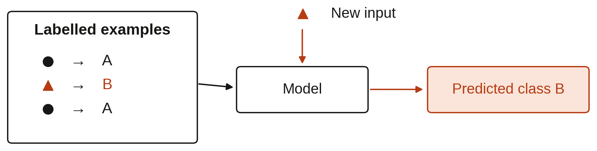

> ML replaces hand-written rules by rules estimated from data

---

<!-- _class: concept image-right -->


## 1.4 A precise definition (Mitchell, 1997)

A program **learns** from experience **E** on a task **T** with performance **P** if its P at T improves with E.

- **Spam filter**
- T: classify an email
- E: emails already labelled
- P: share correctly classified on **new** emails

---

<!-- _class: concept image-right -->


## 1.5 Essential vocabulary

| Term | Meaning |
|---|---|
| **Sample** | One row |
| **Feature** | An input variable |
| **Label** | What we want to predict |
| **Model** | Function: features → prediction |
| **Loss** | How wrong a prediction is |

---

<!-- _class: concept image-right -->


## 1.6 Parameters vs hyperparameters

- **Parameters**: learned from data (weights)
- **Hyperparameters**: chosen by you before training (tree depth, learning rate)
- **Training**: finding good parameters
- **Inference**: predicting on new inputs

> Parameters are learned. Hyperparameters are tuned.

---

<!-- _class: concept image-right -->


## 1.7 Learning paradigms

| Paradigm | Data | Example |
|---|---|---|
| **Supervised** | Inputs and labels | House price, spam |
| **Unsupervised** | Inputs only | Customer groups |
| **Self-supervised** | Labels made from the data | Masked word |
| **Reinforcement** | Rewards | A game-playing agent |

---

<!-- _class: concept image-right -->


## 1.8 The life cycle of an ML project

**Define** → **Collect and explore** → **Prepare** → **Train** → **Evaluate** → **Deploy and monitor**

- **60–80 %** of the time goes into data
- The cycle is **iterative**: evaluation sends you back to the data

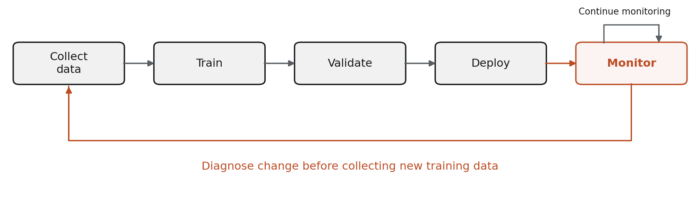

---

<!-- _class: concept image-right -->


## 1.9 The formal setup

Dataset: $(x_i, y_i)$, model $f_\theta$, loss $\ell$

$$\hat\theta = \arg\min_\theta \frac{1}{n}\sum_{i=1}^{n} \ell\big(f_\theta(x_i), y_i\big)$$


> Learning means minimising the average loss on the training data.

---

<!-- _class: concept image-right -->


## 1.10 The central difficulty

- We minimise the error on the data we **have**
- We care about the error on data we **will see**
- The gap between the two is the subject of **Section 4**

> Performance on new data is what matters : A model can exploit accidental patterns in a finite training set. It can also fail because future conditions no longer resemble the past.

---
<!-- _class: concept image-right invert -->


## 1.11 No miracle algorithm

- **No Free Lunch**: no algorithm is best on every problem
- Always start with a **simple baseline**
- Add complexity only if it **measurably** helps

---

<!-- _class: full-width accent-band -->

## 1. Exercises

📝 **1.1** Classify four use cases by learning paradigm and task type
📝 **1.2** Separate parameters from hyperparameters in a neural network
📝 **1.3** Write Mitchell's **T, E, P** for handwritten-digit recognition

---

<!-- _class: full-width takeaway -->

## [1] — Key Takeaways

- Machine learning estimates rules from examples by minimising a loss
- Performance on new data matters more than training performance
- Parameters are learned; hyperparameters are tuned
- Start with a simple baseline and add complexity only when it helps

---

<!-- _class: transition-chapitre -->
<!-- _paginate: false -->
<!-- _header: "" -->
<!-- _footer: "" -->


---

<!-- _class: full-width -->
<!-- header: '[2] — Data and Preprocessing' -->

# 2. Data and preprocessing

### Exploration, transformations and leakage-safe pipelines

---

<!-- _class: full-width objectives -->

## 2.1 Objectives

- **Explore** a dataset and spot problems
- **Encode** and **scale** features
- **Split** data correctly
- **Avoid data leakage**
- Build a **pipeline**

---

<!-- _class: concept image-right -->


## 2.2 Types of data

| Kind | Example | Entry into a model |
|---|---|---|
| **Numerical** | Age | Directly |
| **Categorical** | City | Encode as numbers |
| **Ordinal** | Low / medium / high | Ordered integers |
| **Text, images** | Reviews, photos | Embeddings (Section 10) |
| **Time series** | Sensors | Split by time |

---

<!-- _class: concept image-right -->


## 2.3 Look at the data first

- **Shape**, types, first rows
- **Missing values** per column
- **Duplicates**
- **Distributions** (histograms)
- Impossible values? Balanced classes? Suspicious columns?

> No modelling before exploration

---

<!-- _class: concept image-right -->


## 2.4 Cleaning

- **Missing values**: drop, or **impute** (median is robust)
- Add a column "was missing": missingness can be informative
- **Outliers**: error or real? Keep real ones
- **Duplicates**: remove, or they land in train **and** test

---

<!-- _class: concept image-right -->


## 2.5 Encoding categorical variables

- **One-hot**: one binary column per category
- **Ordinal**: only if the order is meaningful

| city | Paris | Lyon | Nice |
|---|---|---|---|
| Paris | 1 | 0 | 0 |
| Lyon | 0 | 1 | 0 |

---

<!-- _class: concept image-right -->


## 2.6 Scaling numerical variables

- **Standardisation**: $z = (x - \mu)/\sigma$
- **Min–max**: maps values to $[0, 1]$
- **Needed** by: k-NN, SVM, k-means, gradient-based models
- **Not needed** by: trees

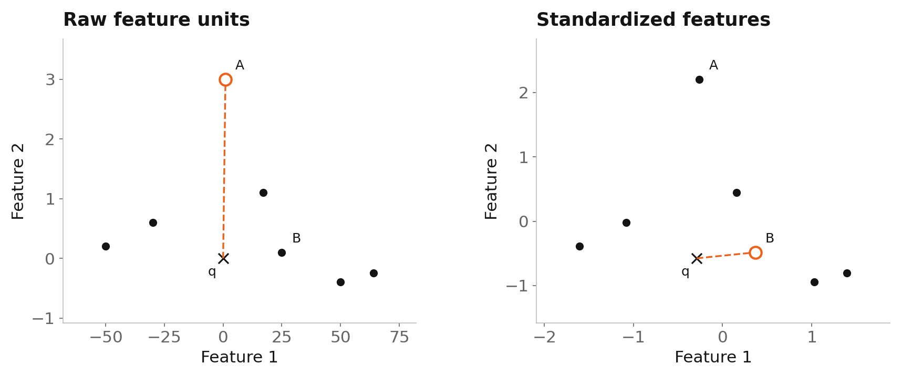

> A feature in the thousands would dominate a feature in 0–1

---

<!-- _class: concept image-right -->


## 2.7 Splitting the data

| Set | Share | Role |
|---|---|---|
| **Training** | 60–70 % | Fit the parameters |
| **Validation** | 15–20 % | Compare models, tune |
| **Test** | 15–20 % | Final estimate, **used once** |

Choose the split for the prediction task

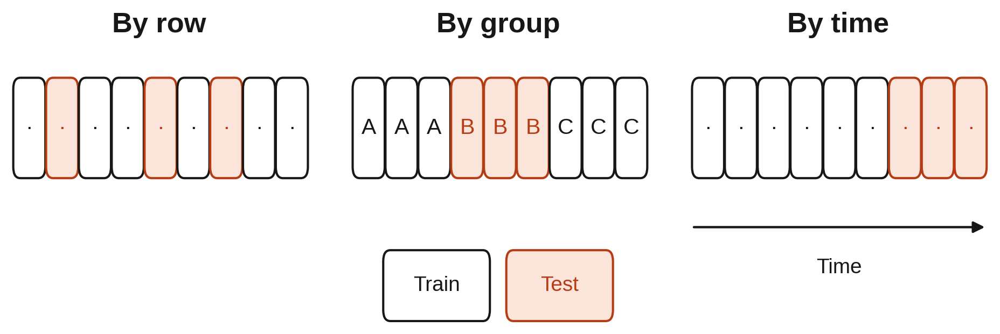

>Decide what must stay unseen at evaluation time.
---

<!-- _class: concept image-right -->


## 2.8 Data leakage

**Information that would not exist at prediction time slips into training.**

- Preprocessing **before** splitting
- A feature **derived from the target**
- **Duplicates** across sets
- **Future** information

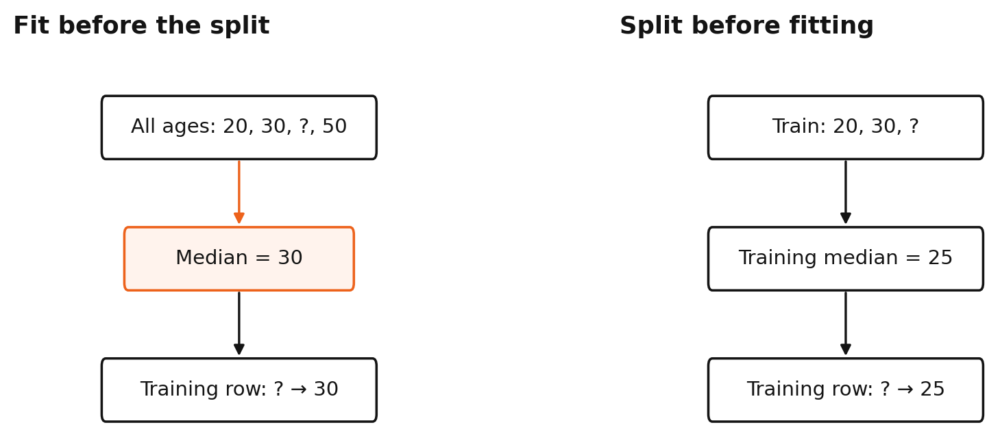

> Great test score, terrible real-world performance

---

<!-- _class: concept image-right -->


## 2.9 Question: find the bug

- A pipeline scales the data, **then** splits
- The test score is surprisingly good

Where is the leak? What does it change?

> Fit preprocessing on the training data only.

---

<!-- _class: concept image-right -->


## 2.10 Feature engineering

- **Ratios**: price per square metre
- **Dates**: day of week, month
- **Logarithms** for skewed variables
- **Interactions** and **aggregates**

> Often the best way to improve a classical model

---

<!-- _class: concept image-right -->


## 2.11 The pipeline

```python
model = Pipeline([("prep", preprocess),
                  ("clf", LogisticRegression())])
model.fit(X_train, y_train)     # fitted on train only
model.score(X_test, y_test)
```

- Preprocessing is **re-fitted** inside cross-validation
- Compare with a **baseline** (`DummyClassifier`)

---

<!-- _class: full-width accent-band -->

## 2. Exercises

📝 **2.1** Explore the data
📝 **2.2** Handle missing ages
📝 **2.3** Build the pipeline
📝 **2.4** Compare with the baseline

---

<!-- _class: full-width takeaway -->

## [2] — Key Takeaways

- Explore and split the data before learning any transformation
- Fit imputation, encoding and scaling on training data only
- Keep preprocessing and the model in one leakage-safe pipeline
- Use validation for choices and the test set once

---

<!-- _class: transition-chapitre -->
<!-- _paginate: false -->
<!-- _header: "" -->
<!-- _footer: "" -->


---

<!-- _class: full-width -->
<!-- header: '[3] — Linear Models and Gradient Descent' -->

# 3. Linear models and gradient descent

### Regression, optimisation and regularisation

---

<!-- _class: full-width objectives -->

## 3.1 Objectives

- Fit and interpret **linear** and **logistic** regression
- Explain **gradient descent**
- Explain **regularisation** (L1, L2)

---

<!-- _class: concept image-right -->


## 3.2 Linear regression

$$\hat y = w^\top x + b$$

- **Weights** $w$: one per feature
- **Bias** $b$: intercept
- $w_j$ = change in prediction for **one unit** of $x_j$, others being equal

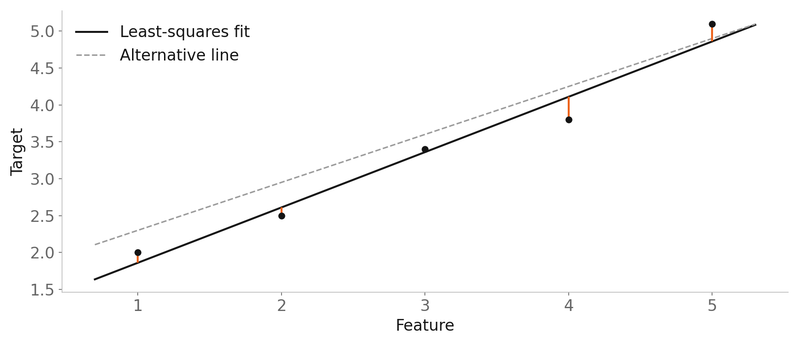

---

<!-- _class: concept image-right -->


## 3.3 The loss: mean squared error

$$L(w,b) = \frac{1}{n}\sum_{i=1}^{n}\big(w^\top x_i + b - y_i\big)^2$$

- Points $(1,2)$, $(2,3)$, $(3,5)$
- Best line: $\hat y = 1.5x + 0.33$
- MSE $\approx 0.056$


---

<!-- _class: concept image-right -->


## 3.4 The normal equation

$$\hat w = (X^\top X)^{-1} X^\top y$$

- Set the gradient of the loss to **zero**
- The loss is a **convex bowl**: one minimum
- Needs $X^\top X$ **invertible**

> Proof in Annex A

---

<!-- _class: concept image-right -->


## 3.5 Gradient descent

$$\theta \leftarrow \theta - \eta\,\nabla L(\theta)$$

- The **gradient** points uphill
- Move the **opposite** way
- $\eta$ = **learning rate**, the step size

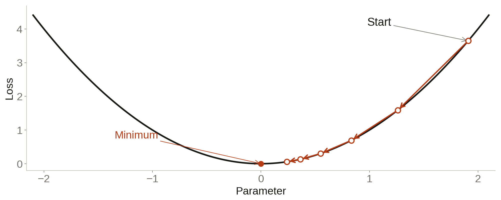

---

<!-- _class: concept image-right -->


## 3.6 Gradient descent: a worked example

Minimise $L(w) = (w-3)^2$, start at $w_0 = 0$, $\eta = 0.1$

- Step 1: gradient $-6$ → $w = 0.6$
- Step 2: gradient $-4.8$ → $w = 1.08$
- … converges to **3**

---

<!-- _class: concept image-right -->


## 3.7 The learning rate

- **Too small**: very slow
- **Too large**: oscillation or divergence
- The most important hyperparameter of gradient-based training

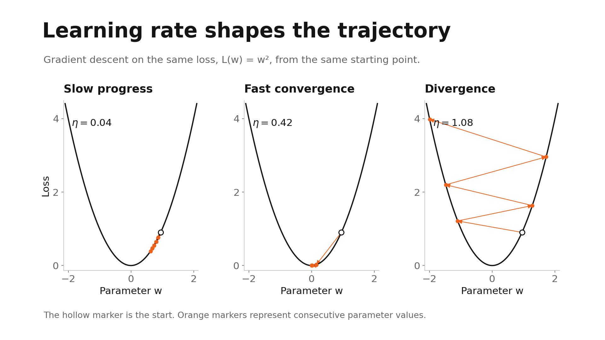

---

<!-- _class: concept image-right -->


## 3.8 Batch, stochastic, mini-batch

| Variant | Samples per update |
|---|---|
| **Batch** | All $n$ |
| **Stochastic (SGD)** | 1 |
| **Mini-batch** | 32–256 |

> Mini-batch is the standard compromise

---

<!-- _class: concept image-right -->


## 3.9 Logistic regression

$$\hat p = \sigma(w^\top x + b), \qquad \sigma(z) = \frac{1}{1+e^{-z}}$$

- A **classifier**, despite its name
- Output = a **probability**
- Predict class 1 if $\hat p \ge 0.5$ (the **threshold** can change)

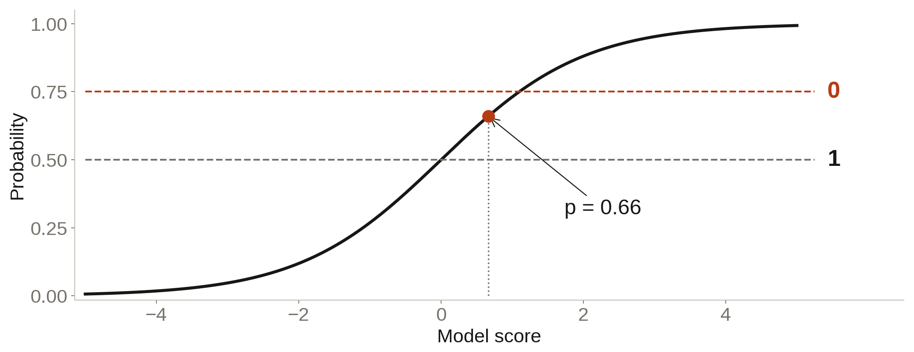

---

<!-- _class: concept image-right -->


## 3.10 The log loss

$$\ell(\hat p, y) = -\big[y\log\hat p + (1-y)\log(1-\hat p)\big]$$

- Small when the true class gets a high probability
- **Huge** when the model is confidently wrong
- **Convex**: gradient descent finds the global minimum

---

<!-- _class: concept image-right -->


## 3.11 Regularisation

| | **Ridge (L2)** | **Lasso (L1)** |
|---|---|---|
| Penalty | $\lambda\sum w_j^2$ | $\lambda\sum \lvert w_j\rvert$ |
| Effect | Shrinks weights | Sets many to **exactly 0** |
| Use | Correlated features | **Feature selection** |


> Always standardise first

---

<!-- _class: full-width accent-band -->

## 3. Exercises

📝 **3.1** **Titanic**: logistic regression, read the weights
📝 **3.2** **California Housing**: OLS, Ridge, Lasso
📝 **3.3** **Autonomy**: code gradient descent in 10 lines

---

<!-- _class: full-width takeaway -->

## [3] — Key Takeaways

- Linear models are fast, interpretable baselines
- Gradient descent lowers loss by moving against its gradient
- Logistic regression outputs class probabilities
- L1 and L2 regularisation trade training fit for better generalisation

---

<!-- _class: transition-chapitre -->
<!-- _paginate: false -->
<!-- _header: "" -->
<!-- _footer: "" -->


---

<!-- _class: full-width -->
<!-- header: '[4] — Evaluating a Model' -->

# 4. Evaluating a model

### Generalisation, validation and decision metrics

---

<!-- _class: full-width objectives -->

## 4.1 Objectives

- Explain **overfitting**, underfitting and the **bias–variance** trade-off
- Use **cross-validation**
- Choose the right **metric**, even with imbalanced classes

---

<!-- _class: concept image-right -->


## 4.2 Generalisation

- **Training error**: on the data used for fitting
- **Generalisation error**: on new data
- Estimated on a **held-out** set


> A model is useful only if it works on new data.

---

<!-- _class: concept image-right -->


## 4.3 Underfitting, good fit, overfitting

| Situation | Training | Validation |
|---|---|---|
| **Underfitting** | High | High |
| **Good fit** | Low | Low |
| **Overfitting** | Very low | **Much higher** |

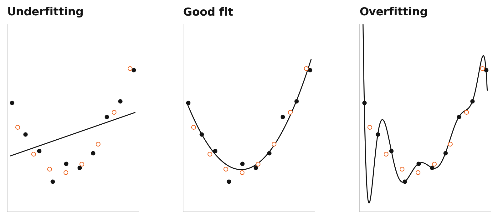

---

<!-- _class: concept image-right -->


## 4.4 Question: which polynomial degree?

- 60 noisy points of a sine curve
- Degree 1, 4 or 14?

Predict the **validation error** curve, then run it.

> Training error always falls. Validation error falls, then rises.

---

<!-- _class: concept image-right -->


## 4.5 Bias and variance

$$\text{Error} = \text{bias}^2 + \text{variance} + \text{noise}$$

- **Bias**: model too simple
- **Variance**: model too sensitive to the training set
- **Noise**: cannot be removed

> Proof in Annex C

---

<!-- _class: concept image-right -->


## 4.6 Remedies

| High bias (underfitting) | High variance (overfitting) |
|---|---|
| More flexible model | More data |
| Better features | Simpler model |
| Less regularisation | More regularisation, bagging, early stopping |

---

<!-- _class: concept image-right -->


## 4.7 Validation strategies

- **Hold-out**: one split, depends on luck
- **k-fold CV**: train $k$ times, average the scores ($k = 5$ or $10$)
- **Stratified**: keeps class proportions
- **Group / time-series** split when rows are not independent

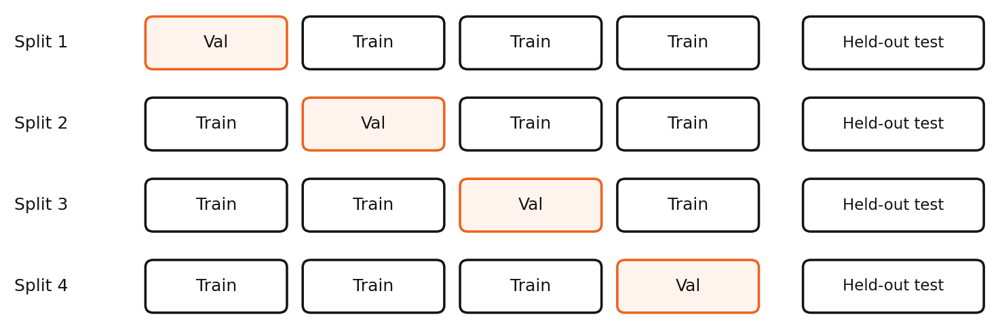

---

<!-- _class: concept image-right -->


## 4.8 The golden rule

**The test set is used once, at the very end.**

- Tune on validation or cross-validation
- If you tune on the test set, its score is **no longer honest**

---

<!-- _class: concept image-right -->


## 4.9 Regression metrics

| Metric | Remark |
|---|---|
| **MAE** | Robust to outliers |
| **MSE** | Penalises large errors |
| **RMSE** | Same unit as $y$ |
| **R²** | 1 = perfect, 0 = predicting the mean |


---

<!-- _class: concept image-right -->


## 4.10 The confusion matrix

| | Predicted +  | Predicted − |
|---|---|---|
| **Actually +** | TP | FN |
| **Actually −** | FP | TN |

- **Precision** = TP / (TP + FP)
- **Recall** = TP / (TP + FN)
- **F1** balances both

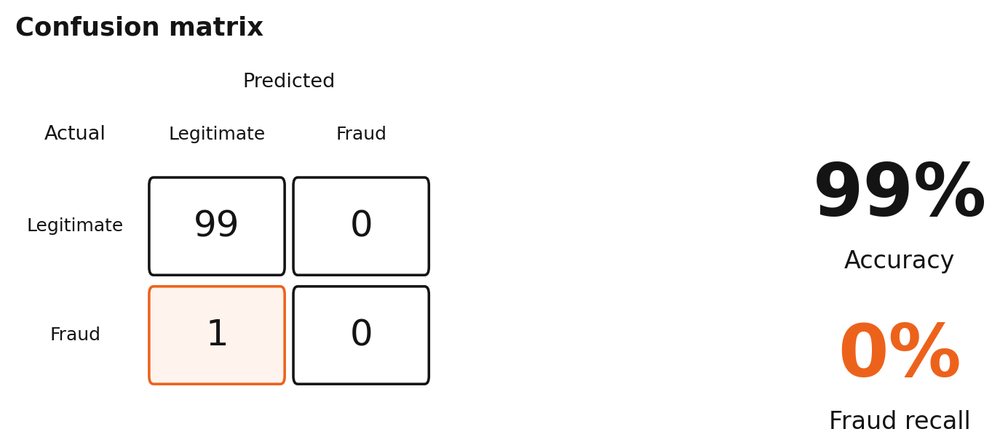

---

<!-- _class: concept image-right -->


## 4.11 Why accuracy can lie

1 000 patients, 60 ill. TP 40, FP 10, FN 20, TN 930.

- Accuracy **0.97**
- Precision 0.80, recall 0.67, F1 0.73
- "Always healthy": accuracy **0.94**, recall **0**


> Accuracy hides the problem

---

<!-- _class: concept image-right -->


## 4.12 Vote: is 99 % accuracy good?

- Fraud detection: **0.67 %** of transactions are fraud
- A model never flags fraud
- Its accuracy?

> About **99 %**, and it is useless

---

<!-- _class: concept image-right -->


## 4.13 ROC and precision–recall

- Lowering the **threshold** raises recall and lowers precision
- **ROC / AUC**: 0.5 = random, 1 = perfect
- **Precision–recall** curve: better when positives are rare

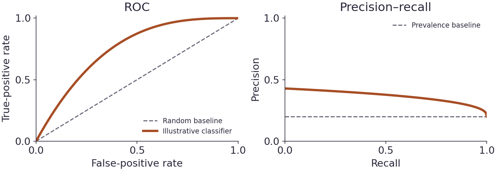

---

<!-- _class: concept image-right -->


## 4.14 Choose by the cost of errors

- Missing a cancer (FN) is not a false alarm (FP)
- Smoke detector: favour **recall**
- Spam folder: favour **precision**


> Choose the metric and the threshold from the cost, not by habit

---

<!-- _class: concept image-right -->


## 4.15 Imbalanced classes

- Use **precision, recall, F1, PR-AUC**
- **Class weights**: penalise errors on the rare class
- **Resample** the training folds only
- Tune the **threshold**


---

<!-- _class: concept image-right -->


## 4.16 Cross validation

- **Cross validation** is a technique for estimating the **generalisation performance** of a model
- Split your data into folds, train and validate on different splits, and report the mean and spread of performance metrics.
- Use **stratified folds for imbalanced classes** to ensure each fold has a representative distribution.

---

<!-- _class: full-width accent-band -->

## 4. Exercises

📝 **4.1** **Titanic**: cross-validation, mean **and spread**
📝 **4.2** **FinBench `cf1`**: baseline, class weights, recall of frauds

---

<!-- _class: full-width takeaway -->


## [4] — Key Takeaways

- Generalisation performance, not training error, determines usefulness
- Select models with validation and report cross-validation mean and spread
- Use the test set once, after all choices are complete
- Choose metrics and thresholds from the cost of errors
- Accuracy can hide failure on imbalanced data

---

<!-- _class: transition-chapitre -->
<!-- _paginate: false -->
<!-- _header: "" -->
<!-- _footer: "" -->


---

<!-- _class: full-width -->
<!-- header: '[5] — Decision Trees and Ensembles' -->

# 5. Decision trees and ensembles

### Splits, bagging and boosting

---

<!-- _class: full-width objectives -->

## 5.1 Objectives

- Explain how a tree chooses its **splits**
- Explain how **bagging** and **boosting** fix a single tree
- Choose between random forest and gradient boosting

---

<!-- _class: concept image-right -->


## 5.2 A decision tree

- A sequence of **yes/no questions** on the features
- **Leaves** hold the prediction
- Built **greedily**: at each node, take the best split

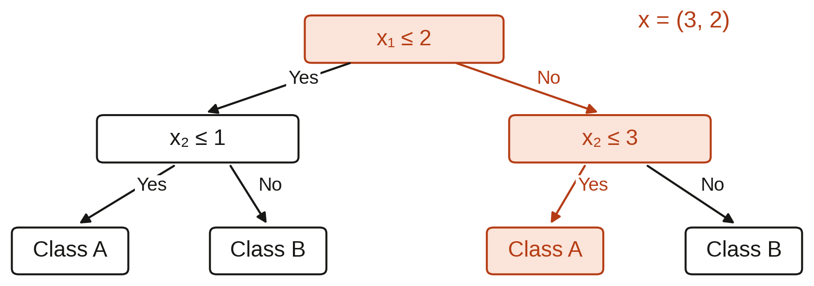

> Easy to read, no scaling needed

---

<!-- _class: concept image-right -->


## 5.3 Impurity

- **Gini**: $G = 1 - \sum_k p_k^2$
- **Entropy**: $H = -\sum_k p_k\log_2 p_k$
- 0 for a **pure** node, maximal when mixed
- Best split = largest **impurity decrease**

---

<!-- _class: concept image-right -->


## 5.4 Worked example: a Gini split

- Node: 6 positive, 4 negative → $G = 0.48$
- Left: 5 positive, 0 negative → $G = 0$
- Right: 1 positive, 4 negative → $G = 0.32$
- After the split: $0.5\times0 + 0.5\times0.32 = 0.16$
- **Gain = 0.32**

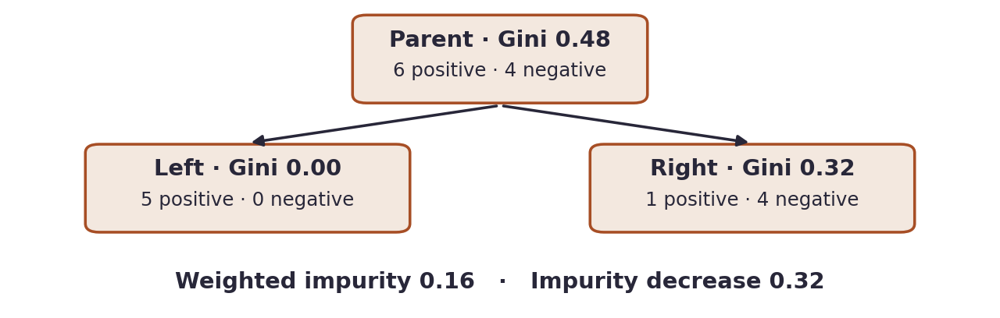

---

<!-- _class: concept image-right -->


## 5.5 A single tree overfits

- A deep tree **memorises** the training set
- A small change in the data gives a very different tree
- Controls: `max_depth`, `min_samples_leaf`, **pruning**


> High variance

---

<!-- _class: concept image-right -->


## 5.6 Bagging

- Draw $B$ **bootstrap samples** (with replacement)
- Train one deep tree on each
- **Average** (regression) or **vote** (classification)

> Averaging many noisy, different predictors reduces variance.

---

<!-- _class: concept image-right -->


## 5.7 Random forest

- Bagging + **random subset of features** at each split
- Makes trees **less correlated**
- Variance of the average: $\rho\sigma^2 + \frac{1-\rho}{B}\sigma^2$

> Adding trees never removes the first term. Decorrelate.

---

<!-- _class: concept image-right -->


## 5.8 Boosting

- Build trees **one after another**
- Each small tree corrects the **errors** so far
- Add it with a small **learning rate**
- Reduces mainly **bias**

> Needs early stopping

---

<!-- _class: concept image-right -->


## 5.9 Random forest vs gradient boosting

| | Random forest | Gradient boosting |
|---|---|---|
| **Trees** | Deep, independent | Shallow, sequential |
| **Reduces** | Variance | Bias |
| **Tuning** | Low | Higher |
| **Overfitting** | Low risk | Use early stopping |

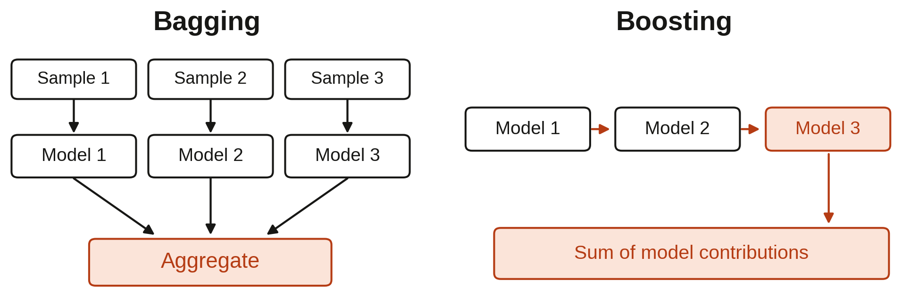

---

<!-- _class: concept image-right -->


## 5.10 Feature importance

- Default **impurity-based** importance is biased
- Prefer **permutation importance** on held-out data
- More in Section 11

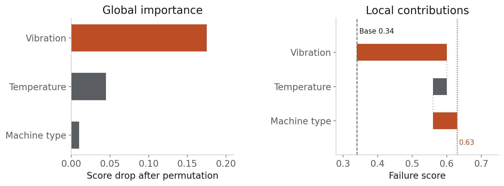

---

<!-- _class: full-width accent-band -->

## 5. Exercises

📝 **5.1** **Titanic**: tree depth 3, unlimited tree, forest, boosting
📝 **5.2** **California Housing**: Ridge, forest, boosting (RMSE)
📝 **5.3** **Autonomy**: plot score against the number of trees

---

<!-- _class: full-width takeaway -->

## [5] — Key Takeaways

- A single tree is readable and flexible but unstable
- Bagging diverse trees reduces variance through averaging
- Random forests decorrelate trees with random feature subsets
- Boosting corrects errors sequentially and mainly reduces bias
- Compare ensembles with a simple baseline

---

<!-- _class: transition-chapitre -->
<!-- _paginate: false -->
<!-- _header: "" -->
<!-- _footer: "" -->

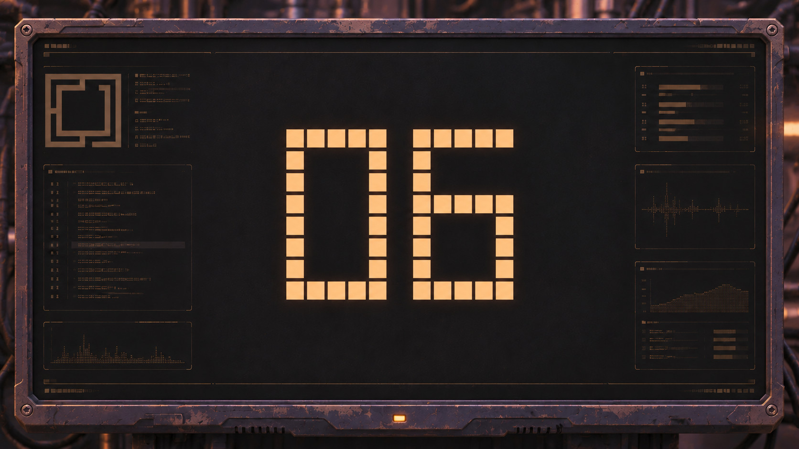

---

<!-- _class: full-width -->
<!-- header: '[6] — k-NN, SVM and Model Selection' -->

# 6. k-NN, SVM and model selection

### Distance, margins and leakage-safe comparison

---

<!-- _class: full-width objectives -->

## 6.1 Objectives

- Explain **k-NN** and **SVM**, and their limits
- **Tune** hyperparameters without leaking data
- Pick a reasonable **first model**

---

<!-- _class: concept image-right -->


## 6.2 k-nearest neighbours

- Find the **$k$ most similar** training samples
- They **vote** (or average)
- **No training phase**: the model is the dataset

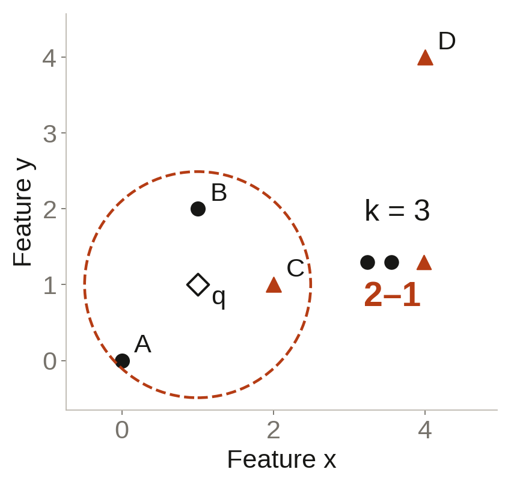

> Small $k$ overfits. Large $k$ is smoother.

---

<!-- _class: concept image-right -->


## 6.3 Scaling is essential for k-NN

- Wine: 13 measurements with ranges differing by about **1 000**
- Raw features: accuracy about **0.7**
- Scaled features: accuracy about **0.95**

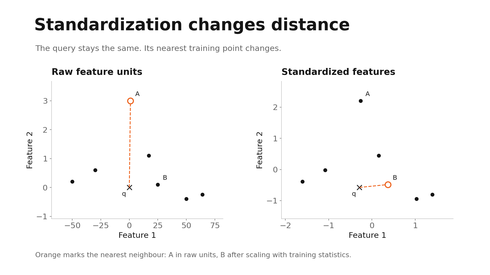

> Distances are dominated by large-scale features

---

<!-- _class: concept image-right -->


## 6.4 The curse of dimensionality

- In high dimension, all points are **almost equally far**
- "Nearest" loses its meaning
- k-NN works best with **few features**

---

<!-- _class: concept image-right -->


## 6.5 Support vector machines

- Choose the hyperplane with the **largest margin**
- Only the **support vectors** matter
- Margin width $= 2/\lVert w\rVert$

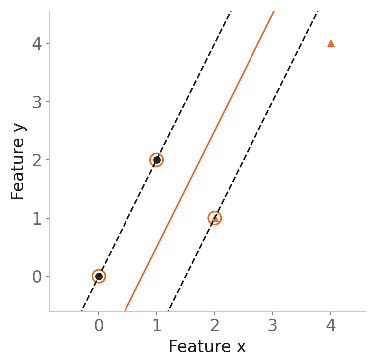

> Proof in Annex G

---

<!-- _class: concept image-right -->


## 6.6 Soft margin and the parameter C

- Real data is rarely separable
- **Large C**: few violations tolerated, risk of overfitting
- **Small C**: wider, more tolerant margin

---

<!-- _class: concept image-right -->


## 6.7 The kernel trick

- Separate classes that are **not linearly separable**
- Replace dot products by a **kernel**
- **RBF**: $K(x,x') = \exp(-\gamma\lVert x-x'\rVert^2)$
- Large $\gamma$: wiggly boundary, **overfitting**

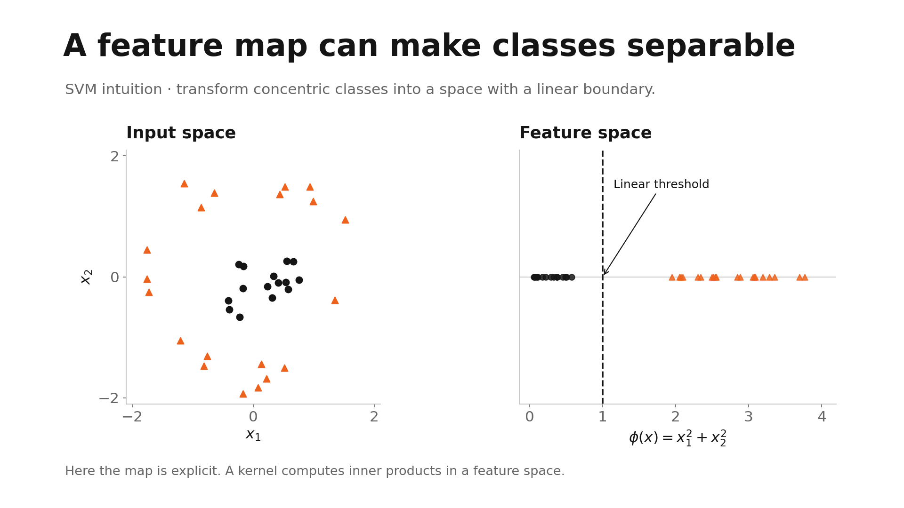

---

<!-- _class: concept image-right -->


## 6.8 Hyperparameter tuning

| Strategy | When |
|---|---|
| **Grid search** | Few hyperparameters |
| **Random search** | Many hyperparameters |
| **Bayesian optimisation** | Expensive models |


> Cross-validate on the training data; the test set stays untouched.

---

<!-- _class: concept image-right -->


## 6.9 Which model first?

| Situation | First choice |
|---|---|
| Interpretability, small data | Regularised linear, shallow tree |
| Tabular, best accuracy | Gradient boosting, random forest |
| Small data, high dimension | SVM (RBF), regularised linear |
| Images, text, audio | Neural networks, pre-trained |

---

<!-- _class: full-width accent-band -->

## 6. Exercises

📝 **6.1** In pairs, use **Wine** and **Titanic**
📝 **6.2** Compare logistic regression, k-NN, SVM, forest and boosting
📝 **6.3** Compare **with and without** scaling
📝 **6.4** Post your **scores** on the shared board

---

<!-- _class: full-width takeaway -->

## [6] — Key Takeaways

- No model family is universally best
- Scale features for k-NN and SVM
- Compare a few families under the same cross-validation pipeline
- Tune on training data and touch the test set only once

---

<!-- _class: full-width -->

# One week
## Homework and project kick-off

---

<!-- _class: concept image-right -->


## Homework

- **Revise** Sections 2 to 4
- **Mini-lab**: a dataset you have not used (another FinBench subset, or any tabular dataset of the Hub)
- Workflow: **EDA → pipeline → three model families → CV comparison → short conclusion**
- **Start the group project**
- **Re-read** derivative and matrix product

---

<!-- _class: full-width -->

# Day 2
## Unsupervised learning, neural networks and responsible ML

---

<!-- _class: concept image-right -->


## Recap quiz: Day 1

1. Why **split before** preprocessing?
2. What are the symptoms of **overfitting**?
3. When does **accuracy lie**?
4. What does **regularisation** do?
5. **Bagging** or **boosting**: which cuts variance?

> Answer alone for 2 minutes, then compare with your neighbour

---

<!-- _class: transition-chapitre -->
<!-- _paginate: false -->
<!-- _header: "" -->
<!-- _footer: "" -->


---

<!-- _class: full-width -->
<!-- header: '[7] — Clustering' -->

# 7. Clustering

### Structure, geometry and validation without labels

---

<!-- _class: full-width objectives -->

## 7.1 Objectives

- Explain **unsupervised learning** and why it is hard to evaluate
- Run **k-means**, **DBSCAN**, **Gaussian mixtures**
- **Choose k** and evaluate without labels

---

<!-- _class: concept image-right -->


## 7.2 The clustering problem

- Samples with **no labels**
- Group them: **similar inside**, **different between** clusters
- The result depends on the **similarity** and the **algorithm**

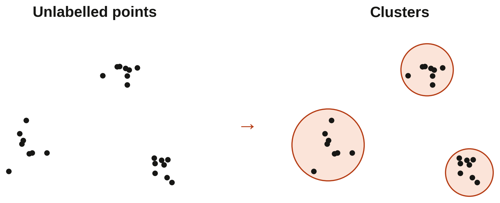

> Always scale the features first

---

<!-- _class: concept image-right -->


## 7.3 k-means

1. **Initialise** $k$ centroids
2. **Assign** each sample to its nearest centroid
3. **Update** each centroid to the mean of its samples
4. **Repeat** until nothing changes

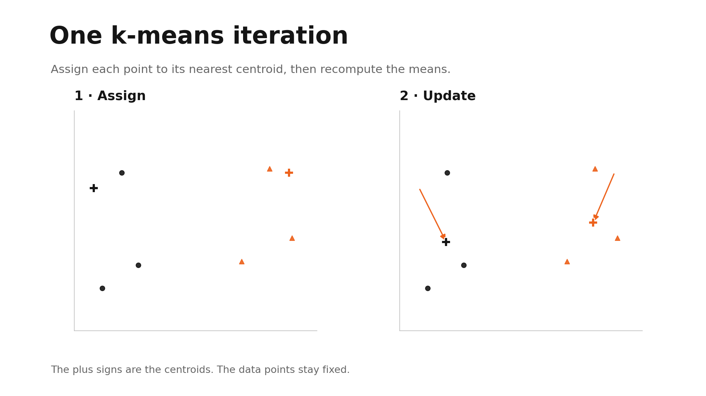

> Minimises the **inertia**: sum of squared distances to the centroid

---

<!-- _class: concept image-right -->


## 7.4 k-means: a worked example

- Samples $\{1, 2, 3, 10, 11, 12\}$, $k = 2$
- Centroids: **2** and **11**
- Inertia $= 2 + 2 = 4$

> Practice at the board: 6 points, 2 iterations

---

<!-- _class: concept image-right -->


## 7.5 k-means: guarantees and limits

- Never increases the inertia, always **stops**
- But at a **local** minimum: run several times (`n_init`)
- You must choose **$k$**
- Assumes **spherical** clusters of similar size
- Sensitive to **outliers** and **scaling**

> Proof in Annex F

---

<!-- _class: concept image-right -->


## 7.6 Choosing $k$

- **Elbow**: inertia always falls; look for the bend
- **Silhouette**: $s = (b - a)/\max(a, b)$, from $-1$ to $1$
- **Domain validation**: do the clusters make sense? Are they stable?

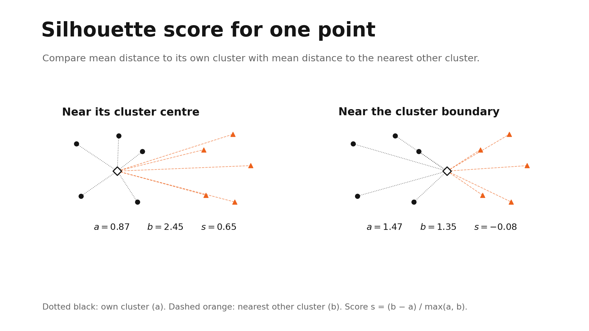

---

<!-- _class: concept image-right -->


## 7.7 Question: how many wine cultivars?

- Wine: 178 wines, 13 measurements, **labels hidden**
- Predict $k$, then compute the silhouette for $k = 2$ to $6$

> Then reveal the real cultivars

---

<!-- _class: concept image-right -->


## 7.8 Comparing with known labels

- **Adjusted Rand index (ARI)**: do two partitions agree on pairs of samples?
- **1** = identical, about **0** = random
- Labels **judge** the clusters, they never **build** them
- Wine: k-means finds clusters close to the cultivars (ARI about **0.9**)

---

<!-- _class: concept image-right -->


## 7.9 DBSCAN

- Clusters = **dense regions** separated by sparse ones
- Two hyperparameters: `eps` and `min_samples`
- **Core**, **border** and **noise** points
- Finds **arbitrary shapes**, flags **outliers**
- Weak when **densities vary**

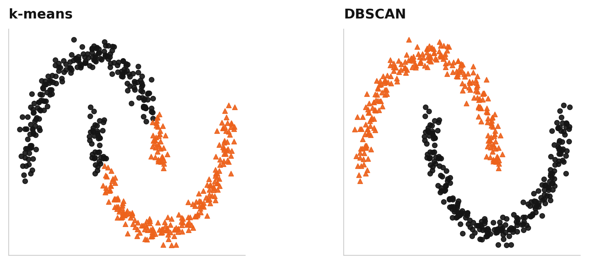

---

<!-- _class: concept image-right -->


## 7.10 Gaussian mixture models

- Data = a mix of **Gaussians**
- Elliptical clusters of different sizes
- **Soft** assignments: a probability per cluster
- Fitted by **EM**, number of components by **BIC**

---

<!-- _class: concept image-right -->


## 7.11 Which clustering algorithm?

| | k-means | DBSCAN | GMM |
|---|---|---|---|
| **Choose $k$** | Yes | No | Yes |
| **Shape** | Spherical | Arbitrary | Elliptical |
| **Outliers** | Sensitive | Detected | Sensitive |
| **Output** | Hard labels | Labels + noise | Probabilities |


---

<!-- _class: full-width accent-band -->

## 7. Exercises

📝 **7.1** **Wine**: k-means with and without scaling, compare the ARI
📝 **7.2** **Half-moons**: observe k-means fail, then tune DBSCAN's `eps`

---

<!-- _class: full-width takeaway -->

## [7] — Key Takeaways

- Clustering proposes structure rather than discovering a unique truth
- Scale features before applying distance-based methods
- Match k-means, DBSCAN or GMM to the expected cluster geometry
- Validate with stability, internal metrics and domain usefulness

---

<!-- _class: transition-chapitre -->
<!-- _paginate: false -->
<!-- _header: "" -->
<!-- _footer: "" -->


---

<!-- _class: full-width -->
<!-- header: '[8] — Dimensionality Reduction and Anomaly Detection' -->

# 8. Dimensionality reduction and anomaly detection

### Compression, visualisation and unusual observations

---

<!-- _class: full-width objectives -->

## 8.1 Objectives

- Explain the **curse of dimensionality**
- Apply **PCA** and read the explained variance
- Use **t-SNE / UMAP** knowing their pitfalls
- Apply basic **anomaly detection**

---

<!-- _class: concept image-right -->


## 8.2 Why reduce dimension?

- Easier to **overfit** and to compute
- Distances **lose meaning**
- Humans see **2–3 dimensions** only
- Uses: visualisation, noise removal, compression, speed

---

<!-- _class: concept image-right -->


## 8.3 PCA: the idea

- Find the axes along which the data **varies most**
- Keep the **first few**
- **Centre** (and scale), compute the **covariance matrix**, take its **eigenvectors**

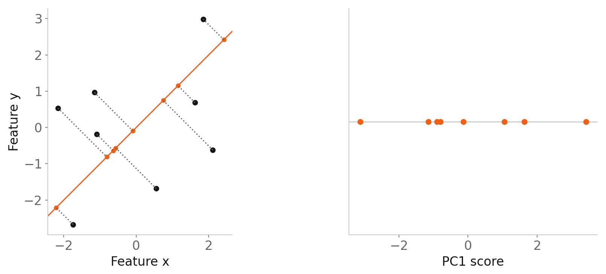

> First component = direction of maximal variance

---

<!-- _class: concept image-right -->


## 8.4 PCA: a worked example

$$\Sigma = \begin{pmatrix}3 & 1\\ 1 & 3\end{pmatrix}$$

- Eigenvalues: **4** and **2**
- First component $(1,1)/\sqrt2$ explains $4/6 \approx 67\,\%$

> Proof in Annex E

---

<!-- _class: concept image-right -->


## 8.5 How many components?

- Keep **90–95 %** of the cumulative explained variance
- or look at the **elbow** of the scree plot
- Wine: **2** components explain about **55 %**, **8** reach 90 %

---

<!-- _class: concept image-right -->


## 8.6 PCA: limits

- **Linear** only
- Components are **mixtures** of features: harder to read
- Sensitive to **scaling**
- Variance is not always what **matters** for a task

---

<!-- _class: concept image-right -->


## 8.7 Question: what will the PCA plot show?

- Wine, 13 features projected on **2 components**
- Colour the points by **cultivar**


> PCA never saw the labels, yet the cultivars separate

---

<!-- _class: concept image-right -->


## 8.8 t-SNE and UMAP

- Keep **neighbours** close in 2D or 3D
- Excellent to **look** at embeddings and clusters
- Distances between clusters and cluster sizes are **not meaningful**
- Depends on **hyperparameters** and the **seed**

> Use t-SNE and UMAP to explore, not to prove.

---

<!-- _class: concept image-right -->


## 8.9 Anomaly detection

| Method | Principle |
|---|---|
| **Statistical** | Far from the mean, $\lvert z\rvert > 3$ |
| **Isolation Forest** | Anomalies are isolated in **few splits** |
| **LOF** | Lower density than neighbours |
| **One-class SVM** | Boundary around "normal" |
| **Autoencoder** | Large reconstruction error |

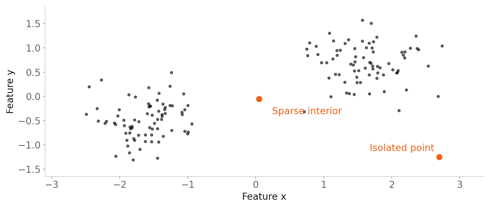

---

<!-- _class: concept image-right -->


## 8.10 Isolation Forest on card fraud

- **FinBench `cf1`**, no labels given to the model
- Do **frauds** get the highest scores?
- Metric: **average precision**; random = share of frauds (about 0.007)


> Evaluation is hard: involve domain experts

---

<!-- _class: full-width accent-band -->

## 8. Exercises

📝 **8.1** **Wine**: PCA, cumulative variance, 2D plot by cultivar
📝 **8.2** **FinBench `cf1`**: Isolation Forest vs LOF, top 100 scores

---

<!-- _class: full-width takeaway -->

## [8] — Key Takeaways

- PCA compresses linearly while preserving as much variance as possible
- Scaling matters for PCA and distance-based methods
- t-SNE and UMAP preserve local neighbourhoods, not global distances
- Anomaly methods rank unusual points and require labels or domain review

---

<!-- _class: transition-chapitre -->
<!-- _paginate: false -->
<!-- _header: "" -->
<!-- _footer: "" -->

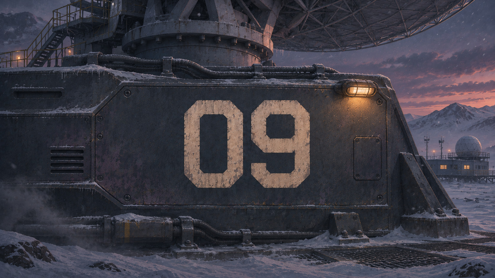

---

<!-- _class: full-width -->
<!-- header: '[9] — Neural Networks' -->

# 9. Neural networks

### Representations, backpropagation and training control

---

<!-- _class: full-width objectives -->

## 9.1 Objectives

- Describe a **neuron** and a **multi-layer network**
- Explain **backpropagation** and gradient descent
- Name the usual **ingredients**
- Train a small network in **PyTorch**

---

<!-- _class: concept image-right -->


## 9.2 From a linear model to a neuron

$$a = \varphi\big(w^\top x + b\big)$$

- Weighted sum, then a **non-linear activation**
- **Logistic regression** = one neuron with a sigmoid

---

<!-- _class: concept image-right -->


## 9.3 Multi-layer perceptron

- **Layers** of neurons, output of one = input of the next
- $a^{(1)} = \varphi(W^{(1)}x + b^{(1)})$, then $a^{(2)} = \varphi(W^{(2)}a^{(1)} + b^{(2)})$

> Fully connected, feed-forward

---

<!-- _class: concept image-right -->


## 9.4 Why non-linearity?

- Stacked **linear** layers = **one** linear layer
- The activation makes **curved**, complex functions possible
- **Universal approximation**: one wide hidden layer can approximate any continuous function

> It says a network **exists**, not that training will **find** it

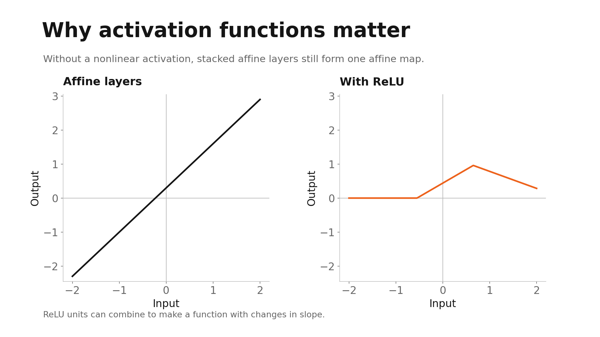

---

<!-- _class: concept image-right -->


## 9.5 Activations and outputs

| Function | Use |
|---|---|
| **ReLU** | Hidden layers (default) |
| **Sigmoid** | Binary probability |
| **Softmax** | Multi-class probabilities |
| **Identity** | Regression output |

- Regression: identity + **MSE**
- Binary: sigmoid + **cross-entropy**
- Multi-class: softmax + **cross-entropy**

---

<!-- _class: concept image-right -->


## 9.6 Training: backpropagation

1. **Forward pass**: compute activations, then the loss
2. **Backward pass**: propagate the error backwards, **chain rule**

- Cost of the same order as the forward pass
- Libraries do it automatically (`loss.backward()`)

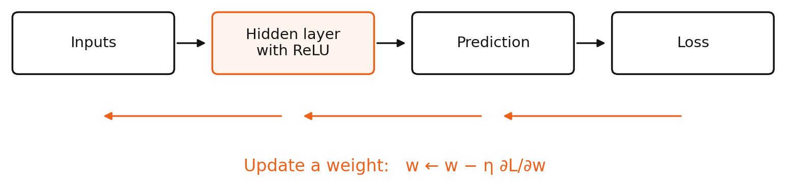

> Proof in Annex H

---

<!-- _class: concept image-right -->


## 9.7 Backpropagation: one neuron by hand

- $x = 2$, $w = 0.3$, target $y = 1$, $\hat y = 0.6$, $L = 0.16$
- $\partial L/\partial w = 2(\hat y - y)\,x = -1.6$
- Update ($\eta = 0.1$): $w = 0.46$ → prediction **0.92**

> Closer to 1

---

<!-- _class: concept image-right -->


## 9.8 Optimisers

- **SGD**: basic mini-batch update
- **Momentum**: smooths and speeds up
- **Adam**: adaptive step per parameter, the **default** ($\eta \approx 10^{-3}$)
- **Epoch**: one pass over the training data


---

<!-- _class: concept image-right -->


## 9.9 Training tricks

- **Initialisation** (He, Xavier)
- **Batch normalisation**
- **Dropout**: random neurons switched off
- **Weight decay**: like Ridge
- **Early stopping**

> The overfitting diagnosis is unchanged: training loss falls while validation loss rises.

---

<!-- _class: concept image-right -->


## 9.10 Typical problems

- **Vanishing gradients**: ReLU, initialisation, normalisation
- **Exploding gradients**: gradient clipping
- **Overfitting**: dropout, weight decay, early stopping

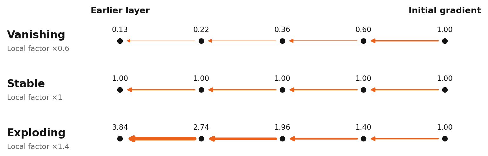

---

<!-- _class: concept image-right -->


## 9.11 Convolutional networks

- Small **filters** slide over the image and detect local patterns
- **Shared weights**: few parameters, same pattern anywhere
- **Pooling** shrinks the size
- Output size: $\lfloor (n + 2p - k)/s \rfloor + 1$

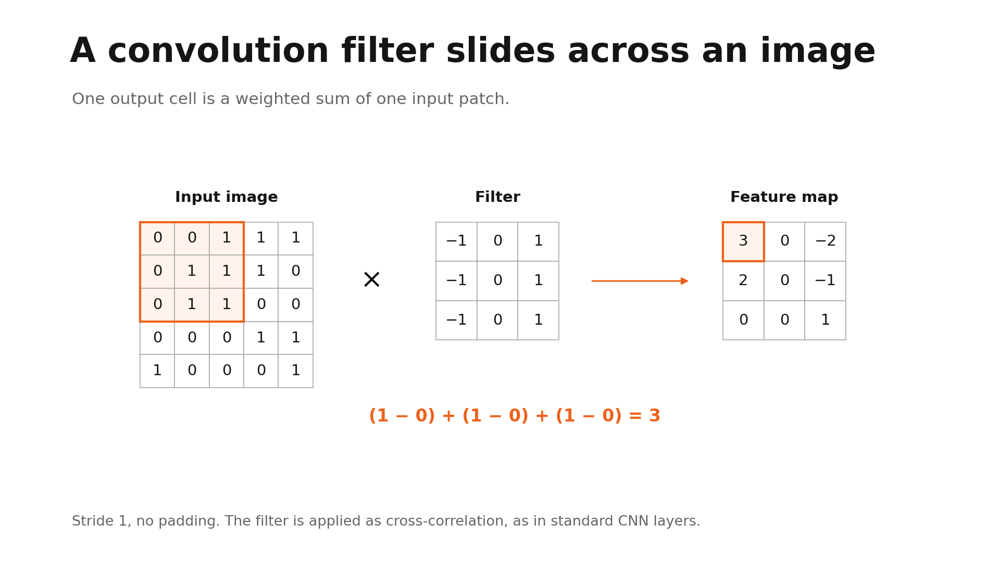

>One output cell is a weighted sum of one input patch.
---

<!-- _class: concept image-right -->


## 9.12 A network in PyTorch

```python
loss = loss_fn(net(X_tr), y_tr)   # forward pass
opt.zero_grad()
loss.backward()                   # backward pass
opt.step()                        # gradient descent update
```

- **California Housing**: MLP for regression
- Compare with **gradient boosting**

---

<!-- _class: concept image-right -->


## 9.13 Question: who wins on tabular data?

- A neural network or gradient boosting on **California Housing**?

> Often a well-tuned tree ensemble, with much less tuning

---

<!-- _class: full-width accent-band -->

## 9. Exercises

📝 **9.1** Run one forward pass and one gradient update by hand
📝 **9.2** Explain why stacked linear layers remain a linear model
📝 **9.3** Compute convolution output sizes for two strides
📝 **9.4** Add dropout, plot train and validation RMSE, then compare with boosting

---

<!-- _class: full-width takeaway -->

## [9] — Key Takeaways

- Neural networks stack linear maps and non-linear activations to learn features
- Backpropagation computes the gradients used by gradient descent
- Validation, regularisation and early stopping control overfitting
- Gradient boosting remains a strong baseline for tabular data

---

<!-- _class: transition-chapitre -->
<!-- _paginate: false -->
<!-- _header: "" -->
<!-- _footer: "" -->


---

<!-- _class: full-width -->
<!-- header: '[10] — Representations and Transfer Learning' -->

# 10. Representations and transfer learning

### Embeddings, pre-trained models and measured escalation

---

<!-- _class: full-width objectives -->

## 10.1 Objectives

- Explain what an **embedding** is
- Reuse a **pre-trained** model
- Place classical ML relative to **foundation models**

---

<!-- _class: concept image-right -->


## 10.2 Representations and embeddings

- Models can **learn** the features
- An **embedding** is a vector encoding the **meaning** of an object
- Similar objects: **nearby** vectors
- **Cosine similarity**: $\cos(a,b) = \dfrac{a^\top b}{\lVert a\rVert\lVert b\rVert}$

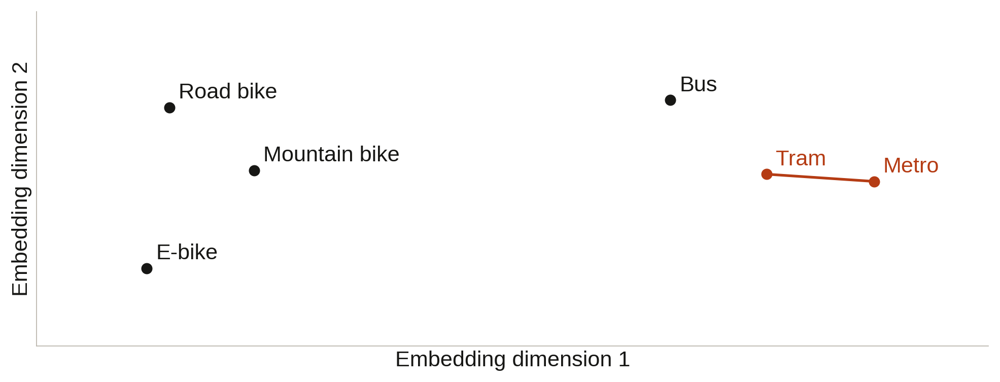

---

<!-- _class: concept image-right -->


## 10.3 Transfer learning

| Strategy | What you do |
|---|---|
| **Feature extraction** | Freeze the model, use its embeddings as features |
| **Fine-tuning** | Keep training some or all weights |

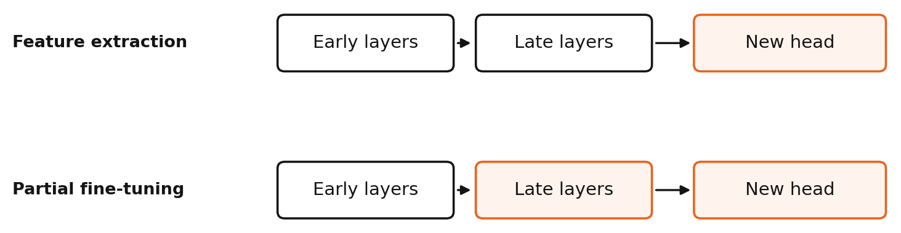

> Start with **feature extraction** when data and compute are limited.

---

<!-- _class: concept image-right -->


## 10.4 Risks of transfer learning

- **Domain mismatch**
- **Catastrophic forgetting** if fine-tuned too hard
- **Inherited biases**

---

<!-- _class: concept image-right -->


## 10.5 Where classical ML ends

- **Foundation models**: pre-trained on huge corpora, covered in the GenAI course
- They **do not replace** classical ML on small, structured data
- Use the **simplest approach** that meets the requirement, and **measure**

---

<!-- _class: full-width accent-band -->

## 10. Exercises

📝 **10.1** Compute and interpret two cosine similarities
📝 **10.2** Choose a transfer strategy for 200 labelled images and no GPU
📝 **10.3** Extend the embedding example, cross-validate and inspect errors

---

<!-- _class: full-width takeaway -->

## [10] — Key Takeaways

- Useful embeddings place similar objects near one another
- Start with a frozen pre-trained model as a feature extractor
- Fine-tune only when measured gains justify the added cost
- Check domain mismatch, catastrophic forgetting and inherited bias

---

<!-- _class: transition-chapitre -->
<!-- _paginate: false -->
<!-- _header: "" -->
<!-- _footer: "" -->

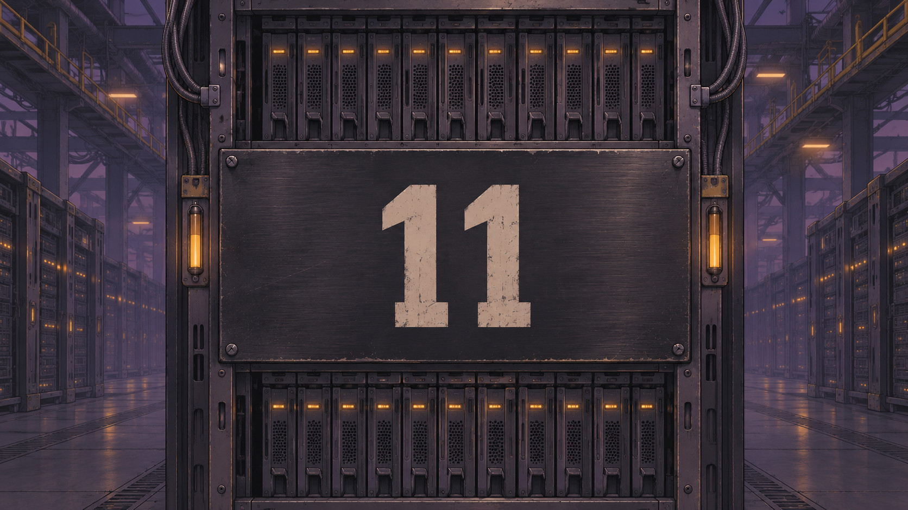

---

<!-- _class: full-width -->
<!-- header: '[11] — Trustworthy Machine Learning' -->

# 11. Trustworthy machine learning

### Explainability, fairness, robustness and accountability

---

<!-- _class: full-width objectives -->

## 11.1 Objectives

- **Explain** a model, globally and per prediction
- Identify sources of **bias** and measure **fairness**
- Anticipate **robustness** problems
- **Document** a model

---

<!-- _class: concept image-right -->


## 11.2 A good score is not trust

- **Understanding**
- **Fairness**
- **Robustness**
- **Privacy**
- **Accountability**

> High accuracy is not trustworthy

---

<!-- _class: concept image-right -->


## 11.3 Explaining a model

| | Global | Local |
|---|---|---|
| **Question** | How does it behave overall? | Why this prediction? |
| **Tools** | Coefficients, **permutation importance**, PDP | **SHAP**, LIME |

- First ask: is an **interpretable model** accurate enough?


---

<!-- _class: concept image-right -->


## 11.4 Permutation importance and SHAP

- **Permutation**: shuffle one feature on held-out data, measure the **score drop**
- **SHAP**: each feature gets a **contribution**; they add up to prediction minus average

> An explanation describes what the model **uses**, not a causal relation.

---

<!-- _class: concept image-right -->


## 11.5 Sources of bias

- **Historical**: past decisions were discriminatory
- **Representation**: a group is under-represented
- **Measurement**: a proxy measures different things for different groups
- **Proxy variables**: postal code
- **Feedback loops**

---

<!-- _class: concept image-right -->


## 11.6 Fairness criteria

- **Demographic parity**: same rate of favourable decisions
- **Equal opportunity**: same **recall**
- **Equalised odds**: same true and false positive rates

> They generally **cannot all hold at once**

---

<!-- _class: concept image-right -->


## 11.7 Worked example: a loan model

- Approves **60 %** of group A, **30 %** of group B
- Demographic parity gap: **0.30**
- Among creditworthy applicants: 80 % vs 50 %, equal opportunity also **violated**

> Always measure metrics **per group**

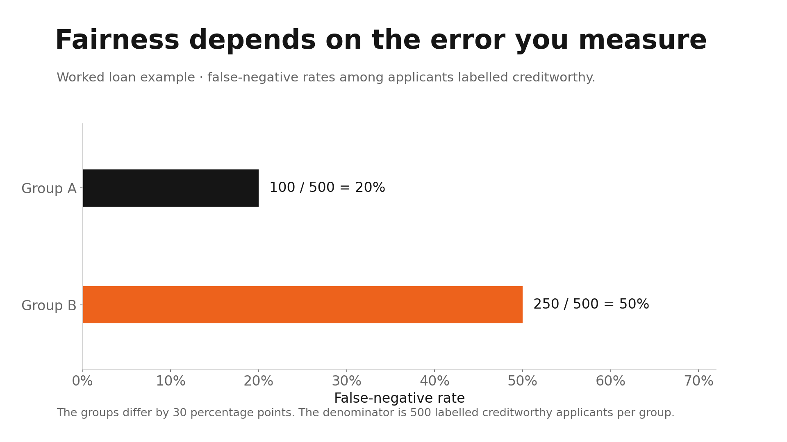

---

<!-- _class: concept image-right -->


## 11.8 Debate: which criterion for Adult?

- **Adult Census**: income above 50 k$ as a "favourable decision"
- Measure rate and recall for `sex` and `race`
- Remove `sex`: does the gap close? Which **proxies** remain?

> No single right answer

---

<!-- _class: concept image-right -->


## 11.9 Robustness

- **Distribution shift**: production differs from training
- **Out-of-distribution** inputs: a classifier always answers
- **Calibration**: "90 % sure" should be right 90 % of the time
- **Stress tests** on slices and degraded inputs

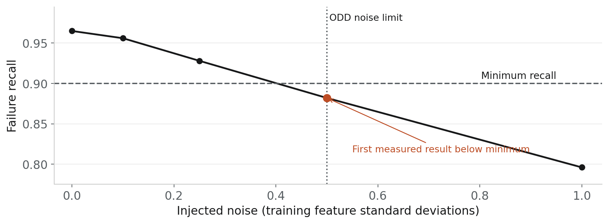

---

<!-- _class: concept image-right -->


## 11.10 Privacy and regulation

- Models can **leak** training data
- Mitigations: data minimisation, access control, **differential privacy**
- **GDPR** for personal data
- **AI Act**: risk-based approach

> Check your application's category with your legal service

---

<!-- _class: concept image-right -->


## 11.11 Documenting a model

- **Model card**: intended use, data, evaluation per group, limits
- **Datasheet** for the dataset: origin, composition, known biases

---

<!-- _class: full-width accent-band -->

## 11. Exercises

📝 **11.1** Diagnose a recall gap between demographic groups
📝 **11.2** Explain why deleting a sensitive feature does not remove its proxies
📝 **11.3** Design a stress test for a seasonal distribution shift
📝 **11.4** Compare permutation and impurity importance without claiming causality

---

<!-- _class: full-width takeaway -->

## [11] — Key Takeaways

- A good aggregate score is necessary but insufficient for trust
- Explanations describe model use, not causal relations
- Measure performance and errors for relevant groups
- Stress-test robustness and document intended use, limits and risks

---

<!-- _class: transition-chapitre -->
<!-- _paginate: false -->
<!-- _header: "" -->
<!-- _footer: "" -->


---

<!-- _class: full-width -->
<!-- header: '[12] — From Notebook to Product' -->

# 12. From notebook to product

### Reproducibility, packaging, serving and monitoring

---

<!-- _class: full-width objectives -->

## 12.1 Objectives

- Make an experiment **reproducible**
- **Package** a pipeline and **serve** it
- List what to **monitor**

---

<!-- _class: concept image-right -->


## 12.2 Reproducibility

Record exactly:

- the **code** version
- the **data** version
- the **environment**
- the **random seeds**
- the **hyperparameters** and **metrics**


---

<!-- _class: concept image-right -->


## 12.3 Code quality

- Notebook for **exploration**, **modules** for the real code
- **Tests** with `pytest`
- **Linter**, type hints, config file
- **Continuous integration**: tests at each commit

---

<!-- _class: concept image-right -->


## 12.4 Package the whole pipeline

- Save **preprocessing + model**, not the model alone
- Otherwise: **training–serving skew**
- Load `joblib` / `pickle` files only from **trusted** sources

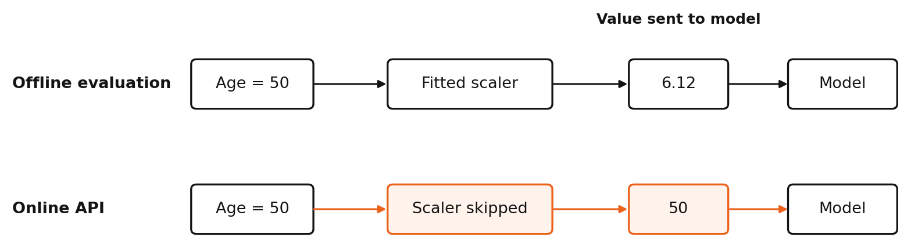

---

<!-- _class: concept image-right -->


## 12.5 Serve it behind an API

```python
@app.post("/predict")
def predict(sample: Sample):
    row = pd.DataFrame([sample.features])[art["columns"]]
    return {"probability": float(...)}
```

- **FastAPI**, one endpoint
- Return the **model version**

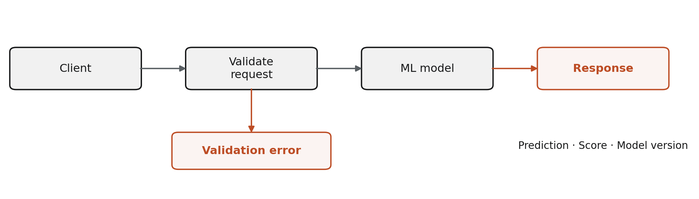

---

<!-- _class: concept image-right -->


## 12.6 Monitor in production

- **Data**: distributions, missing values, drift
- **Predictions**: output distribution, low confidence
- **Performance**: as soon as labels arrive
- **System**: latency, errors

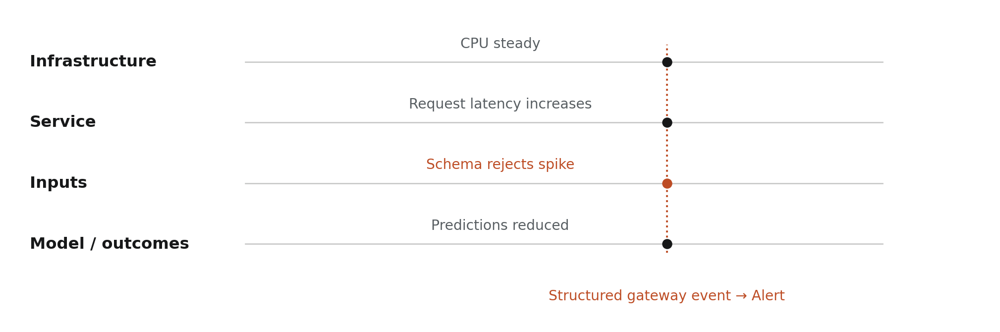

> Plan retraining and rollback before deployment.

---

<!-- _class: concept image-right -->


## 12.7 What comes next

- **Machine Learning Engineer course**: MLOps, CI/CD for ML, deployment, edge

---

<!-- _class: full-width accent-band -->

## 12. Exercises

📝 **12.1** List what must be recorded to reproduce an experiment
📝 **12.2** Explain training-serving skew and how a pipeline prevents it
📝 **12.3** Run the API and test that its probability stays in $[0, 1]$

---

<!-- _class: full-width takeaway -->

## [12] — Key Takeaways

- Version code, data, environment, seeds, hyperparameters and metrics
- Package preprocessing and the model together to prevent training-serving skew
- Monitor data, predictions, performance and service health
- Plan retraining and rollback before deployment

---

<!-- _class: transition-chapitre -->
<!-- _paginate: false -->
<!-- _header: "" -->
<!-- _footer: "" -->


---

<!-- _class: full-width -->
<!-- header: '[13] — Group Project' -->

# 13. Group project

### An evidence chain from problem to decision

---

<!-- _class: full-width takeaway -->

## 13.1 Group project — evidence chain

Your project must tell one coherent story:

**Problem** → **data** → **protocol** → **models** → **evidence** → **decision**

- Define the user, prediction target and **cost of errors**
- Build a leakage-safe pipeline and a **simple baseline**
- Compare at least two model families with the **same validation protocol**
- Analyse failures, one trust risk and the limits of the result

> Topic, team rules, deadlines and assessment grid: provided by the lecturer

---

<!-- _class: full-width takeaway -->

## 13.2 Project — definition of done

- A reproducible repository with environment and run instructions
- One notebook or report for exploration; reusable code for the pipeline
- A results table with metric, validation mean and spread
- One error analysis or slice analysis, not only a global score
- A short model card: intended use, data, limitations and monitoring signal
- A presentation that ends with a **decision**, not “model X scored 0.91”

---

<!-- _class: full-width takeaway -->

## [13] — Key Takeaways

- Connect the problem, data, protocol, models, evidence and decision
- Use a leakage-safe pipeline, a baseline and one validation protocol
- Support technical choices with reproducible evidence and error analysis
- Challenge fairness, deployment and monitoring assumptions
- Communicate a bounded, decision-ready result

---

<!-- _class: concept watermark takeaway -->
<!-- header: 'Machine Learning — Foundations and Practice' -->


## What to remember

- ML = rules **estimated from data**; what counts is **new** data
- **Split first**, pipeline everything, test set **once**
- **Baseline** before complexity
- **Bias–variance**: lowest validation error wins
- Metric = **cost of errors**
- **Trees** for tabular data, **scaling** for distances and gradients
- **Unsupervised** results need domain validation
- **Trust** means explaining, measuring per group and monitoring

---

<!-- _class: concept image-right -->


## Resources

- Bishop, C. M. (2006). Pattern recognition and machine learning. Springer
- Goodfellow, I., Bengio, Y., & Courville, A. (2016). Deep learning. MIT Press
- Hastie, T., Tibshirani, R., & Friedman, J. (2009). The elements of statistical learning: Data mining, inference, and prediction (2nd ed.). Springer. https://doi.org/10.1007/978-0-387-84858-7
- James, G., Witten, D., Hastie, T., Tibshirani, R., & Taylor, J. (2023). An introduction to statistical learning: With applications in Python. Springer. https://doi.org/10.1007/978-3-031-38747-0
- Murphy, K. P. (2022). Probabilistic machine learning: An introduction. MIT Press
- Shalev-Shwartz, S., & Ben-David, S. (2014). Understanding machine learning: From theory to algorithms Cambridge University Press. https://doi.org/10.1017/CBO9781107298019
- Géron, A. (2025). Hands-on machine learning with Scikit-Learn and PyTorch: Concepts, tools, and techniques to build intelligent systems. O’Reilly Media
- Cawley, G. C., & Talbot, N. L. C. (2010). On over-fitting in model selection and subsequent selection bias in performance evaluation. Journal of Machine Learning Research, 11, 2079–2107
- Molnar, C. (2025). Interpretable machine learning: A guide for making black box models explainable (3rd ed.)
- scikit-learn documentation
- PyTorch documentation
- Hugging Face courses and Hub


---

<!-- _class: full-width -->
<!-- _paginate: false -->

# Questions?
